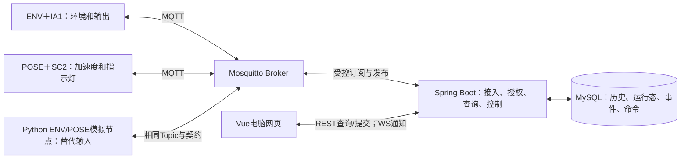

# SmartBox：可追溯的物流箱监测与控制

SmartBox面向物流运输和外卖配送中的“箱内情况看不见、异常难追溯、不同角色信息不对称”问题：用两个采集节点描述同一箱体的环境与运动状态，把观测、事件和控制结果交给服务端保存，并向有权限的用户展示。寄收件人和外卖用户查看授权信息，物流操作者管理配置与控制，骑手执行允许的布撤防操作。权限边界见[角色说明](docs/requirements/product/角色与权限.md)。

项目仓库：[fcj0633/SmartBox](https://github.com/fcj0633/SmartBox)。**当前已完成软件/模拟闭环，以及基础真实双板采集和输出闭环；完整业务算法、设备事件Flash可靠性与最终系统验收仍未完成。** 目标业务是物流箱；当前用两块开发板代表一个虚拟箱体，没有实体箱体、真实门检测或真实GPS。

## 1. 当前能做什么

ENV是环境节点，连接IA1温湿度/光照及补光、风扇；POSE是姿态节点，连接SC2加速度及指示灯。两节点归属同一箱体，保留独立身份、启动代次和数据质量，后端再聚合状态。

| 能力 | 当前实现与验证状态 | 尚未完成的边界 |
|---|---|---|
| 环境监测 | IA1真实温湿度/光照→MQTT→MySQL→网页，已完成真实双板基础验证 | 完整阈值、去抖、回差、异常/恢复算法 |
| 姿态与运动输入 | SC2三轴加速度和基础倾角，转动响应与稳定窗口约50Hz已实测 | 校准、姿态分级、冲击检测；基础倾角不是异常检测结论 |
| 定位 | GPS MOCK，带独立观测标记；模拟器支持定位模式，真实固件为固定Mock位置 | 真实定位硬件、完整围栏业务 |
| 在线与新鲜度 | 节点活动/LWT、90秒无活动判离线、双节点聚合；环境/姿态5秒、定位15秒新鲜度 | 在线不等于数据有效；过期或未知不能显示正常 |
| 事件与查询 | 后端事务保存、去重、精确确认、Outbox查询投影及事件/轨迹/CSV接口，软件验证完成 | 真实固件的事件生成、Flash可靠存储和补传；完整历史页面 |
| 身份与权限 | 四角色、箱体范围、REST/WS/CSV授权和字段裁剪已有软件验证 | 不提供自助注册、节点换绑或账号管理后台 |
| 远程控制 | 后端/网页与Python模拟器五类命令闭环；真实板仅执行`output`，三项10秒实物动作和自动关闭已确认 | 模拟校准/哨兵等不等于真实算法已完成 |
| 实时网页 | 电脑端登录、授权列表、详情、质量状态、控制结果；软件与真实双板基础链路均有证据 | 完整历史筛选、轨迹、CSV页面和手机布局 |
| 告警与安全防护 | 接口、状态及部分模拟流程已有基础 | 无完整判断器时门为UNKNOWN/INSUFFICIENT，告警UNKNOWN；不能解释为安全正常或真实防盗 |

软件证据见[服务端报告](docs/testing/reports/TASK-005-服务端闭环验证报告.md)、[网页报告](docs/testing/reports/TASK-006-网页与首轮闭环验证报告.md)；真实采集、三项输出、310秒双板运行、断电/90秒静默与恢复见[双板报告](docs/testing/reports/TASK-007-双板接入验证报告.md)。启动阶段丢周期、资源峰值与长期测试等限制也在报告中，不扩大为整份需求验收。

## 2. 系统整体如何协作



Broker是MQTT消息中转服务；Topic是消息路由名称。节点按自己的身份发布或订阅，服务端使用独立账号接入。Broker把设备收发与业务处理分开，但不会证明JSON身份正确或数据库已经保存，后端还需校验注册归属、Topic和payload。

后端负责事务、状态聚合与最终授权。REST提供查询和操作提交；WebSocket（WS）通知页面状态有变化，网页再通过REST重读。浏览器不直接连接MQTT，也不接收数据库/Broker凭据，这样角色权限和业务确认集中在服务端。

真实板和模拟器是同一角色输入的两种实现，**同身份不能同时运行**，否则可能互踢连接或混入数据。切换时同时核对节点身份、当前boot_id和状态目录，不清空代次来强行覆盖历史。

## 3. 三条关键链路

### 观测数据上报

采样→节点快照→MQTT property→后端契约/注册检查→遥测历史与最新值→按角色聚合→网页。历史遥测、最新值和连接运行态分开存储：旧代次、乱序或历史数据可以保留，却不能任意覆盖当前观测。新鲜度描述观测年龄，不是网络是否连接。

### 事件可靠处理

当前可验证的输入来自模拟节点/测试事件；真实固件尚无完整可靠事件链路。


`boot_id`区分同一节点的不同启动；事件以节点、启动代次、事件序号标识。`event_ack`是后端确认精确事件集合已保存，和MQTT传输确认PUBACK不同。Outbox是与原始事件同事务保存的待处理工作，避免“事件已存但后续处理丢失”；本期生成查询视图，不是空跑融合/告警。模拟器事件队列在进程退出后会丢失，不能代替设备Flash可靠存储。

### 远程控制

网页确认→REST授权及幂等→保存操作/逐节点命令/发布工作→MQTT→节点动作→command_ack→MySQL执行事实与操作结果→REST/WS展示。**HTTP202仅表示操作受理，不表示动作成功。** 同一动作重试保留幂等键，避免网络不确定时再次执行；整体超时终态与迟到执行事实独立保存。

五类命令为`sentry`、`output`、`gps_mode`、`profile`、`calibrate`。真实固件目前只有`output`实物执行，其他完整板端功能待开发；模拟器成功不代表真实校准或防护通过。

## 4. 技术栈与版本来源

| 部分 | 技术与用途 | 精确版本或依据 |
|---|---|---|
| 固件 | C、CMSIS-RTOS2、现有OpenHarmony SDK；采集、调度、网络和输出 | [固件导读](firmware/README.md)、[版本矩阵](docs/development/environment/工具与依赖版本矩阵.md) |
| 后端 | Java、Spring Boot/Security、MyBatis；鉴权和模块化单体业务 | [Maven配置](backend/pom.xml)、[后端导读](backend/README.md) |
| 数据库 | MySQL、Flyway；持久化与版本化迁移 | [迁移目录](backend/src/main/resources/db/migration)、版本矩阵 |
| 网页 | Vue、TypeScript、Router、Pinia、Element Plus、Vite | [依赖与锁文件入口](frontend/README.md) |
| 通信与模拟 | Mosquitto、MQTT3.1.1、Python/Paho；节点通信和可复现场景 | [工具](tools/README.md)、[模拟器](tools/simulator/README.md) |
| 接口与检查 | JSON Schema、OpenAPI、REST、原生WebSocket | [当前有效契约](contracts/effective/README.md) |

## 5. 目录地图

```text
SmartBox/
├─ README.md / AGENTS.md     # 开发者入口与协作约定
├─ firmware/                # ENV/POSE固件唯一编辑源
├─ backend/                 # Java服务、迁移与后端测试
├─ frontend/                # 电脑网页及组件/浏览器测试
├─ contracts/               # 冻结协议与当前有效补充
├─ tools/                   # 检查、构建、启动、模拟与联调
├─ tests/                   # 跨端工具及固件/模拟组件测试
├─ deploy/                  # 开发拓扑和Broker配置模板
├─ docs/                    # 需求、设计、任务、指南、验收和历史
└─ artifacts/               # 本地忽略产物；仅README受控
```

| 想做什么 | 目录与阅读入口 |
|---|---|
| 修改采集、联网或板端输出 | [firmware](firmware/README.md)；主仓库编辑，SDK仅受控构建副本 |
| 修改服务端、数据库访问或授权 | [backend](backend/README.md) |
| 修改页面、实时状态或表单 | [frontend](frontend/README.md) |
| 核对接口/字段/确认语义 | [有效契约](contracts/effective/README.md)；[冻结入口](contracts/README.md)仅作原始基线 |
| 选择命令、运行模拟或联调 | [tools](tools/README.md)、[simulator](tools/simulator/README.md) |
| 选择测试层次 | [tests](tests/README.md) |
| 配置开发网络和Broker | [deploy](deploy/README.md)、[Mosquitto](deploy/mosquitto/README.md) |
| 查需求、设计、任务与验收 | [docs](docs/README.md) |
| 查本地产物/证据规则 | [artifacts](artifacts/README.md) |

## 6. 快速开始

以下命令在Windows仓库根目录使用项目`.venv`执行；具体版本、项目库/账号及私有配置按[环境清单](docs/development/environment/环境清单.md)、[后端初始化指南](docs/development/guides/后端数据库初始化与启动.md)准备。初次克隆不会包含已有开发机的`secrets/`，不能直接假设账号、密码、签名密钥或硬件配置存在。依赖安装会写入本地虚拟环境/生成目录；不要升级系统工具替代锁定环境。

### A. 软件模拟环境

前提：项目Python依赖、Java/Maven、Node/npm、MySQL项目库/账号和现有Mosquitto已按指南准备；1883/8080/5173空闲。需要时先执行以下初始化/安装入口，具体配置与权限仍按指南提供：

```powershell
.venv/Scripts/python tools/mqtt.py prepare
.venv/Scripts/python tools/backend.py build --profile dev
.venv/Scripts/python tools/backend.py bootstrap --profile dev
.venv/Scripts/python tools/frontend.py install
```

然后在各自终端分别运行：

```powershell
.venv/Scripts/python tools/mqtt.py broker --config secrets/mqtt.local.json
.venv/Scripts/python tools/backend.py run --profile dev --mqtt-config secrets/mqtt.local.json
.venv/Scripts/python tools/mqtt.py node --role ENV --config secrets/mqtt.local.json
.venv/Scripts/python tools/mqtt.py node --role POSE --config secrets/mqtt.local.json
.venv/Scripts/python tools/frontend.py dev
```

打开[工作台](http://127.0.0.1:5173)，使用本地初始化文件中的账号，刷新页面需重新登录。完整过程见[网页指南](docs/development/guides/网页启动与首轮验收.md)。手动模拟适用于未混入更高真实代次的数据；已有真实板历史时，旧模拟boot可能只作为历史保留。需要隔离复验时按[测试导读](tests/README.md)显式使用`smartbox_test`联调，不能降低服务端代次或清空开发库。

### B. 真实双板环境

前提：两板已烧录匹配角色的固件，IA1/SC2安装正确，Wi-Fi与电脑可互访，私有硬件配置与当前LAN地址一致。停止同身份模拟节点，只为项目Broker启用指定LAN监听；后端与网页仍回环运行。

```powershell
.venv/Scripts/python tools/hardware.py check
.venv/Scripts/python tools/hardware.py broker --run-dir artifacts/hardware/NEW-RUN
.venv/Scripts/python tools/backend.py run --profile dev --mqtt-config secrets/hardware/mqtt.local.json --hardware-mqtt
.venv/Scripts/python tools/frontend.py dev
```

`NEW-RUN`替换为新的唯一目录。此处复用已生成配置，**不是重新执行hardware prepare的流程**。Wi-Fi、Broker地址改变或需要重新烧录时先读[固件指南](docs/development/guides/编译烧录与联调流程.md)；不要删除/回退启动区间账本、清空板端记录或擦除后复用旧配置。物理输出会作用于实际灯/风扇，确认目标后再操作。

两种环境都用各终端正常退出；工具只清理自身启动的进程，端口占用时先核对归属，不结束其他项目或停止共享MySQL。

## 7. 当前进度与下一步

P0文档基线完成，P1软件/模拟闭环完成（[REL-001](docs/delivery/releases/REL-001-P1软件与模拟闭环.md)），P2/TASK-007基础真实双板接入完成。TASK-008完整规则、TASK-009持久化可靠性、TASK-010完整交付当前均待开始，具体依赖以[任务索引](docs/development/tasks/README.md)、[当前进度](docs/management/当前进度.md)和[路线图](docs/management/路线图.md)为准。

一个任务完成只说明对应交付切片完成，不自动验收全部需求或TC；P1发布记录中的“未验板”是当时边界，当前硬件结论看双板报告。

## 8. 开发者导航

需求从[系统总纲和六模块索引](docs/requirements/README.md)进入；架构看[系统总体设计](docs/design/architecture/系统总体设计.md)和[数据流](docs/design/architecture/模块边界与数据流.md)，其中目标能力需对照当前实现表。开发前遵守[AGENTS](AGENTS.md)，从相关工程README定位真实调用链，再沿[追踪矩阵](docs/management/需求追踪矩阵.md)找到设计、TASK、TC与报告。

接口以当前有效契约为准，业务规则变化走CR，技术决定走ADR；不要靠README新增规则或改写冻结文件。测试与验收分别见[测试体系](tests/README.md)、[业务用例](docs/testing/cases/README.md)和[证据约定](docs/testing/evidence/README.md)。后续开发从任务索引选择未开始任务，不按MOD编号直接推断开发顺序。
