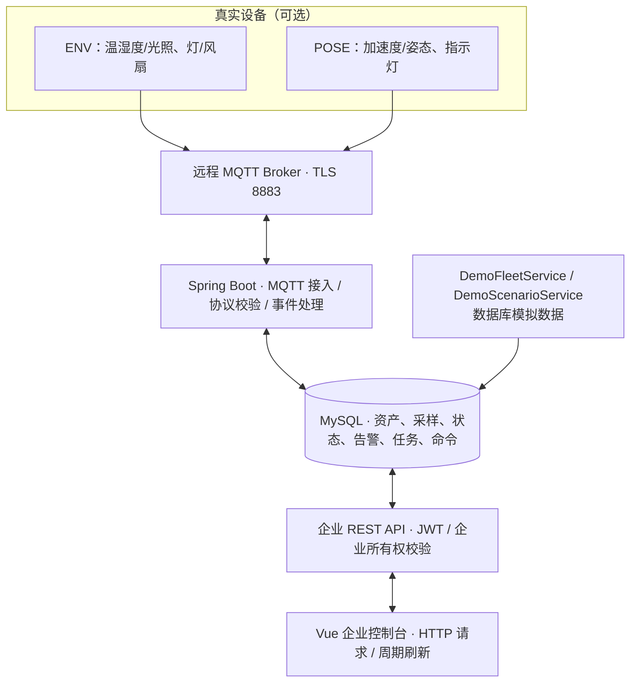

# SmartBox · 企业物流运营控制台

> **一个结合 IoT 设备监测与物流运输管理的全栈演示项目。** 企业管理员可以管理物流箱、创建/开始/结束运输任务，在地图上查看模拟路线，并查询环境、姿态、告警、设备节点和控制回执。
>
> 当前 `main` 是**可本地部署的前后端展示仓库**：提供 Spring Boot 后端、Vue 前端、初始化数据及固件源码参考；不包含开发板 SDK、烧录工具、完整硬件联调或自动化测试环境。项目的模拟功能不代表已经连接真实硬件。

**技术栈：** Java 21 · Spring Boot 3.5 · Spring Security / JWT · MyBatis · MySQL 8 / Flyway · MQTT（Paho）· Vue 3 · TypeScript · Vite

## 1. 系统能做什么？

### 企业运营控制台

| 功能页面 | 已实现的主要能力 |
|---|---|
| **运营总览** | 查看企业箱体、在线/异常状态、运输任务和最近动态；模拟地图与任务列表联动 |
| **物流箱资产** | 真实/模拟箱体统一查看；搜索筛选；创建、编辑、启停模拟箱体并切换演示场景 |
| **运输任务** | 企业管理员直接创建、修改待开始任务、开始与结束运输；查看任务详情和历史记录 |
| **位置与设备** | 多箱体地图、预设路线、随任务时间变化的 **MOCK 位置**、节点状态和详情入口 |
| **物流箱详情** | 八个分区：总览、环境监测、姿态监测、定位轨迹、告警事件、设备节点、控制中心、运行日志 |
| **告警中心** | 查询本企业的设备告警、级别及关联箱体；**当前主要为只读查询**，尚非人工确认/处理工单系统 |
| **设备控制** | 根据节点能力提交控制命令，查看受理、处理中、成功、失败或超时状态；真实成功以设备 ACK 为依据 |

运输状态为 `READY → ACTIVE → COMPLETED`。开始运输需要满足企业权限、箱体可用性和必要的在线/风险规则；同一物流箱不能同时拥有两个进行中的运输。

当前产品只开放**企业管理员**入口，不提供旧骑手、客户或访客页面。

### 实物侧：两块 BearPi-HM Nano

源码在 [`firmware/`](firmware/README.md)，按两个不同节点角色组织。它们分别连接扩展板并通过 Wi-Fi/MQTT 与服务器通信，**浏览器不直接连接开发板**。

| 节点 | 硬件 | 主要观测与本地能力 | 可控输出 |
|---|---|---|---|
| **ENV 环境节点** | BearPi-HM Nano + **IA1** | 采集温度、湿度、光照；根据阈值生成环境变化事件；光照变化可提供**开合证据推断** | 补光灯、风扇 |
| **POSE 姿态节点** | BearPi-HM Nano + **SC2** | 基于 MPU6050 采集三轴加速度和姿态；处理倾斜、冲击及姿态变化事件；提供**模拟位置** | 指示灯 |

固件源码还包含阈值/滞回规则、校准、布防/哨兵逻辑、输出超时自动关闭、节点心跳、SNTP 时间质量、命令处理与回执等实现。设备侧采用采样、业务处理、网络三个任务，尽量隔离实时采集与网络操作。

**重要边界：**

- 没有真实 GPS；POSE 固件产生的位置和企业运输地图都属于 **MOCK**，不能当作实测轨迹。
- “开合证据”由光照或倾斜推断，**不是实物门磁传感器直接读数**。
- 固件事件候选使用有界缓冲，并报告 `DEGRADED` 存储状态；不能据此宣称已具备完整的断电 Flash 事件恢复能力。
- 该精简仓保留的是固件**源码参考**，不包含 OpenHarmony SDK、交叉编译/烧录工具和本版本的真实开发板验收。实体运行效果需在完整开发环境中确认。

### 演示侧：1 个实物资产记录 + 5 个模拟箱体

首次初始化预置一个实物箱体 **`BOX-0001`** 的数据库身份，以及五个 `BOX-SIM-*` 模拟箱体：

| 资产 | 数据来源 | 默认演示内容 |
|---|---|---|
| `BOX-0001` | REAL | 真实节点的资产记录；未连接实板时没有真实实时采样 |
| `BOX-SIM-01` | SIMULATED | 正常环境 |
| `BOX-SIM-02` | SIMULATED | 高温场景 |
| `BOX-SIM-03` | SIMULATED | 离线场景 |
| `BOX-SIM-04` | SIMULATED | 姿态/冲击场景 |
| `BOX-SIM-05` | SIMULATED | 已完成运输的历史展示 |

**模拟箱体不需要 MQTT Broker。** 后端 `DemoFleetService` 在显式开启时按场景生成运行状态及遥测记录，写入 MySQL；`DemoScenarioService` 可通过服务端事件处理链路产生受控模拟事件。真实箱体数据则必须来自实板经 MQTT 上报。

这样，即使只有一套实物设备，也可以在企业页面展示多台不同状态的箱体、运输任务、环境趋势和告警。

## 2. 硬件、后端与前端如何联动？



**① 设备数据上行（需要真实硬件）：** ENV/POSE 采样与本地规则 → Wi-Fi → 远程 MQTT Broker → `MqttGateway` / `IngestionService` → 协议与身份校验 → MySQL 遥测、最近快照、事件与告警投影 → 企业 API → Vue 展示。

**② 演示数据（默认本地方式）：** `DemoFleetService` → MySQL `node_runtime`、`node_latest`、`telemetry`；模拟事件经 `DemoScenarioService` / 事件处理链路形成告警。前端通过**同一套企业 API**读取，真实与模拟数据仍有来源标识。

**③ 设备命令下行（真实设备需接入 Broker）：** 企业点击控制 → 服务端校验企业所有权与节点能力 → 命令持久化、幂等处理 → MQTT 下发 → 设备执行并返回 `command_ack` → 服务端更新操作状态 → 前端查询结果。HTTP 接受请求**不代表**设备已经执行成功；未连接设备可能超时。

**④ 运输与地图：** 企业创建 `READY` 任务并选择预设路线 → 开始变为 `ACTIVE` → `MockPositionProjector` 按任务的开始时间和路线**确定性计算**当前位置 → 结束变为 `COMPLETED`。当前主要是计算出的模拟轨迹**投影**，不是持续写入的真实 GPS 轨迹历史。

### 后端模块划分

| 代码位置 | 职责 |
|---|---|
| [`enterprise/`](backend/src/main/java/cn/smartbox/enterprise/) | 企业总览、资产维护、运输状态机、MOCK 位置、模拟场景、详情和控制入口 |
| [`live/`](backend/src/main/java/cn/smartbox/live/) | MQTT 客户端、遥测接入、设备事件、状态投影、命令下发和 ACK |
| [`auth/`](backend/src/main/java/cn/smartbox/auth/) / [`authorization/`](backend/src/main/java/cn/smartbox/authorization/) | 登录、JWT、企业资源及命令权限 |
| [`asset/`](backend/src/main/java/cn/smartbox/asset/) | 演示企业、箱体和节点初始化 |
| [`config/`](backend/src/main/java/cn/smartbox/config/) | 安全配置、初始化、运行配置 |
| [`db/migration/`](backend/src/main/resources/db/migration/) | Flyway 数据库结构 |

运行时的消息 Schema 在 `backend/src/main/resources/contracts/effective/common.schema.json`，由 `ContractValidator` 从 Classpath 加载。

## 3. 本地部署（不需要开发板或 MQTT Broker）

以下使用 **Windows PowerShell**，在仓库根目录操作。需要：

- **JDK 21、Maven**
- **MySQL 8**
- **Node.js 22+、npm**

> 首次部署请使用**全新空数据库**。当前精简仓的 Flyway 只有 `V1__current_schema.sql`；旧工程的 V1～V17 数据库不能直接套用这个合并基线，必须先备份并迁移/重建。不要对保存了重要数据的库执行删除操作。

### 3.1 创建本地数据库和两个账号

使用 MySQL 管理员执行（将示例密码替换为本机自定密码）：

```sql
CREATE DATABASE smartbox_dev
  CHARACTER SET utf8mb4 COLLATE utf8mb4_0900_ai_ci;

CREATE USER 'smartbox_app'@'127.0.0.1'
  IDENTIFIED BY 'CHANGE_APP_PASSWORD';
CREATE USER 'smartbox_migrator'@'127.0.0.1'
  IDENTIFIED BY 'CHANGE_MIGRATION_PASSWORD';

GRANT SELECT, INSERT, UPDATE, DELETE ON smartbox_dev.*
  TO 'smartbox_app'@'127.0.0.1';
GRANT ALL PRIVILEGES ON smartbox_dev.*
  TO 'smartbox_migrator'@'127.0.0.1';
```

后端 `LocalSettings` 会校验开发环境必须是 `smartbox_dev`，应用账号为 `smartbox_app`，迁移账号为 `smartbox_migrator`，MySQL URL 使用 `127.0.0.1`。请不要直接沿用不符合这些限制的其他数据库名称或账号。

### 3.2 设置后端环境变量

在 **PowerShell 终端 A（仓库根目录）**：

```powershell
$env:SPRING_PROFILES_ACTIVE = "dev"

$env:SMARTBOX_DB_URL = "jdbc:mysql://127.0.0.1:3306/smartbox_dev?connectionTimeZone=UTC&characterEncoding=UTF-8"
$env:SMARTBOX_MIGRATION_URL = $env:SMARTBOX_DB_URL

$env:SMARTBOX_DB_USER = "smartbox_app"
$env:SMARTBOX_DB_PASSWORD = "CHANGE_APP_PASSWORD"
$env:SMARTBOX_MIGRATION_USER = "smartbox_migrator"
$env:SMARTBOX_MIGRATION_PASSWORD = "CHANGE_MIGRATION_PASSWORD"

# 为本次本地运行创建至少 32 字节的 JWT 密钥。
$keyBytes = New-Object byte[] 32
$rng = [System.Security.Cryptography.RandomNumberGenerator]::Create()
$rng.GetBytes($keyBytes)
$rng.Dispose()
$env:SMARTBOX_JWT_SECRET_BASE64 = [Convert]::ToBase64String($keyBytes)

# 默认只演示数据库模拟箱体，不连接真实 MQTT Broker。
$env:SMARTBOX_MQTT_ENABLED = "false"

$env:SMARTBOX_BOOTSTRAP_FILE = (Resolve-Path "deploy/demo/bootstrap.example.json").Path
$env:SMARTBOX_ASSET_SEED_FILE = (Resolve-Path "deploy/demo/enterprise-v2.seed.example.json").Path
```

环境变量仅对当前 PowerShell 会话及它启动的子进程生效。更改数据库密码需同步修改对应变量；**不要将真实密码或密钥提交到 Git**。

### 3.3 首次初始化账号与演示资产

在同一个终端、仍位于仓库根目录执行：

```powershell
mvn -f backend/pom.xml spring-boot:run "-Dspring-boot.run.arguments=--smartbox.bootstrap=true --smartbox.assets.bootstrap=true"
```

这一步自动执行 Flyway 建表，然后载入 [账号示例](deploy/demo/bootstrap.example.json) 和 [企业演示数据](deploy/demo/enterprise-v2.seed.example.json)，完成后**自动退出，不会常驻 Web 服务**。

默认初始化账号为 `admin / admin`（**仅允许在隔离的本地演示中使用**）。密码在数据库中以哈希形式保存。

### 3.4 启动后端

```powershell
mvn -f backend/pom.xml spring-boot:run "-Dspring-boot.run.arguments=--server.port=8080 --smartbox.demo.fleet=true"
```

启用 `smartbox.demo.fleet=true` 后，后端定期产生模拟箱体数据。健康检查：

```powershell
Invoke-WebRequest http://127.0.0.1:8080/actuator/health
```

### 3.5 启动前端

打开 **PowerShell 终端 B**：

```powershell
cd frontend
npm ci
npm run dev
```

浏览器打开 **http://127.0.0.1:5173**，用本地演示账号登录。Vite 默认将 `/api` 请求代理到 `http://127.0.0.1:8080`。

构建检查（可选）：

```powershell
mvn -f backend/pom.xml -DskipTests package
npm --prefix frontend run build
```

**完整部署说明、旧库注意事项和常见错误：**[前后端启动](docs/operations/前后端启动.md)。以上步骤仅针对本地演示，尚不等于已经配置好公网生产部署、HTTPS 或前端静态资源反向代理。

## 4. 如何体验主要功能？

1. 登录后进入**运营总览**，查看六个预置资产及其不同状态（实物未接入时不会出现真实采样）。
2. 在**物流箱资产**中选择 `BOX-SIM-01`，查看环境与姿态等演示数据；可创建新的模拟箱体或切换正常、高温、离线等场景。
3. 进入**运输任务**，选择在线的模拟箱体、填写物品并选择路线，创建 `READY`，随后点击开始。
4. 在**位置与设备**中观察 MOCK 位置随时间推进；在箱体详情查看任务、环境、事件和节点状态。
5. 在**告警中心**查看由演示场景及服务端事件处理形成的告警；当前不支持人工确认/处理闭环。
6. 回到运输任务结束当前运输，查看 `COMPLETED` 状态及历史信息。

设备控制页可提交受支持的指令，但在 `SMARTBOX_MQTT_ENABLED=false` 的纯本地模式下**没有真实板端 ACK**，不能把命令受理或最终超时当作物理设备执行结果。

## 5. 如何连接真实 ENV / POSE？（可选）

本地前后端演示不依赖开发板。需要真实接入时，链路为：

```text
ENV/POSE 开发板
   └── Wi-Fi → 远程 MQTT Broker（TLS 8883）
                      ↕
                 Spring Boot
                      ↕
                    MySQL
                      ↕
                 Vue 浏览器
```

当前后端只支持 **`ssl://<DNS域名>:8883`** 的远程 TLS Broker，要求配置 MQTT 账号、密码和 CA 文件。启用 `SMARTBOX_MQTT_ENABLED=true` 前，必须准备好对应 Broker、节点身份、ACL、板端固件与网络条件。**没有本地 1883 Broker 回退。**

当前 `main` **不提供 SDK、编译烧录工具、Broker 部署或真实硬件联调**。固件源码可用于阅读系统设计；已有可运行固件与完整硬件开发流程需使用完整工程环境。参考：[真实开发板接入说明](docs/operations/真实开发板接入.md)和[固件源码导读](firmware/README.md)。

## 6. 项目结构与文档

```text
SmartBox/
├── backend/             Spring Boot：企业业务、MQTT、MySQL、命令
├── frontend/            Vue：企业控制台
├── firmware/            ENV / POSE 固件源码参考
├── deploy/
│   ├── demo/            账号、企业、模拟资产与历史数据示例
│   └── backend.env.example
├── docs/
│   ├── operations/      本地启动与真实板接入说明
│   ├── requirements/    现行需求
│   ├── design/          架构与模块设计
│   └── project/         项目进度、演进与限制
└── README.md
```

- [完整本地启动步骤](docs/operations/前后端启动.md)
- [企业 V2.0 需求规格](docs/requirements/V2-企业端物流运营控制台需求规格.md)
- [系统总体设计](docs/design/系统总体设计.md)
- [后端模块与数据模型](docs/design/后端模块与数据模型.md)
- [固件架构与 SDK 接入](docs/design/固件架构与SDK接入.md)
- [当前进度](docs/project/当前进度.md)
- [文档导航](docs/README.md)

## 7. 使用边界与安全提醒

- **真实数据与模拟数据分开**：`REAL` 指实际设备来源；`SIMULATED` 指数据库生成的演示遥测；地图 `MOCK` 不是 GPS 实测。
- **模拟告警不是生产监控保证**：数据新鲜度、时间质量、离线和无采样状态仍可能出现，不能一律展示为正常。
- **仅本地演示默认凭据**：`admin/admin` 是公开示例账号，部署到共享网络或公网前必须改为独立高强度密码、JWT 密钥和受控访问配置。
- **不是开箱即用的公网部署包**：后端默认绑定 `127.0.0.1`；如需公网 HTTPS、前端静态部署、反向代理与 Broker 管理，需要单独配置与验证。
- **精简版不含测试及硬件工具**：仓库内没有完整自动化测试、SDK、烧录、实板验证脚本和协议夹具；源码存在不代表本次部署已通过真实硬件验收。
- **不提交敏感文件**：不得提交真实密码、CA 私有材料、JWT 密钥、本地 `secrets/`、`node_modules/`、`target/` 或演示运行产物。

该项目适合展示**多节点 IoT 监测、服务端设备数据处理、企业运输状态管理与 Vue 可视化**；真实硬件可靠性、完整生产安全与长期运行能力不属于本精简仓的交付承诺。
