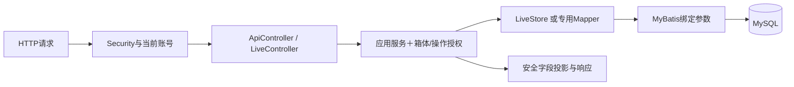

# SmartBox 后端：接入、可靠保存、授权查询与控制

这是运行在开发电脑上的单Maven Spring Boot应用。它不直接读取传感器，而是从MQTT接收节点消息，核对注册身份与契约，把事实保存到MySQL，再为网页提供授权REST/WS视图和命令操作结果。当前已有服务端/模拟闭环和基础真实双板接入证据；不是只有早期认证骨架。

软件结果见[服务端报告](../docs/testing/reports/TASK-005-服务端闭环验证报告.md)，真实输入与三项output结果见[双板报告](../docs/testing/reports/TASK-007-双板接入验证报告.md)。完整融合/告警算法仍未接入；实时门与告警保持未知，不能用“无结论”表示正常。

## 1. 实际结构与阅读地图

```text
backend/
├─ pom.xml
├─ src/main/java/cn/smartbox/
│  ├─ SmartBoxApplication.java
│  ├─ auth/              # 登录、JWT、当前身份、账号Mapper及基础HTTP入口
│  ├─ authorization/     # 操作/箱体授权与基础投影类型
│  ├─ audit/             # 独立脱敏审计
│  ├─ common/            # 响应、异常、request_id、输入与uint64适配
│  ├─ config/            # Security、配置、时钟、受控初始化
│  ├─ node/              # 早期节点数据访问/基础服务，非当前实时查询主链
│  └─ live/              # MQTT接入、事件、查询、命令、WS及持久访问
├─ src/main/resources/
│  ├─ application.yml
│  ├─ mapper/            # AuthMapper.xml、NodeMapper.xml
│  └─ db/migration/      # V1～V9，只追加新迁移
└─ src/test/java/cn/smartbox/  # 单元、MySQL、HTTP/WS及故障测试
```

业务模块MOD是跨端需求边界，不能直接等同于这里的Java包，更不意味着六个微服务。当前实时业务集中在`live`，未来演进应保持明确服务边界，不为README中的分类制造空包。

| 入口 | 核心作用与阅读理由 |
|---|---|
| [SmartBoxApplication](src/main/java/cn/smartbox/SmartBoxApplication.java) | 正常启动Web应用；bootstrap/reset显式参数进入非Web模式，结束后关闭上下文 |
| [SecurityConfig](src/main/java/cn/smartbox/config/SecurityConfig.java) | 无状态Bearer JWT、明确Origin；请求时从数据库重新读取账号/角色，不信任客户端身份声明 |
| [LoginService](src/main/java/cn/smartbox/auth/LoginService.java)、[TokenService](src/main/java/cn/smartbox/auth/TokenService.java) | 密码验证、签发与校验；错误响应和审计不泄漏凭据 |
| [CurrentIdentityService](src/main/java/cn/smartbox/auth/CurrentIdentityService.java) | `/me`返回账号、角色及授权箱体，是网页权限导航输入 |
| [BoxAccessService](src/main/java/cn/smartbox/authorization/BoxAccessService.java)、[PermissionPolicy](src/main/java/cn/smartbox/authorization/PermissionPolicy.java) | 同时检查操作权限与箱体范围，先拒绝未授权访问，再判断资源存在 |
| [AuditService](src/main/java/cn/smartbox/audit/AuditService.java) | 保存脱敏安全/操作事实，不把秘密和原始SQL当日志内容 |
| [公共响应](src/main/java/cn/smartbox/common/ApiEnvelope.java)、[异常处理](src/main/java/cn/smartbox/common/ApiAdvice.java)、[请求上下文](src/main/java/cn/smartbox/common/RequestContextFilter.java) | 统一成功/失败结构和request_id，便于定位请求而不暴露内部堆栈 |
| [BootstrapService](src/main/java/cn/smartbox/config/BootstrapService.java) | 从显式私有输入事务初始化账号/箱体/节点/授权，冲突不静默覆盖 |

## 2. HTTP与持久层的真实边界



[ApiController](src/main/java/cn/smartbox/auth/ApiController.java)承接login、me、nodes；其中当前`nodes`调用`QueryService.nodes()`取得真实运行态，不走旧`NodeService.list()`。[LiveController](src/main/java/cn/smartbox/live/LiveController.java)承接箱体、快照、事件、轨迹、CSV、命令及WS票据。Controller不直接操作SQL。

实时服务通过[LiveStore](src/main/java/cn/smartbox/live/LiveStore.java)调用[LiveMapper](src/main/java/cn/smartbox/live/LiveMapper.java)，后者把仓库内部SQL的参数占位转换为MyBatis绑定；不是把客户端SQL当作查询。账号等基础访问使用[AuthMapper](src/main/java/cn/smartbox/auth/AuthMapper.java)及[XML](src/main/resources/mapper/AuthMapper.xml)。数据库行不直接作为公共响应返回。

[NodeService](src/main/java/cn/smartbox/node/NodeService.java)、[NodeMapper](src/main/java/cn/smartbox/node/NodeMapper.java)和[RoleProjectionService](src/main/java/cn/smartbox/authorization/RoleProjectionService.java)是早期基础服务/类型，仍保留并有相应测试；不能据此推断当前节点恒为离线或实时投影经过该旧类。当前实时快照、节点、历史及字段选择应读QueryService。

## 3. MQTT接入：网络回调不做数据库业务

| 文件/方法 | 责任与协作 |
|---|---|
| [MqttGateway](src/main/java/cn/smartbox/live/MqttGateway.java)：`connect/poll/publish` | 后端独立账号连接、订阅已注册节点上行Topic、256项有界收件队列；回调复制消息，连接丢失只改变接入就绪状态 |
| [ContractValidator](src/main/java/cn/smartbox/live/ContractValidator.java) | UTF-8/JSON、Schema、版本、容量、身份与规范化；本地解析契约，不运行时联网获取定义 |
| [IngestionService](src/main/java/cn/smartbox/live/IngestionService.java)：`drain/accept` | 顺序消费、Topic/payload/注册归属与能力检查；每条消息事务保存，并路由属性、事件、回执和availability |

MQTT订阅消息不携带发布者认证用户名，接入身份建立在Broker ACL、注册信息、Topic和payload一致性之上。不能在导读中虚构“后端从每条MQTT消息取得账号认证信息”。非法报文脱敏审计，不进入正常业务数据。

### 为什么历史、最新值、运行态和位置分表

| 数据 | 主要用途 | 不可混淆的语义 |
|---|---|---|
| `telemetry` | 保存节点属性历史及原始时间质量 | 历史不意味着当前有效 |
| `node_latest` | 按代次和属性序号维护最近观测 | 旧boot、旧序号不能覆盖新快照 |
| `node_runtime` | 当前代次的活动、心跳、availability和已知执行事实 | 心跳可以续在线，不能把旧采样变新 |
| `location_samples` | 以node/boot/sample_seq保存独立位置观测 | 每秒重复携带旧位置不能延长15秒新鲜度 |

`boot_id`区分节点启动；旧代次事件可保留历史，旧心跳或LWT不能推进当前代次。设备UTC、单调时间、接收时间各有用途，未校时UTC保持null。uint64使用精确数值类型与[类型处理器](src/main/java/cn/smartbox/common/Unsigned64TypeHandler.java)，不溢出到Java有符号long。

## 4. 事件事务与Outbox

事件唯一键为node_id＋boot_id＋event_seq。[IngestionService](src/main/java/cn/smartbox/live/IngestionService.java)规范化业务内容作一致性比较，排除发送批次时间/重传标记等传输变化；同键同内容不重复保存，同键异内容不覆盖，批次失败回滚。

原始`events`与`processing_outbox`工作在同一事务中创建。事务完成后才发送精确`event_ack`集合；MQTT PUBACK不是数据库确认。确认丢失时节点可重发，后端用唯一键和内容一致性恢复，不扩大成累计确认。

[ProjectionWorker](src/main/java/cn/smartbox/live/ProjectionWorker.java)的`claim()`以短事务领取可运行工作，设置owner和10秒租约；`complete()`重新校验owner/租约，把`event_views`效果与DONE同事务提交。租约到期可回收、失败可重试，唯一约束使重复处理不重复生成视图。当前实际工作类型是EVENT_VIEW，不把未实现融合/告警工作空跑成DONE。

设备侧Flash事件存储仍待实现；后端可靠保存通过不证明真实设备掉电不丢事件。

## 5. 查询、角色投影与控制结果

[QueryService](src/main/java/cn/smartbox/live/QueryService.java)提供`boxes/nodes/snapshot/history/export`：先授权，再组合最新观测与运行事实，分别表达连接完整性、有效性、时间质量、新鲜度及未知业务结论。节点90秒无活动离线；环境/姿态5秒、定位15秒，具体规则以[有效契约](../contracts/effective/README.md)为准。

角色裁剪在查询/发送处落实：外卖用户不能得到姿态、原始证据、节点诊断、哨兵操作或命令明细；CSV同样经过授权/过滤、转义和公式注入防护。历史按received_at和唯一ID稳定排序，查询窗口上限不代表数据保留期限。后端已有历史/轨迹/CSV接口，网页完整页面仍待后续。

[CommandService](src/main/java/cn/smartbox/live/CommandService.java)负责下行闭环：

1. `submit()`授权并验证有效契约，从注册信息选择目标/能力，拒绝客户端扩权字段；按用户＋箱体＋幂等键判断同请求复用、异请求409。
2. 同事务保存整体操作、逐节点命令、幂等记录及发布工作。`work()`领取发布工作、发送原请求并按原有效期重试，不因重启更换request_id或延长到期时间。
3. `receipt()`核对节点、操作、请求、目标代次及时间，保存原始回执和逐节点执行事实；成功回执须与命令语义匹配。
4. `aggregate()`/`refreshOutcomes()`确定整体结果，截止后终态不因迟到回执变成功；符合当前代次/顺序/修订条件的迟到事实可更新实际状态，历史仍保留。
5. `operation()`为REST/WS提供授权结果。HTTP202只是受理，不是硬件执行成功；实际支持能力取决于模拟器或真实固件。

## 6. WebSocket为何需要票据与背压

[LiveWebSocket](src/main/java/cn/smartbox/live/LiveWebSocket.java)通过已认证REST签发30秒一次性ticket（连接票据），内存只存摘要；握手校验Origin、账号和期限。连接不延长JWT会话，订阅必须逐箱体授权，混合越权整次拒绝。

每连接64项发送队列，独立发送任务及受限发送时间；慢客户端关闭，不阻塞MQTT或数据库事务。发送前重读权限并按当前身份重新查询/投影，避免排队旧数据泄漏。30秒ping/pong使用WebSocket控制帧；事件/操作通知是尽力推送，不承诺可靠重放，恢复通过REST补查。

配置入口见[WebSocketConfiguration](src/main/java/cn/smartbox/live/WebSocketConfiguration.java)及[LiveConfiguration](src/main/java/cn/smartbox/live/LiveConfiguration.java)。当前无完整告警生产者，不制造alarm推送。

## 7. 数据库迁移与本地配置

迁移文件在[Flyway目录](src/main/resources/db/migration)，当前18张业务表；Flyway自己的历史表另计。

| 版本组 | 实际用途 |
|---|---|
| V1～V3 | 身份/箱体/节点、遥测/事件/Outbox、命令/幂等/审计的13张基础表 |
| V4 | 回执时间字段完整性约束 |
| V5 | 节点运行态与独立位置历史 |
| V6 | 事件查询投影视图 |
| V7 | 命令发布恢复与原始执行回执 |
| V8 | 同毫秒操作也可区分先后的operation_order |
| V9 | 运行态、位置和回执数据约束 |

新增结构追加新版本，不修改已应用V1～V9，不自动clean/repair或用自动建表替代迁移。`smartbox_dev`与`smartbox_test`独立，迁移账号与运行账号权限分离，应用不使用root；测试清理只在显式配置和校验通过时执行。

[application.yml](src/main/resources/application.yml)是受控配置入口，真实账号/密码/JWT密钥及演示初始化文件在忽略的`secrets/`，新机器需按[初始化指南](../docs/development/guides/后端数据库初始化与启动.md)准备。开发账号与授权不是通用DDL迁移的一部分，重复初始化不重置密码或覆盖已有授权。版本见[pom.xml](pom.xml)和[版本矩阵](../docs/development/environment/工具与依赖版本矩阵.md)。

## 8. 运行、测试与开发入口

从仓库根目录执行，先具备项目库、私有配置和端口条件：

```powershell
.venv/Scripts/python tools/backend.py unit
.venv/Scripts/python tools/backend.py build --profile dev
.venv/Scripts/python tools/backend.py bootstrap --profile dev
.venv/Scripts/python tools/backend.py run --profile dev --mqtt-config secrets/mqtt.local.json
```

MQTT配置需要已有项目Broker；真实板使用显式`--mqtt-config secrets/hardware/mqtt.local.json --hardware-mqtt`，后端仍监听127.0.0.1:8080。健康地址`/actuator/health`，业务前缀`/api/v1`。完整启动见[服务端指南](../docs/development/guides/服务端闭环启动与验收.md)，不能把只启动无MQTT的JAR当成完整链路。

真实MySQL集成入口为`tools/backend.py test --profile test --allow-test-reset`；跨端联调见[测试导读](../tests/README.md)与[工具](../tools/README.md)。它可能清理项目测试数据，不能与其他测试并行操作smartbox_test，不用H2/SQLite代替真MySQL。单元与IT文件在[后端测试](src/test/java/cn/smartbox)。

| 想修改什么 | 建议从哪里阅读及验证 |
|---|---|
| 登录/身份/角色 | auth、SecurityConfig、PermissionPolicy；测试错误账号、JWT及跨箱体拒绝 |
| 新设备消息或字段 | 有效契约→ContractValidator→IngestionService→查询；验证无效、旧boot、重复及角色裁剪 |
| 新事件派生业务 | 原始事件事务→ProjectionWorker；验证租约恢复和幂等，不把算法缺失伪装DONE |
| 新控制能力 | 契约/需求→CommandService→节点实现→网页；覆盖幂等、拒绝、发布不确定、超时与迟到 |
| 新查询或推送 | QueryService→LiveController/LiveWebSocket；REST/WS/CSV必须同一权限语义 |
| 新表或字段 | 新Flyway迁移、LiveStore或专用Mapper；验证空库升级、唯一/外键与精确数值边界 |

[TestFaults](src/main/java/cn/smartbox/live/TestFaults.java)和[IntegrationReset](src/main/java/cn/smartbox/live/IntegrationReset.java)是受限测试设施，不是管理API或普通开发启动步骤。排错用request_id和脱敏证据，不打印密码、ticket、JWT、SQL或原始配置。完整监测/融合/告警、设备事件Flash和长期稳定性仍待后续。
