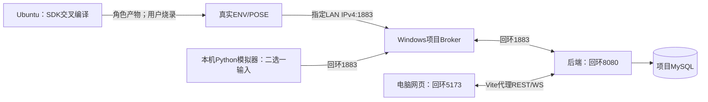

# 开发环境部署导读

未取得本地 SDK 包的开发者，可直接按[官网下载与接入指南](../docs/development/guides/SDK官网下载与接入.md)准备官方源码和工具；公开[来源摘要](sdk/sources.json)已随仓库保存。官网新版本的项目兼容性须实际构建核验，不能把入口可访问当成构建通过。

从空环境开始部署请阅读[完整指南](../docs/delivery/deployment/开发者完整部署指南.md)。`tools/project.py init/db-init/start/status/stop` 分别负责私有配置、首次项目库、开发进程及收尾；SDK 作为独立带校验清单的包交付，不放入 Git。两种运行模式不改变后端及网页回环监听。

这里保存项目开发拓扑入口和Mosquitto模板。当前可以运行真实软件/模拟闭环，也可以让已烧录双板接入同一服务端；**这不是完整生产部署方案**，没有可直接上线的TLS、证书轮换、备份编排或生产监控交付。

## 1. 开发环境分工

Ubuntu负责构建，不充当当前业务服务器；磁盘映射只是文件访问。Windows运行Broker、后端、MySQL和网页。真实板只需访问Broker的指定LAN地址；后端和网页仍回环监听，不为接板把所有服务开放到局域网。

## 2. 模拟与硬件模式

| 模式 | 节点如何访问 | 配置与入口 |
|---|---|---|
| 软件模拟 | 本机ENV/POSE进程访问127.0.0.1:1883 | `tools/mqtt.py prepare/broker/node`；[模拟器](../tools/simulator/README.md) |
| 真实双板 | 板端使用电脑可互访的LAN IPv4；Broker同时保留回环和指定LAN监听 | `tools/hardware.py`显式模式；[Broker说明](mosquitto/README.md) |

真实板上的127.0.0.1指板自己，不是电脑。核对2.4GHz Wi-Fi、电脑当前地址、AP隔离、账号/ACL及校时可达性；网络变化按[固件指南](../docs/development/guides/编译烧录与联调流程.md)处理，不假设电脑配置自动更新已烧录固件。同身份模拟器必须停止，启动代次不能回退。

## 3. 配置与运行边界

- [mosquitto目录](mosquitto/README.md)的模板/ACL示例可提交，工具生成的真实密码/散列、ACL、运行配置和身份状态仅存忽略的secrets。模板不是已运行服务。
- 后端项目开发/测试库和迁移/运行账号分离，按[数据库指南](../docs/development/guides/后端数据库初始化与启动.md)建立；不复用其他项目表、不以root运行。
- 不覆盖Windows旧Mosquitto服务或全局配置，不因端口被占用杀其他进程；本次真实验证没有创建防火墙规则。未来需要时只按明确范围处理，不能关闭总防火墙。
- 启动与退出顺序见[服务端指南](../docs/development/guides/服务端闭环启动与验收.md)、[网页指南](../docs/development/guides/网页启动与首轮验收.md)和[根入口](../README.md)。自动联调只停止自己创建的进程，保留共享MySQL与私有配置。

## 4. 后续部署工作

TLS、生产账号生命周期、秘密分发、数据库备份/恢复、日志留存、监控、服务托管和完整部署手册需要在后续交付中验证；不能把开发机运行通过叫作生产就绪。当前网络设计参考[拓扑](../docs/design/architecture/部署与网络拓扑.md)，具体实测范围以[双板报告](../docs/testing/reports/TASK-007-双板接入验证报告.md)为准。
