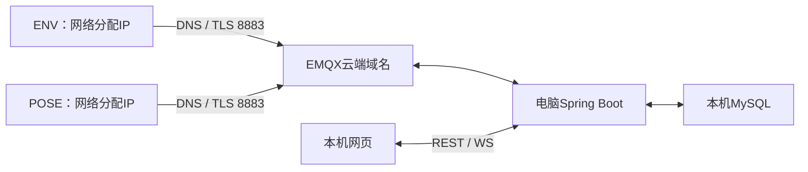

# EMQX Cloud 部署、代码接入与双板迁移

本指南使用Serverless、TLS服务器证书验证和每客户端独立用户名密码；暂不使用mTLS。云端只替换MQTT中转，Spring Boot、MySQL和Vue仍在开发电脑。设计依据见[ADR-004](../../management/decisions/ADR-004-云端Broker与TLS接入.md)，实际覆盖见[实施报告](../../testing/reports/EMQX云端迁移验证报告.md)。

## 1. 创建实例与控制费用

1. 登录自己的EMQX Cloud账号，进入项目，新建 **EMQX Broker**，选择 **Serverless**。项目只是容器，项目URL不是MQTT地址。
2. 核对地区和网络可达性。本次部署选择杭州/阿里云。消费上限设为 **0元/仅使用免费额度**；不要选择“14天试用后按小时计费”的弹性专有版。
3. 当前创建页列出每月100万连接分钟、1GB流量及100万规则动作，免费额度耗尽后零限额实例会停止。以后以控制台实际配额为准，开发时不要长期开无用观察客户端。
4. 等待Running，从Overview取得部署ID、连接域名、MQTT TLS端口和服务器CA。端口使用8883，不能把1883或网页8080用于云端MQTT。

本次实例已建立，后续开发者使用它前需由项目所有者分发独立账号或另建自己的实例，不在公开README保存可通用登录的密码。[官方Serverless创建说明](https://docs.emqx.com/en/cloud/latest/create/serverless.html)。

## 2. 生成本地配置与导入账号

先按[完整部署指南](开发者完整部署指南.md)准备Python虚拟环境、数据库和后端。复制自己的Overview域名和部署ID，运行：

```powershell
.venv\Scripts\python.exe tools/cloud_mqtt.py prepare --host YOUR_DEPLOYMENT_DOMAIN --deployment-id YOUR_DEPLOYMENT_ID
```

此操作创建忽略的 `secrets/mqtt.cloud.local.json`、公开CA的本地副本和两份CSV。重跑不重置已有密码。配置模板和字段说明见[云端入口](../../../deploy/emqx/README.md)。不要把密码放在命令参数里；真实云端设置通过下面控制台导入操作完成。

访问控制→客户端认证→默认认证→导入，上传本地生成的 `secrets/cloud/authentication.csv`。当前控制台模板为 `username,password`，应显示成功5条；账号分别为两个node_id、smartbox_backend、smartbox_test_control、smartbox_test_observer。导入后删除认证CSV，保留忽略配置。账号轮换时先在控制台更换，再同步各消费端；板端凭据变化需要重新构建烧录。

## 3. 配置授权，拒绝未授权操作

访问控制→客户端授权→默认授权→用户名→导入 `secrets/cloud/authorization.csv`。模板列为 `username,topic,action,access`，action为pub/sub，access为allow。共58条允许规则：

| 身份 | 发布 | 订阅 | 条数 |
|---|---|---|---|
| ENV | `box/BOX-0001/BOX-0001-ENV/`下property、heartbeat、event、command_ack、availability | 同前缀cmd、event_ack、box_state | 8 |
| POSE | 自己相同五类上行 | 自己相同三类下行 | 8 |
| 后端 | 两节点三类下行 | 两节点五类上行 | 16 |
| 测试控制 | 两节点三类下行 | 两节点五类上行 | 16 |
| 只读观察 | 无 | 两节点五类上行 | 10 |

然后切到 **全部用户**，添加主题 `#`、动作“发布 & 订阅”、是否允许“不允许”。这是必需的兜底：当前Serverless页面显示黑名单模式，未明确拒绝的请求默认可通过；仅导入Allow表不能形成隔离。核实没有其他泛化Allow、Client ID规则或扩展授权绕过上述限制。[官方授权文档](https://docs.emqx.com/en/cloud/latest/deployments/default_authz.html)。

```powershell
.venv\Scripts\python.exe tools/cloud_mqtt.py check
.venv\Scripts\python.exe tools/cloud_mqtt.py smoke --allow-probes --report-dir artifacts/cloud/NEW-ACL-RUN
```

check验证DNS、TLS证书链和域名；不证明账号或业务保存。smoke需要所有业务客户端断开，使用测试标记检验五账号与实际接收情况，不可在真实板运行时执行。没有部署管理API Key也可完成上述流程，不需要为普通MQTT连接创建API Secret。

## 4. 启动项目，分别选择输入与Broker

```powershell
# 默认云端，仅服务端与网页；不要求开发板在线
.venv\Scripts\python.exe tools/project.py start --mode server
# 云端真实板模式；不会启动模拟器或本机Broker
.venv\Scripts\python.exe tools/project.py start --mode hardware
# 显式本地备用，保留原模拟闭环
.venv\Scripts\python.exe tools/project.py start --mode simulator --broker-profile local
```

网页仍是 http://127.0.0.1:5173 ，后端仍回环8080。缺少云端配置时失败并提示配置，不静默回退。云端模式不占用或管理本机1883。启动前核对已有8080/5173进程，不杀其他进程。后端独立启动可使用：

```powershell
.venv\Scripts\python.exe tools/backend.py run --profile dev --broker-profile cloud --mqtt-config secrets/mqtt.cloud.local.json
```

模拟节点与真实板身份相同，必须停用另一来源。需要切换到云端模拟器时，先停双板及其他云端节点，然后执行 `tools/cloud_mqtt.py reserve-state`，再 `tools/project.py start --mode simulator`。reserve-state从现有项目数据库及不可回退的代次账本预留新区间；只有切换/首次准备时执行，不为日常重启反复分配。之后切回真实板，应重新预留硬件区间、构建和烧录，避免旧boot被判为历史。不要删除身份状态、清空账本或把boot改成0。

若要使用独立云端测试：

```powershell
.venv\Scripts\python.exe tools/cloud_integration.py --allow-test --browser --report-dir artifacts/cloud/NEW-LOOP-RUN
```

使用真实云端、smartbox_test、18080后端及15173网页，不清库；会添加测试遥测/事件/命令。要求本地测试初始化已完成，同云身份的板/模拟器/后端均已停止。原8080/5173服务不受操作，测试自己启动的进程在结束后停止。

## 5. 双板配置、编译与烧录

板端需要可访问互联网、DNS和SNTP的2.4GHz网络。原本地 `secrets/firmware.local.json` 中Wi-Fi继续复用；云端准备不再要求电脑绑定旧LAN IPv4或修改防火墙入站规则。

```powershell
.venv\Scripts\python.exe tools/hardware.py check
.venv\Scripts\python.exe tools/hardware.py prepare --broker-profile cloud --mqtt-config secrets/mqtt.cloud.local.json
.venv\Scripts\python.exe tools/project.py firmware-build
```

prepare预留硬件启动代次区间，生成忽略的固件配置：域名、8883、TLS、服务器CA、每角色独立账号及原Wi-Fi。不为启动项目重复执行prepare。主仓库编辑→受控SDK副本→两角色分别编译链接→立即归档→恢复原输出；详细工具说明见[固件指南](../../development/guides/编译烧录与联调流程.md)。若SDK留有早期Windows映射同步状态，SSH同步会明确拒绝身份不匹配；使用已验证的原映射构建通道，或经完整指纹核对后进行专门状态迁移，不能手工删除状态绕过冲突。

先ENV后POSE，用短ASCII路径的本轮allinone固件。HiBurn选对应COM、921600及Auto burn，Connect后按实体RESET。成功后退出HiBurn、再复位，串口115200观察角色、boot、SNTP、TLS和订阅上线。Windows文件中的修改不会自动更新已烧录固件。

SDK旧mbedTLS未启用HAVE_TIME_DATE，固件在验证回调中使用已校时UTC检查链中每张证书起止日期，同时保留链签名与域名验证结果。未校时可继续采集，但云端TLS连接等待校时；不会关闭验证绕过。TLS内存与栈余量要实板测量，不能用编译成功代替。

## 6. IP关系、排错与恢复



电脑IP变化不再改变板端Broker地址；两板和电脑可以在不同网络。Wi-Fi改变、云域名/CA/板端密码更换，仍需要重新生成构建配置并烧录。后端停机时Broker可保持设备连接，但遥测不会因此自动入MySQL；MQTT QoS/PUBACK也不替代后端业务确认。

| 现象 | 核对 |
|---|---|
| DNS/连接超时 | 实例Running、域名拼写、互联网、DNS、出站8883、VPN分流 |
| TLS验证失败 | 自己部署的CA、SNI域名、SNTP、证书日期与链；禁止关闭校验 |
| 认证失败 | 五账号是否导入、端侧密码是否同步，MQTTX账号不是网页登录账号 |
| 上线但无数据 | Topic精确授权、后端是否连同一部署、注册身份、当前boot及数据质量 |
| 反复断连 | 同Client ID多实例、真实板与模拟节点同时运行、Serverless额度或连接限制 |
| 网页过期 | 当前采样时间、板端联网、后端消费与保存；心跳不能把旧位置变新 |

回退使用明确的local profile；真实板回退本地Broker同样需要本地配置固件。不要自动切换或混合两个Broker下的相同节点。部署消费限额、密码、CA轮换、授权和实际结果需留脱敏记录；长期可靠性和公网时延另按实际指标验收。
