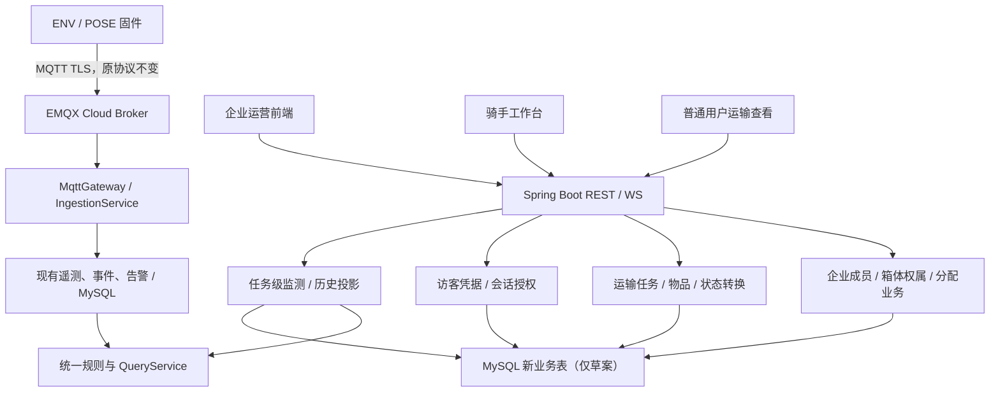
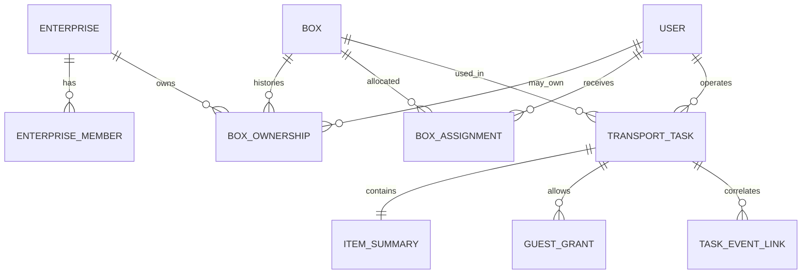
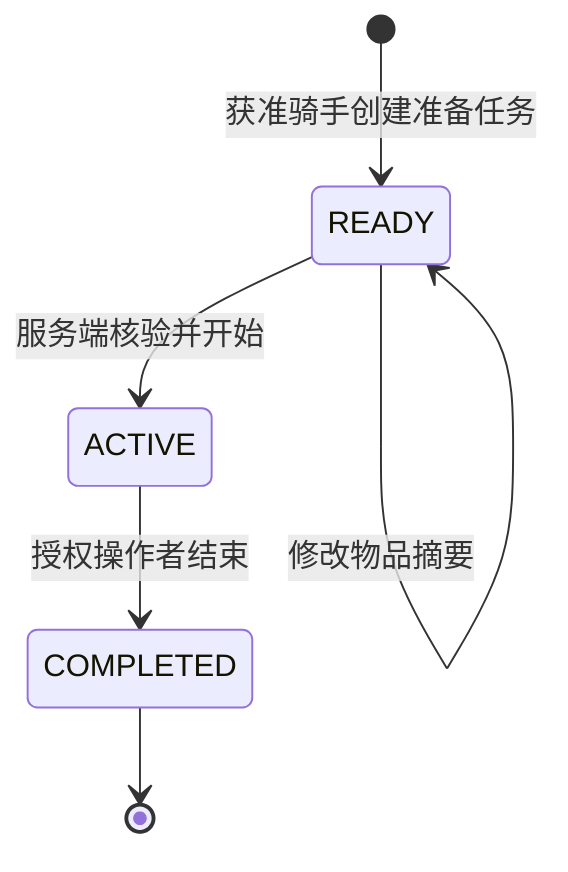

# CR-006 多角色运输业务概要设计草案

> **状态：方案草案，不是已批准架构或已实现接口。** 依据 [CR-006](../../management/changes/CR-006-多角色物流箱与运输任务平台.md) 与 [多角色需求变更说明 V1.1](../../requirements/SmartBox多角色物流箱管理平台需求变更说明.md)。目标是为企业、骑手及普通运输用户提供可实施的业务边界；既有 BL-002 的六模块、47 REQ、3 NFR、50 行正式追踪暂不重排。本文不更改 MQTT Topic/Schema、既有数据库迁移或已验证设备行为。

## 1. 问题、目标与不做什么

现有 SmartBox 以逻辑箱体 `box_id`、ENV/POSE 节点、MQTT 接入、设备控制、遥测/事件/告警及用户箱体授权为核心。三类 UI 原型已可演示，但尚无服务端企业资产归属、骑手分配、运输任务、物品绑定或访客验证码体系。本次要在复用当前监测体系的前提下，把一次运输作为**独立业务事实**保存、授权和查询。

V1 目标：企业受限管理资产及分配；骑手对获准箱体完成准备→绑定→开始→结束；普通用户凭任务编号和验证码只读查看**本任务**状态、环境历史及异常。所有历史、统计、地图和实时结果必须遵守数据来源/质量/授权边界。

V1 不做：GPS 真定位、OTA、路线优化、ETA、客户签收、支付、外部订单、自动短信、复杂组织层级、多箱联运、多件物品明细、人工告警处理、已完成任务重新开启。真实设备事件 Flash/补传继续由 TASK-009 独立负责。

## 2. 总体架构与模块职责

采用**现有 Spring Boot 模块化单体**扩展业务边界，不因新增三个前端创建微服务。Broker 不保存运输业务事实；MySQL 作为任务开始/结束和授权关系的权威来源。现有 `CommandService` 继续负责设备控制结果，运输开始/结束由独立的服务端业务事务完成，不发送虚构 MQTT 设备命令。

| 边界 | 权威责任 | 与已有模块的关系 |
|---|---|---|
| 资产关系 | 企业、企业成员、个人所有者、箱体使用分配、撤权及分配审计 | 影响 MOD-05 资产视图、MOD-06 授权，但不是固件节点绑定 |
| 运输领域 | 任务创建/编号、物品摘要、READY/ACTIVE/COMPLETED、排他及幂等 | 新的业务域，不等同箱体在线或设备控制 |
| 访客访问 | 编号验证码认证、只读任务会话、续期/过期/撤销、失败限流 | 扩展 MOD-06，独立于已有 JWT 登录和 box 级 WebSocket ticket |
| 任务监测 | 可信时间/质量的任务级过程样本、告警裁剪、历史和缺口 | 复用 MOD-01～05 的原始事实及统一业务结论；不重复计算阈值 |
| 前端呈现 | 企业地图/资产、骑手任务工作台、普通用户运输概览 | 以正式 Vue API 接入，不直接复用原型内存逻辑作权限 |

## 3. 领域实体与数据关系（概念模型）

上图表示**候选数据模型**，不是已经存在的 MySQL 表。建议用不同表/关系保存：

| 业务对象 | 最小字段/不变量（设计候选） | 注意 |
|---|---|---|
| 企业与成员 | `enterprise_id`、`user_id`、成员有效期、业务动作集合 | 原四角色不自动成为企业管理员；请求携带明确业务上下文 |
| 箱体权属 | `box_id`、`owner_type`、`owner_id`、有效起止、变更审计 | 不能凭原 `user_box_access` 猜测企业/个人所有权 |
| 使用分配 | `assignment_id`、`box_id`、`rider_id`、`valid_from`、`valid_to`、`status` | 同一企业箱体同一时间最多一个有效骑手分配；撤权权限另校验 |
| 运输任务 | `task_id`、唯一对外 `transport_no`、`box_id`、`operator_id`、`status`、`started_at`、`ended_at`、版本/审计 | 起止时间由后端确权；状态变化与箱体 ACTIVE 排他一致 |
| 物品摘要 | `task_id`、`name`、`description` | V1 一份摘要；开始后不静默改写 |
| 访客凭据/会话 | `grant_id`、`task_id`、安全散列、有效期、撤销版本、失败记录 | 不保存凭据原文，不在 URL/日志传播，任务会话仅只读 |
| 关联/历史 | 原始 `box_id`、节点、可信设备采样时间、质量、任务关联判断、缺口 | 不能仅按 `received_at` 分派；尽量保留原始事实、生成可解释投影 |

**重要设计判断**：可先使用明确的任务时间窗口和查询投影，是否需要物化 `TASK_EVENT_LINK` 由实际 SQL 性能、时间质量和补传行为证明；不能为了方便而直接修改既有消息事件身份。

## 4. 任务状态机、业务不变量与事务

- V1 的 READY 草稿可放弃，但不代表执行中任务取消；ACTIVE 不允许换箱、解绑或重开；COMPLETED 为不可逆事实。
- **开始事务**：当前操作者身份及分配仍有效；物品名称存在；箱体未被其他 ACTIVE 占用；设备状态满足已记录默认要求；服务端写入开始时刻、任务状态和占用一致提交。不能用前端按钮禁用代替数据库排他。
- **结束事务**：重新校验任务操作者资格（含已审计的紧急企业接管）；只有 ACTIVE 能转换；在同一事务中固定结束时间并释放 ACTIVE 占用。响应丢失后可按操作标识查询最终结果，重复结束不改变事实。
- 推荐在数据层设计**唯一有效占用约束**（如与任务关联的单箱活动占用记录/受约束的活动关联），加事务及预期版本检查。仅采用“先 SELECT COUNT 再 INSERT”不足以防并发。
- 设备离线时禁止**开始**，经授权且后端可达允许**结束**。在线但环境异常/过期/未知的开始需要警示、显式二次确认和审计；不意味着断言物品安全。
- 任务状态、设备在线、环境已评估、数据有效/新鲜均为**独立状态维度**。

## 5. 任务时间与数据质量：不得按接收时间猜测归属

时间边界候选：后端将一次任务映射到半开区间 `[started_at, ended_at)`（进行中到当前查询上界）；保存 UTC 时间和必要来源元数据。

- `occurred_at` / 可信采样时间：仅通过既有时间质量验证、语义可与服务端时间对齐的数据才考虑归属，不可只看设备 `ts` 字段存在。
- `received_at`：后端收到并写入记录的时间，主要供存储和诊断，不足以证明任务归属；尤其网络断开时，T1 的数据可能在 T2 已开始后才收到。
- 时间不可信/乱序/迟到：保持原始证据和质量；无法可靠归属则呈现“待核/缺失”，不得在普通用户曲线中猜作 T1 或 T2。
- 跨任务持续告警：查询时按明确规则裁剪可披露的时段/信息，不泄露另一任务的事件详情。
- 已结束任务只能获得自己的历史数据；不从箱体最新快照取值替代历史最后一帧。TASK-009 真实补传前不得承诺历史完全无缺口。

CR-004 仍规定现行箱体历史使用 `received_at` 做检索；此处提出的是**新增任务级归属规则**，不得悄悄修改既有箱体历史接口语义。需要通过新契约和实测补传场景独立验收。

## 6. 权限、访客凭据与三端边界

| 主体 | 最小读取/动作 | 必须拒绝 |
|---|---|---|
| 企业授权成员 | 本企业受控资产、运营汇总、授权任务、告警；有独立权限者可分配/撤销 | 其他企业资产、无独立资格的设备危险控制和凭据原文 |
| 骑手/个人箱主 | 本人所有或有效分配箱体、本人可操作任务、获准历史、既有受限设备动作 | 企业全局资产、他人任务、无资格的分配转授和设备高级控制 |
| 普通用户访客 | 仅单次获准任务的物品摘要、运输状态、允许的环境数据、异常摘要及本次历史 | `box_id` 全历史、设备管理、姿态原始证据、其他任务、导出和设备命令 |

建议 V1 凭据：单任务独立 10 位密码学随机字母数字验证码；服务端仅保存安全散列；ACTIVE 后签发，由有权人员安全交付；任务进行中及结束后 7 天有效，验证成功给予 30 分钟只读会话；15 分钟内 5 次失败加 IP/任务维度限流；重签发和撤销均使旧会话失效。**这些是可调的工作默认值，不代表已完成生产安全评估。**

- 网页直接使用 ID、扩大时间范围、重复使用旧 WS ticket 均不能扩大授权；每次查询和实时订阅都要做任务/字段/时间校验。
- 业务身份上下文、角色、资产所有权、有效分配、任务操作权、访客任务会话不能合并成一个 `is_admin` 布尔值。
- 旧 `DELIVERY_USER` 的登录式箱体授权继续按现行规则有效；**访客模式是新增的任务级身份**，不能直接发行原有箱体级 JWT。
- 安全审计只保存操作主体、目标、结果、必要时间与关联标识；不写入验证码、长令牌或设备密码原文。

## 7. 建议的 HTTP/WS 能力（仅供接口设计评审）

下表是**功能分组和候选端点**，并非已经实现的 URL 或冻结 OpenAPI。

| 业务能力 | 候选资源形态 | 响应需要表达 |
|---|---|---|
| 企业资产/使用授权 | `/api/v1/enterprises/.../boxes`、`.../assignments` | 有权范围、资产/分配状态、动作结果和审计 |
| 骑手任务准备 | `/api/v1/transports` | 唯一任务/运输编号、READY 状态、物品摘要 |
| 开始/结束 | `/api/v1/transports/{id}/start`、`.../finish` | 操作标识、权威状态、冲突/资格失败与结果查询 |
| 运输详情/历史 | `/api/v1/transports/{id}`、`.../environment`、`.../alerts` | 任务范围数据、质量、缺口和授权字段 |
| 访客换取会话 | `/api/v1/transport-access/verify` | 不泄露存在性、仅任务级的短期访问资格 |
| 访客只读查询 | `/api/v1/transport-view/...` | 白名单字段、任务边界、撤销后不可访问 |
| WebSocket | 继承原有通知后重新取服务端权威任务状态 | 撤权立即停读；无权限时不可订阅资源外推送 |

具体状态码、幂等键、凭据承载、事务接口和对外资源路由须在 OpenAPI/安全设计时确定。历史范围检查必须在服务端执行，不能信任客户端时间参数。

## 8. 三套界面与业务数据的对应

| 入口 | 首页任务 | 必要页面与状态 | 主要接口依赖 |
|---|---|---|---|
| 企业桌面端 | 企业箱体/异常/任务概览，地图与列表联动 | 资产、分配、任务、告警、设备；无位置/过期/Mock/底图失败 | 企业成员＋资产范围＋授权动作＋任务查询 |
| 骑手移动端 | 当前进行中运输、环境状态、下一步操作；无任务则开始运输 | 我的箱体、三步准备、任务详情、环境历史、异常、个人权限 | 使用分配、任务事务、真实历史 |
| 普通用户移动端 | 编号验证码 → 单次运输概览及环境结论 | 环境历史、异常、验证码错误/过期/撤销、已结束 | 访客凭据、单任务只读投影 |

原型代码 [企业视觉方向](../../../frontend/design-exploration/README.md)、[骑手和访客预览](../../../frontend/role-design-exploration/README.md) 只提供 UX 参考。验收需覆盖 390×844、768×1024、1440×900 的真实前端渲染和安全/空/异常状态。不可把原型演示数据接入真实结论或默认为已完成业务。

## 9. 实施切片与验证输入

| 切片 | 可交付内容 | 本切片关键验证 |
|---|---|---|
| WS-A 需求基线/技术设计 | 正式 REQ 分配、权限矩阵、新旧契约兼容、数据库初步设计 | 现有 47/3 的反向关联不丢失，CR-006 默认值受控 |
| WS-B 资产和分配底座 | 企业成员、权属、有效骑手分配、审计与撤销 | 企业 A/B 隔离、同箱分配排他、旧角色不自动扩权 |
| WS-C 运输核心事务 | 准备/单份物品/开始/结束、箱体占用、幂等 | 并发单箱至多一 ACTIVE、重复结束不改原事实、异常/离线开始边界 |
| WS-D 任务历史/访客安全 | 可信时间归属、任务级曲线/告警、验证码/会话/撤销 | T1/T2 与迟到补传严格隔离、扩大范围拒绝、旧会话停读 |
| WS-E 三端接入和回归 | 企业/骑手/用户页面真实联调、状态一致性 | REST/WS/角色权限、Mock 边界、三种屏宽与失败路径 |

本 CR 不占用新 TASK/TC 正式编号。未来需依据 [MR-A01～23](../../requirements/SmartBox多角色物流箱管理平台需求变更说明.md#14-验收标准) 拆分测试；本草案没有运行测试结论。

## 10. 尚需明确的设计评审点

1. 正式企业成员与旧 `users/roles/user_box_access` 的共存和迁移映射。
2. 同箱 ACTIVE 数据库强约束、任务状态事务及重复请求结果查询策略。
3. 时间可信度和设备时间与服务端 UTC 的对齐证明，尤其跨任务补传。
4. 访客凭据“仅散列保存”与一次性安全交付、撤销后的缓存/WS 失效机制。
5. 运输开始的设备在线判定是否需要两个必需节点，及环境异常二次确认的确认记录模型。
6. 旧版普通用户可见内容与新增无账号访客的最小数据白名单差异。
7. 数据保留默认值与现有查询窗口、历史清理程序的影响。
8. 可用地图数据的真实许可、来源标签和 GPS Mock 边界。

**完成上述设计评审和需求追踪同步前，本文仅为概要设计草案；不能直接作为数据库迁移、OpenAPI 或设备命令的冻结合同。**

## 12. DEMO 范围优先级调整

用户 2026-11-23 明确将当前产品目标设为可演示，而非企业级 SaaS。此概要设计保留可扩展的完整架构方向；**第一轮实际实现按[CR-006 演示优先实施方案](../../development/guides/CR-006-演示优先实施方案.md)执行**，先让企业分配、骑手运输和普通用户查看形成真实后端闭环。复杂成员系统、紧急接管、重签吊销、全量任务补传归属和长时间压测后置；必要的后端权限/单箱排他/单任务范围不后置。未交付的原始需求仍作为候选追踪，不计为通过。
