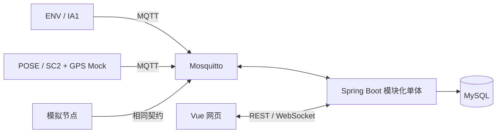

# 系统总体设计

基线 BL-001；关联 REQ-001～009；架构决策 ADR-001。

P1 模拟输入走真实消息链路、注册校验和事务，P2 接入实际采集。网页不直连 Broker。

后端按身份权限、箱体节点、遥测、原始事件、融合、告警、命令、设备接入划分业务模块。模块内区分接口、应用服务、业务规则及持久化适配；单个 Maven 应用，不拆网络微服务。

设备采集/规则、事件存储、网络分别调度；POSE 采样不受网络阻塞。业务状态与连接状态分开，离线不退出 SENTRY。

原始事件及事务 outbox 同时提交，提交后确认；工作者可恢复并幂等生成融合和告警。命令先记录再发布，可按回执和超时查询。首期单后端实例，扩容前另行设计工作者协调。

箱体在线、告警、哨兵、门状态独立返回。历史补传不改最新快照，权限在服务端查询及投影落实。

报文以 [MQTT](../../../contracts/mqtt/v1.md) 与 [HTTP](../../../contracts/http/v1.md) 为准。
