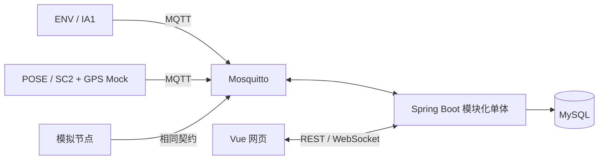

# 系统总体设计

基线 BL-002；关联 REQ-M01-001、REQ-M01-002、REQ-M01-003、REQ-M01-004、REQ-M01-005、REQ-M01-006、REQ-M01-007、REQ-M01-008、REQ-M01-009、REQ-M01-010、REQ-M01-011、REQ-M02-001、REQ-M02-002、REQ-M02-003、REQ-M02-004、REQ-M02-005、REQ-M02-006、REQ-M03-006、REQ-M01-012、REQ-M01-013、REQ-M01-014、REQ-M04-001、REQ-M04-002、REQ-M04-003、REQ-M04-004、REQ-M04-005、REQ-M04-006、REQ-M04-007、REQ-M04-008、REQ-M03-001、REQ-M03-002、REQ-M03-003、REQ-M03-004、REQ-M03-005、REQ-M03-006、REQ-M03-007、REQ-M03-008、REQ-M05-001、REQ-M05-002、REQ-M05-003、REQ-M05-004、REQ-M05-005、REQ-M03-004、REQ-M06-001、REQ-M06-002、REQ-M06-003、REQ-M06-004、REQ-M06-005、REQ-M06-006、REQ-M05-005；架构决策 ADR-001。

P1 模拟输入走真实消息链路、注册校验和事务，P2 接入实际采集。网页不直连 Broker。

后端按身份权限、箱体节点、遥测、原始事件、融合、告警、命令、设备接入划分业务模块。模块内区分接口、应用服务、业务规则及持久化适配；单个 Maven 应用，不拆网络微服务。

设备采集/规则、事件存储、网络分别调度；POSE 采样不受网络阻塞。业务状态与连接状态分开，离线不退出 SENTRY。

原始事件及事务 outbox 同时提交，提交后确认；工作者可恢复并幂等生成融合和告警。命令先记录再发布，可按回执和超时查询。首期单后端实例，扩容前另行设计工作者协调。

箱体在线、告警、哨兵、门状态独立返回。历史补传不改最新快照，权限在服务端查询及投影落实。

报文以 [MQTT](../../../contracts/mqtt/v1.md) 与 [HTTP](../../../contracts/http/v1.md) 为准。

## 业务模块与需求映射

六模块是跨端业务边界，不改变本文既有技术层次、包划分、部署或数据模型。节点在线归MOD-03，箱体综合状态归MOD-05；防护业务归MOD-02，通用通信归MOD-03，事件可靠性归MOD-04，授权归MOD-06。

| MOD | 需求 |
|---|---|
| MOD-01 | [REQ-M01-010](../../requirements/modules/MOD-01-物流箱运行监测.md#req-m01-010) |
| MOD-05 | [REQ-M05-001](../../requirements/modules/MOD-05-物流箱管理与状态聚合.md#req-m05-001) |

全局质量：。
