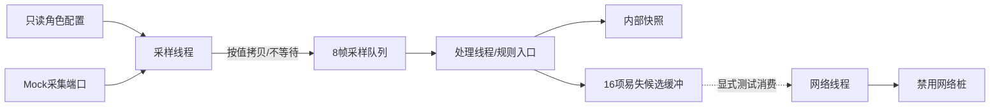

# TASK-002 双角色固件骨架

| 属性 | 内容 |
|---|---|
| 阶段 | P1 |
| 负责人 | 用户（独立开发与验收） |
| 状态 | 已完成（软件完成，待板端验证） |
| 依赖 | TASK-001（接口准备已完成） |
| 关联类型 | 接口与骨架准备，不代表通信、业务或硬件需求已验收 |
| MOD | [MOD-03](../../requirements/modules/MOD-03-设备接入与控制.md) |
| 需求 | [REQ-M03-002](../../requirements/modules/MOD-03-设备接入与控制.md#req-m03-002)、[REQ-M03-003](../../requirements/modules/MOD-03-设备接入与控制.md#req-m03-003)、[REQ-M03-005](../../requirements/modules/MOD-03-设备接入与控制.md#req-m03-005)、[REQ-M03-006](../../requirements/modules/MOD-03-设备接入与控制.md#req-m03-006)、[REQ-M03-007](../../requirements/modules/MOD-03-设备接入与控制.md#req-m03-007)、[REQ-M03-008](../../requirements/modules/MOD-03-设备接入与控制.md#req-m03-008)、[NFR-003](../../requirements/quality/安全与可维护性.md) |

## 1. 目标、输入与本次状态

建立同一套C/CMSIS-RTOS2源码的ENV/POSE固件骨架，使后续真实采集、网络和业务规则能接入明确端口。详细设计集中维护于本任务，其他固件文档仅保留总体职责和操作入口。

当前由用户独立开发、验证和验收，不区分成员或设置跨人签字。任务编号、P1阶段、TASK-001前置依赖及后续技术依赖保持不变。按S1～S7顺序实施，不虚构多人并行或固定工期。

| 输入 | 使用目的 |
|---|---|
| [TASK-001交接](../iterations/TASK-001-接口评审与交接.md)、[版本矩阵](../environment/工具与依赖版本矩阵.md) | 使用已冻结结构和工具依据；SDK编译器执行版本仍需核对 |
| [契约入口](../../../contracts/README.md)、[公共定义](../../../contracts/common/v1.schema.json)、[MQTT v1](../../../contracts/mqtt/v1.md) | 保持身份、单位、能力、时间和确认语义一致，不复制另一套协议 |
| [固件总体设计](../../design/firmware/固件架构与SDK接入.md)、[节点说明](../../design/hardware/节点与演示动作.md) | 核对层次、角色和未来真实外设边界 |
| [当前进度](../../management/当前进度.md)、[追踪矩阵](../../management/需求追踪矩阵.md)、[风险](../../management/风险与假设.md) | 保持需求覆盖、证据及SDK兼容风险一致 |

2026-11-06由Codex按用户授权执行S1～S7。固件骨架、同步/检查/构建工具、组件测试、两角色实际SDK编译链接与恢复已完成，详见[实际报告](../../testing/reports/TASK-002-固件骨架验证报告.md)。本任务完成只表示软件骨架与构建准备完成；未烧录或接板，相关REQ和整份TC仍未验收。

## 2. 范围与需求覆盖

本任务实现角色配置、统一类型、确定性Mock、平台端口、线程/有界队列、处理入口、禁用网络桩、项目GN接入和单向同步工具；最终取得两个角色的实际编译及链接证据。

不实现真实IA1/SC2驱动、Wi-Fi/MQTT链路、业务算法、真实远程控制、持久boot_id及Flash事件存储。真实硬件接入在TASK-007，规则与融合在TASK-008，可靠存储在TASK-009；网络服务、模拟节点与实际闭环按TASK-004/005及后续板端集成推进。本任务的C Mock不替代TASK-004通过真实Broker通信的模拟节点。

| 需求 | 本任务贡献（接口与骨架准备） | 后续仍需验证 |
|---|---|---|
| REQ-M03-002 | 单一网络所有者、网络适配端口和禁用桩 | 连接、订阅、重连及真实收发 |
| REQ-M03-003 | ENV/POSE身份能力集中配置，端口按能力拒绝不支持的动作 | 实际接入注册值、角色过滤和驱动能力 |
| REQ-M03-005 | 单调时间、UTC有效标记及UNSYNCED表达 | 实际校时和未校时下行控制拒绝 |
| REQ-M03-006 | 候选数据、控制及网络端口分离，不伪造发送/执行/保存结果 | 请求幂等、执行回执及整体操作结果 |
| REQ-M03-007 | 输出端口能力校验及默认关闭；Mock仅修改模拟状态 | 各命令真实执行和动作边界 |
| REQ-M03-008 | 配置合法性、显式错误、有界数据和资源入口 | 真实JSON解析、完整报文边界和非法输入拒绝 |
| NFR-003 | 单一源码、GN互斥角色、差异同步、恢复和脱敏构建证据 | SDK接口链接、后续安全与运行检查 |

以上集合与原追踪关系一致，不新增功能需求或变更协议。8帧/16项工作队列不是未确认事件持久化队列；本阶段不满足MOD-04的设备持久化要求，包括REQ-M04-001、REQ-M04-002、REQ-M04-003、REQ-M04-004、REQ-M04-005、REQ-M04-006、REQ-M04-007、REQ-M04-008。不能以临时序号或内存缓存声称事件唯一性可跨重启恢复。

## 3. 双角色与配置

| 配置项 | ENV | POSE |
|---|---|---|
| 默认演示箱体 | BOX-0001 | BOX-0001 |
| 默认演示节点 | BOX-0001-ENV | BOX-0001-POSE |
| 能力位 | 71（0x47） | 120（0x78） |
| Mock输入 | 温度℃、湿度%RH、光照lux | x/y/z加速度g、姿态输入、GPS Mock经纬度 |
| 目标周期 | 环境1000ms | 姿态20ms；定位1000ms |
| 本阶段输出 | Mock补光/风扇状态 | Mock指示灯状态 |
| 真实接入 | TASK-007 | TASK-007 |

周期仅为调度设计，不是50Hz或实时性实测。配置只包含角色、身份、能力、周期及端口选择；业务阈值继续以现行需求为准，不散落在采集或启动代码中。box_id/node_id使用契约规定的ASCII格式与长度；真实Wi-Fi、Broker凭据不能写进受控源码或日志。

GN只允许一种角色：`SB_ROLE_ENV=1`或`SB_ROLE_POSE=1`。未选择、同时选择、配置角色与能力不符均失败；不能静默回退到ENV。每次只构建一个角色产物。角色相关的身份和能力在只读配置对象集中提供。

## 4. 实现目录、类型与分层

以下文件已实现。保留六层目录；公共类型、端口与配置见firmware/include，SDK依赖只进入app和平台适配。

```text
firmware/
├─ app/
│  ├─ smartbox_main.c          # APP_FEATURE_INIT启动装配与启动门禁
│  └─ smartbox_tasks.c         # 采样、处理、网络工作线程
├─ domain/
│  └─ sb_pipeline.c           # 样本处理/规则调用入口；本阶段不实现P3算法
├─ drivers/
│  ├─ sb_sensor_mock.c        # 确定性模拟采集
│  ├─ sb_output_mock.c        # 模拟输出及能力检查
│  └─ sb_platform_cmsis.c     # SDK时钟、短临界区等平台适配
├─ services/
│  ├─ sb_config.c             # 角色/身份/能力/周期只读配置
│  ├─ sb_clock.c              # 单调时间、tick换算与UTC质量
│  ├─ sb_event_buffer.c       # 易失候选工作缓冲
│  └─ sb_network_stub.c       # 禁用网络桩；不返回虚假发送成功
├─ include/
│  ├─ sb_types.h              # 角色、样本、时钟、候选、状态和错误码
│  ├─ sb_ports.h              # 采集、输出、网络及处理端口
│  └─ sb_config.h             # 只读配置接口与角色约束
└─ build/
   ├─ BUILD.gn               # 项目static_library目标smartbox
   └─ roles/                 # ENV/POSE GN配置模板
```

| 层次 | 职责 | 禁止跨越的边界 |
|---|---|---|
| app | 创建资源、装配端口、管理启动与故障 | 不读寄存器、不拼接MQTT |
| domain | 接收统一样本，调用纯规则入口 | 不依赖SDK全局变量、网络或特定器件 |
| drivers | 实现Mock和平台端口，后续替换真实适配 | 不决定告警、融合或事件持久化策略 |
| services | 配置、时间、缓冲及网络边界 | 不把内存保存当成持久承诺或PUBACK当成落库 |
| include | 固定接口、单位及数据所有权 | 不保存可被各层任意修改的公共全局状态 |

公共头文件使用标准C类型；除CMSIS平台适配和app任务装配外，不向domain泄露SDK类型。样本与候选按值拷贝，不让队列持有栈上对象指针；跨模块返回只读配置指针，输出结构由调用者分配。

| 类型 | 关键内容 | 质量与所有权 |
|---|---|---|
| SbConfig | role、box_id、node_id、caps、各采样周期 | 初始化校验后只读，生命周期覆盖全部工作线程 |
| SbClock | uptime_ms、utc_valid、utc_ms、time_uncertainty及质量标记 | 未校时utc_valid=false、质量UNSYNCED；不能把uptime当UTC |
| SbSensorFrame | role、输入类别、模拟来源、采样时钟、有效位及有单位观测 | ENV/POSE使用对应联合体分支；状态未知不填默认正常 |
| SbEventCandidate | 诊断或测试候选、来源、发生单调时间、质量及固定上限数据 | 只作内存工作数据；不是已持久化事件或可上报的正式唯一事件 |
| SbOutputRequest | 输出类别、on及持续时间 | 按角色能力检查；本阶段仅Mock，不承诺实际GPIO动作 |

内部Mock来源标记与网络`loc.src=MOCK`区分：本阶段所有采样来源都明确模拟；未来真实传感器替换不能将模拟来源当实测。Mock使用固定序列和可重置索引，覆盖正常值、无效样本和角色不支持输入；不以真实随机数或系统UTC决定结果。输入姿态状态可以来自显式测试样例，但不得声称已完成校准/分类算法。

## 5. 公共接口设计

以下接口已按同一语义实现，声明见[公共端口](../../../firmware/include/sb_ports.h)；不新增网络报文字段。初始化、快照、调度与状态读取为辅助端口。

| 接口 | 输入与输出 | 调用者/数据归属 | 阻塞性及失败 |
|---|---|---|---|
| `const SbConfig *sb_config_get(void)` | 返回已校验只读配置；初始化失败不得给工作线程使用 | 启动及工作线程只读引用 | 不阻塞，不允许运行中悄改角色 |
| `SbResult sb_clock_get(SbClock *out)` | 取得单调时间及UTC质量快照 | 调用者提供out | 短临界区内读取，不等待校时；平台错误显式返回 |
| `SbResult sb_sensor_read(SbInputKind kind, SbSensorFrame *out)` | 读取角色支持的确定性Mock输入 | 仅采样线程调用，值拷贝进入队列 | 不等待I/O；参数非法/能力不支持/无数据/平台失败 |
| `SbResult sb_output_set(const SbOutputRequest *request)` | 校验输出类别并更新Mock状态 | 默认关闭；处理入口发起请求 | 不阻塞；不支持或参数错误时不改变状态 |
| `SbResult sb_pipeline_process(const SbSensorFrame *frame)` | 消费样本，更新内部快照并调用规则端口 | 仅处理线程写状态 | 不执行网络I/O；骨架不生成声称已判定的业务告警 |
| `SbResult sb_event_buffer_put(const SbEventCandidate *item)` | 按值拷贝到有界候选缓冲 | 处理线程生产 | 不等待空间；满则返回SB_FULL并计数，不覆盖未消费项 |
| `SbResult sb_event_buffer_get(SbEventCandidate *out)` | 取出一个候选副本 | 网络工作线程单一消费 | 非阻塞；空则SB_NO_DATA；取出不代表持久化确认 |
| `SbResult sb_network_poll(void)` | 轮询适配器状态 | 仅网络线程持有网络边界 | 桩返回SB_NOT_IMPLEMENTED，不忙等重试 |
| `SbResult sb_network_publish(const SbEventCandidate *item)` | 预留发送适配入口 | 仅网络线程使用 | 本阶段返回SB_NOT_IMPLEMENTED，不回成功/业务确认 |

错误码统一为`SB_OK`、`SB_INVALID_ARG`、`SB_UNSUPPORTED_CAP`、`SB_NO_DATA`、`SB_FULL`、`SB_NOT_IMPLEMENTED`、`SB_PLATFORM_ERROR`；SDK细节在适配层转换。网络禁用桩是非致命运行状态，不等同启动平台失败；错误被计数和节流记录，禁止每个tick重复打印。

网络线程在禁用模式不自动清空候选缓冲；取出用于显式诊断测试时记录为未发送，不能生成stored确认或升级为可靠事件。输出持续时间按单调时间管理，到期Mock状态关闭，默认不上电开启。当前协议中真实控制1～30秒等规则保持原样，骨架接口不能自行批准实际命令执行。

## 6. 线程、队列与时间设计



图表示软件工作数据流，已通过宿主组件测试与SDK链接，尚未在板端运行。没有SDK变量直接穿透domain；处理线程不持有MQTT客户端，后续网络适配保持单一所有者。

| 线程 | 初始配置 | 工作与等待方式 |
|---|---|---|
| 采样 | 高于普通优先级，栈4096字节 | ENV目标1000ms；POSE姿态20ms、定位1000ms；按单调截止时间调度，入队timeout=0 |
| 处理 | 普通优先级，栈4096字节 | 有界等待样本，按值处理；快照由本线程单一写入，跨线程读用短保护后的副本 |
| 网络 | 较低优先级，栈4096字节 | 持有网络适配器；禁用桩模式采用有界休眠，检查停止请求，不创建真实客户端 |

POSE定位沿同一采样调度循环按独立截止时间触发，不能把姿态采集降成1秒。错过周期时记录missed计数并推进截止时间，不紧密补跑大量旧样本冒充准时采样。正式GPS Mock静止降频等业务规则仍在后续阶段实现。

采样队列满丢弃本次工作帧并累计sample_queue_full，不阻塞采样；候选缓冲满保留既有项、拒绝新工作项并累计candidate_full。这只是骨架背压，不更改正式可靠存储满后覆盖最旧并报告损失的业务规则。业务可靠事件未来必须走持久化后发送通道，不能直接复用易失候选当成已承诺记录。

初始8帧、16项和三个4KB栈是工作资源配置。按结构体实际sizeof和构建map记录静态占用，运行峰值另测；不据此宣称应用增量RAM小于60KB或Flash小于200KB通过。后续有依据调整工作队列或栈时记录设计变化，不能擅自改业务容量、周期或性能目标。

时间端口必须校验tick频率非零，使用向上取整的毫秒→tick换算并检查乘法/结果溢出。维护受短临界区保护的tick回绕扩展，形成uint64单调毫秒；明确观测间隔不能超过一个完整tick计数周期。UTC有效性独立维护，未校时不伪造SNTP或误用收到数据时的电脑时间。

## 7. 启动与异常收敛

启动状态为`BOOTSTRAP → READY`，任一步失败转`FAILED`；这是应用装配状态，不是箱体或业务操作状态。SDK通过现有`APP_FEATURE_INIT`模式调用启动入口，不创建第二个内核入口。

固定顺序：校验配置 → 初始化时钟与Mock端口 → 全部输出默认关闭 → 创建队列/候选缓冲 → 创建工作线程 → 设置READY并开放启动门禁。

工作线程必须先检查启动门禁，所有资源成功前不得进入采样或处理。创建部分线程后失败时，先设置失败/停止标记，唤醒或等待有界检查使线程退出，再释放其可能访问的资源；不能先删队列再让存活线程访问它。失败原因保留，是否需要复位明确记录，不无限忙等重建。

| 异常 | 规定处理 |
|---|---|
| 身份、角色或能力不匹配 | 启动失败，不选择默认角色继续运行 |
| 时钟频率为零、转换溢出 | 返回平台错误并停止相关调度，不把周期设为零循环 |
| 资源/线程创建失败 | 不开放READY，输出保持关闭，按引用关系收敛资源 |
| 无效Mock样本 | 保留无效标记，不能填零或宣称正常 |
| 队列满/缓冲满 | 非阻塞拒绝并计数；不伪造接收、保存或执行成功 |
| 不支持的输出 | 返回能力错误，不改变现有输出 |
| 网络未实现 | 保持禁用状态，节流记录，不上报连接成功或stored |

CMSIS API以当前SDK源码及实际链接为准。不得使用`osMessageQueueReset`；也不能依赖某个退出/清理API仅在头文件中有声明。采用线程函数返回和受控停止时，先核验SDK包装实现的行为；实际编译/链接失败保留原始错误，不靠空实现掩盖缺符号。

## 8. SDK同步与GN接入

唯一编辑源：Windows主仓库`C:/Users/Administrator/Desktop/SmartBox/firmware`。SDK根目录：Ubuntu`/home/bearpi/project/bearpi-hm_nano`，当前映射`Z:/home/bearpi/project/bearpi-hm_nano`。映射路径是当前环境记录，工具开工时必须重新验证，不硬编码为永远可用。

受控副本为SDK的`applications/BearPi/BearPi-HM_Nano/sample/logistics_box`，内容对应firmware的六层目录。计划GN目标为`logistics_box/build:smartbox`；项目`build/BUILD.gn`引用相对源码及既有CMSIS/SDK头路径。根sample选择项只做受控切换，不覆盖整份官方构建文件。

ENV/POSE模板在仓库`firmware/build/roles/`维护；同步时在SDK副本生成`build/selected_role.gni`，GN根据它设置唯一角色宏，公共头文件再做互斥校验。不通过来回修改受控公共头文件选择角色，也不把生成选择文件当成源码编辑入口。

工具[同步入口](../../../tools/sync_firmware.py)已交付，操作如下。完整构建请使用[构建入口](../../../tools/build_firmware.py)，它在切换前保护原产物和厂商子树。

| 操作 | 计划参数 | 写入边界 |
|---|---|---|
| 默认预览 | `--sdk-root PATH --role ENV/POSE` | 只读，报告规范化路径、增加/修改/受控删除、冲突、角色及入口差异 |
| 显式应用 | 增加`--apply` | 仅项目副本、工具自己的状态/备份及必要的sample选择项 |
| 恢复入口 | `--restore-entry --apply` | 只恢复本次接入前入口；不删除源码或旧实验 |

同步规则：

1. 先解析源、SDK根与目标的规范化绝对路径，确认项目标识和目录关系；拒绝源目标重叠、符号链接/重解析点、路径越界及非项目目标。
2. 第一次应用保存入口原始字节、SHA256、启用项，以及副本受控文件清单；状态/备份放项目专属同步元数据区域，不能提交SDK或真实凭据。
3. 后续同步比较“仓库当前文件、上次同步指纹、SDK当前文件”。SDK出现未预期人工改动或首次遇到不明同名副本时报告冲突，不静默采用或覆盖。
4. 删除只限上次清单登记、当前源已移除且SDK内容仍匹配上次指纹的项目文件；未知文件保留并报告，不删除官方实验或SDK父目录。
5. 应用前再次核对预览依据；文件变化则重新预览。sample入口只在当前内容符合预期时切换，不能用旧备份覆盖别人在检查后修改的入口。
6. 恢复只在当前入口仍等于工具最后写入值时恢复原始字节；恢复后发生新变化时必须报冲突。保留恢复证据，不删除学习项目。

## 9. Ubuntu构建、归档与恢复

1. 保存并重新核对sample/BUILD.gn原内容、哈希和启用项；TASK-001记录的学习入口为study_kernel_01_thread，不能当作实时检查结果。
2. 使用预览核对同步及GN差异，显式应用项目副本和ENV角色。
3. 在Ubuntu实际记录Python、GN/Ninja、编译器/链接器版本及SDK文件指纹；根据构建日志确定真实工具，不凭文件名推断其已执行。
4. 在SDK根目录执行既有`python build.py BearPi-HM_Nano`，保存ENV完整输出、退出码及编译/链接结果；检查实际产物路径、更新时间和角色证据。
5. ENV成功后立即归档，再同步选择POSE并重复构建、验证和归档。不能先构建两次再把最后一个bin分别命名为两个角色。
6. 执行入口恢复预览及应用，核对原始字节/哈希，确认旧实验和项目源码均保留；不要求为了验证恢复而重做官方板端实验。

映射盘可读不等于能够在Ubuntu执行命令。无远程执行通道时，用户可在虚拟机终端执行相同步骤，回存原始日志与产物。缺少任一角色的实际编译/链接日志则任务最多待验证，不能仅凭代码和GN存在标为完成。

计划产物归档为`artifacts/firmware/TASK-002/<构建标识>/<ENV或POSE>/`，包含构建日志、实际bin、可用map及manifest。manifest记录角色、box_id/node_id/caps、源码提交号或完整工作区差异、同步指纹、SDK入口/选择配置、工具版本、命令、起止时间/退出码、产物路径和SHA256。预期bin名Hi3861_wifiiot_app_allinone.bin仅作查找线索，最终以实际构建输出为准。

报告位于`docs/testing/reports/`，使用非全局TASK定义式标题，链接上述脱敏证据及校验值。日志/固件不入Git；SDK不入Git；不将字符串中有ENV标记当成硬件已运行。烧录、串口与真实双板联调留TASK-007。

## 10. S1～S7实施步骤

任务负责人和最终验收者为用户；本次实际执行者为Codex。S1～S7于2026-11-06完成，具体证据与检查结果见第12节报告；以下保留步骤及失败处理用于复现。

| 步骤 | 输入 | 动作 | 产出与完成条件 | 失败处理 |
|---|---|---|---|---|
| S1 环境与入口核对 | 第1节输入、SDK现状 | 核对契约、目录、入口、实际执行方式及所需工具 | 路径、版本核验方法、备份/恢复范围和阻塞明确 | 映射/执行不可用分别记录，不修改SDK猜测试错 |
| S2 类型与配置 | 角色表、公共定义 | 建立第4/5节类型、错误码、只读配置及互斥约束 | 两个角色身份能力正确，单位/质量一致，错误配置拒绝 | 配置或接口冲突先修正，不回退默认角色 |
| S3 Mock与平台 | 已定义端口、当前SDK实现 | 实现确定性输入、模拟输出、时钟与短保护 | 序列可重放，未校时不伪造UTC，不访问真实外设 | 无效/不支持/平台失败显式可观察 |
| S4 线程与缓冲 | 配置/端口、生命周期设计 | 装配三线程、8帧队列、16项工作缓冲、处理入口和网络桩 | 启动门禁、背压和停止逻辑明确，禁用网络不回假成功 | 注入创建失败及队列满，修正资源访问顺序 |
| S5 GN与同步 | 源目录、SDK快照 | 实现角色选择、默认预览、显式应用和冲突检测/恢复 | 预览无写入，合法角色可接入，越界/冲突/不受控删除拒绝 | 保留冲突差异，不覆盖未授权路径 |
| S6 双角色构建 | 同步后的项目、Ubuntu工具 | 依次构建ENV/POSE并立即归档，验证入口恢复 | 两份真实编译/链接日志、产物、角色/指纹证据齐全 | 区分编译/链接/产物缺失；未成功保持待验证 |
| S7 证据与状态 | 源码、实际日志与产物 | 对照验收项，更新任务、ITER、进度及证据索引 | 设计/源码/产物版本一致，限制明确，不越级验收REQ/TC | 未测与失败逐项登记，不替换成预期结果 |

## 11. 验收覆盖与完成标准

| 场景 | 方法及证据层次 | 通过条件 |
|---|---|---|
| ENV/POSE合法配置 | 配置检查及两角色真实SDK构建 | node_id/caps对应正确，分别编译/链接成功且产物独立 |
| 未选择/同时选择角色 | 构建配置负例 | 明确失败，不生成误标角色产物 |
| Mock与时间 | 端口/组件测试或可复现诊断；记录实际执行环境 | 固定序列、无效标记、来源和UNSYNCED正确；tick转换/回绕边界符合设计 |
| 初始化失败 | 资源创建失败注入 | 未进入READY、输出关闭、无已释放资源访问；只有静态检查时明确未运行 |
| 采样队列/候选满 | 注入超过8帧/16项工作数据 | 非阻塞拒绝，已有工作数据策略符合第6节，计数可查 |
| 错误角色输出/网络禁用 | 端口负例 | 不支持的输出不改变状态，网络不返回成功或业务确认 |
| 默认同步预览 | 临时SDK样例目录前后指纹比较 | 无写入，差异/目标/角色清楚 |
| 越界、链接、非受控删除 | 临时样例目录故意破坏 | 拒绝意外路径，不改变真实SDK/官方实验 |
| 副本冲突/恢复后修改 | 三方指纹及恢复负例 | 人工变更被识别，不用旧状态静默覆盖 |
| 两角色归档与入口恢复 | 实际构建记录、文件指纹和恢复结果 | 产物未混用，入口恢复原始内容，旧实验保留 |

构建和纯静态检查不能证明线程实际调度、实时性或清理行为运行通过。组件测试可通过替代CMSIS的可控测试端口验证逻辑，但不能声称SDK运行通过；未能执行的运行故障注入必须列待验证，不将其列为已通过。

本任务必需交付为代码、GN、同步工具及其临时目录测试、两个角色的SDK编译/链接/归档和恢复证据。真实SDK任务调度、采样间隔、GPIO及资源峰值由适用后续板端验证补齐。若静态实现无法合理覆盖安全初始化路径且没有任何可执行组件证据，应保持待验证，不忽略故障收敛风险。

关联[TC-007](../../testing/cases/TC-007-MQTT接入与控制.md)与[TC-012](../../testing/cases/TC-012-安全与工程一致性.md)仅记录本任务适用的骨架/构建/静态检查，原真实Broker、数据库、认证和板端场景不被替换。没有完整证据时整份TC仍未执行，需求也不能标为已验收。

## 12. 风险、交付位置与实际记录

优先风险：SDK只有声明无实现、Ubuntu执行通道不可用、旧产物误判为新构建、角色产物覆盖、映射同步冲突、tick单位错误和未校时伪UTC。按[风险表](../../management/风险与假设.md)记录原因、影响、解除条件及实际证据，不因官方IA1/SC2实验通过而关闭SmartBox风险。

Q-01～Q-14保留；本任务不决定定位新鲜度、迟到回执、画像切换、门融合或哨兵重启恢复。没有可靠boot_id时不生成声称跨重启唯一的正式事件。SDK执行版本、真实能力与性能必须在适用阶段用证据确认。

| 交付位置 | 内容 | 当前实际状态 |
|---|---|---|
| [固件源码](../../../firmware/README.md) | 三线程、端口、Mock、时钟、角色和GN | ENV/POSE分别实际编译、链接；尚未板端运行 |
| [同步工具](../../../tools/sync_firmware.py)、[组件检查](../../../tools/check_firmware.py)、[构建工具](../../../tools/build_firmware.py) | 默认预览、受控应用、备份、归档及恢复 | 已实现；工具负例仅用临时SDK样例 |
| artifacts/firmware/TASK-002/ | 两角色日志、bin、map、ELF、manifest及原SDK备份 | 本地独立归档，Git忽略 |
| [实际报告](../../testing/reports/TASK-002-固件骨架验证报告.md) | S1～S7、测试、编译链接与恢复证据 | 已形成；不替代TC-007/012完整集成验收 |

构建流程额外保护原产品out和Hi3861厂商子树，结束后核对文件字节和Unix权限。恢复首次遇到Samba替换入口导致权限改变，工具拒绝覆盖；修正为只接受原始/最后受控权限组合，并由Unix归档还原原权限，补充回归后重跑完整流程通过。没有借此放宽其他文件的并发冲突检查。

当前交付只含Mock、内存候选和禁用网络；不含实际传感器、GPIO、联网、业务规则或Flash持久化。真实50Hz、RTOS调度、输出与资源峰值仍待TASK-007及适用后续任务验证。本任务状态为已完成（软件完成，待板端验证），不批准Q-01～Q-14，不升级业务需求与整份用例状态。
