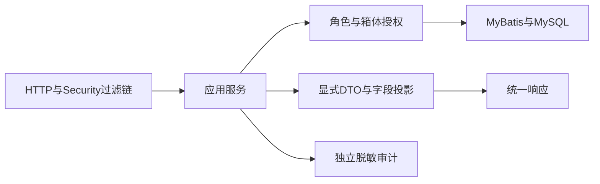
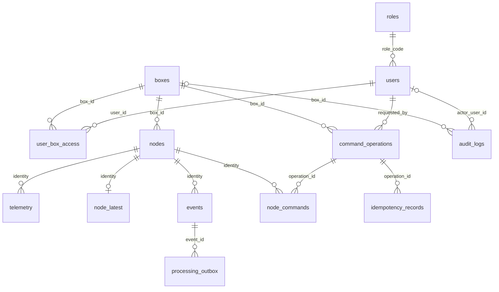

# TASK-003 后端与数据库骨架

| 属性 | 内容 |
|---|---|
| 阶段 | P1 |
| 负责人 | 用户（独立开发与验收） |
| 状态 | 待开始 |
| 依赖 | TASK-001 |
| MOD | [MOD-03](../../requirements/modules/MOD-03-设备接入与控制.md)、[MOD-05](../../requirements/modules/MOD-05-物流箱管理与状态聚合.md)、[MOD-06](../../requirements/modules/MOD-06-用户与权限管理.md) |
| 需求 | [REQ-M03-001](../../requirements/modules/MOD-03-设备接入与控制.md#req-m03-001)、[REQ-M03-006](../../requirements/modules/MOD-03-设备接入与控制.md#req-m03-006)、[REQ-M05-001](../../requirements/modules/MOD-05-物流箱管理与状态聚合.md#req-m05-001)、[REQ-M06-001](../../requirements/modules/MOD-06-用户与权限管理.md#req-m06-001)、[REQ-M06-002](../../requirements/modules/MOD-06-用户与权限管理.md#req-m06-002)、[REQ-M06-003](../../requirements/modules/MOD-06-用户与权限管理.md#req-m06-003)、[REQ-M06-004](../../requirements/modules/MOD-06-用户与权限管理.md#req-m06-004)、[REQ-M06-005](../../requirements/modules/MOD-06-用户与权限管理.md#req-m06-005)、[NFR-003](../../requirements/quality/安全与可维护性.md) |

## 1. 目标、范围与输入

本任务建立能在Windows本机运行的后端与真实MySQL基础：可编译的单Maven应用、配置隔离、迁移、受控初始化、登录、当前身份、节点基础查询，以及可复用的授权和字段投影策略。详细设计集中维护于本文；[后端总体设计](../../design/backend/后端模块与数据模型.md)和[后端入口](../../../backend/README.md)只维护总体职责及导航。

**本轮仅完善设计文档。** 未创建pom、Java源码、SQL或占位文件，未登录数据库、建库、创建账号或启动服务。TASK-003仍为待开始，后面的文件、接口、表结构、命令和测试均为后续开发设计，不是实际执行结果。用户独立开发及验收，Codex本轮只执行已授权文档整理，不代填签字。

前置输入：

| 输入 | 使用方式 |
|---|---|
| [TASK-001](TASK-001-冻结接口与工具版本.md)、[版本矩阵](../environment/工具与依赖版本矩阵.md) | 沿用精确版本，不重新选型或升级系统 |
| [REST/WS契约](../../../contracts/http/v1.md)、[OpenAPI](../../../contracts/http/openapi.yaml)、[公共定义](../../../contracts/common/v1.schema.json) | 字段、错误、认证、时间和角色投影的规范来源 |
| [MQTT契约](../../../contracts/mqtt/v1.md) | 身份、事件键、uint32/uint64、业务确认和命令语义 |
| [角色权限](../../requirements/product/角色与权限.md)、本任务属性中的需求 | 授权与字段裁剪，不新增管理功能 |
| [当前进度](../../management/当前进度.md)、[追踪矩阵](../../management/需求追踪矩阵.md)、[ITER-001](../iterations/ITER-001-三端骨架与通信闭环.md) | 保持现有范围、依赖、阶段与未决问题 |

后续采用完整P1基础表方案：本任务建立13张表，TASK-005再实现遥测写入、事件与outbox事务、提交后确认、聚合查询、命令和WS。表存在不表示业务已实现；本任务不依赖Broker、真实节点或开发板。不开发自助注册、用户管理后台、重新绑定、告警人工工单或运输生命周期。

## 2. 需求贡献与后续边界

| 关联需求 | 本任务贡献 | 后续仍需实现/验证 |
|---|---|---|
| REQ-M03-001 | 固定箱体/节点登记、归属及能力约束，查询不暴露凭据 | TASK-004/005的Broker身份、Topic及载荷交叉校验 |
| REQ-M03-006 | 命令、逐节点结果及幂等表；授权策略与事务边界 | TASK-005的幂等执行、下发、回执、超时聚合 |
| REQ-M05-001 | 箱体、节点、必需节点标识和受控初始化 | TASK-005/007的真实接入与整体运行状态 |
| REQ-M06-001 | 密码散列、30分钟JWT、登录与当前身份 | TASK-005的WS票据和连接有效性 |
| REQ-M06-002 | 角色与箱体范围共同授权，真实HTTP跨箱体拒绝 | 后续所有业务出口复用并回归 |
| REQ-M06-003 | 字段白名单与投影单元测试，节点诊断角色过滤 | TASK-005/006的真实聚合/事件/网页视图 |
| REQ-M06-004 | 布撤防及其他控制能力判断服务 | TASK-005/007的获准请求与实际执行闭环 |
| REQ-M06-005 | 统一授权/投影接口，REST应用与复用边界 | TASK-005的REST/WS一致运行验证 |
| NFR-003 | 版本、配置、数据库隔离、迁移、安全错误及脱敏审计基础 | 后续接入、导出、资源与部署安全验证 |

以上仅说明原关联集合中的贡献，不增加需求或调整TASK-004～006的业务范围和依赖。

| 接口/能力 | TASK-003实际开发目标 | 后续任务 |
|---|---|---|
| GET /actuator/health | 管理端点，仅最小状态，关闭详细信息和其他Actuator公开端点 | 后续监控；不加入业务OpenAPI |
| POST /api/v1/auth/login | 真MySQL账号认证、30分钟JWT、统一失败 | TASK-006网页登录 |
| GET /api/v1/me | username、role、授权box_ids，按既有响应信封 | 后续页面消费 |
| GET /api/v1/boxes/{id}/nodes | 先授权后查询的基础节点列表，使用既有Node对象 | TASK-005填入实际接入状态 |
| 箱体列表、latest、events、track | 数据结构及授权/投影设计，不注册虚假成功接口 | TASK-005真实查询与聚合 |
| commands及操作结果 | 建表与内部授权能力，不执行命令 | TASK-005持久化、发布、回执及幂等 |
| WS票据/连接/订阅 | 共享授权接口及行为约束，无票据或WS实现 | TASK-005运行验证 |
| MQTT、event_ack、outbox处理 | 表、约束和事务设计，无接入或派生工作器 | TASK-004/005 |

尚无接入记录的节点映射为online=false、boot_id=null、last_received_at=null，表示没有有效连接记录，不是已进行板端离线测量。不能用服务启动时间填写心跳或伪造boot_id。授权箱体内无节点返回空列表。完整在线判定仍由MOD-03后续接入实现，不另建第二套心跳规则。

未实现路由不创建返回成功的占位Controller；明确列为未交付。所有受保护请求仍经过认证，不因没有Controller放开权限。DB故障不是“密码错误”，返回脱敏503，不回200或空数据。

## 3. 工程与调用设计

默认Windows回环监听127.0.0.1:8080，使用现有MySQL 8.0；Ubuntu只承担既有固件编译。单Maven应用，不引入微服务、Redis、外部身份服务器或新的系统运行时。

沿用版本矩阵：Java21、Spring Boot 3.5.16、Spring Security 6.5.11（Boot管理）、MyBatis Starter 3.0.5、MyBatis 3.5.19、MyBatis-Spring 3.0.5、Flyway core/mysql 11.7.2、Connector/J 9.7.0。实际开发时输出dependency:tree确认解析结果；解析不一致先报告，不能静默使用其他版本。新增测试/构建依赖也须按既有BOM或明确版本固定。

计划结构如下，本轮不创建这些目录或文件：

```text
backend/
├─ pom.xml
├─ src/main/java/cn/smartbox/
│  ├─ SmartBoxApplication.java
│  ├─ common/          # ApiResponse、ApiError、异常、request_id、Clock
│  ├─ config/          # 配置绑定、Security、MyBatis、数据源
│  ├─ auth/            # 登录、密码验证、JWT、当前身份
│  ├─ authorization/   # 箱体范围、操作权限、字段白名单
│  ├─ box/             # 箱体与授权范围
│  ├─ node/            # 归属、角色、能力及基础查询
│  └─ audit/           # 登录失败、拒绝访问等审计
├─ src/main/resources/
│  ├─ application.yml
│  ├─ mapper/          # 按模块命名的MyBatis XML
│  └─ db/migration/    # Flyway版本化结构迁移
└─ src/test/
```

以后telemetry、event、command、ingestion按职责加入同一Java根包；不为未实现业务创建空类。每个当前模块按需要设置controller、service、model、persistence，避免为单个类机械建四层目录。



公开路由仅登录和不含详细信息的最小健康检查；其余路由要求认证，未实现路由在认证后按框架404处理，未认证先401。Security负责身份与粗粒度路由，应用服务负责对象范围和动作授权。Controller不调Mapper；Mapper不自行推断当前角色；实体、密码散列和原始payload不能直接序列化。模块间通过服务接口，不跨模块直接拼接其他模块Mapper。

| 内部接口/类型（计划） | 责任及返回 | 约束 |
|---|---|---|
| CurrentUserProvider / CurrentUser | user_id、username、当前role；认证无效返回401 | 服务端加载身份，不信任客户端role/box_ids |
| BoxAccessService.requireAccess(user, boxId) | 校验箱体授权，拒绝403 | 先校验作用域再解释资源404 |
| PermissionPolicy.require(user, action) | READ_BUSINESS、READ_DIAGNOSTICS、SENTRY_CONTROL、CONFIGURE、EXPORT的允许/拒绝 | 动作枚举为内部策略，不增HTTP字段 |
| RoleProjectionService | 由显式业务输入构造允许角色DTO | 白名单；不在Map中删除几个字段后整体透传 |
| LoginService / TokenService | 验证受控账号，签发/校验既有Login对象 | 不注册、刷新或管理账号 |
| AuditService.record | 操作者/范围/结果/request_id及时间 | 不存密码、JWT、密钥、原始SQL和请求体 |
| Clock | 可注入UTC Clock，用于exp、接收与审计时间 | 不将服务器时间伪装设备发生时间 |

## 4. HTTP、认证与授权细节

成功和错误信封、分页、字段、枚举继续以根contracts为准，不复制另一套Schema。request_id在请求入口生成UUID字符串，进入MDC及响应；不直接信任任意客户端字符串作为日志内容。Security的401/403与应用异常使用相同错误信封，不依赖ControllerAdvice捕获过滤链异常。

| 状态 | 使用场景 | 处理 |
|---|---|---|
| 400 | 请求缺字段、类型/长度非法、路径ID不合格式 | 脱敏VALIDATION_ERROR，不打印密码或原始请求体 |
| 401 | 未登录、无效/过期JWT、账号不存在/禁用/密码错误 | INVALID_CREDENTIALS或UNAUTHORIZED；凭据失败文案统一 |
| 403 | 无箱体范围或角色能力不足 | FORBIDDEN，拒绝且不读取业务内容 |
| 404 | 已获准范围内资源不存在 | NOT_FOUND；不向未授权者泄露存在性 |
| 409 | 初始化冲突或既有唯一约束业务冲突 | CONFLICT；不覆盖既有内容 |
| 503 | 数据库不可用或其他依赖故障 | SERVICE_UNAVAILABLE，无SQL/连接串/堆栈 |

本节错误code是实现内部技术命名，结构沿既有Error；实际开发不得改变既有契约已有的专用业务码。节点列表只有箱体路径，没有单节点404；当前FK限制下，“授权存在但箱体缺失”不是正常可构造的DB状态，授权先于404的控制流用服务替身另测，不为测试破坏外键。

### 4.1 密码与令牌

使用spring-boot-starter-security及oauth2-resource-server/JOSE支持，复用JwtEncoder、NimbusJwtEncoder和NimbusJwtDecoder，不手写签名解析过滤器，不设置远程issuer发现或新身份服务器。依据：[Spring Security 6.5 JWT](https://docs.spring.io/spring-security/reference/6.5/servlet/oauth2/resource-server/jwt.html)。

- 本地HS256，Base64密钥解码后至少32随机字节，无默认值；显式固定校验HS256，拒绝none及其他算法。密钥不与JWT同存于日志。
- iss固定smartbox，aud固定smartbox-web，sub为稳定user_id字符串，iat/exp为UTC秒；exp=iat+1800秒，响应expires_at精确转换为毫秒。sub、iss、aud、iat、exp必须存在且类型合法，缺失到期字段不视为永久有效；到exp即拒绝，不额外沿用框架默认宽限时间延长会话；使用可注入Clock测试边界。
- JWT只证明签名身份。每次请求按sub读取账号、有效状态和当前角色，按数据库读取箱体授权；不把客户端提交的role或box_ids作为授权来源。DB不可用返回503，不降级为允许。
- 账号采用一个现行业务角色。禁用/角色/授权的数据修改只允许受控维护，不提供管理API，不据此定义用户交接业务。
- PBKDF2使用DelegatingPasswordEncoder，唯一写入标识pbkdf2@SpringSecurity_v5_8，对应Pbkdf2PasswordEncoder.defaultsForSpringSecurity_v5_8()；随机盐随散列保存，不启用noop或明文回退。使用固定版本的明确工厂而非不固定的最新默认。依据：[6.5密码存储](https://docs.spring.io/spring-security/reference/6.5/features/authentication/password-storage.html)。
- username/password长度遵循LoginInput的1～128/1～256个Unicode码点；补充平面字符也按码点计数，不能用Java String.length或默认UTF-16长度校验缩短契约允许范围；不截断、不trim密码，不自行缩小为bcrypt字节上限。用户名不自动改大小写；按区分大小写唯一键匹配。未知账号使用同类虚拟散列比对后统一失败，不泄露账号是否存在。
- 无登录Cookie、无HTTP Session、无refresh/logout/register新接口；Cookie认证关闭，CSRF配置仅适用于此纯Bearer模式，未来若引入Cookie需重新设计。JSON和Authorization头中的密码/令牌均不得记录。

### 4.2 角色、字段与范围

所有允许均要求箱体范围通过，权限表以[既有规范](../../requirements/product/角色与权限.md)为准：

| 角色 | 业务读取 | 节点诊断/原始证据 | 布撤防 | 画像/校准/GPS/输出 | 导出 |
|---|---|---|---|---|---|
| LOGISTICS_VIEWER | 允许 | 允许，无凭据 | 拒绝 | 拒绝 | 拒绝 |
| LOGISTICS_OPERATOR | 允许 | 允许，无凭据 | 允许 | 允许 | 允许 |
| DELIVERY_USER | 允许裁剪视图 | 拒绝 | 拒绝 | 拒绝 | 拒绝 |
| COURIER | 允许 | 允许，无凭据 | 允许 | 拒绝 | 拒绝 |

外卖用户完全省略pose、evidence、raw_events、node_diagnostics、sentry及哨兵操作明细，保留MOCK位置标记，仅看融合结论与相关告警。当前节点接口对DELIVERY_USER返回403。完整Snapshot/DeliverySnapshot及事件/WS投影仍由contracts定义，本任务用含敏感字段的输入做策略单元测试，不声称业务出口已上线。

CORS默认只允许http://localhost:5173、http://127.0.0.1:5173，允许实际需要的Authorization、Content-Type、Idempotency-Key请求头，不启用allowCredentials，不用通配Origin；合法CORS预检由CORS过滤器处理，实际业务请求仍须认证，本任务只实现当前三个业务操作。WS未来复用配置来源但单独校验Origin/票据，不能把CORS当成WS鉴权。

### 4.3 审计与故障

登录失败、权限拒绝使用独立短事务写audit_logs，避免随主请求失败回滚。无合法账号的actor_user_id为空，只保留受长度限制的attempted_username和结果；不存提交密码或整个请求。数据库本身不可用时保留不含秘密的request_id/action/result脱敏日志，记录DB审计未保存，不能伪称数据库审计成功。控制与导出审计入口留TASK-005，不新增业务权限。

## 5. 数据库统一约定与ER关系

目标smartbox_dev与smartbox_test，MySQL 8.0/InnoDB/utf8mb4。业务表共13张，flyway_schema_history由Flyway管理，另计不冒充业务表。以下是拟实现字段字典，本轮不创建SQL。

**字典缩写：** NN=NOT NULL；NULL=可空，未写默认时默认为“无DDL默认，写入者显式赋值”；PK=主键；UK=唯一键。所有FK采用ON DELETE/UPDATE RESTRICT，不级联清除历史。自增PK采用BIGINT正数且不使用UNSIGNED，映射Java Long；有限uint32采用BIGINT并CHECK范围，映射Long。

| 类型约定 | 物理/Java映射与规则 |
|---|---|
| ID48 | VARCHAR(48) CHARACTER SET ascii COLLATE ascii_bin；1～48字节且仅字母数字_-；与契约一致 |
| REF64 | VARCHAR(64) CHARACTER SET utf8mb4 COLLATE utf8mb4_0900_bin；长度与已有契约校验。MQTT request_id还按UTF-8字节≤64校验 |
| ROLE | roles.role_code为VARCHAR(32) ascii_bin，固定四角色；节点role单独为ENV/POSE |
| UTC_MS | BIGINT / Long，非负UTC epoch毫秒；设备时间NULL表示UNSYNCED，不能填接收时间代替 |
| U32 | BIGINT / Long，0～4294967295；event_seq/property_seq须1～4294967295 |
| U64 | DECIMAL(20,0) / BigInteger，0～18446744073709551615，MyBatis TypeHandler准确往返，不经double或long |
| JSON | MySQL JSON / 明确DTO或JsonNode，按Schema验证再写入，不直接透传响应；禁止NaN/Infinity |
| HASH | BINARY(32) / byte[]，SHA256；保存业务内容摘要，不存秘密摘要作为密码散列替代 |
| 记录时间 | created_at、updated_at等UTC_MS均由Clock显式赋值，不用0、CURRENT_TIMESTAMP或字符串混充毫秒 |

设备time字段组：device_ts（UTC_MS NULL）、ts_src（VARCHAR(16) NN，无默认，SNTP/UNSYNCED）、uptime_ms（U64 NN，无默认）、time_uncertainty_ms（非负BIGINT NULL）。SNTP要求device_ts和不确定度均非空，UNSYNCED要求均为空。received_at为服务器接收UTC_MS NN。CHECK与应用校验共同覆盖；JSON内部需要跨字段比较的规则不能仅靠列类型证明。设备原始值不因估时/补传重写。



nodes增加UK(node_id,box_id)，遥测、最新、事件和节点命令使用复合FK(node_id,box_id)，避免“节点存在但归错箱”写入。command_operations增加UK(operation_id,box_id)，node_commands和idempotency_records引用对应复合键。节点更换/归属迁移不在本期自动进行，不能通过更新FK绕过Q-03。

## 6. 十三张基础表字段字典

### 6.1 roles、users、user_box_access

用途：固定角色、受控账号和箱体范围，TASK-003初始化与认证写入，不建立管理API。

| 表 | 字段与类型/空值/默认 | 键与索引 |
|---|---|---|
| roles | role_code VARCHAR(32) ascii_bin NN；display_name VARCHAR(64) NN | PK(role_code)；迁移只写四种固定角色 |
| users | id BIGINT NN AUTO_INCREMENT；username VARCHAR(128) utf8mb4_0900_bin NN；password_hash VARCHAR(255) ascii_bin NN；role_code同roles NN；enabled BOOLEAN NN DEFAULT TRUE；created_at、updated_at UTC_MS NN | PK(id)；UK(username)；FK(role_code)→roles；IX(role_code) |
| user_box_access | user_id BIGINT NN；box_id ID48 NN；created_at UTC_MS NN | PK(user_id,box_id)；FK→users/boxes；IX(box_id,user_id)支持反向连接 |

username长度按字符，使用MySQL 8的utf8mb4_0900_bin精确比较，原样处理，不自动trim、大小写折叠；测试覆盖尾随空格，禁止改用PAD SPACE排序规则令不同输入隐式等价。依据：[MySQL 8.0 Unicode排序规则](https://dev.mysql.com/doc/refman/8.0/en/charset-unicode-sets.html)。enabled是受控账号有效性，不建立运输/交接生命周期。散列只进入认证持久层；禁止数据库实体直接返回。

### 6.2 boxes、nodes

用途：预配置固定归属。TASK-003写基础配置；TASK-005才更新接入状态。必需节点真值只存nodes.required，不再在boxes JSON中复制另一份名单。

| 表 | 字段与类型/空值/默认 | 键与索引 |
|---|---|---|
| boxes | box_id ID48 NN；display_name VARCHAR(128) NN；profile_config JSON NULL DEFAULT NULL；sentry_revision U64 NN DEFAULT 0；created_at、updated_at UTC_MS NN | PK(box_id)；profile_config为空表示未设置，不冒称已下发或已生效 |
| nodes | node_id ID48 NN；box_id ID48 NN；role VARCHAR(8) ascii_bin NN；caps SMALLINT NN；required BOOLEAN NN DEFAULT TRUE；current_boot_id U32 NULL DEFAULT NULL；last_received_at UTC_MS NULL DEFAULT NULL；created_at、updated_at UTC_MS NN | PK(node_id)；UK(node_id,box_id)；UK(box_id,role)限定本期同箱各一ENV/POSE；FK(box_id)→boxes；IX(box_id,required) |

CHECK(role=ENV且caps=71，或role=POSE且caps=120)。不保存明文MQTT凭据；Broker独立ACL及凭据由TASK-004管理。没有节点接入记录不能推导设备正常或已校时。sentry_revision保存后端最后分配的布撤防修订号，后续事务内分配，不代表实际ARMED；达到物理计数容量时停止分配并报告，禁止回绕，此为存储容量而非新增业务阈值。profile_config保存已确认结构的配置内容，不规定Q-09生效时点；未来若需期望/实际拆分，按后续技术决定追加迁移，不把本列当成已生效证明。

### 6.3 telemetry、node_latest

用途：历史遥测与最新快照分离。TASK-003只迁移及验证列边界；TASK-005接入后才写业务数据。

| 表 | 字段与类型/空值/默认 | 键与索引 |
|---|---|---|
| telemetry | id BIGINT NN AUTO_INCREMENT；box_id、node_id ID48 NN；boot_id U32 NN；property_seq U32 NN（≥1）；完整设备time字段组；received_at UTC_MS NN；payload JSON NN；created_at UTC_MS NN | PK(id)；UK(node_id,boot_id,property_seq)；复合FK→nodes；IX(box_id,received_at,id)；IX(node_id,received_at,id) |
| node_latest | node_id ID48 NN；box_id ID48 NN；boot_id U32 NN；property_seq U32 NN（≥1）；完整设备time字段组；received_at、updated_at UTC_MS NN；payload JSON NN | PK(node_id)；复合FK→nodes；IX(box_id,node_id) |

payload按冻结property Schema保存有效值、单位、来源与无效标记；不能用0替代未知。node_latest无默认种子行，无遥测就是无行，不能预填正常值。后续同代次序号比较与时间质量更新在TASK-005处理，补传历史不覆盖实时；31天是查询窗口上限，不是保留期限。UK只提供去重约束，不代替“同键同内容/异内容”的业务判别；不默默覆盖。

### 6.4 events、processing_outbox

用途：可靠保存原始事件及可恢复派生任务。TASK-003只建立基础表及事务能力验证；TASK-005实现真实接入事务、去重冲突、提交后精确确认和工作器。

| 表 | 字段与类型/空值/默认 | 键与索引 |
|---|---|---|
| events | id BIGINT NN AUTO_INCREMENT；box_id、node_id ID48 NN；boot_id U32 NN；event_seq U32 NN（≥1）；完整设备time字段组；received_at、created_at UTC_MS NN；type VARCHAR(32) ascii_bin NN；src TEXT NN；level VARCHAR(16) ascii_bin NN；replayed BOOLEAN NN（显式）；data JSON NN；raw_event JSON NN；content_hash HASH NN | PK(id)；UK(node_id,boot_id,event_seq)；UK(id,box_id)；复合FK→nodes；IX(box_id,received_at,id)；IX(box_id,device_ts,id)；IX(box_id,type,level,received_at,id) |
| processing_outbox | id BIGINT NN AUTO_INCREMENT；event_id BIGINT NN；task_type VARCHAR(32) ascii_bin NN；status VARCHAR(16) ascii_bin NN DEFAULT 'PENDING'；attempts INT NN DEFAULT 0；next_attempt_at UTC_MS NN；locked_until UTC_MS NULL DEFAULT NULL；lock_owner REF64 NULL DEFAULT NULL；last_error_code VARCHAR(64) ascii_bin NULL DEFAULT NULL；created_at、updated_at UTC_MS NN | PK(id)；UK(event_id,task_type)；FK(event_id)→events；IX(status,next_attempt_at,id)；IX(status,locked_until,id) |

事件类型/级别沿Schema；src使用TEXT以容纳既有报文容量内的合法来源，不擅加128字符业务上限；实际接入先按Schema与报文容量验证，禁止截断。raw_event保留设备原始字段，data便于业务读取；received_at不参与设备原始内容摘要。补传时replayed可能变化，后续摘要比较须将传输属性与原始业务内容分开，TASK-003不实现算法或凭此拒绝合法补传。摘要规范与同键冲突行为需在TASK-005编码前对照契约写清，不把简单字符串JSON散列当成业务等价。

outbox状态是内部工作调度PENDING/PROCESSING/RETRY/DONE，不是告警业务状态；attempts非负。事件与首个派生任务同事务，不在事务里发送MQTT。租约、退避和派生幂等的实际执行留TASK-005；本任务不填写无依据的业务重试时限。门结论、证据关联、完整告警表由后续迁移添加，不以outbox状态代替人工处理。

### 6.5 command_operations、node_commands、idempotency_records

用途：用户操作、逐节点请求和HTTP幂等分离。TASK-003只建表/策略及约束测试；TASK-005实现动作、事务和回执。

| 表 | 字段与类型/空值/默认 | 键与索引 |
|---|---|---|
| command_operations | operation_id REF64 NN；box_id ID48 NN；requested_by BIGINT NN；cmd VARCHAR(16) ascii_bin NN；params JSON NN；status VARCHAR(16) ascii_bin NN DEFAULT 'PENDING'；created_at、updated_at UTC_MS NN | PK(operation_id)；UK(operation_id,box_id)；FK(box_id)→boxes、FK(requested_by)→users；IX(box_id,created_at,operation_id)；IX(status,updated_at,operation_id) |
| node_commands | request_id REF64 NN；operation_id REF64 NN；box_id、node_id ID48 NN；target_caps SMALLINT NN；issued_at、expires_at UTC_MS NN；status VARCHAR(16) ascii_bin NN DEFAULT 'PENDING'；ack_boot_id U32 NULL DEFAULT NULL；ack_received_at UTC_MS NULL DEFAULT NULL；ack_ts UTC_MS NULL DEFAULT NULL；ack_ts_src VARCHAR(16) NULL DEFAULT NULL；ack_uptime_ms U64 NULL DEFAULT NULL；ack_time_uncertainty_ms非负BIGINT NULL DEFAULT NULL；result VARCHAR(16) ascii_bin NULL DEFAULT NULL；code VARCHAR(64) ascii_bin NULL DEFAULT NULL；actual_state JSON NULL DEFAULT NULL；created_at、updated_at UTC_MS NN | PK(request_id)；UK(operation_id,node_id)；复合FK→command_operations、nodes；IX(status,expires_at,request_id)；IX(node_id,created_at,request_id) |
| idempotency_records | user_id BIGINT NN；box_id ID48 NN；idempotency_key VARBINARY(64) NN；request_hash HASH NN；operation_id REF64 NN；created_at、expires_at UTC_MS NN | PK(user_id,box_id,idempotency_key)；FK(user_id)→users；复合FK(operation_id,box_id)→command_operations；IX(expires_at,user_id) |

cmd与operation/node status沿既有Command/Operation枚举，不增加人工关闭或自动回滚状态；命令issued_at<expires_at、target_caps为1～127且需完整满足目标能力。初始命令15秒、布防10秒等行为保持原契约，列本身不解决Q-02。未回执时整组ack列均空；收到回执后boot/time/result/code按完整CommandAck验证，UNSYNCED的ack_ts/不确定度仍为空。

HTTP Idempotency-Key按原始UTF-8字节保存，长度1～64，不trim/改大小写；不使用不区分大小写VARCHAR唯一键。expires_at至少created_at+24小时，不能把节点15秒命令有效期当成幂等保留期；请求摘要、并发重试复用及过期后重用流程由TASK-005实现。task3只验证唯一范围和外键，不声称命令已幂等执行。操作实际状态必须来自节点回执，不能由默认PENDING列或HTTP202伪造成功。

### 6.6 audit_logs

用途：安全操作可追踪，与设备原始事件分离。TASK-003写登录失败和访问拒绝，TASK-005接控制/导出审计。

| 字段与类型/空值/默认 | 键与索引 |
|---|---|
| id BIGINT NN AUTO_INCREMENT；actor_user_id BIGINT NULL DEFAULT NULL；attempted_username VARCHAR(128) NULL DEFAULT NULL；box_id ID48 NULL DEFAULT NULL；target_box_id VARCHAR(128) NULL DEFAULT NULL；action VARCHAR(32) ascii_bin NN；result VARCHAR(32) ascii_bin NN；request_id REF64 NN；occurred_at UTC_MS NN；details JSON NULL DEFAULT NULL | PK(id)；FK(actor_user_id)→users；FK(box_id)→boxes；IX(occurred_at,id)；IX(actor_user_id,occurred_at,id)；IX(request_id) |

box_id只引用真实已识别箱体；未授权/未知目标不为记录审计而查其业务数据，使用target_box_id记录已校验且有上限的请求目标。请求目标长度超出时只记错误类型，不截取秘密或塞入不符合ID48的FK。details为白名单诊断信息，不放整个请求、JWT、密码、设备密钥或SQL。用户/箱体历史不通过级联删除抹除；匿名失败允许actor为空。

## 7. 迁移、账号、初始化与配置

### 7.1 库与账号

开发库smartbox_dev；集成库smartbox_test。运行账号分别smartbox_app与smartbox_test_app，迁移账号smartbox_migrator与smartbox_test_migrator；限定localhost和对应项目库，不使用root作为应用数据源。迁移所需DDL/DML仅授权项目库，运行账号仅SELECT/INSERT/UPDATE/DELETE，无CREATE/DROP/ALTER/GRANT。管理员凭据与授权可用性在S1实际核对，本轮不读取或要求用户提供。

Flyway使用独立migration URL/user/password，业务DataSource使用运行账号；集成库使用独立两套配置。连接库名、实际CURRENT_USER和权限在执行时核对，不仅凭配置文件名判定。连接失败不自动尝试其他项目账号或库。字符集/时区配置统一，URL不内嵌密码。

计划迁移划分：V1身份/箱体/节点与四角色；V2遥测/最新/事件/outbox；V3命令/幂等/审计。迁移必须按FK依赖创建，结构迁移没有开发密码/演示账号。已应用脚本不可修改，后续变化新增版本；启动启用validate，cleanDisabled=true，不自动baseline或repair，不以create-drop替代Flyway。

MySQL DDL可能部分提交；失败保留history和实际结构，先定位，不盲目重跑、repair或删表。已有项目库先核对迁移历史，禁止拿空库脚本覆盖。缺迁移账号时不能假装首次迁移成功。

测试清理只允许显式test profile、库名精确smartbox_test、对应test账号和一次性清理开关同时匹配；使用schema内业务数据的受控清理，不自动DROP DATABASE或Flyway clean。开发库绝不作为测试清理目标，不仅依据名称包含test。独立测试库也需先确认无其他项目使用。

### 7.2 受控初始化

设计独立非Web命令模式bootstrap，必须显式启用dev/test profile与本机初始化输入；普通服务启动不创建账号或重置密码。四种角色由迁移建立，账号、明文输入密码、箱体及授权来自本地忽略JSON/交互配置；源文件及凭据不提交，不通过会打印的命令行参数传密码。

默认演示BOX-0001，两个必需节点BOX-0001-ENV/71、BOX-0001-POSE/120。测试另使用BOX-0002及同规则双节点；四种角色各准备两名测试账号，分别只授权BOX-0001或BOX-0002，使每种角色都能验证同角色跨箱体隔离；不在仓库固定任何密码。

单次初始化事务中先校验输入、匹配现有记录、再补建缺项并编码密码。已有账号密码用matches验证，不比较随机盐散列字符串；相同输入无改动，密码/角色/归属/授权集合冲突即整体回滚并报告，不重置、不增删覆盖。不能因同用户名存在就跳过其不一致角色。已有未确认归属更换不靠初始化脚本实现。

### 7.3 本地配置表

以下为未来实现的应用配置输入，不是当前已存在文件。application.yml只放非秘密默认与变量引用，真实值放已忽略的application-local.yml或环境变量。初始化输入放secrets/内，清理开关不放持久默认。

| 配置变量 | 用途/默认 | 缺失或非法处理 |
|---|---|---|
| SPRING_PROFILES_ACTIVE | 显式dev或test | 无明确环境不执行初始化或测试清理 |
| SERVER_ADDRESS / SERVER_PORT | 127.0.0.1 / 8080 | 本期不自行开放LAN |
| SMARTBOX_DB_URL/USER/PASSWORD | 业务连接，开发库smartbox_dev | 无密码默认，启动失败，不打印密码 |
| SMARTBOX_MIGRATION_URL/USER/PASSWORD | Flyway连接同一目标库的迁移账号 | 库不一致或缺失时拒绝迁移 |
| SMARTBOX_JWT_SECRET_BASE64 | ≥32随机字节Base64 | 不合格时启动失败，不生成临时密钥掩盖配置缺失 |
| SMARTBOX_ALLOWED_ORIGINS | localhost/127.0.0.1的5173默认白名单 | 通配或非法来源配置拒绝 |
| SMARTBOX_BOOTSTRAP_FILE | 显式非Web初始化输入，本地忽略路径 | 缺失/不一致拒绝，不采用弱口令种子 |
| SMARTBOX_TEST_DB_URL/USER/PASSWORD | smartbox_test运行连接 | 不允许回退到dev配置 |
| SMARTBOX_TEST_MIGRATION_URL/USER/PASSWORD | smartbox_test迁移连接 | 必须同测试库且账号分离 |
| SMARTBOX_TEST_ALLOW_RESET | 临时显式true，默认false | 其他库/profile/账号不符仍拒绝 |

环境变量映射由config中的配置绑定实现，不能以为任意自定义变量会被Spring自动识别。示例只写REPLACE_WITH_LOCAL_VALUE等明显占位，不提供可通用登录的开发密码。TLS、生产密钥托管及外网部署不在本任务宣称通过。

## 8. S1～S7具体执行计划

所有步骤负责人为用户；未来Codex实际执行时另记录执行者。每一步满足完成条件才登记完成日期，不预填。

| 步骤 | 输入 | 动作 | 产出与完成条件 | 失败处理 |
|---|---|---|---|---|
| S1 环境与权限核对 | TASK-001版本/契约、环境清单、本地连接配置 | 只读核对Java/Maven、8080/DB端口、MySQL版本与管理员/项目权限、现有同名库 | 路径/工具/权限与初始化范围明确，凭据只在本地 | 缺凭据或权限登记阻塞，不猜密码、不试其他项目账号、不覆盖同名库 |
| S2 Maven与应用骨架 | S1、工程/配置设计 | 建pom及当前模块，统一响应/异常/request_id、配置绑定、最小健康检查 | 编译通过；无秘密默认；非法配置明确失败；健康不泄详情 | 依赖解析与既定版本不符时先定位，不静默升降级 |
| S3 表结构与迁移 | 第5/6节字典与ER图 | 编写V1～V3，配置双数据源角色、CHECK/FK/UK/索引与TypeHandler | 真MySQL空库迁移成功、重复启动不改数据；列范围/时间/唯一性可验证 | DDL失败检查部分提交与history；不自动clean/repair或改已应用脚本 |
| S4 初始化与访问 | 已迁移库、MyBatis、本地初始化输入 | Mapper、受控账号、箱体节点、授权；显式非Web初始化 | 相同输入可重跑不覆盖，冲突整事务回滚，密码仅散列，节点/能力正确 | 保留脱敏冲突，不借此完成换绑/移交 |
| S5 认证与授权 | S4账号及合同结构 | 登录/JWT/me/nodes，角色与箱体策略、投影、脱敏审计 | 成功/失败、到期/篡改、跨箱体/角色拒绝；节点DTO契约一致 | DB故障503、凭据错误401，不返回假数据或泄露SQL |
| S6 自动及真实集成 | 测试库、四角色双箱体、现有Schema | 单元+HTTP+MySQL集成；迁移重跑、边界、错误与日志检查 | mvn verify及实际运行证据可复现；真实响应符合冻结Schema | 缺MySQL可继续纯单元，任务保持待验证/阻塞，不能用H2冒充完成 |
| S7 记录与收尾 | 源码、构建/数据库/HTTP实际结果 | 记录版本、证据、迁移与限制，更新TASK/ITER/进度/追踪 | 依赖、数据结构与状态一致，可供TASK-004/005继续使用 | 未执行/失败逐项列出，不将整TC/REQ改通过，不创建虚假报告 |

未来构建命令形状为在backend执行mvn verify，运行JAR、bootstrap及验证所需的精确命令需随实际pom/main模式生成后补齐。当前没有pom，不能现在执行这些计划命令或声称命令已验证。操作次序与失败边界见[初始化与启动指南](../guides/后端数据库初始化与启动.md)。

## 9. 验收矩阵与完成口径

| 场景 | 测试方法/输入 | 通过标准及证据 |
|---|---|---|
| 编译与配置 | Maven解析树、缺少密钥/DB配置、错误profile | 版本一致；无默认秘密；错误配置拒绝；非数据库单元不要求启动完整数据源 |
| 迁移 | 真smartbox_test空库、重复启动、故意损坏的测试迁移 | 初次成功、重跑不重建；校验失败不自动修复；负例只在测试副本 |
| 数值与时间 | U32边界、U64最大值/超界、UNSYNCED/SNTP组合 | 精确往返；超界拒绝；原时间为空时不能填received_at |
| 约束 | 重复事件键/遥测键/请求键、同node异box、错误role/caps | UK/FK/CHECK拒绝，原数据不覆盖；不称业务去重/幂等已完成 |
| 幂等范围 | 相同key在同/异用户、同/异箱体 | 同范围唯一，其他范围独立；UTF-8字节边界正确；不实际发布命令 |
| 初始化 | 首次、重复、密码/角色/授权/节点冲突 | 相同输入无变更；冲突回滚不重置；无默认可用弱口令 |
| 登录 | 正确/错误/不存在/禁用账号，长度/Unicode密码 | 成功响应符合LoginResponse；失败统一；散列无明文，密码不截断 |
| JWT | 到期前/等于exp/之后、缺失必需claim、坏签名、none/异算法、错iss/aud | 只有合法未过期身份通过；不因框架默认宽限延长会话 |
| HTTP授权 | 四类角色、两个箱体；改路径、无token、跨范围 | 未认证401、无范围/能力403；节点诊断外卖403，不泄另一箱体信息 |
| 授权先于404 | 应用服务替身模拟“授权已通过但资源缺失” | 先范围后资源；不能通过破坏FK制造正常DB中不可能的状态 |
| 字段投影 | 含证据/姿态/诊断/哨兵明细的测试输入 | 外卖DTO完全省略敏感字段，保留MOCK；只证明策略，不证明真实查询上线 |
| 审计和错误 | 登录失败、权限拒绝、DB断连、异常 | 正常DB下拒绝审计不随回滚丢；DB断连503及脱敏降级日志；无秘密/SQL/堆栈 |
| 生命周期 | 启动、正常停止、重复启动已有库 | 连接释放；数据/密码/授权不被启动重置；健康只显示最小状态 |

只用真实MySQL验证迁移、Mapper和HTTP集成，不以H2/SQLite替代。单元测试可用接口替身验证授权顺序、投影和Clock边界，报告必须分开写，不把替身结果登记为真实DB行为。健康端点的DB故障为最小DOWN/503，不泄露连接细节。

[TC-009](../../testing/cases/TC-009-角色与箱体权限.md)、[TC-012](../../testing/cases/TC-012-安全与工程一致性.md)只记录本任务实际覆盖部分；原WS/CSV/MQTT、业务命令和网页标准不被替换。完整WS票据、导出、事件确认与命令闭环仍待TASK-005/006，整份TC和REQ不自动通过。

## 10. 风险、待决、交付与实际记录

Q-01～Q-14保持未决：新鲜度/历史解释、控制迟到、初始化归属变更、围栏入口、人工告警处理、保留期限、画像生效和生命周期均不能通过建表擅自解决。字段能保存数据不代表流程已经确认。当前13表只为已确认P1能力提供基础，后续规则变化通过CR/技术决定及新增迁移同步。

后续开发风险与应对：项目库/迁移账号权限缺失先登记；版本解析失败先核对源与锁定版本；MySQL DDL部分提交先定位；不把真实DB不可用伪装为账号错误；审计泄漏通过白名单和日志检查验证；静态投影不代替各出口集成；JWT/数据库本地配置与初始化输入一律不入Git。

| 计划交付位置 | 内容 | 本轮状态 |
|---|---|---|
| backend/ | pom、当前模块、DTO/策略、迁移、Mapper及测试 | 未创建，仍只有README |
| secrets/或忽略local配置 | 本地DB/JWT/初始化输入 | 未创建或读取，不提交 |
| artifacts/backend/TASK-003/运行编号/ | 解析树、构建日志、迁移/HTTP脱敏证据 | 未执行，无产物 |
| docs/testing/reports/ | 未来实际报告，标题避免重复定义全局TASK编号 | 本轮不创建虚假执行报告 |
| 本任务及相关入口/指南 | 可直接实施的设计和验收 | 本轮已完善，仅文档 |

任务未来完成条件：编译、真实MySQL迁移/重复启动、受控初始化、三个业务接口、授权/投影、错误/审计及实际报告全部满足。无数据库条件或无真实结果时不得完成；不能依赖真实板卡作为本任务软件验收前提。

**本轮实际记录：设计与执行计划已完善，S1～S7均尚未执行；TASK-003保持待开始。** 未创建源码/SQL，未登录数据库、建库、创建账号、启动服务或修改SDK。后续开工第一步为S1环境与数据库权限核对；本轮文档检查与中文提交只证明设计整理完成，不表示后端或数据库开发完成。
