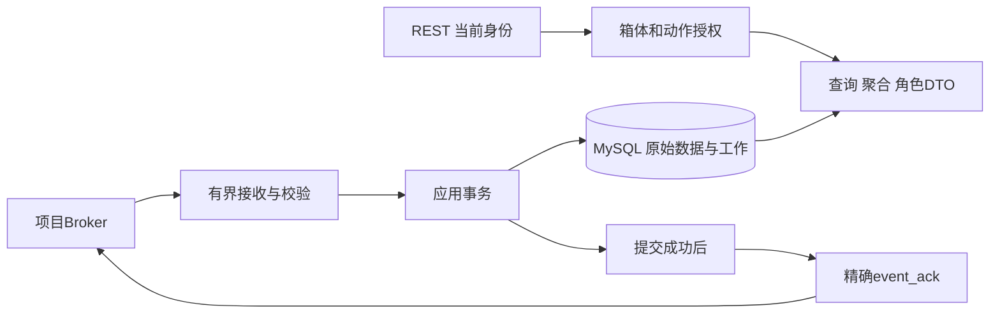

# TASK-005 接入存储与查询闭环

| 属性 | 内容 |
|---|---|
| 阶段 | P1 |
| 负责人 | 用户（独立开发与验收） |
| 状态 | 待开始 |
| 依赖 | TASK-003、TASK-004 |
| MOD | [MOD-03](../../requirements/modules/MOD-03-设备接入与控制.md)、[MOD-04](../../requirements/modules/MOD-04-事件管理与可靠性.md)、[MOD-05](../../requirements/modules/MOD-05-物流箱管理与状态聚合.md)、[MOD-06](../../requirements/modules/MOD-06-用户与权限管理.md) |
| 需求 | [REQ-M03-001](../../requirements/modules/MOD-03-设备接入与控制.md#req-m03-001)、[REQ-M03-002](../../requirements/modules/MOD-03-设备接入与控制.md#req-m03-002)、[REQ-M03-003](../../requirements/modules/MOD-03-设备接入与控制.md#req-m03-003)、[REQ-M03-004](../../requirements/modules/MOD-03-设备接入与控制.md#req-m03-004)、[REQ-M03-005](../../requirements/modules/MOD-03-设备接入与控制.md#req-m03-005)、[REQ-M03-006](../../requirements/modules/MOD-03-设备接入与控制.md#req-m03-006)、[REQ-M03-007](../../requirements/modules/MOD-03-设备接入与控制.md#req-m03-007)、[REQ-M03-008](../../requirements/modules/MOD-03-设备接入与控制.md#req-m03-008)、[REQ-M04-003](../../requirements/modules/MOD-04-事件管理与可靠性.md#req-m04-003)、[REQ-M04-004](../../requirements/modules/MOD-04-事件管理与可靠性.md#req-m04-004)、[REQ-M04-008](../../requirements/modules/MOD-04-事件管理与可靠性.md#req-m04-008)、[REQ-M05-001](../../requirements/modules/MOD-05-物流箱管理与状态聚合.md#req-m05-001)、[REQ-M05-002](../../requirements/modules/MOD-05-物流箱管理与状态聚合.md#req-m05-002)、[REQ-M05-003](../../requirements/modules/MOD-05-物流箱管理与状态聚合.md#req-m05-003)、[REQ-M05-004](../../requirements/modules/MOD-05-物流箱管理与状态聚合.md#req-m05-004)、[REQ-M05-005](../../requirements/modules/MOD-05-物流箱管理与状态聚合.md#req-m05-005)、[REQ-M06-001](../../requirements/modules/MOD-06-用户与权限管理.md#req-m06-001)、[REQ-M06-002](../../requirements/modules/MOD-06-用户与权限管理.md#req-m06-002)、[REQ-M06-003](../../requirements/modules/MOD-06-用户与权限管理.md#req-m06-003)、[REQ-M06-004](../../requirements/modules/MOD-06-用户与权限管理.md#req-m06-004)、[REQ-M06-005](../../requirements/modules/MOD-06-用户与权限管理.md#req-m06-005)、[REQ-M06-006](../../requirements/modules/MOD-06-用户与权限管理.md#req-m06-006)、[NFR-003](../../requirements/quality/安全与可维护性.md) |

## 1. 目标、当前事实与实施边界

本任务把TASK-004的真实Broker/双模拟节点与TASK-003的后端/MySQL/授权基础连接起来，形成可追溯的上报保存、授权查询、远程控制和实时通知闭环。详细设计集中维护在本文，[后端总体设计](../../design/backend/后端模块与数据模型.md)及[后端入口](../../../backend/README.md)只维护职责与导航。

**本轮仅完善文档，TASK-005保持待开始。** 不创建Java、SQL或空占位文件，不安装依赖，不启动Broker/服务/节点，不连接数据库或修改SDK。下文均为后续设计和执行计划，无真实TASK-005业务验收结果。用户独立负责开发及最终验收，Codex本轮仅执行已授权文档整理。

已知基础：TASK-003交付13业务表及V1～V4迁移、JWT/角色/箱体授权和health/login/me/nodes；TASK-004交付独立Broker、五账号、ENV/POSE进程、命令与测试确认。模拟确认不代表MySQL保存；事件队列仍为内存DEGRADED，固件及板端仍按适用任务验证。网页由TASK-006实现，本任务提供它消费的真实接口与推送。

### 输入与开工条件

| 输入 | 使用方式 |
|---|---|
| [TASK-003](TASK-003-后端与数据库骨架.md)、[实际报告](../../testing/reports/TASK-003-后端与数据库验证报告.md) | 复用现有认证、授权、审计、Clock、Mapper及13表，不重建为第二套后端 |
| [TASK-004](TASK-004-MQTT与模拟节点.md)、[实际报告](../../testing/reports/TASK-004-MQTT与模拟节点验证报告.md) | 后端专用账号、真实Broker、双角色及故障输入；不使用测试端代发业务确认 |
| [MQTT v1](../../../contracts/mqtt/v1.md)、[公共Schema](../../../contracts/common/v1.schema.json)、[布防计时补充](../../../contracts/mqtt/sentry-timing-v1.md) | 字段、Topic、时间、容量、身份及CR-003为权威输入 |
| [REST/WS v1](../../../contracts/http/v1.md)、[OpenAPI](../../../contracts/http/openapi.yaml)、[权限投影](../../../contracts/http/权限投影与行为检查.md) | 保持11个HTTP操作和WS结构，不新建平行协议 |
| [版本矩阵](../environment/工具与依赖版本矩阵.md)、[系统总纲](../../requirements/00-系统需求规格说明书.md)、[待决清单](../../../contracts/接口覆盖与待决清单.md) | 精确版本、Q-01～Q-14来源与实施门槛 |
| [追踪矩阵](../../management/需求追踪矩阵.md)、[ITER-001](../iterations/ITER-001-三端骨架与通信闭环.md) | 原关联集合、阶段、依赖及进度，不按模块重排任务 |

本任务不包含完整门融合/告警算法、真实采集/Flash、注册换绑、人工告警工单或运输生命周期。Q项按用户选择继续保留，受影响子项须先确认规则才实现/验收；其他无依赖部分可继续，但部分完成不得作为TASK-005全部完成。

### 需求贡献与后续边界

下表只解释属性表中的既有关联，不增加需求或改变TASK-006～010范围。

| 需求范围 | 本任务贡献 | 后续/限制 |
|---|---|---|
| REQ-M03-001、REQ-M03-002、REQ-M03-003、REQ-M03-008 | 注册归属/角色能力/协议校验、连接恢复、有界接入及拒绝 | 不替代真实设备和资源实测 |
| REQ-M03-004、REQ-M03-005 | 在线判定、代次及时间质量，未校时控制限制 | 定位新鲜度/历史解释受Q-01/Q-11约束 |
| REQ-M03-006、REQ-M03-007 | 持久请求幂等、目标选择、提交后发布、逐节点回执及查询 | 迟到终态/画像生效受Q-02/Q-09约束，不证明物理动作 |
| REQ-M04-003、REQ-M04-004、REQ-M04-008 | 事件/outbox事务、精确确认、冲突、派生幂等及恢复 | 设备掉电可靠性仍由TASK-009验证 |
| REQ-M05-001、REQ-M05-002、REQ-M05-003、REQ-M05-004、REQ-M05-005 | 复用预配置、双节点聚合、字段质量、历史/轨迹/导出 | 未实现融合保持未知，不伪造实时值 |
| REQ-M06-001、REQ-M06-002、REQ-M06-003、REQ-M06-004、REQ-M06-005、REQ-M06-006 | 复用认证，REST/WS/CSV统一授权/裁剪，控制/导出审计 | 网页授权展示与完整回归仍由后续任务完成 |
| NFR-003 | 配置隔离、安全错误、脱敏、可复验及恢复 | 不扩展为生产TLS/高可用验收 |

## 2. 模块、接口与三条调用链

沿用Windows本机、单Maven模块化单体、Java21和既有Spring Boot/Security/MyBatis/Flyway/MySQL版本，不引入微服务、Redis或第二套身份系统。Java MQTT客户端与WS运行依赖须在S1核对官方兼容、精确版本和Maven解析后固定；本轮不将尚未验证的依赖写成已安装，也不重复覆盖Boot管理版本。

以下是计划模块职责，不创建空目录/空类。公开HTTP路径与消息结构保持冻结契约，内部端口只为分离职责。

| 模块/内部端口（设计） | 输入→输出与责任 | 阻塞/事务边界 |
|---|---|---|
| ingestion / MqttGateway | 上行字节/Topic→有界接收记录；提交后的下行计划→发布结果 | 网络客户端生命周期集中管理，回调不做数据库业务 |
| ingestion / MessageValidator | 报文+注册配置→已校验身份/能力/时间或拒绝原因 | 不把payload声明当认证，不记录原始秘密 |
| node / NodeStateService | 合法活动、心跳、LWT→当前代次/连接事实 | 原子更新，旧代次不能刷新当前事实 |
| telemetry / TelemetryService | 合法property→历史及候选latest | 数据库事务内写入，比较后更新当前值 |
| event / EventStoreService | 预检事件批次→已提交精确事件键 | 原始事件与outbox同事务，确认延后至提交后 |
| outbox / ProcessingWorker | 待处理记录→持久派生效果及工作结果 | 短事务领取、租约与幂等，不持锁执行网络发送 |
| aggregation / SnapshotQueryService | 授权箱体与当前状态→快照/列表DTO | 组合独立状态，不用旧观测填实时 |
| event / HistoryQueryService | 授权范围、时间及过滤→分页/轨迹/CSV | 稳定排序，先授权，统一字段裁剪 |
| command / CommandService、CommandDispatcher | 授权请求→操作/节点命令；可发布工作→同一请求的发送 | 先保存后发布，重启可恢复，不重复建立操作 |
| command / CommandResultService | 合法回执→节点事实及操作聚合候选 | 匹配身份/请求/操作/代次，待决转换不擅定 |
| realtime / TicketService、WsSessionRegistry | 当前身份→短票据；订阅/变更→授权推送 | 有界内存与原子消费，发送不占业务事务 |
| 既有authorization/audit/common | 身份/动作/范围→授权/白名单/脱敏记录 | REST/WS/CSV复用，Controller不直接调用Mapper |

图中提交成功是业务确认的前提；MQTT传输确认、数据库保存和用户查询是不同阶段。数据库回滚时不能走到event_ack。

图中每个箭头均需有失败路径；数据库已提交但未发布不能丢失工作，发布成功也不能直接写实际执行成功。WS不作为可靠事件保存通道。

### 既有11个HTTP操作交付表

均带/api/v1前缀。表中“设计新增”表示未来编码范围，本轮没有注册新路由。GET /actuator/health为已有管理端点，不计入11项。

| 方法/路径 | 当前状态与TASK-005交付 | 授权/后续依赖 |
|---|---|---|
| POST /auth/login | TASK-003已实现，保持响应及30分钟JWT | 复用既有认证，网页由TASK-006消费 |
| GET /me | TASK-003已实现 | 当前DB角色/箱体范围，不信任客户端声明 |
| GET /boxes | 设计新增：授权箱体及独立状态 | 不能列出其他箱体，聚合受相关Q项约束 |
| GET /boxes/{id}/latest | 设计新增：真实字段快照与质量 | REST与WS同投影，不透传原始payload |
| GET /boxes/{id}/events | 设计新增：原始/已实现派生事件分页 | 外卖只允许结论和相关告警；无结论不造数据 |
| GET /boxes/{id}/track | 设计新增：合法定位历史分页 | 保留MOCK，未校时解释受Q-11约束 |
| GET /boxes/{id}/nodes | TASK-003基础查询→设计接入真实在线事实 | 诊断角色控制、无凭据；不再固定online=false |
| POST /boxes/{id}/commands | 设计新增：持久幂等、目标及202操作号 | 先角色/范围/参数，后保存和发送 |
| GET /boxes/{id}/commands/{operation_id} | 设计新增：逐节点结果和整体状态 | 控制权限与box绑定，未知操作先授权后404 |
| GET /boxes/{id}/events/export | 设计新增：同口径CSV | 物流操作者，防公式注入并审计 |
| POST /ws-ticket | 设计新增：30秒一次性票据 | 已认证当前身份，不延长JWT期限 |

WS /ws?ticket=...仍为既有契约，不新增业务消息类型。未知/未实现能力不能返回伪造成功的占位响应。权限、参数和依赖失败按已有400/401/403/404/409/503语义脱敏处理。

## 3. MQTT接入、节点代次与遥测

只使用TASK-004后端专用账号，不使用控制端或观察账号。订阅已配置节点的property、heartbeat、event、command_ack、availability；发布cmd、event_ack、box_state仅到配置授权的下行Topic，不订阅自身下行后再次作为上行处理。

标准MQTT订阅消息不携带发布者认证用户名。身份可信边界是受控Broker的独立凭据/ACL，以及服务端注册表、Topic和payload的一致性；不能编造“从订阅消息读出认证用户名”或只相信payload中的node_id。应用校验不能替代Broker ACL，两者都须真实测试。

### 接收与拒绝

回调只校验可立即判断的长度并有界拷贝，处理线程执行UTF-8/JSON/Schema、Topic、版本、身份归属、role/caps、字段有效性和时间语义。JSON拒绝截断、重复键、NaN/Infinity；未知字段保持兼容。payload1536字节、Topic128字节、完整帧2048字节及每批最多4事件不改。Java端需复现实际字节计算，不能把Python静态检查当Java运行校验已存在。

MQTT客户端由集中生命周期组件管理，接收/发送队列和工作线程有明确上限、超时及计数。S1按当前单机环境固定初始参数并用压测/故障验证；不引入无界集合，不把初始队列值当系统吞吐验收指标。队列满或数据库不可用不得发stored；事件等待节点业务重传，遥测丢失计数可观察。无效报文有界拒绝/计数和脱敏审计，不无限重试解析或完整输出敏感载荷。

### 代次、在线与快照更新

| 输入/情况 | 当前事实处理 | 禁止行为 |
|---|---|---|
| 合法当前代次property/heartbeat | 更新有效通信时间，保存各自质量；以服务器UTC记录received_at | 用接收时间冒充设备发生时间 |
| 新代次上线 | 校验注册身份后更新当前代次，保留旧历史 | 旧代次消息反向覆盖当前boot |
| 当前代次LWT/offline | 可提前标离线 | 旧boot的迟到LWT关闭新连接 |
| 90秒无有效活动 | 标节点离线，保留last-known数据及其质量 | 用无效/伪造消息维持在线 |
| 旧代次/乱序property | 可保留合法历史，比较后拒绝推进latest | 仅按最后到达者覆盖最新 |
| replayed历史事件 | 存历史、参与可靠确认；当前通信事实与历史观测分开 | 推进当前采样时间/门状态 |
| 节点恢复 | 重订阅后接收新事实，更新连接和适用字段 | 心跳刷新所有采样组observed_at |

遥测历史受(node_id,boot_id,property_seq)唯一键保护；同代次按序号/单调观测顺序比较，跨代次结合已确认当前boot，不能仅用UTC比较未校时数据。无效样本仍保存无效事实，不作为恢复或有效新值；历史/最新写入保持事务一致。当前代次识别和旧历史接纳应在S2/S3用重复、乱序、未校时及重启场景逐项验证。

连接状态与字段stale相互独立：心跳30秒、90秒判离线、默认5秒遥测新鲜度不改；定位静止10秒与5秒协调仍是Q-01的受阻子项。不能机械照搬两个数值后宣称语义已经解决。

## 4. 事件事务、精确确认与outbox恢复

### 内容规范化与批次事务

唯一键保持node_id+boot_id+event_seq。内容比较使用已校验业务对象，不直接对原始JSON字节求相等：键顺序/空白和数值等价表示应归一，不进行无依据的文本Unicode改写。

哈希输入的设计范围为box_id、node_id、boot_id和事件项中event_seq、ts、ts_src、uptime_ms、time_uncertainty_ms、type、src、level、data。data保留业务对象内容；顶层可忽略的兼容扩展另存原始对象。排除批次发送时间、服务器received_at/created_at、MQTT包号以及replayed传输标记。原始事件/time质量与首次接收事实保留，不因重传改变；content_hash只是比较加速，冲突核对不能覆盖原记录。

结构预检在事务前完成；业务保存采用“合法批次预检+单事务”的设计，不在循环中边提交边拼确认。具体异常处理如下：

| 情况 | 保存/事务处理 | 业务确认 |
|---|---|---|
| 全部新且合法 | 原始事件及对应outbox同事务保存 | 提交后精确列出已保存序号 |
| 同键同业务内容 | 复用原事件，不重复建派生工作 | 一致性核对后纳入提交后的精确集合 |
| 批次内重复序号/部分结构非法 | 整批结构拒绝，不部分写入 | 不发stored，不默默过滤后宣称整批成功 |
| 同键异内容 | 拒绝冲突并独立脱敏审计，整批事务不产生新增效果 | 不确认冲突项，不用相同键证明内容已保存 |
| 数据库/约束/事务失败 | 原始与工作共同回滚 | 不确认，等待合法重传 |
| 提交后确认发送失败/进程退出 | 原数据仍可靠保存 | 节点重传后复核一致并再次精确确认 |

并发相同键不能只靠事务外查重；依赖数据库唯一约束，并在冲突后读取实际记录核对。批次一致性失败不能覆盖既有数据。若后续技术设计改为逐项保存，必须先明确事务/确认集合和对应测试，不隐式改变本页单事务设计。

提交后监听/回调只能向受控下行组件投递确认计划，不在提交前发布，也不将网络发送放入长数据库事务。发送队列拒绝不影响已提交事实，记录失败且允许业务重传恢复。PUBACK仍不表示数据库保存；测试控制端的确认不参与本任务通过证据。

### outbox工作生命周期

| 状态 | 设计含义与恢复 |
|---|---|
| PENDING | 事件事务已建立工作，等待领取 |
| PROCESSING | 工作器短事务领取，设置owner/locked_until，再执行受控工作 |
| RETRY | 可重试失败，增加attempts并设置下一次时间，记录脱敏错误 |
| DONE | 已有相应持久效果/幂等证据，不能只因函数返回就标记完成 |

通过现有唯一约束(event_id,task_type)避免重复创建工作。领取须防并发，租约到期可重领；旧owner不得覆盖新owner结果。工作效果与完成标记尽可能同事务，必须分事务时用唯一效果键/可核对记录保证重试幂等。重启扫描PENDING/到期RETRY/失效租约，不能只靠内存队列。

P1只消费明确实现的派生索引/状态更新及提交后通知工作。未实现的门融合或告警规则不注册为“空成功”处理器，不先建未来任务再无限失败重试。WS本身不承诺可靠重放：通知丢失可由REST补查，不能把推送成功当持久业务效果。任务类型、幂等效果、租约/退避配置和最大错误可观察方式在S1/S3列明并测试，不自动丢弃失败工作。

## 5. 聚合、查询、权限与CSV

### 独立状态和无数据表达

| 维度 | 设计规则/边界 |
|---|---|
| 节点通信/箱体连接 | 基于合法当前代次活动、LWT及90秒规则；按ENV/POSE组合online_mask/connectivity，不能用门状态代替连接 |
| 字段质量 | value/valid/observed_at/received_at/stale/src/time_quality按既有结构分别表达，未知值保留null |
| 部分可用 | 单节点离线仍返回授权可用部分，保留last-known与过期事实，不把缺失节点生成默认正常值 |
| 门结论 | 尚无已实现融合结论时UNKNOWN/INSUFFICIENT及空结论身份，不由单条证据直接假定真实开门 |
| 告警 | 只反映已实现且有持久依据的告警状态；没有已生成记录不能宣传为环境/安全已判正常 |
| 哨兵 | 节点实际状态、revision与箱体完整性分开；整体规则按既有必需节点约束，未完成/迟到转换受Q-02限制 |
| 历史恢复 | 旧补传不刷实时；新有效数据才更新适用字段；定位/未校时口径受Q-01/Q-11约束 |

若冻结结构无法表达某项“尚未判断/不可用”，S1登记接口/业务门槛并提交评估，不能为了让Schema通过填false/正常值，也不能本轮擅改Schema或增加字段。告警、融合和画像的未来目标不意味着TASK-005必须提前完成TASK-008所有业务算法。

### 查询与角色投影

所有箱体路由先认证和范围/动作授权，再解释资源不存在；跨箱体403，已授权但资源不存在才404。操作号必须与路由box及当前权限共同校验，不能只知道ID就读取结果。

默认最近24小时、最大31天，from含/to不含；page从1、size默认20/上限100，时间与唯一ID稳定排序。S1/S4须明确每个端点使用的时间依据与相同时间的tie-breaker。接收时间可作为接收索引，但不能在observed_at中冒称发生时间；Q-11未确认的估时/排序不以隐含回退解决。31天是查询窗口，不新增保留期或自动清理。

历史事件保留设备原始时间、接收时间、质量和历史标记；轨迹保留MOCK/valid，未校时点的业务展示按Q-11门槛处理。没有数据返回契约允许的空集合/未知字段，不构造演示成功数据。

| 角色 | 查询与字段 | 控制/导出 |
|---|---|---|
| LOGISTICS_VIEWER | 已授权完整业务和允许诊断，不含秘密 | 无控制/导出 |
| LOGISTICS_OPERATOR | 已授权完整业务和诊断 | 五类控制及CSV，仍做目标/能力校验 |
| DELIVERY_USER | 允许环境/定位/融合结论及相关告警；完全省略pose、证据、诊断、sentry及操作明细 | 无控制/诊断/导出，不接收node_status/command_status |
| COURIER | 已授权业务与允许诊断 | 仅布撤防及允许的操作结果，无其他控制/导出 |

复用并扩展明确DTO与白名单投影，不直接把设备payload/raw_event实体JSON作为响应。外卖事件只允许DOOR_CONCLUSION/ALARM的安全投影；门证据不是结论，无已实现结论时不能造一条供外卖用户查看。REST/WS/CSV在相同数据与身份下必须一致。

CSV复用同一授权、过滤及时间依据，UTF-8编码、正确转义逗号/引号/换行；文本以=、+、-、@开头时做公式防护，不能只前端处理。审计记录操作者、箱体、过滤范围、结果和request_id，不记录凭据、原始JWT或完整敏感载荷。

## 6. 命令持久幂等、发布与结果恢复

### 请求保存及投递

Idempotency-Key按用户/箱体/key分区，1～64字节，记录至少24小时。先授权及校验请求，再对已知业务字段规范化比较（不受JSON键顺序影响）。同请求返回原operation_id，异请求409；并发使用唯一约束/事务保证只形成一个操作及一组逐节点请求，失败不能留下孤立幂等占位。

服务端根据cmd、配置、必需节点和全部能力位选择目标，不接受客户端声明role/caps/target_caps扩权。target_node_id必须归属该箱体并支持命令；sentry按既有必需节点规则，不因单节点目标绕过整体约束。已知未校时节点不发送远程控制；离线、缺失及部分目标的失败/超时表达必须与原规则及Q-02一致，不静默忽略必需节点。

同事务保存operation、node_commands、幂等记录及必要的可恢复发布工作；提交成功后才发布。重启从数据库恢复待发布/结果不确定工作。重发保持request_id、operation_id、params、issued_at/expires_at，不因网络重试延长期限或生成新请求；PUBACK只推进传输事实，不写执行成功。

sentry_revision按箱体事务串行分配，不能并发复用；CR-003规定节点实际ARMED后起算duration_s，3秒缓冲不计入，0无到期。用户角色与节点能力、箱体整体结果和本地节点结果均需区分。

### 逐节点与整体状态

下表只明确已有状态的事实边界，尚缺的转换由S1/Q-02确认，不将设计推演自动批准为业务。

| 状态层 | 状态 | 已知含义/转换边界 |
|---|---|---|
| 节点命令 | PENDING | 已持久保存，尚无实际完成证据 |
| 节点命令 | RUNNING | 发布/等待执行结果，不等于动作已完成 |
| 节点命令 | SUCCEEDED | 匹配回执证实实际完成，不以发送成功代替 |
| 节点命令 | FAILED / EXPIRED | 明确拒绝/失败或请求时效结束；时效结束不证明设备从未执行，迟到事实如何收敛待确认 |
| 整体操作 | PENDING / RUNNING | 操作已建立/处理中，保留逐节点明细 |
| 整体操作 | SUCCEEDED | 全部配置必需节点实际完成，不能只收到一个节点成功 |
| 整体操作 | PARTIAL / FAILED / EXPIRED | 部分完成、失败与期限结束分开；具体组合与迟到终态转换列Q-02，不擅定回滚 |

匹配回执的box、node、request、operation、boot及时间质量，拒绝错配或旧代次污染；同一回执重复不重复执行派生处理。记录原执行code/actual_state及收到时间，不把后端估计写成设备实际状态。

布防10秒操作超时与15秒命令有效期都保留，不能将布防10秒无条件套用到所有命令。迟到回执事实、节点当前状态和整体终态分开，Q-02确认前不得随意改终态、自动撤销或清除已生效状态。profile请求/节点完成回执/实际采用的展示区分，Q-09未确认计数、告警或画像生效点不补规则。

| 故障窗口 | 必需恢复设计 |
|---|---|
| 数据库提交前退出 | 无操作/节点/幂等半成品，不发送 |
| 提交后、发布前退出 | 持久工作扫描恢复，同请求继续发送 |
| 发布结果不确定或PUBACK丢失 | 有效期内使用相同请求重发，依靠节点幂等；不延长期限 |
| 已执行但回执丢失 | 不宣称动作未发生；重试/超时/迟到按已有规则及Q-02分开留证 |
| 回执已保存、通知前退出 | 查询可见已保存事实，WS不保证补发，客户端REST补查 |
| 过期工作恢复 | 不重新签发旧请求；记录期限及实际事实，终态转换按已确认规则 |

## 7. WebSocket票据、订阅、投影与背压

复用JWT及当前DB用户/角色/授权；票据不延长JWT会话。POST /ws-ticket生成30秒一次性高熵随机票据，只在本地单体受控内存中保存摘要、用户、JWT到期和票据到期；原子消费避免并发复用，过期定期清除、容量有界。服务重启未使用票据失效，客户端重新获取，不为短票据引入Redis或假定永久有效。

握手先校验明确Origin白名单、票据/会话和用户有效性，再消费可用票据并建立连接。代理和应用访问日志隐藏ticket及Authorization，错误不回显完整URL/token。升级前错误使用HTTP错误，升级后业务错误沿用冻结WS错误结构，不新增JSON ping/pong类型。

subscribe/unsubscribe按box列表处理；每次订阅逐项复核当前授权，任一无权整次拒绝且不新增订阅，不能部分接受后只报告整体失败。推送前再次复核账号状态/角色/箱体范围；授权撤销或禁用后停止对应数据发送，JWT到期关闭连接并重新登录，不能依赖握手时的旧授权缓存。

snapshot、box_event、alarm、command_status、node_status复用REST投影；没有已实现生产者的数据类型不发送虚构消息。外卖用户不接收node_status/command_status且快照省略sentry。单独控制帧30秒ping/pong，连接健康与业务快照更新分开。

会话发送队列有界，业务提交/MQTT回调只投递通知，不在数据库事务内等待网页；发送超时或慢消费者按受控策略关闭并要求补查，不无限积压。客户端重连REST重新取快照及上次时间之后的事件、按唯一ID去重；WS不是可靠消息重放或保存确认通道。

## 8. 现有13表、状态缺口与迁移边界

以下逐表说明复用职责，不重新定义TASK-003字段字典。本轮不写DDL；正式开发新增结构通过后续Flyway迁移，不更改已应用V1～V4或自动clean/repair。

| 现有表 | 读写方与事务用途 | 约束/恢复用途 |
|---|---|---|
| users | 认证/授权读取，复用TASK-003 | DB账号状态/角色为准，WS也复核 |
| roles | 权限策略读取 | 固定现行业务角色，不新建管理后台 |
| user_box_access | REST/WS/CSV范围读取 | 用户/箱体唯一，撤销后不继续推送 |
| boxes | 注册/聚合读取，命令事务分配revision | 箱体身份与sentry_revision序列，不等同实际ARMED |
| nodes | 注册校验及当前代次/活动事实更新 | 节点归属、角色/caps/required、旧boot防覆盖 |
| telemetry | 合法遥测历史写入/轨迹查询 | 节点+boot+property_seq唯一，保留原时钟及接收时间 |
| node_latest | 遥测服务比较后更新/聚合读取 | 不按到达时间覆盖，不存假新鲜度 |
| events | 原始事件事务保存/历史读取 | 节点+boot+event_seq唯一及content_hash核对 |
| processing_outbox | 同事件事务创建，工作器领取/重试 | event+task_type唯一、租约及重启恢复 |
| command_operations | 命令事务创建/结果服务更新/查询 | 操作与box/请求者绑定，整体事实不冒充节点事实 |
| node_commands | 同操作事务创建，发布恢复/回执保存 | request唯一、操作+节点唯一、原期限/完整回执时间保留 |
| idempotency_records | 同命令事务保存/重试读取 | 用户+box+key唯一、至少24小时，不延长期限骗重试 |
| audit_logs | 控制/导出/拒绝等脱敏审计 | 不随业务拒绝丢失，不存秘密；故障时降级可观察 |

### 必须补齐的状态与设计输出

| 结构缺口 | 后续设计处理 | 本轮边界 |
|---|---|---|
| 心跳/availability与当前代次通信事实 | 明确last_seen/当前在线来源、LWT、心跳质量/sentry等持久状态与节点关联；只靠nodes.last_received_at不足 | S1/S2确定新增运行态记录或列，不虚构现有字段已覆盖 |
| 命令可靠发布 | 明确发布尝试、下一次时间、租约/归属及结果不确定状态；现有operation/节点行能重建请求但不能证明是否已发送 | S1/S5补可恢复投递结构；不能把事件FK的outbox硬塞为命令工作 |
| 派生效果幂等 | 明确event/task对应持久效果唯一键及事务关系，必要时新增结果记录 | 不能只靠内存“已处理集合”或工作DONE标记证明效果 |
| WS票据/会话 | 单实例有界内存、原子消费、到期清除及权限复核 | 不新增持久登录会话或外部缓存服务 |
| 融合/告警业务结果 | 当前基础表不等于已有box_events/event_evidence/alarms实现 | 后续明确规则后新增迁移；不先造表/假数据满足响应 |

S1输出迁移影响清单（新增表/列、唯一/外键/索引、写入方、升级和测试方式），S3/S5再编码验证；不在本轮提前占用迁移版本号。uint32范围、uint64的DECIMAL(20,0)/BigInteger、可空未校时UTC、外键限制删除等既有约束不变。

## 9. 未决事项与实施门槛

| 待决项 | 受影响步骤/需明确的内容 | 可继续范围与解除条件 |
|---|---|---|
| Q-01 定位新鲜度 | S4字段聚合/展示；静止10秒与默认5秒的口径、字段更新依据 | S2/S3接入保存及其他字段可继续；定位口径确认后才实现/验收相关聚合 |
| Q-02 超时及迟到 | S5整体状态、迟到回执、重启后的操作收敛 | 可做持久请求、传输与逐节点事实；终态转换表确认后才完成相关控制验收，不自动回滚 |
| Q-09 画像生效 | S4/S5展示与实际采用一致性、计数/告警接续 | 可设计/实现已明确请求和回执；不声明回执必然等于画像全面生效 |
| Q-11 未校时历史 | S3/S4估时、排序与融合解释 | 保留原始值/接收值/质量；具体查询时间口径及估时确认后再验收受影响历史出口 |
| 其他Q项 | Q-03/13归属/生命周期，Q-04围栏入口，Q-05人工告警，Q-06保留期，Q-07/08门/抑制，Q-10重启期限等 | 原编号/实质/未决性质保持，不扩为新接口或假定已确认 |

记录“阻塞规则、影响步骤、已有依据、可继续内容、所需决定和负责人”，不在实现中随意选默认值。当某冻结结构不足以表达业务事实时，先列出影响并评估补充/变更，不回写174个冻结文件或借技术设计代替业务确认。本轮不新增CR/ADR，不解决Q项。

## 10. S1～S7执行计划与交付物

全部步骤负责人为用户；后续Codex实际开发时如实记录执行者。下面每步当前均未执行，无预填日期或签字。按可靠上行→查询→控制→实时推送推进，不创建新的全局TASK，不改变TASK-006最终依赖。

| 步骤 | 输入 | 动作 | 产出 | 检查/完成条件 | 失败处理 |
|---|---|---|---|---|---|
| S1 输入/依赖/门槛 | 本文、任务3/4、冻结契约、13表与Q项 | 核对版本、MQTT/WS依赖、账号/配置、接口/工作清单、迁移影响、队列/租约及待决转换 | 实施基线与可继续/受阻子项清单 | 依赖解析方法、规则依据、恢复及测试输入明确 | 不猜规则/凭据、不升级系统或改旧迁移；受阻部分先确认 |
| S2 接入/节点状态 | S1、后端专用账号、双模拟节点 | 客户端生命周期、有界接收、校验/归属、心跳/LWT、代次和重连 | 接入模块、节点运行态与拒绝审计 | 真Broker合法双节点；非法身份拒绝；通信/采样质量分开 | 队列/依赖失败不发stored，旧LWT不得误关新boot |
| S3 遥测/事件/outbox | S2、现有表/迁移影响及内容规范化 | 历史/latest比较、批次事务、去重/冲突、提交后确认、领取/幂等/租约恢复 | 真实保存与可恢复工作、精确确认 | 真MySQL回滚无确认，重复不重复派生，提交后丢确认/重启可恢复 | 冲突审计不覆盖；不以PUBACK或空DONE通过 |
| S4 聚合/查询/导出 | S3真实数据、角色及Q-01/Q-11确认范围 | 列表/latest/节点/事件/轨迹/分页/投影/CSV与审计 | 真实REST查询及质量/权限输出 | 历史不刷实时，四角色双box一致裁剪，相关未决已解除 | 不造正常/成功数据，不以接收时间冒充发生时间 |
| S5 命令闭环 | 授权、持久结构、模拟器及Q-02/Q-09 | 并发幂等/目标/revision、同事务保存、发布恢复、回执匹配与聚合 | 操作及逐节点查询、恢复证据 | REST→Broker→模拟执行→MySQL→查询闭合，受阻转换先确认 | 越权不发布；不延长旧期限、不自动撤销或假定未执行 |
| S6 WS/故障 | 已有REST/权限、ticket/消息契约 | 票据/Origin/原子消费、订阅/投影、会话到期/撤权、背压及REST补查 | 真实WS与故障场景 | 真实授权/推送通过，慢客户端不阻塞，错误/日志脱敏 | 关闭/补查不伪造重放保证，不能用静态Schema代替鉴权 |
| S7 综合验收/收尾 | 各模块真实结果、版本和Q项状态 | Broker/后端/MySQL/双节点联调、报告/导航/进度与进程清理 | 可复验交付和限制清单 | 必需结果齐全、配置/源码/迁移对应、未决及失败不被掩盖 | 未完成保持实际状态，不凭部分成功创建发布或全TC通过 |

| 计划交付位置 | 内容与消费对象 | 本轮状态 |
|---|---|---|
| backend/ | 现有单体新增实际模块、必要迁移、DTO/策略和测试；TASK-006消费 | 不创建源码/SQL/空目录 |
| 本地忽略配置 | 后端MQTT及DB连接、票据/队列参数等，复用既有秘密隔离 | 本轮不生成/读取密码或连接数据库 |
| tools及测试目录 | 启动/停止、契约检查及真实联调入口，复用任务4场景 | 本轮不创建可执行占位工具 |
| artifacts/与docs/testing/reports/ | 本地原始证据与受控实际报告 | 尚未执行，不造运行报告 |
| 本任务及入口/总体设计 | 集中详细设计、导航、验证层次 | 本轮仅完善文档 |

真实编译/迁移/联调命令在正式实现后验证并补齐，不能把现有backend.py或mqtt.py已成功的历史结果登记为TASK-005通过。测试清理只允许显式smartbox_test隔离条件，不能用开发库作可销毁库；故障注入不得停止共享MySQL或修改旧Broker服务。

## 11. 内部验收场景与完成口径

以下I01～I14为任务内部场景，不新增全局TC。本轮全部未执行。实际报告需记录输入、时间、源码/迁移版本、观察点、结果与证据，不只勾选总表。

| 场景 | 必须验证 | 证据层次/边界 |
|---|---|---|
| I01 真实接入 | Broker、Spring Boot、MySQL、双模拟节点；后端专用账号，合法/错身份/错能力/旧代次 | 真实链路，不用控制端确认代替后端 |
| I02 接收边界 | 非法JSON/版本/字节、重复键、队列满、依赖故障 | Java单元+真实MQTT；拒绝不入业务表不确认 |
| I03 事件去重 | 同键同内容、JSON顺序/数值等价、replayed变化、同键异内容、并发 | 真MySQL唯一约束/内容核对，原值不覆盖 |
| I04 事务确认 | 批次非法、事务回滚、提交后丢确认/进程退出、精确序号集合 | 真DB提交与真实event_ack有先后证据 |
| I05 outbox | 并发领取、租约失效、工作失败/重试、旧owner、效果后退出、重启 | 持久效果幂等，未来未实现工作不空DONE |
| I06 时序/在线 | 重复/乱序/旧boot、旧LWT、90秒离线及恢复 | 受控Clock边界与真实活动分开；不能将模拟时钟称真实90秒经过 |
| I07 聚合/质量 | 部分节点、5秒新鲜度、无效、UNSYNCED、旧补传/恢复、MOCK | 真实查询+边界单元；Q-01/Q-11未解除则相关项不通过 |
| I08 查询/导出 | 24h/31天、分页/tie-breaker、无数据、CSV转义和公式 | 真HTTP/MySQL，保留期不被暗设 |
| I09 命令幂等/授权 | 四角色/双箱体、并发同key/异体、目标扩权、无UTC、越权不发 | 真HTTP、DB唯一和Broker观察，不只测策略函数 |
| I10 命令恢复 | 提交前后退出、发布不确定、重复/错回执、部分节点、超时/迟到 | 逐节点/整体事实可查；Q-02/Q-09前置决定不省略 |
| I11 WS握手 | ticket重用/到期/并发、坏Origin、JWT到期/禁用、敏感日志 | 真实WebSocket握手/关闭，不用Schema替代 |
| I12 WS授权/背压 | 混合越权整次拒绝、取消、撤权、各角色投影、慢客户端 | 真推送与队列边界，不能继续泄露旧授权数据 |
| I13 WS恢复 | 连接断开、重连REST补快照/事件及ID去重 | 不宣称可靠重放，网页整体验证留TASK-006 |
| I14 隔离/收尾 | 无密码/JWT/ticket/SQL泄漏、迁移校验、测试库保护、自身进程退出 | 不停止他人进程，不改原始/冻结/历史记录 |

[TC-006](../../testing/cases/TC-006-事件持久与补传.md)、[TC-007](../../testing/cases/TC-007-MQTT接入与控制.md)、[TC-008](../../testing/cases/TC-008-聚合与过期状态.md)、[TC-009](../../testing/cases/TC-009-角色与箱体权限.md)、[TC-012](../../testing/cases/TC-012-安全与工程一致性.md)仅同步适用层次。原步骤/通过标准和整份未执行状态保持，完整设备持久化/网页/板端及其他未覆盖子项不能由本任务替代。

后续完成必须有真实Broker/MySQL/HTTP/WS和故障结果，不能只有单元或静态契约。凡必需Q项未确认、相关业务不能正确表达或验收失败，任务仍按事实为进行中/待验证并列解除条件，不以“基础可运行”登记全部完成。

## 12. 本轮实际记录与交付检查

2026-11-07，实际执行者Codex：本轮只完善设计、S1～S7和验收场景，S1～S7实际开发均尚未执行；TASK-005保持待开始，无编译、迁移、运行、联调或板端通过声明。

本轮检查仅覆盖文档引用、追踪/编号、差异与原始/历史/174冻结文件保护；不改业务规则、接口/报文或检查工具，不新增CR/ADR和任务编号。检查通过后中文本地提交，不推送。正式开工从S1核对及实施门槛确认开始，先完成可靠上行，再推进查询、控制和WS；TASK-006网页范围与依赖不变。
