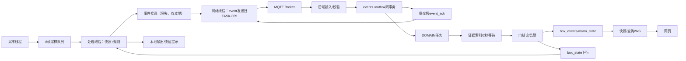

# TASK-008 核心规则与业务视图

| 属性 | 内容 |
|---|---|
| 阶段 | P3 |
| 负责人 | 用户（独立开发与验收） |
| 状态 | 进行中（软件实现已完成；后端集成复验与板端验证待完成） |
| 依赖 | TASK-007；软件规则测试可提前 |
| MOD | [MOD-01](../../requirements/modules/MOD-01-物流箱运行监测.md)、[MOD-02](../../requirements/modules/MOD-02-安全防护与哨兵.md)、[MOD-05](../../requirements/modules/MOD-05-物流箱管理与状态聚合.md) |
| 需求 | [REQ-M01-001](../../requirements/modules/MOD-01-物流箱运行监测.md#req-m01-001)、[REQ-M01-002](../../requirements/modules/MOD-01-物流箱运行监测.md#req-m01-002)、[REQ-M01-003](../../requirements/modules/MOD-01-物流箱运行监测.md#req-m01-003)、[REQ-M01-004](../../requirements/modules/MOD-01-物流箱运行监测.md#req-m01-004)、[REQ-M01-005](../../requirements/modules/MOD-01-物流箱运行监测.md#req-m01-005)、[REQ-M01-006](../../requirements/modules/MOD-01-物流箱运行监测.md#req-m01-006)、[REQ-M01-007](../../requirements/modules/MOD-01-物流箱运行监测.md#req-m01-007)、[REQ-M01-008](../../requirements/modules/MOD-01-物流箱运行监测.md#req-m01-008)、[REQ-M01-009](../../requirements/modules/MOD-01-物流箱运行监测.md#req-m01-009)、[REQ-M01-010](../../requirements/modules/MOD-01-物流箱运行监测.md#req-m01-010)、[REQ-M01-011](../../requirements/modules/MOD-01-物流箱运行监测.md#req-m01-011)、[REQ-M01-012](../../requirements/modules/MOD-01-物流箱运行监测.md#req-m01-012)、[REQ-M01-013](../../requirements/modules/MOD-01-物流箱运行监测.md#req-m01-013)、[REQ-M01-014](../../requirements/modules/MOD-01-物流箱运行监测.md#req-m01-014)、[REQ-M02-001](../../requirements/modules/MOD-02-安全防护与哨兵.md#req-m02-001)、[REQ-M02-002](../../requirements/modules/MOD-02-安全防护与哨兵.md#req-m02-002)、[REQ-M02-003](../../requirements/modules/MOD-02-安全防护与哨兵.md#req-m02-003)、[REQ-M02-004](../../requirements/modules/MOD-02-安全防护与哨兵.md#req-m02-004)、[REQ-M02-005](../../requirements/modules/MOD-02-安全防护与哨兵.md#req-m02-005)、[REQ-M02-006](../../requirements/modules/MOD-02-安全防护与哨兵.md#req-m02-006)、[REQ-M05-002](../../requirements/modules/MOD-05-物流箱管理与状态聚合.md#req-m05-002)、[REQ-M05-003](../../requirements/modules/MOD-05-物流箱管理与状态聚合.md#req-m05-003)、[REQ-M05-004](../../requirements/modules/MOD-05-物流箱管理与状态聚合.md#req-m05-004)、[NFR-001](../../requirements/quality/性能与资源约束.md) |

2026-11-17 按用户指令执行 TASK-008。详细设计以本文为唯一入口，[固件架构](../../design/firmware/固件架构与SDK接入.md)、[后端模型](../../design/backend/后端模块与数据模型.md)、[页面设计](../../design/frontend/页面与状态设计.md)只保留职责和导航。实施记录将按真实代码、测试、迁移及板端证据追加；当前任务进行中，不表示已验收。

## 1. 任务目标、当前事实与交付边界

### 1.1 当前事实

| 已具备 | 证据/入口 | 仍缺 |
|---|---|---|
| TASK-007 基础真实双板采集、联网、入库、网页与三项 `output` 输出 | [双板报告](../../testing/reports/TASK-007-双板接入验证报告.md) | 完整业务规则、事件生成、Flash 可靠性 |
| 后端接入、事件事务保存、精确 `event_ack`、Outbox 事件视图、查询/CSV、命令与 WS | [TASK-005 报告](../../testing/reports/TASK-005-服务端闭环验证报告.md) | 门结论、告警判断器、派生事件生产者 |
| 电脑端登录、列表、详情、控制与实时状态 | [TASK-006 报告](../../testing/reports/TASK-006-网页与首轮闭环验证报告.md) | 门/告警真实结论与告警推送 |
| 模拟器协议、五类命令、事件批次与确认 | [模拟器导读](../../../tools/simulator/README.md) | 环境/姿态/门/围栏规则镜像与规则场景 |
| 固件三线程、真实 IA1/SC2、`output`、SNTP、启动代次 | [固件导读](../../../firmware/README.md) | 规则引擎、sentry/profile/gps_mode/calibrate 处理；真实板 `event` 发送随 TASK-009 |
| 事件类型与数据字段、门/告警/WS 结构已在有效契约中定义 | [有效契约](../../../contracts/effective/README.md)、[公共 Schema](../../../contracts/effective/common.schema.json) | 生产者与持久化结果 |

当前后端在无生产者时按 CR-004 返回 `alarm.assessment=UNKNOWN`、`active/level=null`，`door` 为 `UNKNOWN/INSUFFICIENT`；这些是**未判断**，不是“正常/安全”。TASK-008 的职责是把这些占位结论变成可解释的真实业务结果，同时保持未知、过期、降级和历史的区分。

### 1.2 交付范围

| 范围 | 本任务交付 | 边界 |
|---|---|---|
| 固件业务规则 | ENV 环境规则；POSE 校准/分级/冲击；光照与倾角门证据；GPS 三模式与围栏；哨兵本地状态机与快速响应；事件候选生成（写入现有易失候选缓冲） | 不提前实现真实板 `event` 发布、Flash 持久、跨重启补传、掉电一致性和 65 条容量（TASK-009） |
| 后端融合与告警 | 证据索引、2 秒等待与配对、门结论、告警状态、派生事件查询视图、快照与 WS 推送 | 不做人工告警工单、围栏配置后台、注册换绑或运输生命周期 |
| 网页 | 现有详情页的门/告警真实状态、未知语义、角色字段裁剪 | 不新增页面/路由；历史、轨迹、CSV 页面仍由 TASK-010 完成 |
| 模拟器 | 已确认规则的独立镜像、可复现场景、真实 Broker/后端/MySQL 联调入口 | 模拟通过不等于固件实现或板端通过 |
| 验收 | 软件规则、真实 Broker/MySQL/HTTP/WS、双模拟节点、适用真实双板 | 完整告警算法、24 小时稳定、资源峰值、Flash 可靠性不在本任务验收 |

### 1.3 不在本任务范围

- 真实 GPS 硬件接入；本期 `src` 恒为 `MOCK`，真实模块只替换 HAL 适配。
- 云端开门抑制的离线差异、`box_state` 新鲜度/TTL 的最终定义（Q-08 仍待确认）。
- 人工已读/确认/处理/关闭告警，告警保留期限与规模（Q-05/Q-06）。
- 门“相反证据”、最后已知状态与质量变化如何形成新结论的完整规则（Q-07）。
- 围栏配置入口、修改权限与模式切换后的围栏状态（Q-04）。
- 重启后哨兵期限恢复（Q-10）与 Flash 事件可靠性（TASK-009）。
- 真实板 `event` 发布：契约要求本地持久化后发布，TASK-008 不在易失候选上发送；真实板事件链路随 TASK-009 接通。软件联调由模拟器提供事件输入，模拟器不是真实固件已发布的证据。
- 新增 HTTP 路由、取消命令、回滚、账号管理后台、手机布局。

## 2. 输入、开工条件、需求覆盖与待决门槛

### 2.1 输入

| 输入 | 使用方式 |
|---|---|
| [TASK-007](TASK-007-双板实际采集与输出接入.md)及[报告](../../testing/reports/TASK-007-双板接入验证报告.md) | 复用真实采集、网络、输出、身份、校时、启动代次和板端证据；不重建第二套接入 |
| [TASK-005](TASK-005-接入存储与查询闭环.md)及[报告](../../testing/reports/TASK-005-服务端闭环验证报告.md) | 复用事件事务、精确确认、Outbox、查询、命令、WS、角色投影与 V1～V9 |
| [MQTT v1](../../../contracts/mqtt/v1.md)、[有效契约](../../../contracts/effective/README.md)、[公共 Schema](../../../contracts/effective/common.schema.json) | Topic、QoS、容量、身份、事件类型/data、门/告警/WS 结构的权威来源 |
| [MOD-01](../../requirements/modules/MOD-01-物流箱运行监测.md)、[MOD-02](../../requirements/modules/MOD-02-安全防护与哨兵.md)、[MOD-05](../../requirements/modules/MOD-05-物流箱管理与状态聚合.md) | 业务规则、阈值、状态和验收的权威来源；本任务不新增阈值 |
| [CR-003](../../management/changes/CR-003-布防有效期限计时起点.md)、[CR-004](../../management/changes/CR-004-闭环时间语义与未知状态.md) | 布防计时起点、定位新鲜度、固定终态/迟到事实、画像采用、接收时间检索、未知告警语义 |
| [TC-001](../../testing/cases/TC-001-环境规则.md)～[TC-005](../../testing/cases/TC-005-定位与围栏.md)、[TC-008](../../testing/cases/TC-008-聚合与过期状态.md) | 场景与通过标准；本任务只同步适用层次，不改用例状态 |
| [固件架构](../../design/firmware/固件架构与SDK接入.md)、[后端模型](../../design/backend/后端模块与数据模型.md)、[模块边界](../../design/architecture/模块边界与数据流.md) | 线程、模块、事务和融合/告警的职责边界 |
| [风险与假设](../../management/风险与假设.md)、[版本矩阵](../environment/工具与依赖版本矩阵.md) | 已知风险、工具版本和验证限制 |

### 2.2 开工条件与门槛

1. **软件规则可先行**：C 纯规则可在 Ubuntu 宿主测试中开发、验证，不依赖真实板；但只有软件证据时不得声称板端通过。
2. **真实板验证条件**：两板已烧录匹配角色、IA1/SC2 安装正确、Wi-Fi/MQTT/SNTP 可用、私有配置与启动区间账本有效；缺少任一项时保留软件结果并登记未执行项。
3. **业务规则门槛**：第 2.4 节标为“待确认”的语义在实施和验收前必须由用户确认；未确认时只能实现不依赖该语义的部分，相关验收项标记受阻，不填入自定数字或伪成功。
4. **测试环境**：真实 MySQL/HTTP/WS 联调使用 `smartbox_test` 与显式清理同意，新建唯一证据目录；不得清理 `smartbox_dev` 或用开发库代替可销毁库。
5. **契约门槛**：只使用现有事件类型、data 字段、Topic、11 个 HTTP 操作和有效 WS 结构；如实现确需新字段/新类型，先走 CR，不在本任务直接改冻结文件。

### 2.3 需求覆盖与后续边界

| 需求范围 | 本任务贡献 | 仍留后续/待确认 |
|---|---|---|
| REQ-M01-001～004 | 环境采集质量、画像采用、3 帧去抖/回差、开门抑制与补光排除 | 抑制离线差异和 `box_state` 新鲜度（Q-08）；完整光照异常规则 |
| REQ-M01-005～007 | 校准基准、姿态分级/回差、冲击候选与合并 | 真实量程/资源指标（Q-12）；真实跌落区分不承诺 |
| REQ-M01-008～011 | 光照/倾角证据、2 秒配对与置信度、去重/迟到/历史 | 相反证据与最后状态（Q-07）；历史双源质量（Q-11） |
| REQ-M01-012～014 | FIXED/ROUTE/WALK、静止降频、圆形围栏与 10 米回差 | 围栏配置入口/权限（Q-04）；真实 GPS |
| REQ-M02-001～006 | 固件哨兵状态机、3 秒缓冲、实际 ARMED 计时、本地快速提示、逐节点事实 | 重启期限恢复与 Flash 持久（Q-10/TASK-009）；人工处置（Q-05） |
| REQ-M05-002～004 | door/alarm/sentry 独立聚合、EVALUATED/UNKNOWN、部分可用与角色裁剪 | 完整历史页面（TASK-010） |
| NFR-001 | 记录规则执行时延、资源增量、事件到网页时延 | 24 小时、100 次 P95、完整资源峰值仍由 TASK-009/010 验收 |

本表只解释既有需求关联，不新增需求，也不提前验收整项 REQ 或 TC。

### 2.4 待决问题处理

| 问题 | 与本任务关系 | 本任务处理 | 验收边界 |
|---|---|---|---|
| Q-01 | 定位新鲜度 | 按 CR-004：独立采样标记、15 秒新鲜度 | 已确认，不重开 |
| Q-02 | 操作终态/迟到事实 | 沿用 CR-004，不改命令状态机 | 已确认，不重开 |
| Q-03 | 初始化/归属变更 | 固定预配置，不新增换绑 | 不在本任务 |
| Q-04 | 围栏配置入口/权限/模式切换 | 只实现规则与本地测试配置；不新增命令或后台 | 配置入口待确认；相关验收标记受阻 |
| Q-05 | 告警人工闭环 | 只做自动开始/恢复；不实现人工处理 | 人工闭环待确认 |
| Q-06 | 保留期限/规模 | 不做删除/归档；31 天查询窗口不是保留期 | 不在本任务 |
| Q-07 | 门未知、相反证据、最后状态 | 单源关门保持 UNKNOWN；相反证据不自动关闭；记录未融合 | 相关语义待确认 |
| Q-08 | 开门抑制离线差异、`box_state` 新鲜有效 | 在线收到有效 OPEN 结论后本地起 30 秒窗口；无有效消息不抑制；不定义 TTL | TTL/离线差异待确认 |
| Q-09 | 画像切换 | 节点确认采用后生效；切换清零未触发计数、已有告警保留（CR-004） | 已确认规则，本任务实现算法 |
| Q-10 | 重启后哨兵期限 | 固件先实现 RAM 状态；重启不恢复，报告降级；持久恢复留 TASK-009 | 重启恢复待确认/后续 |
| Q-11 | 未校时历史与双源质量 | 历史结论只补历史、不改实时；未校时不生成高置信 | 历史双源质量条件待确认 |
| Q-12 | 硬件量程/资源/24h | 记录实测数据；不把短测当完整 NFR | 完整指标后续验收 |
| Q-13 | 业务生命周期 | 不增加运输任务、签收、归档 | 不在本任务 |
| Q-14 | 硬件事实 | 沿用当前事实表述 | 不重做官方实验 |

### 2.5 已确认参数来源

本文第 3 节所有阈值均来自需求正文，不新增数字。主要来源：[REQ-M01-003](../../requirements/modules/MOD-01-物流箱运行监测.md#req-m01-003)（3 帧、1℃/3%RH）、[REQ-M01-004](../../requirements/modules/MOD-01-物流箱运行监测.md#req-m01-004)（30 秒、2 秒）、[REQ-M01-005～007](../../requirements/modules/MOD-01-物流箱运行监测.md#req-m01-005)（50Hz/1Hz、3 秒、200ms、2°、0.5g/1 秒）、[REQ-M01-008～010](../../requirements/modules/MOD-01-物流箱运行监测.md#req-m01-008)（5 秒基线、3 倍、50lx、1.5 秒、1.5 倍、25°/10°、2 秒、60°、500ms）、[REQ-M01-012～014](../../requirements/modules/MOD-01-物流箱运行监测.md#req-m01-012)（10 秒/1 秒、30 秒、3～5 米、10 米、3 点）、[REQ-M02-001～006](../../requirements/modules/MOD-02-安全防护与哨兵.md#req-m02-001)（3 秒、10 秒、15 秒、1 秒、CRITICAL）及 [CR-003](../../management/changes/CR-003-布防有效期限计时起点.md)/[CR-004](../../management/changes/CR-004-闭环时间语义与未知状态.md)。

## 3. 规则与参数总表

### 3.1 环境规则（ENV，REQ-M01-001～004）

**输入与质量**

- ENV 每 1 秒采集温度、湿度、光照；保留单位、有效标记、采样时间和接收时间。
- 读取失败或无效帧不填零、不用旧值刷新采样时间；无效帧中断连续计数。
- 画像为演示配置：温度 2～8℃、湿度 30～85%RH；这些数值不代表货物保存建议，修改画像产生审计。

**异常进入与恢复**

| 项 | 规则 |
|---|---|
| 进入 | 同一指标连续 3 个有效帧同向越界，产生一次 `ENV_HIGH` 或 `ENV_LOW`；持续越界不每秒重复 |
| 回差 | 温度 1℃、湿度 3%RH；例如高温 >8℃ 进入，降至 ≤7℃ 才满足恢复方向 |
| 恢复 | 连续 3 个有效帧满足回差方向，产生一次 `ENV_RECOVERED` |
| 计数 | 无效帧、画像切换、进入/恢复后重新计数；不把单帧尖峰升级为异常 |
| 事件 data | `metric`、`value`、`threshold`、`profile_id`；恢复事件同样带指标、当前值和阈值 |
| 级别 | 按[CR-005](../../management/changes/CR-005-哨兵快速提示与事件级别.md)：进入 `WARNING`、恢复 `INFO` |

**画像采用（Q-09/CR-004）**

- 后端命令 `profile` 的回执必须表示节点已采用，后端才更新箱体采用配置。
- 切换生效时清零未触发的去抖计数；已有告警保留，并按新规则判断恢复；不重置历史事件。

**开门抑制与补光排除（REQ-M01-004）**

- 在线收到有效、非历史、`door_state=OPEN` 的 `box_state` 后，ENV 以本地单调时间开 30 秒窗口；窗口内不新增温湿度超限事件，保留采集和已有告警，窗口结束重新计数。
- 只有补光及切换后 2 秒内的样本不用于光照门证据；补光状态随数据记录。
- 断网未收到有效结论时不假装已抑制；`box_state` 的新鲜度/TTL 和离线差异仍属 Q-08，本文不自行定义。

### 3.2 姿态与冲击（POSE，REQ-M01-005～007）

**校准与量程**

- 合盖模拟姿态静置 3 秒后校准基准重力方向；只有有效、近静止样本参与；校准失败显示未校准，不输出可信倾角。
- 量程与驱动配置一致后换算 g；TASK-007 已提供真实 SC2 读数与基础倾角，完整量程/校准结论仍属 Q-12，不盲用文档常数。
- 初始采样 50Hz，姿态展示最多 1Hz；50Hz 是初始目标，实际周期、错过周期和资源按真实板记录，不用网页刷新频率证明采样率。

**分级**

| 相对基准倾角 | 状态 |
|---|---|
| `[0,10)` | `NORMAL` |
| `[10,45)` | `TILTED` |
| `[45,90)` | `SIDEWAYS` |
| `[90,180]` | `INVERTED` |

- 状态切换需持续 200ms 确认；边界回差 2°；初始状态直接按区间确定。
- 加速度近零、无效或强动态期间不计算有意义的倾角；不产生 NaN/Infinity，不更新可信姿态；保留冲击候选。
- 状态确认后产生 `POSE_CHANGED`，data 为 `previous_state`、`state`、`tilt_deg`；单次转换只产生一条，级别为 `INFO`（CR-005）。

**冲击**

- 候选条件 `abs(|a|-1g) > 0.5g`；记录峰值、发生时间、样本质量。
- 相邻 1 秒内的候选合并为一次 `IMPACT`；data 为 `peak_g`、`duration_ms`、`quality`；级别为 `WARNING`（CR-005）。
- 这是冲击演示，不声称区分真实跌落与其他运动；不得用摔裸板验证，先注入和安全动作。

### 3.3 门证据（REQ-M01-008～009）

节点只产生证据，不在节点端宣布门状态。证据 data 必须带 `action` 和 `actuator_excluded`，并至少带 `lux` 或 `tilt_deg`。

**光照证据（ENV）**

- 基线：相对近 5 秒有效关门样本的光照基线；基线下限 1lx。
- OPEN：光照跃升超过基线 3 倍且大于 50lx，持续 1.5 秒，产生 `OPEN/LIGHT`。
- CLOSE：回落至不超过基线 1.5 倍，持续 1.5 秒，产生 `CLOSE/LIGHT`。
- 补光开启及切换后 2 秒内的样本排除；基线缺失不能伪造；每次状态转换只产生一份证据。
- `actuator_excluded` 在该证据未受补光污染时为 `true`；无法确认时不能标 `true`。

**倾角证据（POSE）**

- OPEN：相对校准倾角大于 25° 持续 1.5 秒，产生 `OPEN/TILT`。
- CLOSE：小于 10° 持续 1.5 秒，产生 `CLOSE/TILT`。
- 只有已校准、有效样本参与；整板转动不等于真实门动作；未校准/强动态不产生证据。

### 3.4 后端证据融合（REQ-M01-010～011）

**证据登记**

- 每条 `DOOR_EVIDENCE` 成功后登记到 `event_evidence`；`kind` 取 `TILT`（存在 `tilt_deg`）或 `LIGHT`（仅 `lux`）。TASK-008 的节点每次只发一种证据。
- 证据记录 `observed_at`（设备 UTC）、`received_at`（后端时间）、`ts_src`、`time_uncertainty_ms`、`action`、`node_id`、原始 data。
- 同一 `event_id` 只登记一次；重复事件按既有事件去重处理。

**等待与配对**

- 首份证据登记后设置 `wait_until = received_at + 2000ms`；到期前不立即完成结论。
- 互补证据（同 box、同 action、不同 kind）在等待窗内到达且发生时间差 ≤2 秒时配对。
- 配对成功后两份证据只消费一次；重复、乱序不重复消费。
- 等待到期仍无配对时按单源规则完成结论，并设置 `unfused=true`；迟到配对不再回填该结论。

**置信度与结论**

| 证据情况 | 门结论 | 置信度 | 依据/说明 |
|---|---|---|---|
| 双源 OPEN，时间差 ≤2s，双节点在线，时间不确定度各 ≤500ms | OPEN | HIGH | REQ-M01-010 明确条件 |
| 双源 OPEN，时间差 ≤2s，但节点离线/质量不满足 | OPEN | MEDIUM | 降级映射；仅当当前有效规则允许该结论时应用，不可据此宣称在线高置信 |
| 仅 TILT OPEN 且 >60° | OPEN | MEDIUM | REQ-M01-010 明确 |
| 仅 TILT OPEN 且 25～60° | UNKNOWN | INSUFFICIENT | “仅倾斜”，不生成开门 |
| 仅 LIGHT OPEN | UNKNOWN | INSUFFICIENT | 生成光照异常事件/派生记录；门不变 |
| 双源 CLOSE，时间差 ≤2s 且质量满足 | CLOSED | HIGH | 双源条件 |
| 双源 CLOSE 但质量不满足 | CLOSED | MEDIUM | 降级映射；时间与证据质量不满足的剩余情形保持 UNKNOWN/INSUFFICIENT |
| 单源 CLOSE（任意 kind） | UNKNOWN | INSUFFICIENT | REQ-M01-010 明确“单源关门维持 UNKNOWN” |
| 未校时/时间质量不明 | 双源不生成 HIGH，按降级映射；单源按单源规则 | LOW/INSUFFICIENT 或单源规则 | 不伪造 UTC；历史双源质量属 Q-11 |
| 迟到配对超过等待窗 | 按单源结论并标记 `unfused` | 不高于单源规则 | 不强行凑高置信 |
| `replayed=true` 的历史证据 | 历史结论 `historical=true` | 按证据质量 | 不改实时门状态、不触发新告警 |
| 相反证据（OPEN/CLOSE 交叠） | 不自动选择 | 保持 UNKNOWN/未融合 | Q-07 待确认 |

- 结论原因使用稳定字符串（如 `DUAL_SOURCE`、`TILT_STRONG`、`TILT_WEAK`、`LIGHT_ONLY`、`SINGLE_SOURCE_CLOSE`、`UNSYNCED`、`LATE_UNFUSED`、`HISTORICAL`、`CONFLICTING`）。
- 每份证据只能被同类一个结论消费；已是 OPEN 的同类证据追加关联，不新增重复开门记录（REQ-M01-011）。
- 只有状态转换或证据质量变化产生记录；重复补传不生成重复结论。
- 当前门状态取最近一条**非历史**结论；历史结论只进入历史查询，不更新实时门状态。

### 3.5 定位与围栏（REQ-M01-012～014）

- 三模式：`FIXED`、`ROUTE`、`WALK`；统一 WGS84 经纬度；`src` 恒为 `MOCK`，前后端不得去掉模拟标记。
- 演示路线由仓库测试配置给出；随机游走使用固定种子，可复现；噪声默认 3～5 米演示范围。
- FIXED 固定每 10 秒更新；ROUTE/WALK 运动时每 1 秒更新，静止连续 30 秒后降至 10 秒，恢复运动后回到 1 秒（CR-004 与 REQ-M01-013）。
- `valid=false` 时界面提示定位不可用；历史有效坐标可显示但必须标注时间和过期，不作为当前点。
- 位置观测独立 `sample_seq`/时间；后端按 CR-004 使用独立 15 秒新鲜度；心跳或重复坐标不刷新位置采样时间。
- 圆形围栏：中心、半径、10 米回差；连续 3 个有效点越界产生 `GEOFENCE_EXIT`，连续 3 点进入半径减回差产生 `GEOFENCE_ENTER`；无效点中断计数，不生成越界。
- 围栏配置入口、权限、模式切换后的围栏状态仍属 Q-04；本任务只使用本地测试配置，不新增后台或命令。

### 3.6 哨兵与本地快速响应（REQ-M02-001～006）

**节点状态机**

| 状态 | 进入条件 | 退出条件 |
|---|---|---|
| `DISARMED` | 初始、撤防成功、期限到期（按单调时间） | 收到更高 `sentry_revision` 的布防 |
| `ARMING` | 接受布防后的 3 秒缓冲 | 缓冲结束进入 `ARMED`；撤防/旧版本拒绝 |
| `ARMED` | 3 秒缓冲结束；`duration_s` 从此刻起算，0 表示不自动到期 | 收到撤防、到期、重启（RAM 丢失） |
| `DEGRADED` | 重启后无法恢复期限或状态不完整 | 重新布防成功；持久恢复由 TASK-009 设计 |

- ENV 与 POSE 都声明哨兵能力位 0x40；必需节点固定来自箱体配置，不临时只选在线节点。
- 后端已负责 `operation_id`/`request_id`、`sentry_revision`、10 秒操作截止和 15 秒命令有效期；固件负责逐节点实际状态和回执。
- 旧 `sentry_revision` 不得覆盖新状态；重复 `request_id` 返回缓存结果，不重复执行。
- 布防回执只在 3 秒缓冲后实际 `ARMED` 时返回；`duration_s` 从实际 ARMED 开始计，缓冲不计入（CR-003）。

**本地快速路径**

- 已布防时，倾角异常确认、冲击候选、未经补光污染的光照突变候选触发本地提示并生成 `SENTRY_INTRUSION` 事件候选（真实板远程发送随 TASK-009 事件链路）；不得等待云端门融合或 1.5 秒门证据。
- `reason` 取 `LIGHT`、`POSE`、`IMPACT` 之一；带 `sentry_revision`；级别为 `CRITICAL`。
- 本地输出要求 ≤1 秒；ENV 提示灯/风扇、POSE 提示指示灯，不使用蜂鸣器或振动器承诺。
- 本地提示按 CR-005 使用灯光：ENV 补光灯、POSE 指示灯；不启动风扇，持续 10 秒后自动关闭。异常确认后 1 秒内开始提示。该规则不改变断网本地响应要求。
- 断网仍保持本地布防与快速响应；到期按单调时间撤防并记录；0 不自动到期。
- 重启后 RAM 状态丢失，当前无持久状态时节点报告 `DISARMED`（这是重启后的真实本地状态）；TASK-009 增加持久恢复后按 Q-10 显示恢复或 `DEGRADED`，不假装已恢复布防。

### 3.7 告警聚合与快照

- 后端维护 `alarm_state`（每个箱体一行）与 `alarms`（每个 `alarm_key` 一行）；`active` 取任一活动告警，`level` 取活动告警中的最高级。
- `assessment`：只要该箱体已有过一次域事件评估记录，就返回 `EVALUATED`；尚无任何判断时为 `UNKNOWN`，且 `active/level=null`。这是实现映射，不新增业务阈值。
- 自动生命周期（环境/围栏的开始与恢复为现行规则；哨兵恢复条件仍待确认）：

| alarm_key | 开始 | 自动恢复 | 级别 |
|---|---|---|---|
| `env.temp.high`、`env.temp.low`、`env.humi.high`、`env.humi.low` | 对应 `ENV_HIGH`/`ENV_LOW` | 同指标 `ENV_RECOVERED` | 进入建议 `WARNING`（待确认） |
| `sentry.intrusion` | `SENTRY_INTRUSION` | 收到哨兵实际 `DISARMED`（撤防）时收敛；当前约定，待确认 | `CRITICAL`（已确认） |
| `geofence.exit` | `GEOFENCE_EXIT` | `GEOFENCE_ENTER` | 建议 `WARNING`（待确认） |

- 哨兵侵入除撤防外的恢复方式未定义（Q-05/Q-10相关）；本任务只按撤防收敛并如实记录，不把该约定写成已确认业务规则。
- `IMPACT`、仅光照异常：先作为原始事件/派生记录保存；其“活动告警”开始/恢复语义未确认（Q-05/Q-07），不进入快照 active，不虚构恢复。
- 门结论不是告警；门状态与告警分别表达，不互相覆盖。
- 不提供人工已读/确认/处理/关闭；级别不等于人工处理进度。

### 3.8 事件级别映射（CR-005已确认）

有效契约要求事件带 `level`。按 CR-005：`SENTRY_INTRUSION=CRITICAL`；`ENV_HIGH`/`ENV_LOW`/`IMPACT`/`GEOFENCE_EXIT=WARNING`；`ENV_RECOVERED`/`POSE_CHANGED`/`DOOR_EVIDENCE`/`GEOFENCE_ENTER=INFO`。`STORAGE_OVERFLOW`/`DEVICE_FAULT` 仍由生产者按其故障语义处理，TASK-009完善；不属于CR-005映射范围。

## 4. 端到端数据流与职责

图中 `event` 上行在 TASK-008 只由模拟器或测试 peer 产生；真实固件只生成本地候选，TASK-009 在本地持久化接通后才发布并处理 `event_ack`。

| 层 | 责任 | 不做什么 |
|---|---|---|
| 固件规则 | 采样质量、去抖/回差、姿态、证据、围栏、哨兵本地状态与快速输出；生成事件候选 | 不做云端融合、不宣布门结论、不做 Flash 持久 |
| 固件网络 | 单 MQTT 所有者；命令/`box_state` 接收；保留现有事件未实现桩，不提前发送未持久事件 | 不在回调做数据库/长耗时；不阻塞采样 |
| 后端接入 | 既有契约/身份/容量校验；事件与 outbox 同事务；提交后精确 `event_ack` | 不把 PUBACK 当落库；不在 MQTT 回调线程做 SQL |
| 后端融合/告警 | 证据登记、2 秒等待、配对、结论幂等、告警状态、派生视图、下行 `box_state` | 不伪造高置信；不用接收时间冒充发生时间 |
| 查询/WS | 快照 door/alarm/sentry、事件/轨迹/CSV、角色裁剪、告警推送 | 不在网页复制权限规则；不返回证据给外卖用户 |
| 网页 | 展示现有字段与未知/过期语义；控制入口沿用 TASK-006 | 不新增页面/路由，不用“正常”代替未知 |

**事务与确认边界**：证据/结论/告警/派生视图在同一短事务内落库；`event_ack` 仍由原事件事务提交后发送；`box_state` 发布在结论提交后由独立调度器完成，发布失败不回滚结论，重试可观察；WS 只发通知，网页收到后 REST 重读。

**幂等键**：证据 `event_id`；结论 `source_key`（排序后的证据事件集合哈希）；派生视图 `source_key`；告警 `box_id+alarm_key`。重复任务、重启和并发领取不得产生第二份结论/告警转换。

## 5. 固件设计

### 5.1 文件与职责

| 位置 | 计划改动 |
|---|---|
| `firmware/domain/sb_rules.c`（新增） | 集中规则状态机：环境、姿态/冲击、门证据、围栏、哨兵/快速路径；按 `SB_ROLE_ENV`/`SB_ROLE_POSE` 条件编译；只依赖时钟、配置和快照输入，可宿主测试 |
| `firmware/include/sb_rules.h`（新增） | 规则接口、确认参数常量、事件类型/状态结构；参数只在此集中定义，不散落 |
| [sb_types.h](../../../firmware/include/sb_types.h) | 扩展事件类型/等级/数据与命令状态；保留现有启动/输出类型 |
| [sb_ports.h](../../../firmware/include/sb_ports.h) | 增加规则处理与 `box_state` 处理接口；保持短临界区约定；事件发送接口留 TASK-009 |
| [sb_wire.c](../../../firmware/services/sb_wire.c) | 扩展命令处理：profile/gps_mode/calibrate/sentry；保持 1536 字节限制与 32 条结果缓存；事件编码与发送留 TASK-009 |
| [sb_network_real.c](../../../firmware/services/sb_network_real.c) | 保留现有事件未实现桩，不提前发布未持久事件；确保命令与 `box_state` 接收不阻塞 |
| [sb_event_buffer.c](../../../firmware/services/sb_event_buffer.c) | 事件项改为带类型/时间/数据的本地候选；仍是易失缓冲，满时计数不阻塞采样，不发送 |
| [smartbox_tasks.c](../../../firmware/app/smartbox_tasks.c) | 处理线程在快照后调用规则；网络线程处理命令/`box_state`；事件发布与确认清理留 TASK-009 |
| [BUILD.gn](../../../firmware/build/BUILD.gn) | 加入新源文件；保持角色互斥 |
| [check_firmware.py](../../../tools/check_firmware.py)、[check_hardware.py](../../../tools/check_hardware.py) | 同步新增源文件和宿主测试；不能让新规则绕过现有编译/检查 |

### 5.2 命令处理与回执

| 命令 | 固件行为 | 回执 |
|---|---|---|
| `output` | 既有真实输出，保持 | 立即 `ok` + `kind/on` |
| `profile` | 校验上下限/回差；采用配置并清零未触发计数；保留已有告警 | 立即 `ok` + `profile_id` |
| `gps_mode` | 切换 FIXED/ROUTE/WALK，设置种子，重置位置观测调度 | 立即 `ok` + `mode` |
| `calibrate` | 进入 3 秒静置采样；仅有效、近静止样本参与 | 3 秒后 `ok` + `calibrated` 或错误码 |
| `sentry` | 校验 revision/必需能力；布防 3 秒缓冲后进入 ARMED，撤防按实际状态即时处理；`duration_s` 从 ARMED 起算；重复请求缓存 | 布防 3 秒后实际状态；撤防返回实际状态；旧 revision 拒绝；到期由本地单调时间处理 |

- 延迟回执期间重复的 `request_id` 不得再次执行；缓存保留最终结果；重启后缓存可丢，但 revision/有效期仍防止旧命令覆盖。
- 未校时不执行远程动作，返回 `time_unsynced`；本地采集和防护不受影响。
- retained 命令、参数错误、能力不满足、过期等按既有契约为准，不新增错误码。

### 5.3 事件候选与 `box_state`

- 规则产生事件后只写入易失候选缓冲，供本地统计、心跳计数和宿主测试；TASK-008 不通过 MQTT 发送 `event`。契约要求“本地持久化→发布→确认”，真实固件事件发送、`event_ack` 清理和补传随 TASK-009。
- 现有 `sb_network_publish` 未实现桩保持不变；心跳 `storage=DEGRADED` 如实表达；不把候选计数写成已持久或已发送。
- `STORAGE_OVERFLOW` 的完整区间语义留 TASK-009。
- `box_state`：校验 box/node/`historical=false`/`conclusion_id`/`ts`；只处理目标节点消息；以收到时刻的本地单调时间开 30 秒抑制窗（实现映射：收到即起算，不追溯结论时刻）；重复 `conclusion_id` 不重复开窗；不定义 TTL。
- 旧代次、错误身份、未注册或跨节点消息不改状态。

### 5.4 资源与失败边界

- 规则状态静态分配，不引入动态内存；不增加采样线程阻塞；事件编码在有限栈内完成。
- 采样/姿态周期按既有 1000ms/20ms；规则处理不得让处理线程长期阻塞。
- 传感器无效、近零/强动态、未校准、输出失败、队列满、网络断开分别计数并降级；不以零或旧值冒充有效。
- 真实板资源增量按 NFR-001 记录，但本任务不宣称完整峰值/24h 通过。

## 6. 后端设计

### 6.1 包与职责

沿用单 Maven 应用和 `cn.smartbox.live` 包，不新建微服务或第二套身份系统。

| 组件 | 职责 |
|---|---|
| `IngestionService`（扩展） | 合法事件事务内除 `EVENT_VIEW` 外，为需要业务处理的类型创建 `DOMAIN` Outbox 任务 |
| `DomainWorker`（新增） | 租约领取 `DOMAIN` 任务；按类型分发证据/告警；失败重试，不空跑 DONE |
| `EvidenceService`（新增） | 校验/登记 `DOOR_EVIDENCE`，维护 `event_evidence` 与等待期限 |
| `FusionService`（新增） | 扫描到期证据，配对/单源结论，幂等写 `door_conclusions` 与 `box_events`，消费证据 |
| `AlarmService`（新增） | 环境/哨兵/围栏告警开始/恢复，维护 `alarms`/`alarm_state` 与 `box_events` 的 ALARM 记录 |
| `BoxStatePublisher`（新增） | 扫描未发布的 OPEN/CLOSED 结论，向两必需节点发布 `box_state`，记录尝试 |
| `DerivedViewService`（新增） | 派生视图统一写入、`source_key` 幂等、通知 WS |
| `QueryService`（扩展） | 快照 door/alarm 投影；历史/导出/WS 事件改读 `event_feed`；角色裁剪 |
| `LiveWebSocket`（扩展） | `box_event` 读 `event_feed`；告警状态变化推送 `alarm` |

`DOMAIN` 任务只为 `DOOR_EVIDENCE`、`ENV_HIGH`/`ENV_LOW`/`ENV_RECOVERED`、`IMPACT`、`SENTRY_INTRUSION`、`GEOFENCE_EXIT`/`GEOFENCE_ENTER` 创建；`POSE_CHANGED` 不直接触发告警，仍由既有 `EVENT_VIEW` 投影；`EVENT_VIEW` 任务职责不变。

### 6.2 数据模型（新增迁移 V10～V12，不改 V1～V9）

| 迁移 | 对象 | 关键内容 |
|---|---|---|
| V10 | `event_evidence` | `event_id` PK/FK 事件；`box_id`、`node_id`、`kind`（LIGHT/TILT）、`action`（OPEN/CLOSE）、`observed_at`、`received_at`、`ts_src`、`time_uncertainty_ms`、`status`（WAITING/CONSUMED）、`wait_until`、`conclusion_id` 可空、`data` JSON、`created_at`；索引（box_id,status,wait_until） |
| V10 | `door_conclusions` | `conclusion_id` VARCHAR(64) PK；`box_id`；`source_key` CHAR(64) UNIQUE；`state`、`confidence`、`reason`、`observed_at`、`received_at`、`historical`、`unfused`、`evidence_event_ids` JSON、`box_state_published_at`、`notify_attempts`、`created_at`；索引（box_id,historical,received_at,conclusion_id） |
| V11 | `alarms` | `alarm_id` PK；`box_id`、`alarm_key`、`type`、`level`、`active`、`started_at`、`ended_at`、`last_source_id`、`updated_at`；唯一（box_id,alarm_key） |
| V11 | `alarm_state` | `box_id` PK；`evaluated_at`、`active`、`level` 可空、`updated_at`；快照是否 `EVALUATED` 的依据 |
| V11 | `box_events` | `id` VARCHAR(64) PK；`box_id`、`event_type`（DOOR_CONCLUSION/ALARM）、`level`、`observed_at`、`received_at`、`time_quality`、`historical`、`payload` JSON、`source_key` UNIQUE、`created_at`；索引（box_id,received_at,id） |
| V12 | `event_feed` 视图 | `event_views` 与 `box_events` 的 UNION ALL；列 `id,box_id,received_at,event_type,level,payload`；历史/导出/WS 统一读取 |

- 时间字段遵守既有约定：设备 UTC 可空、`ts_src` 必须匹配、接收时间由服务器生成；uint64 用 DECIMAL(20,0)/BigInteger。
- 不删除/改写 `events`、`event_views` 或历史数据；派生表只追加。保留期限仍属 Q-06，不做自动清理。
- [IntegrationReset](../../../backend/src/main/java/cn/smartbox/live/IntegrationReset.java) 的测试清理清单需加入新表，顺序在 `event_views/events` 之前；只用于 `smartbox_test` 显式重置。

### 6.3 查询、快照与推送

- **door**：最近非历史结论；无结论 → `UNKNOWN/INSUFFICIENT`、`conclusion_id=null`、`observed_at=null`、`historical=false`；历史结论不进入当前快照。
- **alarm**：`alarm_state` 不存在 → `UNKNOWN/null/null`；存在 → `EVALUATED`、`active`、`level`。
- **sentry**：沿用既有实际状态/修订；不把命令受理当 ARMED。
- **history/export**：从 `event_feed` 读取，稳定排序 `received_at,id`；DELIVERY_USER 只允许 `DOOR_CONCLUSION`/`ALARM`；派生 payload 不含证据、姿态、节点诊断或原始事件字段。
- **WS**：`box_event` 从 `event_feed` 推送；`alarm` 使用有效契约的 `Alarm`（含 `assessment`）在状态变化时推送；发送前按当前授权重投影；外卖用户不接收 `node_status`/`command_status`。
- 不新增 HTTP 路由；现有 11 个操作的路径、权限和错误结构不变。

### 6.4 失败与恢复

- 证据等待落库，后端重启后调度器可继续；结论/告警/派生写入幂等。
- 配对过期、证据消费竞争、任务重复领取、旧 owner 恢复按 `source_key`/`FOR UPDATE SKIP LOCKED` 处理；不产生第二份结论。
- `box_state` 发布失败不回滚结论；重试次数可观察；不伪造“节点已收到”。
- 告警状态更新失败进入重试；查询仍可读到上一次已提交状态，不把失败当已更新。
- 所有拒绝/重试使用既有审计与日志约定，不输出凭据或原始秘密。

## 7. 模拟器与测试工具

### 7.1 规则镜像

- 新增 `tools/simulator/rules.py`，按本文已确认参数独立实现 ENV/POSE 规则：环境 3 帧/回差、姿态分级/冲击、光照/倾角证据、GPS/围栏、哨兵状态与快速响应。
- 模拟器输出沿用现有 `property/heartbeat/event/command_ack/availability` 和契约校验；事件通过现有批次发送，等待后端精确确认。模拟器的事件队列仍是易失测试输入，**不是**真实固件已持久化或已发布的证据；真实板事件发送由 TASK-009 接通。
- 模拟器只证明软件链路与协议，不证明固件 C 实现、真实采样或实物动作；两者证据分开记录。

### 7.2 场景

在现有 `normal/unsynced/invalid` 基础上增加可复现场景（名称实施时固定，示例）：

| 场景 | 目的 |
|---|---|
| `env-high` / `env-low` / `env-spike` | 3 帧进入、回差、恢复、单帧尖峰不升级 |
| `door-light` / `door-tilt` / `door-both` | 单源/双源证据、2 秒窗、置信度 |
| `pose-tilt` / `pose-impact` | 分级边界、200ms/2°、1 秒合并 |
| `fence-exit` | 3 点越界/恢复、无效点中断 |
| `sentry-fast` | 已布防快速异常、1 秒输出、3 秒缓冲/计时 |
| `unsynced` / `invalid` | 未校时不高置信、无效不伪造 |

场景输入、期望事件/结论、运行时间和证据路径由测试报告逐项保存，不能只勾选总表。

### 7.3 联调入口与测试层次

| 层次 | 入口/位置 | 验证 | 不能证明 |
|---|---|---|---|
| C 纯规则宿主测试 | `tests/firmware` 与 `tools/check_firmware.py`/`check_hardware.py` | 边界、计数、状态机、NaN/零向量 | 真实采样/RTOS 调度 |
| 模拟器单元 | `tools/mqtt.py unit`、模拟器测试 | 规则镜像、协议、事件批次 | 固件实现 |
| 后端单元 | `tools/backend.py unit` | 融合窗口、置信度、幂等、投影 | 真实 MySQL/网络 |
| 真实集成 | 新增规则联调工具（复用 `tools/live_integration.py` 模式，使用 `smartbox_test` 与显式清理同意） | Broker+后端+MySQL+双模拟节点、REST/WS | 板端与 Flash |
| 浏览器 | `tools/frontend.py integration` | 门/告警/未知/角色裁剪页面 | 真实设备 |
| 真实双板 | 烧录后按 TC 适用步骤执行 | 固件本地规则、3 秒/1 秒时延、真实输出 | 远程事件记录/长期稳定性/24h |

新增规则联调工具和场景参数属于本任务实施内容；本文只固定入口和证据边界，本轮不创建这些文件。

## 8. 网页视图

- 现有[详情页](../../../frontend/src/features/Detail.vue)继续展示门、告警、哨兵、节点、环境/姿态/位置，不新增页面或路由。
- 门卡片：显示状态与置信度；`UNKNOWN/INSUFFICIENT` 显示“未知/证据不足”，不显示“已关闭”；有结论时显示 `observed_at`；历史结论不进入当前卡片。
- 告警卡片：`UNKNOWN` 显示“尚未完成判断”，`active/level` 为 null 不转成“无告警”；`EVALUATED` 且无活动告警才显示“无活动告警”；活动时显示级别。
- 哨兵卡片沿用现有状态与修订；整体状态以全部必需节点实际确认为准。
- 外卖用户看不到姿态、节点、命令状态和证据；服务端裁剪是最终权限依据，前端[投影](../../../frontend/src/api/projection.ts)只做二次过滤。
- 证据/原始事件仍通过既有事件接口查询；本任务不新增证据面板、历史页或地图。

## 9. 失败模式与恢复

| 场景 | 预期行为 |
|---|---|
| 仅有 LIGHT 或仅有 TILT（弱角） | 门保持 UNKNOWN/INSUFFICIENT；光照异常只记录，不伪造开门/关门 |
| 单源 CLOSE | UNKNOWN/INSUFFICIENT；不自动宣布已关 |
| 未校时/时间不确定度超限 | 不生成 HIGH；降级或未融合；不伪造 UTC |
| 迟到配对超过 2 秒 | 按单源结论并标记 `unfused`；不强行高置信 |
| 重复/乱序/补传 | 证据只消费一次；结论/派生幂等；历史不改实时 |
| 相反证据交叠 | 保持 UNKNOWN/未融合，等待 Q-07，不自选答案 |
| 必需节点离线/拒绝/超时 | 保持 PARTIAL/FAILED 与逐节点事实；不显示全部布防 |
| `box_state` 丢失/延迟 | 不假装抑制已生效；不定义 TTL；不伪造离线差异 |
| 固件事件缓冲满 | 计数/降级，不阻塞采样；完整溢出语义留 TASK-009 |
| 后端重启 | 已完成事件/结论不丢；等待窗由 DB 恢复；`box_state`/告警重试可观察 |
| 输出失败 | 回执错误/实际状态如实；不假装动作完成 |
| 重启后哨兵 | RAM 丢失，当前报告 `DISARMED`；TASK-009 增加持久恢复后按 Q-10 显示恢复或 `DEGRADED` |
| 网页断线 | REST 重同步；WS 不是可靠重放通道；不把断线当设备离线 |

## 10. S1～S9 执行计划

全部步骤由用户独立实施与验收；实际执行者、日期、证据按真实结果填写。

| 步骤 | 输入 | 动作 | 产出 | 检查/完成条件 | 失败处理 |
|---|---|---|---|---|---|
| S1 输入/门槛 | 本文、TASK-007、有效契约、Q 项 | 核对版本、参数、Q 状态、测试环境 | 实施基线与受阻清单 | 每条规则有来源、每个 Q 有处理边界 | 不猜规则/凭据；受阻项先确认 |
| S2 固件规则 | S1、固件类型/时钟/配置 | 实现 `sb_rules` 纯规则与宿主测试 | 规则、测试、参数常量 | 固件侧 R01～R06、R11部分、R12/R13组件规则测试通过 | R07/R08/R09属于后端融合，不能列作固件宿主测试；不以模拟替代 C 测试 |
| S3 事件候选/网络 | S2、wire/network/缓冲 | 事件候选结构、`box_state` 窗口；不实现真实板 `event` 发送 | 候选缓冲与抑制 | 候选计数/心跳 DEGRADED、`box_state` 起窗 | 不提前发布未持久事件 |
| S4 证据/融合/迁移 | S3、V1～V9、契约 | V10～V12、证据登记、等待配对、结论幂等 | 后端融合与派生表 | 真实 MySQL 事务/并发/重启恢复 | 冲突不覆盖；不造重复结论 |
| S5 告警/快照/WS | S4、查询/WS 既有代码 | 告警状态、door/alarm 快照、event_feed、alarm 推送 | 业务视图与实时通知 | 四角色投影、UNKNOWN 语义、告警变化 | 不用未知冒充正常 |
| S6 网页 | S5、现有页面 | 门/告警状态与级别显示、未知/历史处理 | 页面改动与测试 | 桌面尺寸、未知/过期/角色裁剪 | 不新增页面/路由 |
| S7 软件联调 | S5/S6、模拟器场景 | 真实 Broker/后端/MySQL/双模拟节点跑 R01～R13 | 软件证据与报告 | 事件→结论→网页可追溯 | 失败保留输入与日志 |
| S8 真实双板 | S2/S3、两板/私有配置 | 烧录匹配角色，跑 R01～R06、R12/R13 的板端侧；融合 R07/R08 由同一联调的后端验证 | 板端证据、时延/输出观察 | 真实采集/输出/快速提示 | 无板则如实登记未执行 |
| S9 回归/收尾 | S7/S8、追踪矩阵 | 单元/集成/文档检查、报告、进度、进程清理 | 报告与更新后的状态 | 必需结果齐全、限制清楚 | 不凭部分成功升级 REQ/TC |

## 11. 内部验收 R01～R14 与 TC 映射

以下为任务内部场景，不新增全局 TC。

| 场景 | 必须验证 | 关联 TC | 证据层次 |
|---|---|---|---|
| R01 环境进入/恢复 | 3 帧、回差、单帧尖峰、无效中断、不刷屏 | TC-001 | C 宿主 + 模拟器 + 真实 |
| R02 开门抑制/补光 | 30 秒窗、已有告警保留、2 秒补光排除、无消息不抑制 | TC-001/003 | C 宿主 + 模拟器 + 真实（`box_state` 注入） |
| R03 姿态边界 | 10/45/90°、200ms、2° 回差、零向量/动态无 NaN | TC-002 | C 宿主 + 真实 |
| R04 冲击 | 0.5g 候选、1 秒合并、峰值/质量 | TC-002 | C 宿主 + 真实 |
| R05 光照证据 | 5 秒基线、3 倍+50lx、1.5 秒、1.5 倍回落、每次转换一份 | TC-003 | C 宿主 + 模拟器 |
| R06 倾角证据 | >25°/<10° 持续 1.5 秒、未校准不产生 | TC-003 | C 宿主 + 模拟器 |
| R07 双源融合 | 0/2/超 2 秒、双在线/≤500ms、一条 HIGH | TC-003 | 后端单元 + 真实集成 |
| R08 单源降级 | TILT 30/70°、LIGHT 单源、单源 CLOSE UNKNOWN | TC-003 | 后端单元 + 真实集成 |
| R09 时间降级 | 未校时、500ms 边界、迟到未融合 | TC-003 | 后端单元 + 真实 |
| R10 去重/历史 | 重复、乱序、补传、历史不改当前 | TC-003 | 真实 MySQL |
| R11 定位/围栏 | 三模式可复现、静止降频、3 点/10 米、无效中断 | TC-005 | 模拟器 + 页面 + 真实按需 |
| R12 哨兵 | 3 秒缓冲、ARMED 起算、撤防、到期、旧 revision、重复请求 | TC-004 | C 宿主 + 真实 |
| R13 快速响应 | 已布防快速异常 ≤1 秒本地输出、不等待融合、断网保持 | TC-004 | 真实双板 |
| R14 聚合/视图 | door/alarm/sentry 并存、EVALUATED/UNKNOWN、角色裁剪、WS 告警 | TC-008 | 真实 HTTP/WS + 浏览器 |

**TC 边界**：TC-004 的“重启/期限持久恢复”子项留 TASK-009；TC-006/011 的 Flash、掉电、补传和 24h 不在本任务；TC-010 只记录资源/时延观察，不完成 NFR 验收。真实板在 TASK-008 只覆盖本地规则/本地输出；远程事件记录与告警端到端随 TASK-009 接通事件发布后再验收。本任务完成后，相关 TC 仍按实际覆盖追加“部分结果”，不整份标通过。

## 12. 交付物、风险与完成口径

### 12.1 交付物

- 固件：`domain/sb_rules.c`、`include/sb_rules.h`、类型/接口/命令/缓冲改动（真实 `event` 发布留 TASK-009）、构建与宿主测试更新。
- 后端：`live` 包融合/告警/派生服务、V10～V12 迁移、快照/查询/WS/投影改动、单元与真实集成测试。
- 模拟器：规则镜像、场景、规则联调入口与测试。
- 网页：详情页门/告警显示与测试。
- 文档：本任务、TC 适用层次、设计入口、进度；实施后新增报告与证据索引。

### 12.2 风险

| 风险 | 影响 | 应对 |
|---|---|---|
| Q-04/05/07/08/10/11 未确认 | 部分告警/门/抑制/重启语义不能验收 | 只实现已确认部分，验收项标受阻，走 CR/确认 |
| 固件规则增加 CPU/栈/事件量 | 影响采样/网络时序与资源 | 静态状态、批处理、宿主测试与板端测量；不宣称峰值 |
| 模拟器与固件规则双实现 | 行为漂移 | 以需求参数和 C 宿主测试为基准；模拟器只作软件联调，结果分开 |
| 派生表/事件增长 | 查询和数据量上升 | 索引、分页、31 天查询窗；保留期仍按 Q-06 |
| `box_state` 发布不可靠 | 抑制不生效 | 本地不假装已抑制；重试可观察；Q-08 确认后再定 TTL |
| 测试库重置/联调冲突 | 误清数据或端口冲突 | 只用 `smartbox_test`、显式清理同意、唯一证据目录、先停自身服务 |
| 真实板事件不发送 | 板端只能验证本地规则/输出，不能验证远程事件与告警 | 软件联调用模拟器；真实板事件链路与告警端到端随 TASK-009 验收 |
| 无真实板或板件异常 | 只有软件证据 | 报告明确“软件完成，待板端验证”，不升级需求/TC |

### 12.3 完成口径

- “软件完成”要求：规则/融合/告警/视图/页面在 C 宿主测试、后端单元与真实 Broker/MySQL/HTTP/WS 双模拟节点联调中通过，证据可追溯。
- “板端完成”要求：两板真实运行 R01～R06、R12/R13 的板端侧，保存时延、输出与日志；本地规则/输出可验收，**远程事件记录与告警端到端需 TASK-009 接通事件发布后再验收**；融合 R07/R08 在同一联调的后端验证；无板时不得声称完成。
- TASK-008 完成不自动验收整项 REQ/TC，也不代表 TASK-009/010 完成；Q 项未确认的子项保持“待确认/受阻”。

### 12.4 实际记录

2026-11-17：在前期详细设计基础上实施固件规则模块、后端 V10～V12、模拟器规则场景及网页门/告警视图，详细结果见[实施报告](../../testing/reports/TASK-008-核心规则与业务视图实施报告.md)。ENV/POSE SDK 编译链接、Ubuntu C 宿主组件/规则测试 22 项、SDK 端口/启动/Wi-Fi 检查、模拟器 40 项、后端单元 30 项、前端单元 16 项、隔离浏览器 12 项、契约和文档检查通过。

两角色构建已归档且 SDK 原学习入口与输出恢复成功。后端较早一轮 44 项集成通过；后续新增两项集成用例后，本轮复跑在 Java 21 本机 NIO selector 初始化阶段失败，未能复验最新后端真实集成，不能记为通过。当前没有识别到已连接板端；新固件尚未烧录和执行规则场景。现有 1883/8080/5173 硬件模式进程保持运行，未由本轮停止或重配。TASK-008 仍进行中，后端隔离数据库复验与 ENV/POSE 实板操作是剩余验收工作；事件持久化/发布及 Q-04/05/06/07/08/10/11 仍不在已完成结论内。

## 13. 本轮文档整理记录

- 本节记录实施前的详细设计阶段，不代表当前实现状态。实施后的测试和限制以[实际报告](../../testing/reports/TASK-008-核心规则与业务视图实施报告.md)为准。
- 整理范围：本文第 1～12 节；同步 TC-001～005/008 的 TASK-008 适用验证层次、后端/固件/网页设计的任务入口和[当前进度](../../management/当前进度.md)。
- 未改变：需求正文与编号、冻结契约、有效契约、V1～V9 迁移、源码、测试、配置、历史报告；未新增 Q/CR/ADR/RSK 编号。
- 未完成：第 2.4 节待确认语义、板端验证和所有实现工作；这些必须在后续按 S1 门槛和用户确认推进。
