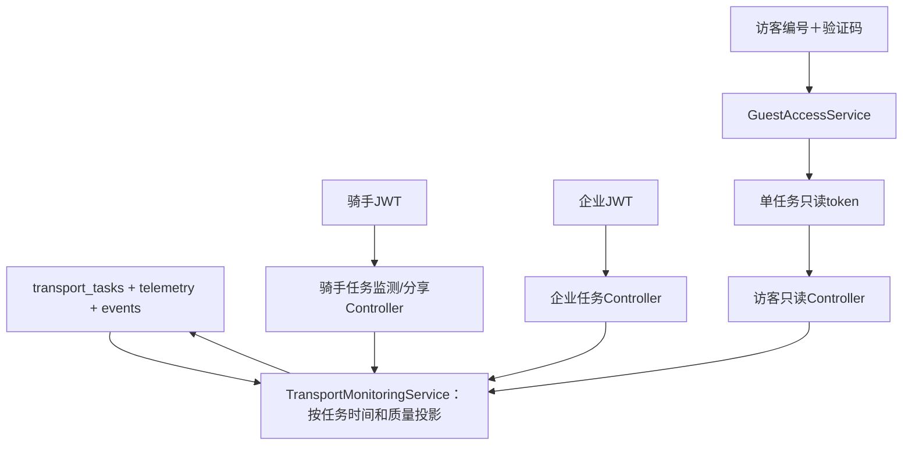

# TASK-013 任务历史访客授权与三端接入

| 属性 | 内容 |
|---|---|
| 阶段 | CR-006 / 候选 BL-003 |
| 负责人 | 用户 |
| 状态 | 待开始（详细开发方案已编写，未实施） |
| 依赖 | TASK-011、TASK-012；完整补传另依赖 TASK-009 |
| MOD | [MOD-06](../../requirements/modules/MOD-06-用户与权限管理.md)、[MOD-07](../../requirements/modules/MOD-07-运输任务与过程管理.md) |
| 需求 | [REQ-M06-008](../../requirements/modules/MOD-06-用户与权限管理.md#req-m06-008)、[REQ-M07-005](../../requirements/modules/MOD-07-运输任务与过程管理.md#req-m07-005)、[REQ-M07-006](../../requirements/modules/MOD-07-运输任务与过程管理.md#req-m07-006)、[REQ-M07-008](../../requirements/modules/MOD-07-运输任务与过程管理.md#req-m07-008) |
| TC | [TC-015](../../testing/cases/TC-015-任务历史访客安全与页面.md) |

## 1. 目标与实现范围：让三个界面真实共用运输数据

**本轮定位：CR-006 / 候选 BL-003 的演示优先集成任务。** TASK-011 已完成企业与骑手资产底座，TASK-012 已完成运输任务后端事务；本任务负责补上**一次运输的环境/事件查询、普通用户凭据访问，以及三个角色入口的真实页面**。

最终应能连续演示：

```text
企业管理员登录 → 查看本企业箱体与运输 → 对箱体分配骑手
    ↓
骑手登录 → 我的箱体 → 创建 READY → 绑定物品 → 开始 ACTIVE
    ↓
真实 ENV/POSE 持续采样（或在隔离测试库使用明确标注的模拟设备输入）
    ↓
骑手可查看本任务环境摘要与事件，生成本任务验证码
    ↓
普通用户无需登录 → 输入运输编号＋验证码
    ↓
仅查看该运输的状态、物品、可确认环境样本、设备事件
    ↓
骑手结束运输 → 三端状态刷新 → 旧用户不能看同箱下一运输
```

**核心 P0：** 一条真实数据闭环、三个可操作页面入口、任务级数据隔离、验证码后端验证、基本状态正确性。**不做**大规模企业组织、配送 ETA、真实 GPS/线路、支付签收、人工处理告警、访客 WebSocket、复杂重签/撤销中心、全量时间补传推导、长周期压测或覆盖全部原型评审场景。

此文档的“历史”指**可信落在运输边界内的采样与设备事件**。不改变已存在的箱体级历史/导出、MQTT/固件协议和 TASK-009 的 Flash/可靠补传范围。不能用 TASK-012 任务列表代替环境历史，也不能用原型内存数组冒充真实 API。

## 2. 真实代码与 TASK-012 完成交接

已依据 main 分支的[实际报告](../../testing/reports/TASK-012-运输任务事务后端验证报告.md)、[TASK-012](TASK-012-运输任务状态与事务闭环.md)与源码核对：

| 已存在的能力/代码 | TASK-013 的复用方式 | 需注意的边界 |
|---|---|---|
| `V14__transport_tasks.sql` | 任务包含 `id/transport_no/box_id/rider_id/status/item_name/item_description/started_at/ended_at` | 任务状态 `READY/ACTIVE/COMPLETED` 与设备在线和环境评估相互独立 |
| `TransportController` | 已有 6 个 `/api/v1/rider/transports` JWT 操作 | 创建、物品、开始、结束、本人列表和详情**不重复实现** |
| `TransportService` / `TransportMapper` | 可按 `task_id`/`transport_no` 读任务，在新增查询层复用 | 原 `byIdForRider` 只允许本人，不能直接开放给访客；对企业需新建受限查询 |
| `AssetService` | 当前使用权/所有权，企业当前分配与收回规则 | 分配不会自动写 `user_box_access`，不要以旧箱体权限判断运输业务资格 |
| `QueryService` | 已有节点在线、环境质量、统一告警和箱体级 REST/WS 功能 | `snapshot(CurrentUser,box)` 和 `history(...)` 是**旧账号/箱体权限及旧接收时间查询语义**，不能直接调用后放行访客 |
| `telemetry`、`events` | 均包含 `box_id`、`device_ts`、`ts_src`、`time_uncertainty_ms` 和 `received_at` | TASK 级历史须明确按**可信发生时间**归属；无可信时间不猜测 |
| `frontend/src` | 现有 Vue 3/Pinia/Vue Router、`Http`、`session`、登录与箱体页 | 当前只有 `/login`、`/boxes`、`/boxes/:boxId`；`session.user.box_ids` 是旧箱体权限，不代表企业资产/骑手分配 |
| `frontend/design-exploration` | 企业“`route` 物流地图控制台”视觉方向 | 纯 Mock 的地点/轨迹/统计，不能复制成真实 GPS 数据 |
| `frontend/role-design-exploration` | 骑手工作台、三步准备、运输概览、访客验证等视觉/交互参考 | `usePreview.ts` 的任务、验证码 `DEMO-4821`、模拟采样与页面导航均仅在内存 |
| `SecurityConfig`、`TokenService` | 现有 30 分钟登录 JWT，保护 `/api/v1/**` 默认私有 | 现有 JWT 只面向已登录账号，**不能把访客任务授权伪装成 DELIVERY_USER 或全箱 JWT** |

**TASK-012 验证结论：** 报告记录 34 项单元、73 项真实集成（含 9 项 TransportIT）通过；V14 已在受控测试库和开发库迁移，新增接口契约已落库。开发库独立 HTTP 演示完成“分配 → READY → 物品 → 列表/详情”；由于真实节点 `last_seen` 已超过 90 秒，`start` 正确返回 `409 BOX_OFFLINE`，**未在开发库证明真实板在线时的开始/结束**。TransportIT 的在线节点/告警是明确的测试夹具。TASK-013 不得隐去这个差异。

首轮应先在真实双板在线的受控环境完成一次 ACTIVE，或在 `smartbox_test` 用标注的模拟节点完成可重现链路；不能为演示向开发库插入虚假的在线心跳。

## 3. 本轮范围和交付拆分（P0 优先）

| 切片 | 必须交付 | 可以延后 |
|---|---|---|
| A. 任务级只读数据 | 对 ACTIVE/COMPLETED 运输提供最少温湿度/时间质量/设备事件，企业、骑手与访客共享同一服务端投影 | 大型图表、高性能时序分析、完整历史导出、按节点调试 |
| B. 访客验证 | 服务端签发任务验证码、验证后发放短期**单任务只读凭据**，受限 REST 查询 | 多设备并行会话、SMS、复杂重签中心、访客 WS |
| C. 企业端 | 查看本企业箱体、骑手分配、进行中/历史任务，主要资产/任务页 | 真实地图供应商、自动 GPS/路线、复杂员工系统 |
| D. 骑手端 | 我的箱体、当前运输、创建/绑定/开始/结束、本人历史、生成分享凭据 | 高级设备控制重做、多任务调度优化、复杂通知 |
| E. 普通用户端 | 输入运输编号＋验证码，查看当前/已结束运输、环境/设备事件，失效后清空视图 | 登录/注册、下载原始设备数据、查看其他任务 |
| F. 验证 | 真实 MySQL/HTTP＋Vue 的一次全流程，错误凭据/跨任务拒绝，基本响应式 | 性能/压力、长时稳定性和全部原型状态矩阵 |

**首轮交付标准是“能真实操作和展示”，不是“原型所有按钮都实现”**。与当前冻结的 11 个 HTTP 操作、TASK-011/012 增量契约冲突时，新能力建独立增量接口，不能覆盖既有协议。

## 4. 任务级数据查询：先定义可靠且够用的查询口径

### 4.1 统一数据边界

- **任务维度**：只从服务端可信的 `transport_tasks` 记录取得 `box_id`、`started_at`、`ended_at`、`status`。`READY` 没有运输过程环境历史，可只展示准备状态。
- **时间区间**：ACTIVE 使用 `[started_at, server_now)`；COMPLETED 使用 `[started_at, ended_at)`。边界使用服务器 UTC 毫秒，半开区间。
- **可信时间**：`telemetry.ts_src='SNTP'` 且 `device_ts/time_uncertainty_ms` 有效时，只有**采样误差区间完全落在任务范围**才计入本次历史。`UNSYNCED`、缺设备时间、误差跨边界的记录一律不归属，返回“数据不足/不确定”；不能用 `received_at` 补当发生时间。
- **事件**：`events` 的发生时间与质量遵守相同的任务边界规则；展示白名单内的 `type`、`level`、时间与简短描述。原始事件数据、设备身份、敏感证据字段不要原样吐给访客。
- **统一监测判断**：可复用现有后端事实/质量规则的结果，但要区分“当前箱体结论”与“运输期间的历史证据”。当前告警 `alarm_state` 是箱体现时状态，**不能直接冒充已完成任务在结束时的历史告警**。
- **最新值**：任务 ACTIVE 时只可从该任务已确认归属的采样中提取最近值；任务 COMPLETED 时只显示截至 `ended_at` 的最后有效记录，不取同箱新的 `node_latest`。无有效样本就显示空值与原因。
- **数量**：演示首轮最多查询最近 30 条可信采样与 20 条可信设备事件，无分页/导出；需要跨节点温湿度时按实际 `payload` Schema 解析，不编造不存在的字段。

### 4.2 建议的服务端返回投影

以下是**新增接口建议的 DTO**，不宣称已存在：

```json
{
  "task": {
    "task_id": 1,
    "transport_no": "TR-0123456789ABCDEF0123",
    "status": "ACTIVE",
    "item_name": "书籍",
    "started_at": 1795450000000,
    "ended_at": null
  },
  "environment": {
    "assessment": "UNKNOWN",
    "latest_temperature": null,
    "latest_humidity": null,
    "observed_at": null,
    "time_quality": "UNKNOWN",
    "data_state": "INSUFFICIENT"
  },
  "samples": [],
  "events": [],
  "position": { "source": "MOCK", "available": false }
}
```

以上时间及值只是格式示例；实际响应使用现有 `ApiEnvelope.success` 的 `data/request_id`，不加第二套外壳。`assessment=UNKNOWN`、`data_state=INSUFFICIENT` 不得在 UI 上画绿勾“正常”。`position` 可直接省略；真实 GPS 没有接入时不返回捏造的经纬度。

### 4.3 建议的后端实现

建议新增 `TransportMonitoringService` + `TransportMonitoringMapper`，按“先鉴权/取得任务 → 再查询这一任务的数据 → 白名单投影”的顺序。可以通过内部重构复用 `QueryService` 中对已验证样本的解析逻辑；**禁止**把访客凭据转成一个有整箱权限的虚假 `CurrentUser` 以绕过现有 `BoxAccessService`。

首轮用索引现状运行在小量数据上即可；若 `telemetry` 按 `device_ts` 查询出现真实慢 SQL，再考虑**仅追加**合适索引的 V15。不要直接修改 V2、V14 或迁移历史，也不为了可能的百万数据扩展建时序仓库。

**迟到补传注意**：可信的旧任务采样后来入库，可以在旧任务查询中出现；不能因为 `received_at` 落在新任务期间，就划给新任务。TASK-009 尚未提供完全可靠的实板 Flash 补传证据，页面必须允许缺口，不能承诺历史完整。

## 5. 访客验证码与短期只读会话：最小而真实的安全设计

### 5.1 核心规则

- 运输编号 `transport_no` 只是业务标识；**不能单靠编号获得查看权限**。
- 骑手本人在 ACTIVE 或未超过结束后 7 天的 COMPLETED 任务上显式点击“生成查看验证码”，服务端密码学随机生成**10 位字母数字**。创建/重新生成时只把原文在当前响应中显示一次；数据库仅保存安全验证散列，前端提醒复制/分享。
- 普通用户以**运输编号＋验证码**执行验证。成功后获得约 30 分钟、只作用于**该 task_id** 的短期只读资格；获取成功后不再需要每次输入验证码。
- 用户通过页面刷新/退出清空访客令牌；失效返回入口。演示允许同一个任务同一时间只有一个活动访客会话，重复验证覆盖旧会话；并非生产多收件人体系。
- 验证请求必须有最基本的失败频率限制，例如每任务/来源 15 分钟内连续失败 5 次暂时拒绝；**可以先在受控单实例内存实现，并明确重启会丢失计数**。公网部署前还需限流/代理来源/安全评审，当前不宣称生产安全。
- 首轮无需访客 `WebSocket`、短信、独立认证系统、复杂权限角色、批量验证码、浏览器记住登录或全站导出。

### 5.2 V15 数据表候选（1 张）

建议在 `backend/src/main/resources/db/migration/V15__transport_guest_access.sql` 追加**一张最小访问表**；如果本轮确有必要给任务数据加索引，另评审迁移编号，不与本表混写无关的复杂变更。

```sql
-- DDL 是开发计划示例，不是已执行迁移
CREATE TABLE transport_guest_access (
  task_id BIGINT NOT NULL PRIMARY KEY,
  code_hash VARCHAR(100) NOT NULL,
  issued_at BIGINT NOT NULL,
  session_hash BINARY(32) NULL,
  session_expires_at BIGINT NULL,
  FOREIGN KEY (task_id) REFERENCES transport_tasks(id)
    ON DELETE RESTRICT ON UPDATE RESTRICT,
  UNIQUE KEY uk_guest_session_hash (session_hash)
) ENGINE=InnoDB DEFAULT CHARSET=utf8mb4 COLLATE=utf8mb4_0900_bin;
```

- 可使用现有 Spring Security 加密库的 `BCryptPasswordEncoder` 保存验证码散列，`matches` 验证；验证码由 `SecureRandom` 生成。访客随机会话令牌建议 32 字节，服务端只保存 `SHA-256` 摘要（`session_hash`），验证时按摘要查询，并检查时效及所属任务。
- 不需要再增加一个独立用户、密码、企业成员或整箱 `user_box_access` 记录。
- 验证码有效性以关联的任务状态和结束时间判断：READY 不可验证；ACTIVE 可验证；COMPLETED 截至 `ended_at+7天`。数据表不需复制任务结束时间。
- 每次骑手重新生成验证码时覆盖 `code_hash`、清空 `session_hash`，自然使旧会话失效；无需建设单独撤销推送/权限中心。**若不实现重生成功能，就需要在 UI 明确“仅显示一次，丢失后无法找回”，不能暗示可再次读取散列原文。**
- 单表单会话是**DEMO 取舍**：后验证成功会使前一位访客会话失效；后续需要多人同时查看时再拆多会话表，不为首轮增加复杂度。

### 5.3 访客与现有 JWT / 安全配置如何共存

目前 `SecurityConfig` 默认保护 `/api/v1/**`，`TokenService` 的登录 JWT 要求 `iss=smartbox`、`aud=smartbox-web` 且 `sub` 为真实用户 ID。**访客凭据不应复用这一 JWT，也不能随便把 `/api/v1/**` 全部开放。**

建议：

1. 只将 `POST /api/v1/public/transport-access/verify` 与 `GET /api/v1/public/transport-view` 两个精确入口设置为允许匿名到达 Controller；**Controller/Service 仍需强制验证请求中的验证码或受限 token**。如果需要更多公开路由，逐项列出。
2. `verify` POST 接收 JSON `transport_no/code`，统一用不泄露编号存在性的错误消息，符合频率限制后才兑换会话。
3. `transport-view` GET 从专用 `X-Transport-View-Token` 请求头获取不透明令牌，服务端哈希比对、校验 `session_expires_at`、任务状态/结束后窗口后，**仅由服务器端解析并固定 task_id**，不接受客户端任意 `box_id`、`task_id` 或起止时间扩大范围。
4. 这个专用头与现有 `Authorization: Bearer <登录JWT>` 区分，避免访客误入原 OAuth JWT 验证过滤链；若跨域访问，需要把 `X-Transport-View-Token` 加入明确的 CORS 允许头，而不是全开放。
5. 前端访客 token 只保存内存，不存 URL、`localStorage` 或日志，刷新后要求重新验证；`fetch` 遵守现有同源代理和不携带登录 cookie 的做法。
6. 禁止在 HTTP GET 中以 query string 传验证码或访客 token，任何错误日志不得打印原始验证码、session token。

这套方案比“完整 Session/Grant/撤销系统”简单，但有真实后端授权和短期有效性。生产公网部署前还需要更严格的持续限流、日志脱敏和安全复核。

## 6. 后端最小接口清单（新增增量，不改冻结协议）

| 权限 | 方法与候选路径 | 作用 |
|---|---|---|
| 骑手 JWT | `POST /api/v1/rider/transports/{id}/access-code` | 本人 ACTIVE/有效 COMPLETED 任务生成/重新生成验证码；原文只在响应中显示一次 |
| 骑手 JWT | `GET /api/v1/rider/transports/{id}/monitoring` | 本任务白名单环境/设备事件历史 |
| 企业管理员 JWT | `GET /api/v1/enterprise/transports` | 本企业拥有箱体的任务列表，含任务状态与简要物品 |
| 企业管理员 JWT | `GET /api/v1/enterprise/transports/{id}` | 本企业授权任务详情 |
| 企业管理员 JWT | `GET /api/v1/enterprise/transports/{id}/monitoring` | 同一任务投影，只返回企业角色必要字段 |
| 匿名入口 | `POST /api/v1/public/transport-access/verify` | 验证编号＋验证码，返回受限短期查看 token |
| 受限访客 token | `GET /api/v1/public/transport-view` | 返回由 token 固定的**单任务概览＋少量环境/事件**，不接受任意任务 ID |

**为了减少开发量**，访客可以只调用一个 `transport-view` GET 获取运输概览、最新可信读数、最近采样和事件。环境历史与异常“详情页”在 Vue 对同一份受限结果做筛选显示即可，避免先做三套重复 API；必要时才加独立分页面。

- 企业任务范围：依据 `enterprises.admin_user_id` 和 `box_ownerships.enterprise_id` 在服务端过滤；V1 没有权属转让，暂时不建立历史多企业成员关系。不得直接按前端传来的企业 ID 查询全表。
- 骑手数据范围：沿用 `TransportService` 本人 `rider_id` 校验，历史查看不应因为当前箱体分配已变化就泄露给新骑手。
- 访客范围：token 绑定唯一 `task_id`，服务器内部获得 `box_id`、时间边界并投影，**不提供箱体全部历史、设备节点诊断、命令及导出**。
- 企业、骑手与访客复用同一个 `TransportMonitoringService` 的环境/事件数据规则，仅返回不同白名单字段，不让三端重新实现阈值。
- 对已有 `contracts/http/assets` 和 `contracts/http/transport` 保持兼容；新建如 `contracts/http/transport-view/` 的**独立增量契约**及少量正反示例，不改冻结的 11 个设备 HTTP 操作。

## 7. Java 实施结构（不拆微服务）

可继续放在现有 `cn.smartbox.transport` 内，或建一个简洁的 `cn.smartbox.transportview` 包；不要为了 DEMO 再引入网关、Redis、独立鉴权服务。

```text
backend/src/main/java/cn/smartbox/transport/
  TransportMonitoringService.java   # 统一的任务边界与环境/事件投影
  TransportMonitoringMapper.java    # MyBatis任务范围查询/数据质量筛选
  EnterpriseTransportController.java# 企业JWT任务列表/详情/监测
  RiderMonitoringController.java    # 骑手JWT监测/签发验证码入口
  GuestAccessService.java           # code散列、限流、session token
  GuestTransportController.java     # verify与受限view公开入口

backend/src/main/resources/mapper/
  TransportMonitoringMapper.xml     # 必要时与现有 TransportMapper 复用

backend/src/main/resources/db/migration/
  V15__transport_guest_access.sql

backend/src/test/java/cn/smartbox/
  TransportViewIT.java              # 真实MySQL/HTTP代表性路径
```

职责关系：



`AssetService`、原 `TransportService`、`QueryService` 继续负责已有业务，不为新访客伪造旧 `CurrentUser`，不把运输开始/结束变成设备命令。

## 8. 三端 UI 接入现有正式 Vue：最小页面与路由

### 8.1 整合策略

**只在 `frontend/src` 正式应用接入真实 API。** `frontend/design-exploration` 和 `frontend/role-design-exploration` 是设计参考，保留独立目录及现有演示功能，不直接把 `usePreview.ts`、硬编码 `SBX-24018` 或 `DEMO-4821` 并入正式页面。

复用 `frontend/src/api/http.ts` 中的 `Http`、现有 `Pinia session`、通用 API 类型与 `ApiError`；新增 `api/assets.ts`、`api/transports.ts`、`api/transportView.ts` 等适当模块，避免一个巨大的组件内部混杂所有 fetch。老设备监测/控制页面仍可用。

### 8.2 路由、身份与公共页

| 建议正式路由 | 角色/入口 | 核心内容 |
|---|---|---|
| `/enterprise` | 已绑定企业的 `LOGISTICS_OPERATOR` | 资产/运输总览、箱体分配、当前运输与已结束任务 |
| `/enterprise/boxes/:boxId` | 企业管理员 | 资产摘要、分配状态、任务列表（可作为抽屉而非复杂独立页） |
| `/rider` | `COURIER` | 当前运输任务、我的箱体、开始新运输 |
| `/rider/transports/:id` | `COURIER` | 物品、开始/结束、监测摘要与历史 |
| `/track` | **无需登录的公开入口** | 编号＋验证码，验证后同页展示单任务概览及环境/事件 |
| `/login`、`/boxes`、`/boxes/:boxId` | 原有角色/权限 | 旧功能保留，旧箱体页不混入新的业务授权 |

- 原 `frontend/src/router/index.ts` 默认将除登录外所有路由都强制 JWT 登录；TASK-013 要对 `/track` 设置**明确的公开路由例外**，不能误拦截到登录页。
- 原 `App.vue` 在非登录页使用监测控制台固定侧栏，并根据 `identityValid` 跳转登录；要让公开 `/track` 绕过这一外框和登录 watch，使用独立的访客简洁布局。
- 登录后的业务首页可由现有身份与真实企业登记关系决定：企业管理员去 `/enterprise`，骑手去 `/rider`；旧 `LOGISTICS_VIEWER`、`DELIVERY_USER` 仍去 `/boxes`。若 `LOGISTICS_OPERATOR` 没有演示企业，保留原箱体入口，不要因为只按角色分流就导致 403 页面。
- **不要将 `session.user.box_ids` 用于新企业/骑手业务路由权限或列表过滤**；它是老 `user_box_access`，动态分配来自 `/enterprise/boxes`、`/rider/boxes`。服务端始终重校验权限。
- 访客令牌和登录 JWT 独立，访客退出后清空组件状态及受限结果；切换账户或权限失效清理缓存/订阅。首轮 REST 手动刷新或每 10～15 秒轮询即可，不必访客 WebSocket。

### 8.3 三端页面最小展示

**企业端（桌面优先，参考 `design-exploration direction=route`）**

- 第一屏：企业名、箱体数量、当前运输数、异常/离线提示、企业资产列表，允许分配/收回骑手。
- 点击箱体/任务展示任务状态、物品、更新时间和可信监测摘要。**GPS 仍是 MOCK**，可以用有标记的示意地图背景，但不生成虚假位置、路线或 ETA；无位置时优先清晰列表。
- 仅企业实际拥有箱体的任务可见；不实现复杂成员管理和人工告警结案。

**骑手端（移动优先，参考 `role-design-exploration`）**

- 工作台：当前 ACTIVE 最显眼；没有 ACTIVE 时突出“开始新运输”。
- “我的箱体”显示 OWNED/ASSIGNED 和是否可开始；个人无设备 DEMO 箱显式离线。
- 三步流程：选箱 → 填写物品 → 核对并开始；发生 `BOX_OFFLINE` 或 `RISK_CONFIRMATION_REQUIRED` 时按真实 API 处理。`confirm_risk=true` 只能在用户实际确认后传入。
- 运输详情：开始/结束时间、状态、最近可信环境、简单事件记录；本人可生成一次访客验证码并复制/分享（分享文本不包含原登录 JWT）。
- 运输记录用 `GET /rider/transports`，点击查看旧任务，不用最新箱体快照覆盖历史。

**普通用户端（独立移动页）**

- 只有“运输编号 + 验证码”与后续单任务展示，**不要求注册/登录**。
- 验证成功后呈现物品、任务状态、起止时间、环境摘要、最近可信采样和事件；没有可信数据就展示“暂无可确认数据”。
- 错误验证码/过期/令牌失效显示通用错误或重新验证入口；退出/刷新清空 token 和旧结果。
- 没有箱体目录、设备高级控制、Raw JSON、全箱历史、CSV、企业管理入口。

### 8.4 视觉与实施优先级

保持已确定的品牌/交互方向，可重用原型布局、配色和现有组件样式，但先保证真实 API。**优先完成骑手和访客的主路径，企业端先实现列表/分配/任务状态，地图最后做，且标记 MOCK。** 首轮至少验证一个手机视口约 390×844 和桌面约 1440×900；768px/全部视觉细节可在核心流程稳定后补。

## 9. 测试与真实演示：只做高价值的少量检查

关联 [TC-015](../../testing/cases/TC-015-任务历史访客安全与页面.md)。以**真实服务和数据**为准，测试不追求覆盖数量。

| 编号 | 最低检查 | 通过标准 |
|---|---|---|
| M1 数据迁移/兼容 | `V15` 在受控 `smartbox_test` 升级；原 `V1～V14` 和任务数据保留 | 不改已有迁移或破坏登录/运输接口 |
| M2 任务历史 | 构造 T1/T2 同箱两次不同运输，写入具可信时间的采样与事件；包括 1 条 UNSYNCED 或跨界样本 | T1/T2 只各自展示本任务数据；不可信的样本不猜测归属 |
| M3 访客验证 | 骑手生成验证码 → 正确编号/码获取受限 token → 查询运输 | 不需要完整账号，能读单次任务的白名单字段 |
| M4 关键负例 | 错误验证码、其他任务 ID/时间区间、会话过期后访问 | 不能查看他人运输、整箱历史或设备命令，失败不泄露任务详情 |
| M5 企业/骑手权限 | 企业 A 不能读 B 的运输；骑手不能读其他骑手任务 | 服务端 403/404，不依赖前端隐藏按钮 |
| M6 三端主链路 | 企业分配 → 骑手 START/FINISH → 普通用户跟踪 → 企业查看结束状态 | 页面来自真实 Spring Boot/MySQL，不使用 `usePreview.ts` 的 Mock 业务 |
| M7 设备/数据真实性 | 开发库/实板再次在线时演示 ACTIVE；否则用明确的受控测试夹具演示并标记 | 不在开发库伪造设备在线或冒充实板证据 |
| M8 旧功能抽查 | 登录、资产接口、TASK-012 六个操作、原箱体页 | 未意外放宽设备控制或原历史权限 |

**本轮最需要的负例**只有三个：错误验证码、跨任务/跨企业越权、无可信时间不显示为正常。无需 20 并发、长周期补传、完备安全渗透、所有交互状态矩阵或高流量压测。真正运行过的和没有运行过的必须分开记录。

**测试库保护**：新 `transport_guest_access` 关联任务后，现有 `AssetIT`、`TransportIT`、`BackendIT`、`LiveIT` 等清理数据时应先删访客表、再删 `transport_tasks`、最后删资产/账号/箱体；只允许 `TestDatabaseGuard` 保护的测试库。开发库不得为集成测试清库，旧 8080/5173 用户进程不可由本任务随意关闭。

## 10. 推荐实施顺序（直接提供给开发 Agent）

| 步骤 | 开发工作 | 交付与停止条件 |
|---|---|---|
| S1 | 核对 main 最新 V14、`TransportService`、`TransportMapper`、`AssetService`、`QueryService`、`frontend/src` 与原型；确认原 `8080/5173` 运行状态 | 不根据旧原型臆造 API、主键、设备权限或在线状态 |
| S2 | 增加 `TransportMonitoringService/Mapper` 和任务级可信时间历史投影、最简环境/事件 DTO | 同箱 T1/T2 的历史与缺口可解释 |
| S3 | 增加企业只读运输列表/详情和骑手监测接口；保留旧运输 6 操作 | 两类 JWT 权限范围正确，没有新箱体控制授权 |
| S4 | V15 建任务访客访问表，完成验证码签发/校验、单任务短期 token、精确放行路由 | 错误码和跨任务不能越权；验证码不出日志/URL |
| S5 | 先接骑手正式页面：当前任务、我的箱体、三步准备、开始/结束和监测 | 单个骑手可在真实 API 上走通整个业务 |
| S6 | 接独立访客 `/track`：编号验证、任务概览、退出与失效；不触发原登录跳转 | 未登录也能查看本人获授权任务，不能进入旧设备页面 |
| S7 | 接企业资产/任务页面，复用 `route` 方向视觉但以真实列表为主；清楚标记地图 MOCK | 企业能分配骑手并看到对应任务，不能浏览其他企业 |
| S8 | 在隔离测试库完成重点 HTTP/浏览器检查，再按受控流程迁移开发库、做一次可复验三端演示 | 留下可复现的成功/失败和跳过记录，保护原有服务 |
| S9 | 新建增量契约、最小 `TransportViewIT` 与页面测试/报告，更新任务进度及 TC-015 | 接口与代码一致，冻结契约无改动；未做的安全/可靠性场景标“未覆盖” |

避免让 Agent 在这个任务中顺便重做原设备 Dashboard、完整定位、MQTT Flash、全部告警生命周期或复杂用户管理。**完整业务闭环优先于大面积 UI 微调与无收益测试扩充。**

## 11. 本任务需要提交的成果

- 后端：任务级监测查询、企业运输读取、验证码及短期访客查询、必要的 V15 表与 Security/CORS 精确调整。
- 文档：`contracts/http/transport-view/` 增量接口说明、少量真实正/反样例；已有 `contracts/http/transport` 与资产契约保持兼容。
- 前端：`frontend/src` 的企业、骑手和普通用户三套**真实路由与页面**；不覆盖 Mock 原型目录，旧 `/boxes` 页面继续工作。
- 验证：至少一条真实 MySQL/HTTP/浏览器跨角色闭环＋错误验证码和跨任务负例；设备实测或受控模拟结果来源明确。
- 报告：更新本 TASK、TC-015 的实际执行状态，新增 `docs/testing/reports/TASK-013-三端运输业务联调报告.md`（计划路径，仅在实际执行时创建），列出“已完成/未完成/失败/跳过”而不是全部打勾。

## 12. 已知限制、依赖与风险控制

1. **真实设备在线**：TASK-012 开发库尚未在本次在线启动成功；TASK-013 完整现场演示依赖真正在线的 ENV/POSE。没有在线证据时，使用隔离测试库模拟并明确标注，不伪造数据。
2. **原前端登录与访客路由冲突**：`/track` 必须在 Vue Router 和 App.vue 同时从旧登录守卫中排除；否则访客永远被踢到 `/login`。
3. **原 JWT 与访客凭据边界**：新增公开 API 只允许匿名到达验证/受限读端点，实际读取必须由服务端核对独立 token；不能把普通用户当旧 `DELIVERY_USER`。
4. **旧箱体级 API 权限不等于新任务权限**：不要把 `QueryService.snapshot(user,box)` 的旧校验简单删除以服务访客。若需要复用业务投影，应抽取内部只读服务并在严格任务鉴权后调用。
5. **时间质量与事件语义**：历史没有可信采样时间时不展示“运输一直正常”；原 `events` 设备事件不等于人工确认/关闭的告警。TASK-009 完整补传尚未完成。
6. **数据库与兼容性**：新访客表外键影响测试清理顺序；不改冻结迁移，不在开发库清库。
7. **公网部署边界**：受控 DEMO 的内存限流、单活动访客会话和轻量测试不是生产级安全。若要公开公网访问，需要补真实限流、会话安全、审计和部署审查。

## 13. 当前状态与完成判定

本次仅完善 **TASK-013 开发计划文档**，不编写 V15、Java/Vue 代码，不启动 MySQL/HTTP/浏览器测试，也不声称访客凭据/三端接入已实现。TASK-011、TASK-012 的实际完成状态与已有报告保持不变。

**TASK-013 判定为“DEMO 三端业务已完成”的条件：** 真实后端可提供任务范围监测；骑手/企业/普通用户三个界面使用真实 API；普通用户凭编号与验证码仅查看本任务；一次企业分配→骑手运输→普通用户查看→结束历史的链路可复验；关键越权/时间质量检查通过，来源为 Mock 或未完成的范围均明确记录。
