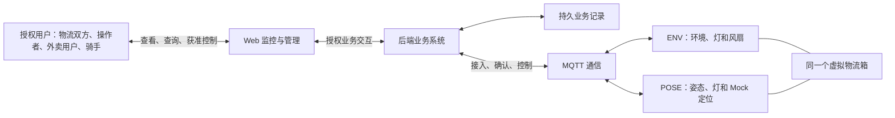
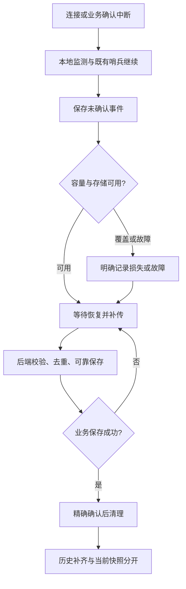

# SmartBox 系统需求规格说明书

| 文档信息 | 内容 |
|---|---|
| 版本与状态 | V1.1 评审稿 |
| 编写日期 | 2026-11-06 |
| 适用项目 | SmartBox：基于 OpenHarmony 的多功能智能物流监测与管理系统 |
| 适用对象 | 产品与系统分析人员、设备端/后端/前端开发人员、测试人员及课程项目评审者 |
| 分析基线 | 仓库 BL-002；参考提交 8b25e164349ac19510d62f2824a71a61c2a65c0f；用户本次提供的硬件情况及已确认的编写方案 |
| 文档定位 | 系统级需求总纲，说明业务目标、系统行为、功能协作、边界和验收；与现有详细 REQ、NFR 形成关联 |
| 实现状态 | 仓库当前交付为 P0 文档及工程基线；本说明书不代表 SmartBox 业务软件已完成或通过验收 |

**使用约定：**“应”用于重述有来源的现行要求；“待确认”“待设计决策”“待硬件验证”分别表示业务规则未定、实现细化未定、实际能力尚需验证。建议均显式标注。本稿不新增业务功能，CR-002仅批准组织与编号迁移、不批准未决规则，也不以总纲名义覆盖仍有冲突的详细规范。待决问题须先评审并在后续获准的变更中落实，不能由实现者任选规则。

据用户本次说明，两块 BearPi-HM Nano 及对应扩展板的官方例程已经能够正常编译、烧录和运行。这是**用户提供的最新基础事实**，不是本次重新执行实验所得的结果，更不代表 SmartBox 固件、Flash 事件存储、跨端协同或系统指标已经验证。仓库历史记录中“硬件正常为假设”的表述保留；当前资料同步区分官方例程与项目验证，差异见第十章。

## 目录

1. [第一章：项目概述](#chapter-1)
2. [第二章：业务需求分析](#chapter-2)
3. [第三章：系统总体需求与边界](#chapter-3)
4. [第四章：系统功能需求分析](#chapter-4)
5. [第五章：系统核心业务流程](#chapter-5)
6. [第六章：系统状态与数据需求](#chapter-6)
7. [第七章：非功能需求](#chapter-7)
8. [第八章：系统约束与实现边界](#chapter-8)
9. [第九章：系统验收要求](#chapter-9)
10. [第十章：需求关联与待决问题](#chapter-10)
11. [参考资料索引](#references)

## 第一章：项目概述

### 1.1 背景与业务问题

物流运输和外卖配送中的箱体通常只承担容纳物品的作用，运输过程中的环境、姿态和开合行为难以被持续观察。发生物品受损、温湿度异常或疑似擅自开启时，参与者可能只能提供当前状态或主观描述，缺少连续、具有来源和时间信息的过程记录。

单一温度读数不能解释一次异常是否持续，单一倾斜不能证明箱盖被打开，一条消息发送成功也不能证明记录已经保存。设备偶发离线时，如果系统把历史值继续显示为当前值，还可能使用户错误判断运输过程正常。因此，系统既需要采集信息，也需要判断其有效性、形成可解释的事件、说明能力降级，并提供适合不同参与者的信息。

SmartBox 以这些问题为出发点，建设“可感知、可判断、可追溯、可分角色使用”的课程项目原型。[依据：原始需求第1.1～1.2节、产品范围，见参考资料 R01、R03。]

### 1.2 建设目标与产品定位

SmartBox 是物流过程的监测与管理系统。它通过 ENV 和 POSE 节点协同观察一个箱体，由后端形成箱体级视图，通过 Web 提供监控、查询、授权控制和异常追溯。

| 建设目标 | 对用户的价值 |
|---|---|
| 连续观察环境与姿态 | 了解物品所处条件及搬运动作，识别持续异常与无效数据 |
| 记录异常及恢复过程 | 区分短时干扰、持续异常和已恢复现象 |
| 形成开合证据与实验性结论 | 说明结论来自哪些证据、可信程度如何，避免把单一变化当确定事实 |
| 提供哨兵与授权控制 | 在临时防护场景中快速提示异常，并显示指令是否实际执行 |
| 支持有限离线记录和恢复 | 网络不稳定时保持本地能力，恢复后补齐容量范围内的事件 |
| 聚合多节点、按角色提供信息 | 让用户看到同一个箱体的业务状态，同时避免越权 |
| 留出替换和扩展路径 | 保留模拟与真实模块的边界，支持后续验证与演进 |

系统提供过程观察和追溯依据，不自动完成责任裁定，不构成真实冷链控制、安全认证、防盗保障或物流平台。

### 1.3 建设范围

本期使用两块开发板模拟一个虚拟物流箱：ENV 负责环境及灯/风扇，POSE 负责姿态、冲击候选、本地灯提示及 GPS Mock。设备经 MQTT 上报，后端处理接入、数据保存、事件、融合、告警、命令和权限，Web 提供授权视图。

范围包括六个一级业务模块及47项子需求和现有 NFR：设备接入与远程控制、环境监测、姿态与冲击、实验性开合、哨兵、模拟定位及围栏、事件及补传、箱体聚合、角色权限。数据模型允许多个逻辑箱体及其授权，但实际双板演示不证明任意规模的并发能力。

本期不制作实体箱体、不安装真实 GPS，不承诺真实门识别准确率，不增加声音/振动执行器，不对接真实订单、支付、派单、物流运单或外部物流平台。自助账号注册、设备绑定管理后台、人工告警工单也未被确认为当前功能。[依据：R03、R04、R05、R17。]

### 1.4 核心价值与完成含义

项目的价值来自信息之间的联系：环境和姿态提供观察，规则产生事件，开合融合提供解释，哨兵提供防护场景，持久化保证有限条件下可追溯，箱体聚合和权限使信息可被正确使用。

系统完成意味着这些能力在约定边界内形成闭环，并有真实执行证据。只有界面、只有模拟上报、只有官方例程，或只有文档检查通过，都不等于整个 SmartBox 完成。

### 1.5 术语与定义

| 术语 | 本文含义 |
|---|---|
| 虚拟物流箱/箱体 | 两个已配置节点共同表示的业务对象；当前没有实体箱体 |
| ENV / POSE | 环境节点 / 姿态节点；分别搭载 IA1 / SC2 |
| 设备绑定 | 受控配置节点身份、角色及其所属箱体；不等于已有自助绑定界面 |
| 物品画像 | 环境判断使用的阈值等配置；演示画像不代表真实货物保存规范 |
| 门证据/开合结论 | 单节点候选 / 后端综合证据形成的实验性判断 |
| 置信度 | 结论的证据支持程度，不是经过实际箱体统计验证的识别准确率 |
| 哨兵 | 节点布防后对规定异常进行本地提示并记录、上报的工作模式 |
| 事件/告警 | 对一次变化或行为的记录 / 对需要关注的异常的分级表达；并非所有事件都是告警 |
| 实时快照/历史数据 | 当前可用的最新状态 / 已发生过程的记录，后者不能冒充当前状态 |
| 数据有效/新鲜/在线 | 测量是否可用 / 是否足够及时 / 节点近期是否可通信，三者相互独立 |
| 业务确认 | 后端可靠保存事件后的确认，不等于 MQTT 传输确认 |
| MOCK | 软件生成的定位来源；必须显式展示 |
| REQ / NFR / TC | 已有功能需求 / 非功能需求 / 测试用例编号，本文不重编号 |

更多术语和技术字段由现有[术语表](product/术语表.md)及根目录[接口契约](../../contracts/README.md)定义。

## 第二章：业务需求分析

### 2.1 问题到业务能力的关系

| 业务问题 | 需要的信息或行为 | 对应领域 |
|---|---|---|
| 环境是否持续异常难以判断 | 连续有效读数、画像、异常开始与恢复 | REQ-M01-001、REQ-M01-002、REQ-M01-003、REQ-M01-004、REQ-M04-001、REQ-M04-002、REQ-M04-003、REQ-M04-004、REQ-M04-005、REQ-M04-006、REQ-M04-007、REQ-M04-008 |
| 搬动、倒置和冲击难以还原 | 校准后的姿态、冲击候选及时间质量 | REQ-M01-005、REQ-M01-006、REQ-M01-007、REQ-M04-001、REQ-M04-002、REQ-M04-003、REQ-M04-004、REQ-M04-005、REQ-M04-006、REQ-M04-007、REQ-M04-008 |
| 光照或倾角容易被误当开门 | 原始证据、双源关联、置信度和降级原因 | REQ-M01-008、REQ-M01-009、REQ-M01-010、REQ-M01-011、REQ-M05-001、REQ-M05-002、REQ-M05-003、REQ-M05-004、REQ-M05-005、REQ-M03-004 |
| 暂离配送物品时缺少异常提示 | 布防、逐节点状态、本地提示与远程告警 | REQ-M02-001、REQ-M02-002、REQ-M02-003、REQ-M02-004、REQ-M02-005、REQ-M02-006、REQ-M03-006、REQ-M03-001、REQ-M03-002、REQ-M03-003、REQ-M03-004、REQ-M03-005、REQ-M03-006、REQ-M03-007、REQ-M03-008 |
| 需要演示位置变化及越界逻辑 | 明确标记的 Mock 轨迹、有效性和围栏结果 | REQ-M01-012、REQ-M01-013、REQ-M01-014 |
| 断网造成过程记录断裂 | 本地事件保存、损失说明、补传与去重 | REQ-M04-001、REQ-M04-002、REQ-M04-003、REQ-M04-004、REQ-M04-005、REQ-M04-006、REQ-M04-007、REQ-M04-008 |
| 多块板的数据难以对应同一箱体 | 固定归属、统一视图、独立质量状态 | REQ-M03-001、REQ-M03-002、REQ-M03-003、REQ-M03-004、REQ-M03-005、REQ-M03-006、REQ-M03-007、REQ-M03-008、REQ-M05-001、REQ-M05-002、REQ-M05-003、REQ-M05-004、REQ-M05-005、REQ-M03-004 |
| 参与者看到的信息和控制权不同 | 角色及箱体双重授权、各出口一致限制 | REQ-M06-001、REQ-M06-002、REQ-M06-003、REQ-M06-004、REQ-M06-005、REQ-M06-006、REQ-M05-005 |

### 2.2 用户与参与者

| 参与者 | 使用目的与关注信息 | 职责及交互边界 |
|---|---|---|
| 物流寄件人/收件人 | 查看授权箱体的环境、姿态、轨迹、开合和异常历史 | 只读业务信息；不控制设备、不取得凭据 |
| 物流操作者 | 监控授权箱体，调整既有配置、布撤防并导出记录 | 进行获准操作，查看逐节点执行结果；不因该角色自动拥有账号/设备管理后台 |
| 外卖用户 | 了解授权箱体环境、模拟位置、开合结论与相关告警 | 不读取原始姿态/光照证据或设备诊断，不执行控制 |
| 骑手 | 查看配送过程证据、临时布撤防、证明系统记录的过程 | 可对授权箱体布撤防；不调整画像、校准、GPS模式或任意输出 |
| 受控初始化参与者 | 准备演示账号、箱体、节点身份和授权范围 | 通过受控初始化完成必要配置；不是新增的日常产品角色或管理端 |
| ENV/POSE 节点 | 执行采集、本地判断、记录、提示和命令 | 只以自身身份访问允许主题；不能替代用户授权 |
| 网络、时间服务与消息系统 | 提供通信和时间基础 | 不保证业务结论和最终数据保存；故障须可降级 |

具体权限沿用[角色与权限](product/角色与权限.md)及 REQ-M06-001、REQ-M06-002、REQ-M06-003、REQ-M06-004、REQ-M06-005、REQ-M06-006、REQ-M05-005。物流场景的“全量业务信息”不包含密码、密钥或其他箱体的数据。

### 2.3 场景一：物流运输过程监测

- **背景与参与者：** 寄收件人希望了解运输过程，物流操作者需要发现异常；ENV/POSE 提供数据。
- **触发与目标：** 箱体完成受控初始化并上线后开始监测，目标是持续呈现可用环境和姿态，而非只提供一个当前数值。
- **业务过程：** 节点采集并标记质量；后端按箱体归属聚合；用户查看授权视图；异常进入和恢复形成可追溯记录。
- **期望结果：** 数据来源、时间、有效性及异常状态清楚，操作者能区分已恢复异常和仍在持续的异常。
- **异常情况：** 无效读数、节点缺失、未校时或网络断开时，不填零或保持“正常”假象；显示局部可用和降级。

### 2.4 场景二：异常开合与过程追溯

- **背景与参与者：** 物流方或骑手需要解释箱体是否出现疑似开启，寄收件人或外卖用户需要了解相关结论。
- **触发与目标：** 人为改变光照和转动 SC2，产生实验性候选；目标是形成可解释记录，而不是认定实际擅自开门。
- **业务过程：** 两节点形成各自证据；后端核对时间和质量后融合；结论关联证据；不同角色查看允许的信息；必要时导出授权事件。
- **期望结果：** 一次模拟开合不被重复消息刷成多次，结论可说明单源、双源、置信度和限制。
- **异常情况：** 仅光照、仅倾角、补光污染、未校时或迟到数据不能被强行拼成高置信开门。历史证据只能解释历史，不重新宣布现场刚发生开启。

### 2.5 场景三：外卖用户查看配送情况

- **背景与参与者：** 外卖用户希望知道环境是否异常、模拟位置如何变化、是否有实验性开合告警；骑手提供配送操作场景。
- **触发与目标：** 用户登录并进入获授权箱体，目标是获得简洁、及时、不会误导的业务信息。
- **业务过程：** 系统校验角色和箱体范围，展示环境、Mock 定位、融合结论及相关告警；实时更新中断后提示并重新同步。
- **期望结果：** 用户看得到约定信息，但不能通过更换地址或订阅方式取得证据明细与控制能力。
- **异常情况：** 模拟坐标不能标为真实骑手位置；离线、过期和定位无效必须解释。本期没有真实外卖订单或骑手账号平台对接。

### 2.6 场景四：骑手临时布防

- **背景与参与者：** 骑手临时离开配送物品，希望系统记录并提示异常；物流操作者也可执行同类授权操作。
- **触发与目标：** 用户发起布防，目标是确认所有必需节点是否真正进入规定状态。
- **业务过程：** 授权检查后逐节点下发，节点进入缓冲再确认实际状态；布防期间异常触发本地提示和远程事件；用户撤防并查看结果。
- **期望结果：** 页面显示每个节点与箱体整体结果，部分成功不冒充全部已布防。
- **异常情况：** 离线、拒绝、超时、重启及迟到回执必须可见；网络断开不表示已撤防。部分节点已执行时不能假装回滚。

### 2.7 场景五：网络中断后的过程恢复

- **背景与参与者：** 运输网络可能中断，节点、后端和监控用户都需要区分现场能力与远程可见能力。
- **触发与目标：** Wi-Fi、Broker或后端不可用，目标是在有限资源内继续本地监测，并在恢复后补齐事件。
- **业务过程：** 本地采集、规则和已布防能力继续；事件保存；网页标记远程信息过期/离线；恢复后补传，后端可靠保存、去重并确认。
- **期望结果：** 容量内事件可以追溯，重复不重复计数；超容量的损失明确可见。
- **异常情况：** 数据保存失败、容量覆盖、校时不可靠或确认丢失时，系统不能宣称全过程完全无损；历史补传不能覆盖实时快照。

### 2.8 需求之间的协同原则

环境、姿态和定位既产生观察，也为业务规则提供输入；开合与哨兵产生不同语义的判断；事件服务保留过程；箱体聚合提供一致视图；角色权限限制谁能看和操作。快速哨兵提示无需等待后端门结论，门结论也不能被当作已经识别了行为人的身份。

用户的查看、系统的异常判断、设备的动作执行和后端的数据保存是不同业务事实，应分别表达其结果。后续章节围绕这些事实串联流程，而不把六个模块当作互不相关的演示按钮。

## 第三章：系统总体需求与边界

### 3.1 系统参与关系

图示表达业务参与关系，不规定代码部署或数据库结构。两个节点保持独立身份，后端按预配置关系组合为一个箱体；Web只向后端提出授权业务请求。

### 3.2 各组成部分应提供的能力

| 组成部分 | 系统级职责 | 不应被误解为 |
|---|---|---|
| ENV | 采集温湿度/光照，进行规定环境与光照判断，记录事件，执行灯/风扇及布撤防 | 具备实际制冷、可靠温控或振动提示装置 |
| POSE | 采集加速度和姿态、校准、冲击候选、倾角证据、Mock定位与本地灯提示 | 能单凭板件辨别真实掀盖和整箱搬动，或取得真实GPS |
| MQTT通信 | 承载身份受限的上报、回执和下行，支持重连后的重新接入 | 传输确认即业务保存，或QoS即可替代业务去重 |
| 后端 | 校验接入和归属，保存/查询数据，聚合状态、融合证据、告警、控制和鉴权 | 真实物流运营平台、自动责任判定系统 |
| 业务持久化 | 保存身份、观测、事件、结论、命令结果及必要审计，支持恢复与追溯 | 每秒所有遥测都可无限离线保存 |
| Web | 展示角色允许的数据、质量和降级，发起允许的命令并呈现实际结果 | 前端隐藏按钮就已实现权限隔离 |

### 3.3 外部边界和初始化前提

系统依赖可互访网络、供电、时间服务和既有开发环境。本期“云端”首先指局域网后端与Broker，不意味着已经完成公网生产部署。用户浏览器不是设备认证主体，设备也不是业务用户。

设备接入前应已具备唯一身份、正确箱体归属和通信授权；用户查看前应具备账号、角色和箱体范围。现有规范仅确认受控配置，不应推导出新的注册、绑定或授权管理界面。配置的责任归属及替换流程见待决问题 Q-03。

### 3.4 信息与控制边界

系统应保留“观测—事件—结论—告警”的关联：一次有效采样未必形成事件，单份门证据未必形成开门结论，普通事件未必构成告警。用户应能按权限追溯到相关依据。

远程控制应有授权、目标、请求身份、实际执行结果和失败原因。命令被接受不等于设备已执行；某节点成功不等于箱体全部成功。节点离线时的本地状态与后端最后已知状态可以不同，系统应表达不确定性，不提供虚假的同步保证。

## 第四章：系统功能需求分析

本章按业务领域组织，章节顺序不改变既有编号。具体算法、阈值和消息格式仍由详细需求及契约定义；存在缺口时引用第十章，不用新的推测填补。

### 4.1 MOD-01 物流箱运行监测

观察环境、姿态、实验性开合与MOCK位置，产生可解释监测现象。 不实现事件可靠存储底层、不聚合箱体全部状态、不决定布撤防命令的最终业务结果。

**参与者与输入：** ENV/POSE、后端、物流寄收件人、物流操作者、骑手及外卖用户（按字段权限）。输入与各子需求的前置条件见[模块权威需求](modules/MOD-01-物流箱运行监测.md)。

**系统协作流程：** ENV和POSE独立采样并保留有效性、时间及执行器状态。 → 按画像、基准姿态和MOCK配置形成监测状态，只有满足现行规则才产生事件。 → 环境光照与倾角形成独立证据，按时间和质量融合，保留单源/未知/历史区别。 → 将监测现象交防护模块使用，将事件交可靠性模块保存，将结果交聚合模块展示。

**状态及输出边界：** 有效/无效/未校准、姿态等级、环境异常与恢复、证据候选/已关联/未融合、OPEN/CLOSED/UNKNOWN、定位有效/无效；它们不等于网络在线或人工处理状态。

**子需求：** [REQ-M01-001](modules/MOD-01-物流箱运行监测.md#req-m01-001)、[REQ-M01-002](modules/MOD-01-物流箱运行监测.md#req-m01-002)、[REQ-M01-003](modules/MOD-01-物流箱运行监测.md#req-m01-003)、[REQ-M01-004](modules/MOD-01-物流箱运行监测.md#req-m01-004)、[REQ-M01-005](modules/MOD-01-物流箱运行监测.md#req-m01-005)、[REQ-M01-006](modules/MOD-01-物流箱运行监测.md#req-m01-006)、[REQ-M01-007](modules/MOD-01-物流箱运行监测.md#req-m01-007)、[REQ-M01-008](modules/MOD-01-物流箱运行监测.md#req-m01-008)、[REQ-M01-009](modules/MOD-01-物流箱运行监测.md#req-m01-009)、[REQ-M01-010](modules/MOD-01-物流箱运行监测.md#req-m01-010)、[REQ-M01-011](modules/MOD-01-物流箱运行监测.md#req-m01-011)、[REQ-M01-012](modules/MOD-01-物流箱运行监测.md#req-m01-012)、[REQ-M01-013](modules/MOD-01-物流箱运行监测.md#req-m01-013)、[REQ-M01-014](modules/MOD-01-物流箱运行监测.md#req-m01-014)。

**异常与验收目标：** 模块记录正常、分支、断网、超时、重启、重复与迟到等适用行为，按其子需求关联的TC验收；Q问题未获确认前不自行选择规则。详细参数不在总纲重复维护。

### 4.2 MOD-02 安全防护与哨兵

以获准布撤防及本地快速异常响应提供临时防护，保留逐节点及箱体操作事实。 不采集传感器、不实现MQTT底层、不代替事件持久化或用户授权。

**参与者与输入：** 骑手、物流操作者、ENV/POSE及后端。输入与各子需求的前置条件见[模块权威需求](modules/MOD-02-安全防护与哨兵.md)。

**系统协作流程：** 授权用户发起布撤防，按配置中的必需节点建立操作。 → 设备控制模块分别下发，节点校验版本并完成规定缓冲后返回实际状态。 → 根据必需节点全部结果形成整体结论；失败或超时保留部分成功事实。 → 已布防时快速异常先本地提示并留痕；断网保持；到期和重启按原约束恢复或降级。

**状态及输出边界：** 节点未布防/缓冲/实际ARMED，与整体PENDING/RUNNING/SUCCEEDED/PARTIAL/FAILED/EXPIRED分别表达。操作超时不证明设备未执行，重启期限不可靠必须降级。

**子需求：** [REQ-M02-001](modules/MOD-02-安全防护与哨兵.md#req-m02-001)、[REQ-M02-002](modules/MOD-02-安全防护与哨兵.md#req-m02-002)、[REQ-M02-003](modules/MOD-02-安全防护与哨兵.md#req-m02-003)、[REQ-M02-004](modules/MOD-02-安全防护与哨兵.md#req-m02-004)、[REQ-M02-005](modules/MOD-02-安全防护与哨兵.md#req-m02-005)、[REQ-M02-006](modules/MOD-02-安全防护与哨兵.md#req-m02-006)。

**异常与验收目标：** 模块记录正常、分支、断网、超时、重启、重复与迟到等适用行为，按其子需求关联的TC验收；Q问题未获确认前不自行选择规则。详细参数不在总纲重复维护。

### 4.3 MOD-03 设备接入与控制

校验接入身份与能力，管理通信、时间质量、节点在线及通用命令闭环。 不创建完整资产后台、不代替哨兵整体结果、不维护第二套箱体归属。

**参与者与输入：** 节点、后端、获准控制者；网页不直连Broker。输入与各子需求的前置条件见[模块权威需求](modules/MOD-03-设备接入与控制.md)。

**系统协作流程：** 核对预配置身份、箱体归属、角色能力和消息身份，非法不接入。 → 建立独立连接并订阅，持续上报心跳与时间质量，通信恢复后重新订阅。 → 将获准请求按能力及时效发送，节点实际执行后回执，后端关联操作结果。 → 重连与业务状态独立，重复/非法/过期输入不导致意外动作。

**状态及输出边界：** 连接、校时和能力是独立维度。以接收时间和有效通信判在线，设备时间不伪造在线；本地MONITORING/SENTRY不因连接断开而被替代。

**子需求：** [REQ-M03-001](modules/MOD-03-设备接入与控制.md#req-m03-001)、[REQ-M03-002](modules/MOD-03-设备接入与控制.md#req-m03-002)、[REQ-M03-003](modules/MOD-03-设备接入与控制.md#req-m03-003)、[REQ-M03-004](modules/MOD-03-设备接入与控制.md#req-m03-004)、[REQ-M03-005](modules/MOD-03-设备接入与控制.md#req-m03-005)、[REQ-M03-006](modules/MOD-03-设备接入与控制.md#req-m03-006)、[REQ-M03-007](modules/MOD-03-设备接入与控制.md#req-m03-007)、[REQ-M03-008](modules/MOD-03-设备接入与控制.md#req-m03-008)。

**异常与验收目标：** 模块记录正常、分支、断网、超时、重启、重复与迟到等适用行为，按其子需求关联的TC验收；Q问题未获确认前不自行选择规则。详细参数不在总纲重复维护。

### 4.4 MOD-04 事件管理与可靠性

提供事件身份、可靠保存、精确确认、去重、补传和恢复。 不决定环境异常或哨兵侵入的业务含义，也不替查询视图决定权限。

**参与者与输入：** 各事件产生模块、ENV/POSE、后端与授权追溯者。输入与各子需求的前置条件见[模块权威需求](modules/MOD-04-事件管理与可靠性.md)。

**系统协作流程：** 业务模块提供稳定事件和原始时间质量，本地先可靠保存再发送。 → 后端校验并将事件与必要派生工作可靠提交，之后确认精确事件集合。 → 设备仅释放已确认记录；确认丢失可重发，重复和乱序按唯一键处理。 → 断网恢复补传；溢出、存储失败和掉电损坏明确报告，派生工作可恢复而非静默丢失。

**状态及输出边界：** 本地已保存、待发送/业务确认、后端已保存、派生待处理/完成、溢出/故障分别表达。PUBACK与业务确认不同，事件身份不因校时或重启复用。

**子需求：** [REQ-M04-001](modules/MOD-04-事件管理与可靠性.md#req-m04-001)、[REQ-M04-002](modules/MOD-04-事件管理与可靠性.md#req-m04-002)、[REQ-M04-003](modules/MOD-04-事件管理与可靠性.md#req-m04-003)、[REQ-M04-004](modules/MOD-04-事件管理与可靠性.md#req-m04-004)、[REQ-M04-005](modules/MOD-04-事件管理与可靠性.md#req-m04-005)、[REQ-M04-006](modules/MOD-04-事件管理与可靠性.md#req-m04-006)、[REQ-M04-007](modules/MOD-04-事件管理与可靠性.md#req-m04-007)、[REQ-M04-008](modules/MOD-04-事件管理与可靠性.md#req-m04-008)。

**异常与验收目标：** 模块记录正常、分支、断网、超时、重启、重复与迟到等适用行为，按其子需求关联的TC验收；Q问题未获确认前不自行选择规则。详细参数不在总纲重复维护。

### 4.5 MOD-05 物流箱管理与状态聚合

管理受控箱体关系，组合多节点信息及独立状态，提供当前和历史查询。 不增加发货/签收/订单，不重新判断监测异常或定义第二套节点在线规则。

**参与者与输入：** 受控初始化参与者、后端与各授权查看角色。输入与各子需求的前置条件见[模块权威需求](modules/MOD-05-物流箱管理与状态聚合.md)。

**系统协作流程：** 受控准备箱体与固定节点归属、必需节点，接受接入模块校验后的信息。 → 按字段时间/质量组织快照，并列连接、告警、哨兵和门状态。 → 单节点缺失保留可用数据，历史补传不推进实时值，恢复后重同步。 → 接收用户模块限定的查询范围，组织稳定分页、轨迹和导出内容。

**状态及输出边界：** 连接完整性、告警、门、哨兵与字段质量并存。当前值、最后已知值、补传历史分开，在线不代表传感器有效或数据新鲜。

**子需求：** [REQ-M05-001](modules/MOD-05-物流箱管理与状态聚合.md#req-m05-001)、[REQ-M05-002](modules/MOD-05-物流箱管理与状态聚合.md#req-m05-002)、[REQ-M05-003](modules/MOD-05-物流箱管理与状态聚合.md#req-m05-003)、[REQ-M05-004](modules/MOD-05-物流箱管理与状态聚合.md#req-m05-004)、[REQ-M05-005](modules/MOD-05-物流箱管理与状态聚合.md#req-m05-005)。

**异常与验收目标：** 模块记录正常、分支、断网、超时、重启、重复与迟到等适用行为，按其子需求关联的TC验收；Q问题未获确认前不自行选择规则。详细参数不在总纲重复维护。

### 4.6 MOD-06 用户与权限管理

为身份、角色、箱体范围、字段、控制和导出提供一致授权及审计。 不替聚合模块组织所有业务数据，不新增自助注册或用户管理后台。

**参与者与输入：** 物流寄收件人、物流操作者、外卖用户、骑手及后端授权服务。输入与各子需求的前置条件见[模块权威需求](modules/MOD-06-用户与权限管理.md)。

**系统协作流程：** 受控账号登录后建立有期限身份，校验角色与箱体范围。 → 对查询、实时订阅、操作号、控制和导出采用相同权限规则。 → 服务端裁剪字段后交页面，禁止以隐藏按钮代替拒绝访问。 → 操作及拒绝保留脱敏审计；令牌失效重认证，不通过URL或日志泄漏秘密。

**状态及输出边界：** 认证有效/失效与允许/拒绝访问分开，角色与箱体范围同时满足。查看不改变设备状态或告警处理状态，控制成功不由前端判断。

**子需求：** [REQ-M06-001](modules/MOD-06-用户与权限管理.md#req-m06-001)、[REQ-M06-002](modules/MOD-06-用户与权限管理.md#req-m06-002)、[REQ-M06-003](modules/MOD-06-用户与权限管理.md#req-m06-003)、[REQ-M06-004](modules/MOD-06-用户与权限管理.md#req-m06-004)、[REQ-M06-005](modules/MOD-06-用户与权限管理.md#req-m06-005)、[REQ-M06-006](modules/MOD-06-用户与权限管理.md#req-m06-006)。

**异常与验收目标：** 模块记录正常、分支、断网、超时、重启、重复与迟到等适用行为，按其子需求关联的TC验收；Q问题未获确认前不自行选择规则。详细参数不在总纲重复维护。

## 第五章：系统核心业务流程

以下为目标业务行为，不是已执行记录。流程中没有依据的分支直接列为待决，不虚构一个完整但未经确认的生命周期。

### 5.1 物流箱初始化与设备绑定

**前置条件：** 已具备两节点、可用网络及受控初始化条件；操作者有环境配置权限。当前没有自助注册或绑定界面。

**触发：** 为首次演示准备一个虚拟箱体。

**正常流程：**

1. 受控配置箱体身份、环境画像及必需的ENV/POSE节点。
2. 为节点设置唯一身份、角色、箱体归属和通信授权，不能共用同一设备身份。
3. 准备演示用户角色与箱体授权，不把物流操作者角色等同全部初始化权限。
4. 节点接入时由系统核对配置，箱体视图等待有效观测；待数据和质量条件满足后呈现可用状态。

**关键分支与异常：** 节点未注册、角色不符、归属冲突或身份重复时拒绝相应接入，不靠自动改绑消除冲突。缺一必需节点时保留部分能力，不宣称双节点完整。替换、解绑、退役、权限移交的授权主体和流程见Q-03。

**结束条件与结果：** 身份、归属及用户范围准备完成，节点可以按既有配置进入上线流程；未上线或未采集有效数据的箱体不能因此被标为监测正常。

依据：REQ-M03-001、REQ-M03-002、REQ-M03-003、REQ-M03-004、REQ-M03-005、REQ-M03-006、REQ-M03-007、REQ-M03-008/008/009及角色权限“受控初始化”说明。

### 5.2 设备上线与监测启动

**前置条件：** 节点已配置，SmartBox对应固件在目标阶段可用；官方例程可运行并不能替代此前提。

**触发：** 上电、复位或连接恢复。

**正常流程：**

1. 节点初始化角色、采集与本地工作状态，恢复能够可信恢复的记录。
2. 尝试联网和校时，以独立设备身份接入通信系统。
3. 完成下行订阅，上报角色、能力、质量和实际状态。
4. 后端校验后更新该节点在线信息，按字段质量形成箱体当前视图。
5. 节点持续采集与本地判断，网络任务处理上报、回执及补传。

**关键分支与异常：** 未联网仍保留本地监测；校时失败可以带未校时标记上报，不能把运行时间当UTC。接入失败持续恢复；传感器或姿态基准未就绪时展示对应无效/未校准。历史补传和当前上线声明分开。

**结束条件与结果：** 本地工作状态和远程可见程度明确；可以处于“本地监测中、远程不可达”，不要求只有一条正常路径。

依据：REQ-M01-005、REQ-M01-006、REQ-M01-007/006/007/008。

### 5.3 日常环境与姿态监测

**前置条件：** 采集服务运行，画像和必要校准已准备；网络不是本地采集的必要条件。

**触发：** 周期采样或有效样本到达。

**正常流程：**

1. 分别采集环境、加速度并附质量和时间。
2. 更新有效观察，执行环境和姿态规则，持续正常时不生成无意义的重复异常事件。
3. 联网时上报当前数据，后端按来源与新鲜度更新授权快照。
4. 用户查看环境、姿态及对应状态；查看范围受角色限制。

**关键分支与异常：** 无效样本中断相关连续判断；未校准/强动态时不输出可信倾角。补光开启影响门证据，不应被误当开合。网络失败转入5.8，不抹除本地状态。

**结束条件与结果：** 每轮采集形成新的有效观察或明确的无效结果；检测到变化时进入相应异常流程，周期监测继续。

依据：REQ-M01-001、REQ-M01-002、REQ-M01-003、REQ-M01-004/002/008。

### 5.4 环境异常检测与告警

**前置条件：** 有适用画像与有效环境输入。

**触发：** 有效读数达到超限候选条件。

**正常流程：**

1. 连续有效样本满足去抖后确认异常进入，保留类型和时间。
2. 形成事件，按已定规则表达告警并保存/上报；持续异常不逐帧重复进入。
3. 后端聚合，向有权限用户展示持续异常及记录。
4. 数据达到回差和恢复条件后产生恢复记录，用户仍可查询原异常过程。

**关键分支与异常：** 单帧尖峰不升级为持续异常；无效数据不计作恢复。有效模拟开门结论可触发现有抑制窗口，采集和已有告警继续；离线缺少该结论时不会同样推断窗口。画像变化后的判定接续见Q-09。

**结束条件与结果：** 形成已恢复的过程，或维持持续异常状态；查看过告警不等于已经解决，人工确认/处理见Q-05。

依据：REQ-M01-001、REQ-M01-002、REQ-M01-003、REQ-M01-004；离线抑制差异见Q-08。

### 5.5 开合行为检测与事件生成

**前置条件：** 有环境/姿态基准及节点质量信息；演示者明确使用光照和转板动作模拟。

**触发：** 节点观察到符合规定的开/关候选。

**正常流程：**

1. 节点排除已知执行器干扰，形成各自证据并保存。
2. 后端接收证据，校验事件时间、节点状态和质量，进入规定候选窗口。
3. 对符合条件的双源同类证据形成高置信实验性结论；不匹配的证据按单源规则处理。
4. 结论关联证据、避免重复消费，并按角色推送或查询。
5. 新的有效实时开门结论在适用条件下提供环境判断背景；历史结论只补历史。

**关键分支与异常：** 仅光照是光照异常，部分倾角仅是倾斜；证据不足或时间不可靠应降级。快速相反动作和单源关门不能被擅自扩成确定闭合，见Q-07。

**结束条件与结果：** 产生一个可解释结论、单源异常或未知/未融合结果，均保留其限制；不能输出真实门识别准确率或行为人身份。

依据：REQ-M01-008、REQ-M01-009、REQ-M01-010、REQ-M01-011及MQTT“时间与标识”。

### 5.6 哨兵布防、异常检测和撤防

**前置条件：** 操作者具有布撤防权限，箱体必需节点集合已配置。

**触发：** 授权用户提交布防或撤防意图。

**正常流程：**

1. 后端校验用户、目标和控制条件，记录操作并为必需节点分别发送命令。
2. 节点检查命令时效、能力及先后关系，布防时进入规定缓冲。
3. 节点实际完成后回报；后端依据全部必需节点结果表达整体状态。
4. 布防期间，规定快速异常触发本地灯/风扇提示，同时形成可追溯事件；远程显示依赖网络。
5. 用户发起撤防，系统仍逐节点执行与确认，不以“已发送”代替“已撤防”。

**关键分支与异常：** 缺失、超时或拒绝显示失败/部分成功及节点明细。断网不撤销已经生效的本地布防；重启或期限恢复不可靠时显示降级。超时后的迟到执行/回执及后续操作关系见Q-02。

**结束条件与结果：** 用户可以区分全部完成、部分完成、失败和待确认实际状态；告警发生不意味着自动撤防，撤防也不能删除历史异常记录。

依据：REQ-M02-001、REQ-M02-002、REQ-M02-003、REQ-M02-004、REQ-M02-005、REQ-M02-006、REQ-M03-006、REQ-M03-001、REQ-M03-002、REQ-M03-003、REQ-M03-004、REQ-M03-005、REQ-M03-006、REQ-M03-007、REQ-M03-008及既有命令契约。

### 5.7 定位更新与电子围栏检测

**前置条件：** POSE有可用Mock模式和围栏配置；配置入口的缺口见Q-04。

**触发：** 定位更新或模式变化。

**正常流程：**

1. 按模式生成带来源、时间、有效性的位置。
2. 按现有运动/静止规则调整更新频率，保留可复现行为。
3. 对连续有效点执行越界/恢复判定，生成对应事件；处于布防场景时为哨兵提供异常输入。
4. 后端保存、聚合并展示Mock位置或轨迹，使用者看得到模拟标记。

**关键分支与异常：** 无效点不能证明越界或恢复；旧点只能按历史展示。边界抖动通过已有连续和回差规则处理；静止更新频率与统一过期阈值不协调，见Q-01。

**结束条件与结果：** 当前定位有效/无效及围栏状态可解释，历史轨迹可查询，不对真实骑手位置作承诺。

依据：REQ-M01-012、REQ-M01-013、REQ-M01-014/008。

### 5.8 网络中断、数据保存与恢复

**前置条件：** 本地事件保存能力已按目标阶段实现；P1内存缓存不能替代最终掉电持久要求。

**触发：** Wi-Fi、Broker或后端中断，或事件无法得到业务确认。

**正常流程：**

1. 本地继续采集、判断和已生效的哨兵，保存未确认事件。
2. 远端按照心跳和数据新鲜度标记离线、过期或部分可用。
3. 节点持续尝试恢复；恢复连接和订阅后发送当前状态，并补传历史事件。
4. 后端校验、去重、可靠保存，再确认精确事件；派生处理能够继续恢复。
5. 节点清理被确认记录；用户可追溯补齐的历史，但实时快照不被其覆盖。

**关键分支与异常：** 确认丢失允许重发；数据库回滚不确认；溢出覆盖有持久损失信息。未校时不伪造发生时刻，存储失败不声称已保存。

**结束条件与结果：** 连接恢复且待确认事件按保存或明确损失状态被解释；当前视图重新反映当前数据。恢复通信不自动证明所有历史均完整。

该流程只对事件给出有限容量内的保证；不表示所有采样均离线保存，也不表示存储故障时仍能提供可靠留痕。

依据：REQ-M04-001、REQ-M04-002、REQ-M04-003、REQ-M04-004、REQ-M04-005、REQ-M04-006、REQ-M04-007、REQ-M04-008/007/008、NFR-002。

### 5.9 用户查看监测数据、历史事件和告警

**前置条件：** 用户具备账号、角色及箱体范围，系统存在相应数据或可说明的空状态。

**触发：** 登录、打开箱体、筛选历史或实时连接恢复。

**正常流程：**

1. 验证身份并返回授权箱体，限制可见功能。
2. 获取当前快照，显示值、时间、来源和质量。
3. 订阅获准实时信息；需要历史时按时间/类型等既有条件查询，记录与结论按稳定身份呈现。
4. 具备导出权限的用户可导出授权事件，记录审计。
5. 浏览器实时连接中断后显示同步情况，恢复时重新取得快照与所需历史并去重。

**关键分支与异常：** 无数据、无效、过期和无权是不同状态；不能以正常值填空。登录过期需重新认证，无权请求不能泄漏数据。外卖用户不读原始证据。查看历史告警不代表完成人工处理，见Q-05。

**结束条件与结果：** 用户获得当时可用且被授权的信息，知道其时效和模拟边界；查询/导出不改变设备实际状态。

依据：REQ-M05-001、REQ-M05-002、REQ-M05-003、REQ-M05-004、REQ-M05-005、REQ-M03-004/009及HTTP契约。

### 5.10 用户下发远程控制命令及查看执行结果

**前置条件：** 操作者有相应控制权限、目标可确定，设备能力和时间条件符合契约。

**触发：** 用户发起画像、GPS模式、校准、输出或布撤防操作。

**正常流程：**

1. 后端先校验箱体、角色、操作参数及重复请求，再建立可查询操作记录。
2. 按目标能力发送节点命令，网页展示处理中而非完成。
3. 节点校验并实际执行，回报结果和实际状态。
4. 后端关联节点回执，更新操作结果；多节点操作按必需节点合成。
5. 用户查询结果、失败原因和节点明细，审计保留操作过程。

**关键分支与异常：** 越权或参数非法不发送；重复请求不形成意外重复动作；无可靠UTC时拒绝远程执行；超时与实际失败分别表达。迟到、重启及画像生效一致性见Q-02/Q-09。

**结束条件与结果：** 有实际完成、明确拒绝/失败，或显式未完成/不确定的操作记录。没有回执不能宣布执行成功；本流程不增加离线排队控制或自动补执行规则。

依据：REQ-M03-001、REQ-M03-002、REQ-M03-003、REQ-M03-004、REQ-M03-005、REQ-M03-006、REQ-M03-007、REQ-M03-008/009及MQTT、HTTP命令规范。

## 第六章：系统状态与数据需求

### 6.1 设备与箱体生命周期的业务语义

设备初始化、校准、连接、采集和恢复是已有运行行为；箱体身份与节点关系通过受控配置形成。两者不等于完整资产生命周期系统。

| 对象 | 当前有依据的过程 | 尚无完整定义的过程 |
|---|---|---|
| 设备 | 受控配置、初始化、上线、断线/重连、复位恢复、监测与布防 | 注册审批、自助绑定、跨箱体迁移、替换、退役、凭据重置 |
| 虚拟箱体 | 受控建立、关联必需节点、等待可用数据、持续监测、异常及降级恢复 | 发货/签收/退回状态、运输任务创建/结束、归档或注销 |
| 用户授权 | 预配置角色与箱体范围，登录并受控访问 | 动态交接、多人协作修改、账号生命周期管理 |

不得把“离线”解释为“已退役”，或把“门关闭”解释为“已签收”。上表右栏是待确认范围，不是本期新增需求，见Q-03/Q-13。

### 6.2 连接、数据质量和本地工作状态

| 维度 | 业务含义 | 与其他状态的关系 |
|---|---|---|
| 在线/离线 | 后端依据近期有效通信和遗嘱判断 | 在线可伴随无效传感器；离线不代表本地停止 |
| 有效/无效/未校准 | 观测是否具有可用测量意义 | 无效不能用于异常恢复或可信倾角 |
| 新鲜/过期 | 数据年龄是否满足相应口径 | 最后有效值仍可过期，不能用心跳伪装重新采样 |
| 已校时/未校时 | 事件时间能否支持跨节点关联 | 未校时仍可本地判断，但高置信融合和远程命令受限 |
| 本地监测/哨兵 | 本地业务工作方式 | 与网络状态并存，不因断网自动变成撤防 |
| 存储正常/故障/溢出 | 事件留痕是否完整及容量情况 | 连通不代表未丢事件，溢出信息需单独展示 |

节点默认90秒无有效心跳/数据标离线，LWT可提前标记；环境/姿态默认5秒、定位15秒无新观测标过期；Q-01口径已由CR-004明确。补传发生在当前连接上可证明有通信，但其旧观测不能刷新当前字段的采样时间。

### 6.3 箱体综合状态

箱体应并列表达连接完整性、告警、哨兵、门状态和字段质量。可以同时出现“ENV离线、POSE在线、部分布防、存在历史告警、当前门未知”，不能用一个“正常/异常”标签掩盖这些不同事实。

部分节点缺失时应保留可用信息并说明受影响能力，例如单节点在线不能提供完整双源高置信门结论。页面颜色和摘要可以帮助理解，但具体优先级展示尚未定义，不在本稿新增一个覆盖其他维度的单一状态机。

### 6.4 门状态与证据状态

门结论至少涉及OPEN、CLOSED、UNKNOWN及置信度/时间质量。证据不足、未校准或未校时不能按默认CLOSED处理；门状态表达的是实验性推断，不是锁具或门磁的硬确认。

一份证据可以等待匹配、被结论关联或形成单源/未融合结果；同一份不能重复生成多份同类结论。历史结论是历史事实的解释，不是当前门状态命令。单源关闭时当前详细规则要求UNKNOWN，但从既有OPEN如何展示、如何保存最后已知状态仍需协调，见Q-07。

### 6.5 哨兵与远程命令状态

| 状态对象 | 现有业务含义 |
|---|---|
| 节点哨兵 | 未布防、布防缓冲、实际已布防；期限/恢复不确定时另有降级说明 |
| 箱体布防操作 | 等待或进行中，全部确认成功，部分成功，失败/超时；需保留每节点结果 |
| 命令记录 | PENDING、RUNNING、SUCCEEDED、PARTIAL、FAILED、EXPIRED是现HTTP设计的状态 |
| 最后已知实际状态 | 来源于节点回执/状态上报；可能与一次已超时操作的界面结果不同 |

“操作超时”仅说明未在规定时间完成确认，不能推断设备一定未执行。“整体已布防”需要所有必需节点确认；部分成功不能因为操作失败就被标为全部未布防。节点后续重启、离线和期限到期也可能改变实际状态，操作记录仍是历史操作记录。

迟到回执是否修正操作终态、如何表达重新上线后的状态收敛，尚未完整定义，见Q-02；本稿不擅自增设自动撤销或事务回滚。

### 6.6 告警与事件状态

告警表达异常的严重程度以及开始/持续/恢复关系。INFO/WARNING/CRITICAL属于级别，不是人工处理进度。异常恢复后事件仍可追溯；用户打开页面不改变异常是否存在。

事件需要区分已在本地保存、待发送/待业务确认、后端已保存、派生结论处理中/完成及溢出损失。这些是业务事实，不要求设备和后端共享同一个数据库式枚举。后端已确认原始事件不等于融合/告警派生已经完成，但后续工作应可恢复而非静默遗漏。

人工“已读、确认、处理、关闭”的含义与权限未定义，统一列Q-05。仅在事件类型存在恢复含义时谈恢复，不强行为一次冲击等瞬时事件补造“恢复告警”流程。

### 6.7 数据需求与实时/历史关系

| 数据类别 | 应能说明的信息 | 使用限制 |
|---|---|---|
| 身份与归属 | 箱体、节点、角色和能力 | 不允许跨箱体混入，不暴露凭据 |
| 观测 | 数值、单位、来源、发生/接收时间、有效性和新鲜度 | 无效不是零；过期不是当前实测 |
| 原始事件 | 稳定身份、来源、原时间和时间质量、类型、强度/上下文 | 重复不重复计数，冲突不能静默覆盖 |
| 箱体结论 | 证据关联、置信度、历史标记和限制 | 不提升为实际开门或行为人判断 |
| 告警 | 来源、级别、适用的开始/恢复 | 不等于人工处理工单 |
| 命令及回执 | 发起者、目标、实际结果、时间和失败原因 | 提交、发送和执行完成分开 |
| 审计与损失 | 授权操作、拒绝、溢出和存储故障 | 脱敏，不能记录密码或长期令牌 |

设备发生时间和服务器接收时间是不同概念；未校时不得伪造UTC。补传保留原始质量，估计时间与原始值应能区分。历史查询和当前快照使用不同语义，重连时重新同步，不以重放消息覆盖当前状态。

每秒遥测是否完整留存、历史保存期限及清理策略尚未统一；本期对离线完整性的硬保证限于容量内需保存的事件，见Q-06。

## 第七章：非功能需求

所有指标均为已有设计目标或验收口径，**当前未取得 SmartBox 系统实测成绩**。下表保留既定数值，并说明其测量范围，不将普通上报、规则去抖和门融合的时间混为一项。

### 7.1 性能、实时性与资源（NFR-001）

| 项目 | 现有目标/口径 | 验证状态 |
|---|---|---|
| 环境采集 | 每1秒采集，记录实际间隔与读取无效情况 | 待SmartBox板端验证 |
| 姿态采样 | 初始50Hz，实际周期与资源需核验；姿态展示最多1Hz | 初始设计参数，待硬件验证 |
| 心跳与在线 | 心跳默认30秒；90秒无有效通信标离线，LWT可提前 | 待集成与板端验证 |
| 数据新鲜度 | 环境/姿态5秒、定位15秒无新观测标过期 | CR-004已确认；缺观测依据为UNKNOWN |
| 普通事件在线链路 | 本地规则确认事件至网页显示≤2秒，不含去抖 | 正常局域网下待验证 |
| 哨兵本地快速响应 | 快速异常判定成立至灯/风扇输出≤1秒，不依赖云端 | 待板端测量；不是异常物理发生至显示的总耗时 |
| 门融合在线时延 | 后端收到首份候选至发布结论≤3秒；证据累计1.5秒和网络传送另计 | 待集成验证 |
| 节点RAM | 应用增量RAM峰值<60KB，排除SDK/Wi-Fi/TLS基线 | 待基线对照与实际峰值测量 |
| 节点Flash | 应用Flash增量<200KB | 待构建产物对照 |

时延应在正常局域网、双节点校时有效等既有条件下至少采集100次，报告最大值及P95；最大值超标应记录失败，不能只用平均值说明通过。网络中断期间不适用在线端到端时延，但本地响应和事件保存目标仍适用。

节点资源以基线构建/运行与应用增量比较，不能只累加代码中结构体大小。缺少后端吞吐、同时在线箱数、网页并发和大规模历史查询指标，不在本稿填入新数字，列Q-06。

依据：[性能与资源约束](quality/性能与资源约束.md)及REQ-M01-005、REQ-M01-006、REQ-M01-007。

### 7.2 可靠性与完整性（NFR-002）

| 项目 | 现有验收目标 | 限定条件 |
|---|---|---|
| 本地容量 | 每节点至少64条未确认事件 | 非所有遥测，不保证任意事件速率下30分钟无损 |
| 溢出 | 覆盖最旧未确认事件，持久暴露累计及损失范围 | 必须明确数据不完整，不能继续声称完全无损 |
| 断网恢复 | 验证2分钟和30分钟断网后自动重连、重新订阅和补传 | 容量内不丢不重，溢出单独验收 |
| 掉电恢复 | 写入、元数据和确认清理阶段合计至少10次断电 | 已承诺持久记录可恢复；未完成/损坏记录可识别，不污染其他已提交记录 |
| 长时稳定 | 连续24小时无非预期重启、无持续内存增长 | 每分钟记录连接、队列、堆内存及重启，解释正常波动 |
| 保存与确认 | 后端可靠保存后才业务确认；重复不重复入库 | 数据库回滚不确认，确认丢失允许重发 |
| 派生一致性 | 已确认的原始事件后续融合/告警可恢复处理 | 不以原始保存成功掩盖派生工作丢失 |

时钟回拨、设备重启、序号边界不应破坏事件身份，历史数据不冒充当前数据。掉电试验条件、KV能力、采样资源和实际周期必须保存原始证据；官方例程可用不能作为这些指标通过的依据。

依据：[可靠性与数据完整性](quality/可靠性与数据完整性.md)、REQ-M04-001、REQ-M04-002、REQ-M04-003、REQ-M04-004、REQ-M04-005、REQ-M04-006、REQ-M04-007、REQ-M04-008。

### 7.3 安全与权限（NFR-003）

系统应同时实施设备身份、通信方向、业务角色和箱体范围的限制。每节点使用独立凭据与受限主题，拒绝伪造身份和跨节点发布。后端、设备和用户的身份与权限不能混用。

Web查询、实时推送、命令及导出应采用一致授权和字段裁剪。凭据、密码、令牌不应出现在业务响应、日志和仓库中；登录失效、非法请求和拒绝应有明确且脱敏的反馈。导出还应满足已有格式与公式注入防护要求。

开发期1883仅限受控局域网及来源；生产要求TLS 8883，但本期不宣称生产安全部署已验收。长期令牌不能通过URL传播，实时连接采用现有契约的受控认证方式。本稿不新增认证技术。

依据：[安全与可维护性](quality/安全与可维护性.md)、REQ-M06-001、REQ-M06-002、REQ-M06-003、REQ-M06-004、REQ-M06-005、REQ-M06-006、REQ-M05-005及根目录契约。

### 7.4 可维护性与扩展性

系统应保留角色和能力边界，同源双角色构建，报文版本明确；不支持版本应拒绝而非猜测。配置、规则、实际结果可追踪，数据库变更按既有迁移约定管理，不因启动破坏已有数据。

模拟与真实输入边界应清楚，后续替换真实GPS不应改写定位业务含义；但这不表示真实模块已经接入。需求、设计、测试和证据需关联，本文按六模块及新子需求编号引用，追踪同步迁移但不改变既有任务和测试编号。

可扩展多个逻辑箱体不等于已经具备经验证的大规模部署能力。新增节点、外部平台和新执行器需后续确认，不能仅凭架构预留写为当前承诺。

## 第八章：系统约束与实现边界

### 8.1 硬件与环境约束

本期为两块BearPi-HM Nano，各通过E53接口搭载一块扩展板。ENV采用IA1，支持温湿度、光照与灯/风扇；POSE采用SC2，支持加速度/姿态相关采集和D1/D2灯控制。没有额外真实GPS、蜂鸣器、振动器、门磁或锁具。

官方例程运行证明基础路径已有用户报告的验证，不证明SmartBox使用的新周期、新任务、持久化或网络组合可稳定工作。量程、校准、执行器对测量的影响、Flash可用区域与掉电一致性仍需项目实测。

沿用现有OpenHarmony/C及SDK开发环境。旧SDK存在接口声明与实际实现不完全一致的历史风险，不能用头文件或模拟测试代替真实编译链接；不得使用未经核验的Flash地址。本稿不升级SDK或改变架构。[依据：R11、R14、R15。]

### 8.2 真实、模拟与未来能力的区分

| 能力 | 当前条件与目标 | 不可作出的结论 |
|---|---|---|
| 环境测量 | 有实际传感器，SmartBox需接入并验证 | 已有完整货物安全控制与认证 |
| 姿态和冲击 | 有实际加速度输入，业务检测待实现/验证 | 已证明真实跌落分类和安装准确率 |
| 开合 | 双板动作及光照实验，结论带置信度 | 已检测实体门、授权开门或非法开启 |
| GPS与围栏 | 软件模拟位置，验证逻辑和展示 | 已取得真实物品/骑手位置 |
| 本地提示 | 灯和风扇可作为输出目标 | 已有声响、振动或制冷能力 |
| 离线补传 | 目标为可靠保存的容量内事件 | 所有采样无限保存、任意断网完全无损 |
| 用户/设备管理 | 受控初始化、既有角色和访问范围 | 已有自助注册、动态绑定、完整资产管理后台 |

### 8.3 无实体箱体的影响

同一POSE节点在真实安装后可能反映箱身运动，也可能反映箱盖动作，当前没有实际装配可以证明两者区分。光照还受外部遮挡、环境和补光影响。因此本期验收关注“按明确动作与输入产生预期证据、融合、降级和记录”，不设置未经定义的真实门识别准确率。

演示应明确动作、基准姿态、光照条件及模拟来源，不以实际跌落裸板的方式验证冲击。未来实体箱、固定方案、门磁或更多姿态参考点均属于另行验证与需求变更方向。

### 8.4 外部业务与演进边界

本期不接入运单、订单、派单、配送平台账户、支付、真实骑手地图或监管系统，不自动通知保险/执法主体，也不对争议作自动责任裁定。既有Web实时显示与告警不能延伸为已经支持短信、电话或第三方消息渠道。

未来可讨论真实GPS、实体箱及专用门传感器、声音提示、动态资产/用户管理和生产部署。列为方向不表示这些能力获得本期承诺，也不改变既有技术栈与系统架构。

## 第九章：系统验收要求

### 9.1 总体验收原则

验收应回答完整业务目标是否实现，而不是按钮是否存在。证据至少注明源码/固件版本、环境、输入、预期、实际、节点身份、时间、结果和限制；软件模拟、真实双板与长时间运行分别给出结论。

官方例程通过是基础事实，P0文档检查是结构事实；二者不能使以下任一SmartBox验收项自动通过。本文中的“应通过”均为目标，当前不是测试成绩。

### 9.2 系统级验收矩阵

下列“验收项”使用本章顺序号，不创建或替代现有TC编号。

| 项 | 验收目标与可验证结果 | 关联需求/现有用例 | 所需证据 |
|---|---|---|---|
| 1 双节点协同 | 真实ENV/POSE各有唯一身份、共同归属一个箱体，实际数据到达后端和网页；缺一节点可解释降级，错误归属拒绝 | REQ-M03-001、REQ-M03-002、REQ-M03-003、REQ-M03-004、REQ-M03-005、REQ-M03-006、REQ-M03-007、REQ-M03-008/008；TC-007/008 | 双角色固件及串口、接入、保存和页面记录；既有P2要求至少5分钟双板运行 |
| 2 环境监测 | 有效温湿度/光照可查；单帧尖峰不进入持续异常；连续越界和回差恢复各有记录；补光不误触发门证据 | REQ-M01-001、REQ-M01-002、REQ-M01-003、REQ-M01-004；TC-001 | 规则输入结果、真实测量和输出、异常/恢复流水 |
| 3 姿态与冲击 | 正常、倾斜、侧翻、倒置及冲击候选可解释；未校准/无效不输出可信倾角；重复候选按规则合并 | REQ-M01-005、REQ-M01-006、REQ-M01-007；TC-002 | 注入边界及安全手动动作、校准与实际采样日志 |
| 4 实验性开合 | 双源形成一条结论，单源/未校时降级，快速重复不刷屏；证据关联可追溯，历史补传不改当前门状态 | REQ-M01-008、REQ-M01-009、REQ-M01-010、REQ-M01-011；TC-003 | 模拟动作条件、双源原始事件、融合记录及角色视图 |
| 5 哨兵控制 | 全部必需节点确认才显示整体已布防；部分失败和离线明确；布防期间快速异常产生本地提示及事件，撤防需实际结果 | REQ-M02-001、REQ-M02-002、REQ-M02-003、REQ-M02-004、REQ-M02-005、REQ-M02-006、REQ-M03-006/007；TC-004/007 | 操作与节点回执、实际输出时序、断网及异常日志 |
| 6 Mock定位与围栏 | 三模式可复现，所有入口保留MOCK；无效点不误报，边界去抖，轨迹可查 | REQ-M01-012、REQ-M01-013、REQ-M01-014；TC-005 | 固定输入/路线、围栏进入恢复记录、页面；配置入口依Q-04确认 |
| 7 保存与恢复 | 容量内事件可靠保存、补传不丢不重；确认丢失不重复业务；溢出损失可见；后端回滚不确认；派生处理可恢复 | REQ-M04-001、REQ-M04-002、REQ-M04-003、REQ-M04-004、REQ-M04-005、REQ-M04-006、REQ-M04-007、REQ-M04-008；TC-006/011 | 64/65条、重启、乱序、事务失败、掉电和断网实际记录 |
| 8 箱体查询 | 最新、历史、无效、过期、离线可区分；历史不覆盖实时；事件分页和筛选稳定 | REQ-M05-001、REQ-M05-002、REQ-M05-003、REQ-M05-004、REQ-M05-005、REQ-M03-004；TC-008 | 数据到视图对照、同秒事件分页、单节点离线及恢复 |
| 9 权限 | 四类角色按现有表允许/拒绝；REST、实时订阅、控制和导出一致；外卖用户看结论但无证据泄漏 | REQ-M06-001、REQ-M06-002、REQ-M06-003、REQ-M06-004、REQ-M06-005、REQ-M06-006、REQ-M05-005、NFR-003；TC-009/012 | 权限矩阵、跨箱体与改参数测试、脱敏审计 |
| 10 远程控制闭环 | 授权请求可追踪至节点实际结果；重复/过期/非法命令不误执行；无回执不宣布成功 | REQ-M03-001、REQ-M03-002、REQ-M03-003、REQ-M03-004、REQ-M03-005、REQ-M03-006、REQ-M03-007、REQ-M03-008/009；TC-007/009 | 请求、发送、节点动作、回执及页面结果对应 |
| 11 Web整体使用 | 登录、授权列表/详情、环境/姿态/Mock定位、事件告警、历史与命令结果形成角色化流程；断线提示并重同步 | REQ-M05-001、REQ-M05-002、REQ-M05-003、REQ-M05-004、REQ-M05-005、REQ-M03-004/009；TC-008/009 | 真实服务/Broker/数据库链路下的浏览器流程；模拟与板端分开 |
| 12 性能及资源 | 按第七章的起止点、适用条件和基线口径达到既定目标 | NFR-001；TC-010 | 至少100次在线时延、最大值/P95、构建与运行资源差值 |
| 13 长时可靠性 | 2/30分钟断网、至少10次掉电、24小时运行满足限定条件；无非预期重启和持续内存增长 | NFR-002；TC-006/011 | 故障阶段、存储恢复对照、每分钟连续观测 |
| 14 安全及可维护 | 独立凭据与主题授权有效、非法输入拒绝、无敏感泄漏；版本、配置和证据可追踪 | NFR-003；TC-012 | ACL/认证拒绝、脱敏检查、迁移及依赖/版本记录 |

### 9.3 异常与恢复必验组合

应覆盖：单节点离线、双节点重启、传感器无效、姿态未校准、校时失败、Broker中断、后端保存失败、业务确认丢失、重复与乱序事件、超容量和部分控制成功。这些结果不能由一条“网络恢复成功”概括。

跨功能还应证明：补光不会被当开门；门融合不阻塞快速本地哨兵；开门抑制不删除已有环境异常；断网不撤防；历史补传不制造当前开门；读取权限不包含控制权限。

### 9.4 完成判定与未决限制

全部已确认必需需求及关联测试通过、系统级流程无遗漏、实际双板和稳定性证据齐全，才可判定约定范围完成。单个迭代的模拟闭环只是实现切片，不代表全部需求完成。

影响判断标准的待决项应先获得明确结论，再完善相应详细需求和验收；在此之前应标记受影响验收“待确认”，不能填入自定数字或默认为通过。现有[测试策略](../testing/测试策略.md)和[用例目录](../testing/cases/README.md)仍为详细测试输入，本次仅更新其中需求关联，不改变用例场景和标准。

## 第十章：需求关联与待决问题

### 10.1 模块与子需求关联

| 模块 | 子需求与职责 | 状态所有权 |
|---|---|---|
| [MOD-01](modules/MOD-01-物流箱运行监测.md) | [REQ-M01-001](modules/MOD-01-物流箱运行监测.md#req-m01-001)、[REQ-M01-002](modules/MOD-01-物流箱运行监测.md#req-m01-002)、[REQ-M01-003](modules/MOD-01-物流箱运行监测.md#req-m01-003)、[REQ-M01-004](modules/MOD-01-物流箱运行监测.md#req-m01-004)、[REQ-M01-005](modules/MOD-01-物流箱运行监测.md#req-m01-005)、[REQ-M01-006](modules/MOD-01-物流箱运行监测.md#req-m01-006)、[REQ-M01-007](modules/MOD-01-物流箱运行监测.md#req-m01-007)、[REQ-M01-008](modules/MOD-01-物流箱运行监测.md#req-m01-008)、[REQ-M01-009](modules/MOD-01-物流箱运行监测.md#req-m01-009)、[REQ-M01-010](modules/MOD-01-物流箱运行监测.md#req-m01-010)、[REQ-M01-011](modules/MOD-01-物流箱运行监测.md#req-m01-011)、[REQ-M01-012](modules/MOD-01-物流箱运行监测.md#req-m01-012)、[REQ-M01-013](modules/MOD-01-物流箱运行监测.md#req-m01-013)、[REQ-M01-014](modules/MOD-01-物流箱运行监测.md#req-m01-014) | 有效/无效/未校准、姿态等级、环境异常与恢复、证据候选/已关联/未融合、OPEN/CLOSED/UNKNOWN、定位有效/无效；它们不等于网络在线或人工处理状态。 |
| [MOD-02](modules/MOD-02-安全防护与哨兵.md) | [REQ-M02-001](modules/MOD-02-安全防护与哨兵.md#req-m02-001)、[REQ-M02-002](modules/MOD-02-安全防护与哨兵.md#req-m02-002)、[REQ-M02-003](modules/MOD-02-安全防护与哨兵.md#req-m02-003)、[REQ-M02-004](modules/MOD-02-安全防护与哨兵.md#req-m02-004)、[REQ-M02-005](modules/MOD-02-安全防护与哨兵.md#req-m02-005)、[REQ-M02-006](modules/MOD-02-安全防护与哨兵.md#req-m02-006) | 节点未布防/缓冲/实际ARMED，与整体PENDING/RUNNING/SUCCEEDED/PARTIAL/FAILED/EXPIRED分别表达。操作超时不证明设备未执行，重启期限不可靠必须降级。 |
| [MOD-03](modules/MOD-03-设备接入与控制.md) | [REQ-M03-001](modules/MOD-03-设备接入与控制.md#req-m03-001)、[REQ-M03-002](modules/MOD-03-设备接入与控制.md#req-m03-002)、[REQ-M03-003](modules/MOD-03-设备接入与控制.md#req-m03-003)、[REQ-M03-004](modules/MOD-03-设备接入与控制.md#req-m03-004)、[REQ-M03-005](modules/MOD-03-设备接入与控制.md#req-m03-005)、[REQ-M03-006](modules/MOD-03-设备接入与控制.md#req-m03-006)、[REQ-M03-007](modules/MOD-03-设备接入与控制.md#req-m03-007)、[REQ-M03-008](modules/MOD-03-设备接入与控制.md#req-m03-008) | 连接、校时和能力是独立维度。以接收时间和有效通信判在线，设备时间不伪造在线；本地MONITORING/SENTRY不因连接断开而被替代。 |
| [MOD-04](modules/MOD-04-事件管理与可靠性.md) | [REQ-M04-001](modules/MOD-04-事件管理与可靠性.md#req-m04-001)、[REQ-M04-002](modules/MOD-04-事件管理与可靠性.md#req-m04-002)、[REQ-M04-003](modules/MOD-04-事件管理与可靠性.md#req-m04-003)、[REQ-M04-004](modules/MOD-04-事件管理与可靠性.md#req-m04-004)、[REQ-M04-005](modules/MOD-04-事件管理与可靠性.md#req-m04-005)、[REQ-M04-006](modules/MOD-04-事件管理与可靠性.md#req-m04-006)、[REQ-M04-007](modules/MOD-04-事件管理与可靠性.md#req-m04-007)、[REQ-M04-008](modules/MOD-04-事件管理与可靠性.md#req-m04-008) | 本地已保存、待发送/业务确认、后端已保存、派生待处理/完成、溢出/故障分别表达。PUBACK与业务确认不同，事件身份不因校时或重启复用。 |
| [MOD-05](modules/MOD-05-物流箱管理与状态聚合.md) | [REQ-M05-001](modules/MOD-05-物流箱管理与状态聚合.md#req-m05-001)、[REQ-M05-002](modules/MOD-05-物流箱管理与状态聚合.md#req-m05-002)、[REQ-M05-003](modules/MOD-05-物流箱管理与状态聚合.md#req-m05-003)、[REQ-M05-004](modules/MOD-05-物流箱管理与状态聚合.md#req-m05-004)、[REQ-M05-005](modules/MOD-05-物流箱管理与状态聚合.md#req-m05-005) | 连接完整性、告警、门、哨兵与字段质量并存。当前值、最后已知值、补传历史分开，在线不代表传感器有效或数据新鲜。 |
| [MOD-06](modules/MOD-06-用户与权限管理.md) | [REQ-M06-001](modules/MOD-06-用户与权限管理.md#req-m06-001)、[REQ-M06-002](modules/MOD-06-用户与权限管理.md#req-m06-002)、[REQ-M06-003](modules/MOD-06-用户与权限管理.md#req-m06-003)、[REQ-M06-004](modules/MOD-06-用户与权限管理.md#req-m06-004)、[REQ-M06-005](modules/MOD-06-用户与权限管理.md#req-m06-005)、[REQ-M06-006](modules/MOD-06-用户与权限管理.md#req-m06-006) | 认证有效/失效与允许/拒绝访问分开，角色与箱体范围同时满足。查看不改变设备状态或告警处理状态，控制成功不由前端判断。 |

全局NFR编号保持不变。每一子需求的Design、TASK与TC在模块正文和需求追踪矩阵双向关联；旧编号只在CR-002迁移审计及保护的历史记录出现。

### 10.2 已解决的历史差异

原始需求曾包括多种技术候选、实际箱体、声光、可选第三GPS节点和较粗状态模型。当前以已确认产品边界、ADR-001及CR-001为依据：

- Spring Boot/MySQL/Vue与Mosquitto方向已定，不重新选择。
- 本期双板模拟、GPS Mock、灯/风扇提示，不进行真实箱体或声音验收。
- 外卖用户可看融合开合结论与相关告警，不能看原始证据。
- 容量内可靠与溢出损失分别表达，不能一边覆盖最旧一边宣称任意情况无损。
- 节点事件身份、业务确认和命令回执已区分，双节点均参与哨兵。
- 普通在线时延、本地快速响应和融合时延分别验收，旧的笼统“所有事件≤2秒”不再混用。
- 本期初始化及现有角色不等于新增资产/用户管理后台。

这些是有变更依据的既有边界，不列为需要再次决定的问题。[来源：CR-001“原始设计/有效规范”表、产品范围及ADR-001；见R03、R04、R05。]

### 10.3 现行规则协调及业务待决事项

以下Q编号仅用于本说明书内评审定位，不是新增REQ、TASK或已批准变更。表中“需要明确”不表示本文已选择答案。

| 问题 | 分类与来源 | 影响及需要明确的内容 |
|---|---|---|
| Q-01 静止定位与过期 | 现行规则协调，待确认；REQ-M01-012、REQ-M01-013、REQ-M01-014“功能规则3”与REQ-M05-001、REQ-M05-002、REQ-M05-003、REQ-M05-004、REQ-M05-005、REQ-M03-004“功能规则4” | 定位静止每10秒更新，默认5秒无新遥测标过期。需确认采样组与字段的新鲜度口径、静止时允许展示含义；不能直接用心跳刷新定位时间，也不自行修改阈值 |
| Q-02 控制超时与迟到执行 | 业务空白，待确认/待设计决策；REQ-M02-001、REQ-M02-002、REQ-M02-003、REQ-M02-004、REQ-M02-005、REQ-M02-006、REQ-M03-006“规则3/4”、MQTT“命令与回执”、HTTP操作状态 | 布防10秒超时，命令有效期15秒。需明确迟到执行/回执是否及如何修正结果、操作结束与节点实际状态的关系、后续撤防如何收敛；不擅自加自动撤销 |
| Q-03 初始化和归属变更 | 业务空白，待确认；REQ-M05-001、REQ-M05-002、REQ-M05-003、REQ-M05-004、REQ-M05-005、REQ-M03-004“规则1”、角色权限受控初始化说明、REQ-M04-001、REQ-M04-002、REQ-M04-003、REQ-M04-004、REQ-M04-005、REQ-M04-006、REQ-M04-007、REQ-M04-008“规则3” | 已确认预配置和固定归属，未明确由谁维护、替换/解绑/停用/迁移如何处理，及历史证据与授权是否保留；本期不据此新增管理后台 |
| Q-04 围栏配置与模式参数 | 需求至接口缺口，待确认/待设计决策；REQ-M01-012、REQ-M01-013、REQ-M01-014“规则2/4”、MQTT命令表 | 已需围栏中心/半径和路线等配置，但现有gps_mode只覆盖模式/种子。需明确配置入口、修改权限、生效反馈及模式切换后的围栏状态；不自行扩展命令 |
| Q-05 告警人工闭环 | 业务空白，待确认；REQ-M02-001、REQ-M02-002、REQ-M02-003、REQ-M02-004、REQ-M02-005、REQ-M02-006、REQ-M03-006“规则6”、REQ-M06-001、REQ-M06-002、REQ-M06-003、REQ-M06-004、REQ-M06-005、REQ-M06-006、REQ-M05-005视图、HTTP路由 | 已有级别及适用开始/恢复，没有人工已读/确认/处理/关闭的定义、权限和审计规则。需确认是否需要；系统恢复不能冒充人工处置 |
| Q-06 保留期限与规模 | 指标缺口，待确认；原始需求“事件保留期可配置”、REQ-M05-001、REQ-M05-002、REQ-M05-003、REQ-M05-004、REQ-M05-005、REQ-M03-004/009历史功能、HTTP查询范围、NFR | 遥测/事件/轨迹/审计的保留与清理、实际并发/箱体规模未定。HTTP最大31天查询区间不是数据只保留31天；不擅自填写期限或吞吐 |
| Q-07 门未知与最后状态 | 状态细化，待确认/待设计决策；REQ-M01-008、REQ-M01-009、REQ-M01-010、REQ-M01-011“规则3～8”、TC-003 | 单源关闭要求UNKNOWN，但已有OPEN如何展示最后状态、相反证据时间交叠、质量变化是否另记结论尚不完整。需保持不确定性，不自动当CLOSED |
| Q-08 开门抑制的离线差异 | 边界已存在、效果待确认；REQ-M01-001、REQ-M01-002、REQ-M01-003、REQ-M01-004“规则6”、MQTT box_state、REQ-M03-001、REQ-M03-002、REQ-M03-003、REQ-M03-004、REQ-M03-005、REQ-M03-006、REQ-M03-007、REQ-M03-008未校时规则 | 离线/未校时可能得不到有效开门结论，因此与在线新增温湿度告警抑制不同。需确认用户接受的业务解释；box_state如何判定新鲜有效仍待设计细化 |
| Q-09 画像切换生效 | 一致性空白，待确认/待设计决策；REQ-M01-001、REQ-M01-002、REQ-M01-003、REQ-M01-004画像与去抖、REQ-M03-001、REQ-M03-002、REQ-M03-003、REQ-M03-004、REQ-M03-005、REQ-M03-006、REQ-M03-007、REQ-M03-008 profile、REQ-M05-001、REQ-M05-002、REQ-M05-003、REQ-M05-004、REQ-M05-005、REQ-M03-004箱体画像 | 修改请求、ENV实际采用、后端展示何时一致，以及切换后计数/已有告警如何处理未完整定义；不自行补版本或重置规则 |
| Q-10 重启后的哨兵期限 | 恢复细化，待确认/待设计决策并待硬件验证；REQ-M02-001、REQ-M02-002、REQ-M02-003、REQ-M02-004、REQ-M02-005、REQ-M02-006、REQ-M03-006“规则7” | 已规定恢复启用状态、重新缓冲、期限不可靠时降级。还需明确可用状态证据、界面表述、后续校时怎样恢复期限判断，且不能误显示全部已布防 |
| Q-11 未校时历史与融合 | 时间质量细化，待设计决策；REQ-M01-008、REQ-M01-009、REQ-M01-010、REQ-M01-011“规则6/7”、REQ-M04-001、REQ-M04-002、REQ-M04-003、REQ-M04-004、REQ-M04-005、REQ-M04-006、REQ-M04-007、REQ-M04-008“规则8”、MQTT时间规范 | 已禁伪造UTC和历史覆盖实时；仍需明确离线估时可信程度、无可信时间的历史排序、历史双源质量条件。不能将接收时间假称实际发生时间 |
| Q-12 项目硬件及指标 | 待硬件验证；REQ-M01-005、REQ-M01-006、REQ-M01-007、REQ-M04-001、REQ-M04-002、REQ-M04-003、REQ-M04-004、REQ-M04-005、REQ-M04-006、REQ-M04-007、REQ-M04-008、NFR-001/002、风险表 | 量程/校准、初始50Hz、快速响应、RAM/Flash、KV容量/掉电一致性、24h稳定均未有SmartBox结果；官方例程验证不关闭这些问题 |
| Q-13 业务生命周期范围 | 业务范围待确认；产品范围、REQ-M05-001、REQ-M05-002、REQ-M05-003、REQ-M05-004、REQ-M05-005、REQ-M03-004固定归属与原始物流场景 | 当前可描述虚拟箱初始化至监控/恢复，未确认运输任务、发货/签收、归档、授权交接等流程。是否纳入后续需用户选择，本稿不新增状态 |
| Q-14 基础硬件事实更新 | 事实更新，不是本次新实测；用户本次说明与风险表ASM-001、当前进度“双板实测” | 新总纲区分官方例程已有用户报告与SmartBox集成待验证；本次同步当前资料的事实表述，仍不将官方例程等同SmartBox集成结果 |

Q-01是需要协调的数据语义，不宜在没有说明的情况下将两条现行数值机械同时实现；Q-02是未闭合的时间与结果语义，不据此断言设备已经发生误动作。其余缺口也不意味着现有目标无效，只表示不能把缺少的规则当成已确认事实。

#### 待决问题的模块归属

下表只分配分析与协作责任，不改变原问题、阈值或未决性质。

| 问题 | 所属或协作模块 |
|---|---|
| Q-01 | MOD-01、MOD-05 |
| Q-02 | MOD-02、MOD-03 |
| Q-03 | MOD-03、MOD-04、MOD-05、MOD-06 |
| Q-04 | MOD-01、MOD-03、MOD-06 |
| Q-05 | MOD-02、MOD-06 |
| Q-06 | MOD-04、MOD-05、MOD-06 |
| Q-07 | MOD-01、MOD-05 |
| Q-08 | MOD-01、MOD-03 |
| Q-09 | MOD-01、MOD-03 |
| Q-10 | MOD-02（MOD-04提供恢复支撑） |
| Q-11 | MOD-01、MOD-03、MOD-04、MOD-05 |
| Q-12 | MOD-01、MOD-02、MOD-03、MOD-04及全局NFR |
| Q-13 | MOD-05、MOD-06 |
| Q-14 | 全部六模块的事实说明，不等于项目验证 |

### 10.4 哪些事项需要用户参与

用户或业务评审者主要需要确认：数据过期的可接受表达（Q-01）、超时/迟到与部分完成的业务含义（Q-02）、归属和授权交接边界（Q-03/Q-13）、围栏配置参与者（Q-04）、是否引入人工告警处理（Q-05）、保留期限及实际使用规模（Q-06）、开门抑制和画像切换的可接受行为（Q-08/Q-09）。

Q-07/Q-10/Q-11可由系统分析提出选项再评审，涉及业务含义时仍需确认。Q-12由实际硬件和系统实验给证据，不应要求用户凭空选择性能数值。Q-14按最新用户说明记录，不要求重做官方实验作为本文完成门槛。

**建议（未确认）：** 先确认会改变用户判断和安全提示的状态语义，再细化接口与验证口径。本建议不是任务拆分或迭代变更。

### 10.5 模块需求的后续完善方向

本次只重组现有要求与交互，不批准新的业务规则。评审待决问题后，按原子需求稳定编号更新模块正文，再同步受影响设计、契约、任务与测试。

| 模块 | 后续细化方向（未批准的新规则不得直接实现） |
|---|---|
| MOD-01 | 画像生效、开门抑制、采样验证、门未知/迟到、定位配置和静止新鲜度 |
| MOD-02 | 部分布防、迟到回执、期限重启及人工告警处理是否需要 |
| MOD-03 | 受控初始化边界、时间质量、通用命令与布防操作期限关系 |
| MOD-04 | KV验证后的恢复保证、损失报告、未校时历史与派生恢复 |
| MOD-05 | 字段质量口径、最后已知状态、归属变化及历史查询范围 |
| MOD-06 | 已有角色上的配置/交接边界、人工操作和导出权限 |

业务模块不等于技术组件，迭代仍按既有阶段依赖推进，不按模块编号重排。迁移历史见CR-002，不能借旧编号再建一套当前体系。

### 10.6 本稿质量自查结论与限制

- 十章覆盖业务背景、参与者、系统边界、六个模块、十条业务流程、状态/数据、NFR、实现边界、验收及关联问题。
- 第四章及模块文档提供场景/角色、输入、能力、目标、输出、依赖，正文补规则、异常及验收；第五章每条包含前置、触发、正常流程、分支、异常、结束条件和结果。
- 关键规则引用现行需求；参数和实现细节留在原有规范，指标仅以目标表达。
- 官方例程事实、SmartBox实现、软件模拟、动作模拟与真实硬件效果分别表达；没有宣称真实箱体、真实GPS或声音能力。
- 已批准的历史变化与当前缺口分列；没有以选择一个冲突方案的方式制造统一性。
- 本文可指导需求评审和后续细化，但未决规则不能作为直接开发的新指令；只有获得确认并落实到详细规范后才进入执行依据。

上述是内容审查结论，不是业务测试结果。文档检查仅核验结构/链接/追踪等，不能代替业务评审或系统验收。

## 参考资料索引

本稿阅读并关联以下仓库资料。设计、任务和测试用于理解约束、规划和验收，不因存在这些文件就推断实现完成。

| 索引 | 资料与重点 |
|---|---|
| R01 | [项目原始需求v1.0](baseline/项目原始需求-v1.0.md)：背景、原始FR、系统设想、指标、风险；内容保持不变 |
| R02 | [项目README](../../README.md)、[文档导航](../README.md)、[需求目录](README.md)：当前P0状态、有效基线与文档职责 |
| R03 | [产品范围与场景](product/产品范围与场景.md)、[角色与权限](product/角色与权限.md)、[术语表](product/术语表.md) |
| R04 | [CR-001](../management/changes/CR-001-原始需求规范化.md)：历史设想与当前规范差异 |
| R05 | [项目章程](../management/项目章程.md)、[ADR-001](../management/decisions/ADR-001-系统架构与技术选型.md) |

| R09 | [NFR-001](quality/性能与资源约束.md)、[NFR-002](quality/可靠性与数据完整性.md)、[NFR-003](quality/安全与可维护性.md) |
| R10 | [总体设计](../design/architecture/系统总体设计.md)、[模块与数据流](../design/architecture/模块边界与数据流.md)、[部署拓扑](../design/architecture/部署与网络拓扑.md) |
| R11 | [固件架构与SDK接入](../design/firmware/固件架构与SDK接入.md)、[硬件节点与演示动作](../design/hardware/节点与演示动作.md) |
| R12 | [后端模块与数据模型](../design/backend/后端模块与数据模型.md)、[页面与状态设计](../design/frontend/页面与状态设计.md) |
| R13 | [MQTT契约](../../contracts/mqtt/v1.md)、[MQTT示例](../../contracts/mqtt/examples.json)、[HTTP/WebSocket契约](../../contracts/http/v1.md)；实际目录是根contracts |
| R14 | [当前进度](../management/当前进度.md)、[需求追踪矩阵](../management/需求追踪矩阵.md)、[风险与假设](../management/风险与假设.md)、[路线图](../management/路线图.md) |
| R15 | [环境清单](../development/environment/环境清单.md)、[协作指南](../development/guides/开发与文档协作.md)、[编译烧录流程](../development/guides/编译烧录与联调流程.md)、[已知兼容问题](../development/troubleshooting/已知兼容问题.md) |
| R16 | [既有任务目录](../development/tasks/README.md)及TASK-000～010、[ITER-001](../development/iterations/ITER-001-三端骨架与通信闭环.md)：全部阅读，仅作实现阶段参考，不在本稿重排或新增任务 |
| R17 | [测试策略](../testing/测试策略.md)、[用例目录](../testing/cases/README.md)及TC-001～012、[联调场景](../testing/integration/联调验收场景.md)、[证据约定](../testing/evidence/README.md)、[P0检查报告](../testing/reports/P0-文档基线验收.md) |
| R18 | 用户本次《SmartBox：编写系统级需求规格说明书》要求及确认的编写方案：官方例程验证情况、原文档目标和当时仅新增总纲的范围（本次CR-002另行授权跨文档重构）；属用户输入，不是仓库硬件测试报告 |

## 文档组织基线与业务模块映射

BL-002通过CR-002验收后生效。[MOD-01](modules/MOD-01-物流箱运行监测.md)、[MOD-02](modules/MOD-02-安全防护与哨兵.md)、[MOD-03](modules/MOD-03-设备接入与控制.md)、[MOD-04](modules/MOD-04-事件管理与可靠性.md)、[MOD-05](modules/MOD-05-物流箱管理与状态聚合.md)、[MOD-06](modules/MOD-06-用户与权限管理.md)。

设备端承担监测与本地防护及存储，后端承担接入/融合/可靠保存/聚合/授权，前端承担获准交互。六模块跨端协作，不产生六个新服务。节点在线由MOD-03判定，箱体综合状态由MOD-05组织；MOD-06限制各出口。

验收按六模块组织但保留第九章全部具体验收项目与十条跨模块流程。原Q-01～Q-14的来源编号已迁移，未决实质不因本次重构消失。

新增参考：[六模块与47项子需求索引](README.md)、[CR-002组织与编号迁移](../management/changes/CR-002-需求体系与编号重构.md)。

## CR-004后续批准决定

[CR-004](../management/changes/CR-004-闭环时间语义与未知状态.md)是本文Q-01/Q-02/Q-09/Q-11相关段落的后续有效决定。Q-01定位15秒；Q-02操作终态固定、迟到事实独立；Q-09节点确认采用及计数/告警接续明确，算法尚未实现；Q-11接收时间检索明确，历史双源质量仍未决。告警判断UNKNOWN对应active/level=null，门融合仍UNKNOWN；兼容位置观测标记与新鲜度说明见[有效契约](../../contracts/effective/README.md)。第十章问题编号保留供追溯，旧“尚待确认”叙述在本次已批准范围内由本段取代，不解读为其他Q项获得批准。
