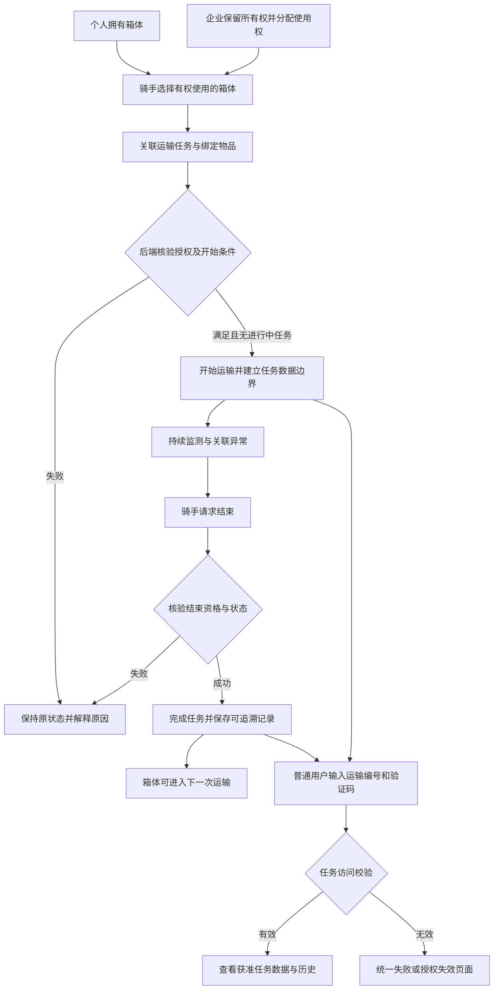
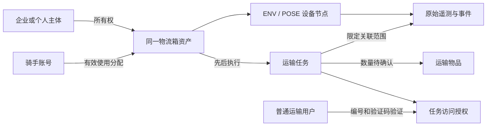

# SmartBox 多角色物流箱管理平台需求变更说明

## 1. 文档基本信息

| 属性 | 内容 |
|---|---|
| 版本 | V1.0，2026-11-22 |
| 文档状态 | 需求变更分析稿；用户已确认的方向按下述分类记录，尚未替换正式需求基线 |
| 编写目的 | 为多角色入口、所有权与使用授权、运输任务、物品绑定和任务级查询提供后续设计与开发的统一分析依据 |
| 适用范围 | 企业端、骑手/个人箱体拥有者端、普通运输用户端及其共享业务；本轮仅文档，不实施页面、接口、数据库或固件变更 |
| 基础 | BL-002 六模块、47 项功能需求与三项全局质量需求，以及后续适用 CR；实际代码和报告按本次审查时的仓库状态 |
| 执行与确认 | Codex 编写与核查；用户独立进行业务确认和最终验收，无虚构评审签字 |
| 后续生效 | 新角色、运输和归属规则正式实现前，须完成适用 CR、模块需求、设计、契约、任务、测试和追踪关系的同步；本文不授予现网新权限 |

### 1.1 规则分类和优先级

- **现行保留**：有现行规范依据、没有被本次修改的要求；保留规范不代表全量实现或验收。
- **本次已确认**：用户在多角色任务及会话中明确提出的产品能力与边界；本轮记录，尚未将现网基线切换为新模型。
- **V1 暂定**：阶段性业务假设，可指导后续评审；必须在界面和设计中保留可扩展边界。
- **设计建议**：本文提出的候选规则，不作为已批准实现要求。
- **待确认**：业务信息不足。对应第 15 章 MR-Q 问题；不擅自选择数值、操作资格或状态分支。

P0/P1/P2 表示本次变更的建议开发优先级：P0 为首版闭环及隔离必需，P1 为管理完善，P2 为可延后体验。它们不改变既有 P0～P5 项目阶段或 TASK 顺序。P0 不表示未决事项已自动批准。

### 1.2 术语与标识

| 术语 | 定义 |
|---|---|
| 企业 | 拥有箱体、管理授权人员及业务资源的主体；不同于现有一个用户账号或一个角色值 |
| 所有权 | 箱体属于企业或个人的资产关系；不因分配使用而转移 |
| 使用授权/分配 | 指定骑手在某范围、某期间使用箱体的业务关系；不同于设备节点与箱体的固定归属 |
| 运输任务 | 一次可识别、可开始和结束的运输业务，关联箱体、操作者、物品与过程数据 |
| 运输物品 | 任务关联的待运输对象；一任务是否可含多物品尚待确认 |
| 运输访问授权 | 普通用户经运输编号和验证码验证后获得的任务范围访问资格，不是完整账号或箱体管理权 |
| 验证码 | 本次任务访问凭据；不预设为短信、邮箱或图形验证码，签发和送达方式待确认 |
| 环境状态 | 统一业务判断结果；与设备在线、样本有效和数据是否过期分别展示 |
| Mock / Demo | 模拟来源或原型内容；不能充当真实位置、真实运输或硬件验证证据 |
| MR-* | 本文变更条目标识，按 ENT/RID/CUS/COM 区分入口或公共业务；不是新增正式 REQ、MOD、TASK、TC 编号 |

## 2. 变更背景与原因

### 2.1 原有依据与实际范围

用户希望保留企业级箱体管理并扩展个人与运输查看入口。仓库原有规范本身已经覆盖物流寄收件人、物流操作者、外卖用户、骑手四类角色，不能将原产品概括成“只有企业管理人员”。现有核心是预配置箱体/节点、按用户授予 box_id、监测与设备控制，运输任务生命周期原属系统总纲 Q-13 待决范围。

企业地图总览、创建资产、调度运输等此前已出现在产品原型设想中，但不能因此记为现有业务实现。本次将三类业务入口、两种所有权、运输操作及免注册任务查看纳入明确的产品变更分析。

### 2.2 审查资料与证据定位

下列相对链接均指向仓库资料。规范用于证明要求，代码用于证明存在实现，报告用于证明实际验证层次；旧文档中的“待开始”须与最新实际记录对照。

| 来源 | 审查重点与用途 |
|---|---|
| [系统需求总纲](00-系统需求规格说明书.md)、[原始输入](baseline/项目原始需求-v1.0.md)、[产品范围](product/产品范围与场景.md) | 产品范围、双节点及 MOCK 边界、Q-03 归属、Q-05 人工告警闭环、Q-06 留存、Q-11 时间质量、Q-13 生命周期；原始输入仅作历史追溯 |
| [MOD-01](modules/MOD-01-物流箱运行监测.md)、[MOD-02](modules/MOD-02-安全防护与哨兵.md)、[MOD-03](modules/MOD-03-设备接入与控制.md) | 采样、环境/姿态/门/位置、防护、节点与命令闭环；不新设传感器或设备能力 |
| [MOD-04](modules/MOD-04-事件管理与可靠性.md)、[MOD-05](modules/MOD-05-物流箱管理与状态聚合.md)、[MOD-06](modules/MOD-06-用户与权限管理.md)、[角色权限](product/角色与权限.md) | 事件身份/可靠性、箱体聚合/历史、四角色及箱体范围/字段/控制权限 |
| [总体设计](../design/architecture/系统总体设计.md)、[模块与数据流](../design/architecture/模块边界与数据流.md)、[后端模型](../design/backend/后端模块与数据模型.md)、[页面设计](../design/frontend/页面与状态设计.md) | 复用模块化单体、数据与权限分层；前端不得承担第二套监测判定 |
| [当前进度](../management/当前进度.md)、[追踪矩阵](../management/需求追踪矩阵.md)、[任务索引](../development/tasks/README.md) | 实际进展与 REQ/Design/TASK/TC 对应，避免将早期设计描述当最新交付 |
| [TASK-008](../development/tasks/TASK-008-核心规则与业务视图.md)、[TASK-009](../development/tasks/TASK-009-持久化补传与可靠性.md)、[TASK-010](../development/tasks/TASK-010-完整交付与回归.md) | 核心规则、后续可靠性、完整历史/轨迹/导出页面的范围与依赖 |
| [TASK-006 报告](../testing/reports/TASK-006-网页与首轮闭环验证报告.md)、[TASK-007 报告](../testing/reports/TASK-007-双板接入验证报告.md)、[TASK-008 报告](../testing/reports/TASK-008-核心规则与业务视图实施报告.md) | 首轮网页与模拟闭环、真实双板采样/output、规则软件及尚未完成的后端复验/板端验证 |
| [TC-009](../testing/cases/TC-009-角色与箱体权限.md)、[TC-008](../testing/cases/TC-008-聚合与过期状态.md)、[TC-012](../testing/cases/TC-012-安全与工程一致性.md) | 授权、状态质量与安全检查基础；尚不覆盖新运输访客模型 |
| [有效契约](../../contracts/effective/README.md)、[CR-004](../management/changes/CR-004-闭环时间语义与未知状态.md)、[CR-005](../management/changes/CR-005-哨兵快速提示与事件级别.md) | 当前操作与时间/未知状态语义、后续批准的哨兵提示/事件级别；不改冻结接口 |
| [前端路由](../../frontend/src/router/index.ts)、[前端导读](../../frontend/README.md)、[方向预览说明](../../frontend/design-exploration/README.md) | 当前三个主路由和隔离演示的差别；企业端选中第三套“物流地图控制台” |
| [V1 身份与节点迁移](../../backend/src/main/resources/db/migration/V1__identity_and_nodes.sql)、[迁移目录](../../backend/src/main/resources/db/migration) | users/roles/boxes/nodes/user_box_access 和 V10～V12 派生表；未发现企业、所有权、分配、运输、物品、访客授权业务表 |
| [权限策略](../../backend/src/main/java/cn/smartbox/authorization/PermissionPolicy.java)、[资源授权](../../backend/src/main/java/cn/smartbox/authorization/BoxAccessService.java)、[查询服务](../../backend/src/main/java/cn/smartbox/live/QueryService.java)、[业务控制器](../../backend/src/main/java/cn/smartbox/live/LiveController.java) | 角色与 box 范围联合限制、按箱体接收时间查询、事件/轨迹/导出与命令；无运输生命周期或访客访问操作 |

### 2.3 现状分类结论

| 能力 | 文档规定 | 实际代码与验证证据 | 本次定位 |
|---|---|---|---|
| 登录、四角色和按箱体授权 | MOD-06 明确规定 | 权限策略与资源授权已实现；TASK-006/007 有软件/基础双板证据 | 保留基础，扩展企业与任务范围；现有角色不直接改名合并 |
| 环境/姿态/节点质量与远程输出 | MOD-01/03/05 明确规定 | 快照、真实采集和三项 output 已有证据；GPS 仍 MOCK | 保留；增加任务范围关联 |
| 门/告警和规则 | 规定了适用业务及未决规则 | TASK-008 规则、V10～V12、派生/详情代码存在；最新报告列明后端集成复验和板端未完成，固件候选事件未经真实 MQTT 发布 | 复用已确认判定；不宣称全量告警闭环已验收 |
| 历史事件、轨迹、导出 | MOD-05 规定 | QueryService 已有箱体级事件/轨迹/导出，接收时间过滤；完整页面归 TASK-010 | 保留；任务级历史曲线与访客隔离是新增查询能力 |
| 企业地图管理 | 概念方向与既有定位/轨迹目标可借鉴 | design-exploration 为 Mock 预览；生产路由仍为登录、列表、详情 | 企业端主设计方向已确认，真实地图功能待开发 |
| 事件持久与掉电补传 | MOD-04/NFR 明确规定 | 后端事件保存/outbox 有基础；TASK-009 尚待开始，真实 Flash 可靠闭环未验收 | 保留，不因“结束运输”承诺断网数据完整 |
| 企业、所有权、分配 | 原规范为受控预配置和固定授权；Q-03 未完整定义变更 | 现有 user_box_access 不表达所有权或分配有效期，无企业模型 | 新增/扩展业务关系 |
| 运输任务、物品绑定、开始/结束 | 总纲 Q-13 尚未确认生命周期 | 当前业务模型与控制器未实现 | 本次新增，不等同设备命令 |
| 编号＋验证码免注册访问 | 原角色体系要求账号及 box 授权 | 未实现访客任务授权 | 本次新增，须独立于完整账号登录 |

本次未执行运行测试或重新连接设备；上述验收事实来自所列报告。附件不是仓库原始需求，本文明确记录为本次用户输入来源，不将其追写进历史基线。

## 3. 原有需求与变更需求对比

| 需求模块 | 原有需求及实现边界 | 变更后需求 | 变更类型 | 变更原因 |
|---|---|---|---|---|
| 产品入口 | 四类角色共用电脑网页基础切片 | 三类业务入口，共享监测数据；旧账号迁移另定 | 修改 | 适配企业、个人操作和任务查看目标 |
| 企业管理界面 | 列表/详情真实页面，地图方向仅原型 | 地图控制台主界面，资产/告警/设备/运输模块并存 | 修改＋新增 | 企业从空间分布进入多箱体管理 |
| 采样和状态质量 | 单独表示有效性、新鲜度、连接和业务状态 | 同语义跨三端显示 | 保留 | 角色变化不改变监测事实 |
| 箱体节点关系 | 受控固定 ENV/POSE 与能力校验 | 原节点关系保留，新增所有者及实际使用人 | 保留＋新增 | 避免把节点归属当资产所有权 |
| 箱体授权 | user_box_access 的用户/箱体关系 | 企业范围、个人所有权、分配使用权、任务访客权分别限制 | 修改＋新增 | 按主体、动作、资源和期间隔离 |
| 骑手操作 | 授权查看及布撤防，不允许配置/导出 | 增加物品绑定、开始和结束运输；设备控制仍单独授权 | 新增 | 骑手承担运输业务责任 |
| 运输任务 | 原属 Q-13，未建业务流程 | 任务关联箱体、物品与过程数据，完成后可再运输 | 新增 | 建立过程监测与用户查询边界 |
| 物品 | 无明确物品业务模型 | 绑定任务、保存历史关联，数量和字段待确认 | 新增 | 普通用户关心自身物品 |
| 用户查看 | 账号登录后访问授权箱体 | 新增运输编号＋验证码访问具体任务，完成后按有效授权查看历史 | 新增 | 降低查看门槛并限制跨任务访问 |
| 环境与告警 | 统一业务判断及级别/开始恢复；人工处置未定 | 保留统一结果，关联运输；人工确认/备注作为待定扩展 | 保留＋新增 | 连接运输异常和处理责任 |
| 历史查询 | 箱体级、接收时间范围、事件/轨迹与导出 | 补充任务级环境曲线与异常过滤，不以 box 全历史替代 | 修改＋新增 | 同箱体多次运输的隔离 |
| 事件可靠与控制回执 | 原有幂等、去重、实际回执、历史时间质量 | 原语义保留，运输业务请求同样需防重复 | 保留＋新增 | 复用基础，不将运输状态等同设备执行 |
| 企业复杂功能在个人入口 | 现有未建立独立个人信息架构 | 骑手/访客入口不展示企业全局统计、调度或成员管理 | 修改入口范围 | 降低操作复杂度，不删除企业功能 |
| 支付、电商订单、外部物流接口 | 当前不属于已确认范围 | 继续不纳入 | 保留边界 | 本次没有此类业务要求 |

本次没有证据支持删除既有功能，故不填造“删除”项。原先“本期不增加运输任务/后台”的边界是需要后续正式变更的冲突点，不在本轮直接改写。

## 4. 产品定位与用户角色

SmartBox 的目标定位为：**面向物流企业、骑手及个人箱体拥有者、普通运输用户的多角色物流箱体监测与管理平台。** 三个入口共享设备数据及统一业务判断，围绕不同资源范围和任务呈现内容。

| 用户群体 | 核心目标 | 主要场景/方式 | 资源边界 |
|---|---|---|---|
| 企业管理人员 | 掌握企业箱体和运输状态，分配使用与处理异常 | 桌面地图控制台、资产表、任务/设备详情 | 企业自有及明确授权管理的资产；具体成员动作权限另授 |
| 骑手/个人拥有者 | 管理自己可用箱体并完成运输操作 | 移动优先“我的箱体→选箱→物品/任务→开始→监测→结束” | 个人所有或有效企业分配的箱体；两类来源不能混同 |
| 普通运输用户 | 查看自己物品所属任务的运输环境和异常 | 移动优先“编号＋验证码→运输详情/历史” | 验证得到的任务及获准时间/字段，无资产管理权 |

现行角色对应分析：LOGISTICS_OPERATOR 可作为企业操作能力的复用基础，但当前没有企业成员/管理员语义；COURIER 可作为骑手账号基础，但没有个人所有权；LOGISTICS_VIEWER、DELIVERY_USER 与新访客存在查看场景重合，不能自动转成免注册访客或删除原账号。一个人是否可兼具企业人员和个人拥有者身份、多企业上下文如何切换见 MR-Q-01。界面入口不是权限角色枚举，也不决定数据库如何编码。

## 5. 三类用户功能需求

本章全部条目采用独立变更标识。条目中的“应”描述目标验收行为；标有“设计建议/待确认”的分支须先完成决定。现行 REQ 映射是复用/影响依据，不宣称原 REQ 已覆盖全部新增需求。

### 5.1 企业端需求

#### MR-ENT-001 企业地图运营主界面

| 属性 | 内容 |
|---|---|
| 需求编号 | MR-ENT-001 |
| 需求名称 | 企业地图运营主界面 |
| 用户角色 | 企业管理人员 |
| 前置条件 | 有效企业身份和资产读取资格 |
| 性质与优先级 | 本次已确认，地图真实来源待确认；P0 |
| 业务描述 | 以第三套物流地图控制台为主要入口，地图与资产列表联动，位置摘要关联箱体、当前任务和异常。 |
| 业务规则 | 只看企业获准资产；有效、过期、无位置和 Mock 分层，筛选计数口径一致；不新增调度、ETA 或路径优化。 |
| 操作流程 | 进入企业工作区→筛选→选点/选列表→查看摘要→进入获准详情。 |
| 异常情况 | 无定位仍在列表；无效坐标不绘点；底图失败保留列表；旧位置不当实时。 |
| 权限要求 | 企业＋资产＋动作三重范围；点、聚合与统计同范围裁剪。 |
| 验收标准 | MR-A10/11/15：筛选联动一致、无伪坐标，跨企业请求不返回数据。 |
| 现有映射/待决 | REQ-M01-012/013、REQ-M05-002/003/005、REQ-M06-002；MR-Q-15 |

#### MR-ENT-002 企业资产与节点管理

| 属性 | 内容 |
|---|---|
| 需求编号 | MR-ENT-002 |
| 需求名称 | 企业资产与节点管理 |
| 用户角色 | 企业管理人员 |
| 前置条件 | 已建立企业与箱体的合法归属及管理资格 |
| 性质与优先级 | 本次已确认＋现行保留；P0 |
| 业务描述 | 在统一箱体目录查看资产、ENV/POSE、当前质量、分配来源和历史入口。 |
| 业务规则 | 企业拥有的箱体分配后仍属于企业，原节点能力和身份不变；登记/解绑/退役规则不自动扩展。 |
| 操作流程 | 查看企业资产→筛选→箱体详情→节点与状态/运输记录。 |
| 异常情况 | 未知节点/缺数据保留未知；无权箱体拒绝；新管理动作未定义时不提供伪成功。 |
| 权限要求 | 非所有企业成员自动拥有编辑或分配权；资产诊断沿用动作授权。 |
| 验收标准 | MR-A01/06：只返回企业范围、节点层级准确、质量独立。 |
| 现有映射/待决 | REQ-M03-001/003、REQ-M05-001/002、REQ-M06-002/003；MR-Q-01/02 |

#### MR-ENT-003 企业箱体分配与收回

| 属性 | 内容 |
|---|---|
| 需求编号 | MR-ENT-003 |
| 需求名称 | 企业箱体分配与收回 |
| 用户角色 | 获准企业管理人员 |
| 前置条件 | 企业拥有箱体，目标骑手身份合法，分配操作获准 |
| 性质与优先级 | 本次已确认，进行中收回待确认；P0 |
| 业务描述 | 将企业箱体授予骑手使用并支持收回，保留分配变更事实。 |
| 业务规则 | 使用权不转移所有权；收回不得删除设备或运输历史；多人分配及进行中接管按确认规则。 |
| 操作流程 | 选箱体→选骑手→确认资格→建立关系→骑手可见；收回时重新校验并终止相应后续资格。 |
| 异常情况 | 重复分配/并发修改/进行中任务按获批策略处理；无权操作不改变关系。 |
| 权限要求 | 仅企业范围内获准分配人员；骑手不因使用权获得转授或企业资产管理权。 |
| 验收标准 | MR-A01/02/16：归属不变、可用范围随授权变化、旧页面不能绕过撤权。 |
| 现有映射/待决 | REQ-M05-001、REQ-M06-002/005/006 的扩展；MR-Q-07/08/12 |

#### MR-ENT-004 企业运输与监测查询

| 属性 | 内容 |
|---|---|
| 需求编号 | MR-ENT-004 |
| 需求名称 | 企业运输与监测查询 |
| 用户角色 | 企业管理人员 |
| 前置条件 | 任务属于可管理业务范围，具备相应查询资格 |
| 性质与优先级 | 本次已确认，历史细界待确认；P0 |
| 业务描述 | 查看企业范围任务、运输阶段、关联物品摘要、环境过程和异常。 |
| 业务规则 | 运输状态与设备在线独立；企业资产管理权保留，历史可见边界不按当前归属无条件继承。 |
| 操作流程 | 任务列表→任务详情→过程曲线/异常→箱体或节点。 |
| 异常情况 | 暂无任务不填造记录；时间不可信/缺口明确显示；跨范围跳转拒绝。 |
| 权限要求 | 企业任务范围＋字段授权；历史按 MR-Q-08，物品隐私按 MR-Q-17。 |
| 验收标准 | MR-A01/06/08/09：范围一致、曲线不跨任务、未知不当正常。 |
| 现有映射/待决 | REQ-M05-005、REQ-M06-002/003；新增运输业务；MR-Q-03/08/10/17 |

#### MR-ENT-005 企业告警查看与处置边界

| 属性 | 内容 |
|---|---|
| 需求编号 | MR-ENT-005 |
| 需求名称 | 企业告警查看与处置边界 |
| 用户角色 | 企业管理人员 |
| 前置条件 | 已有获准资产的统一告警或未知评估信息 |
| 性质与优先级 | 查看已确认，人工处置待确认；P0 查看/P1 处置 |
| 业务描述 | 查看异常来源、级别、发生/恢复及任务关联，区分自动恢复和人工处理。 |
| 业务规则 | 不重算阈值；无评估显示未知；确认/备注/关闭的人工生命周期在旧 Q-05 与 MR-Q-16 确认前不作为可执行能力。 |
| 操作流程 | 筛选告警→详情→查看上下文和相关箱体/任务；获批后另行接入人工流程。 |
| 异常情况 | 无记录不等于已评估正常；不支持人工操作时标待接入，不显示虚假成功。 |
| 权限要求 | 只看企业授权资产；确认等动作需另外批准和授权，不由读取资格推导。 |
| 验收标准 | MR-A13：同一事件三端结果一致，未接入确认不会改变业务状态。 |
| 现有映射/待决 | REQ-M01-003、REQ-M02-004、REQ-M05-002、REQ-M06-006；MR-Q-16 |

#### MR-ENT-006 企业资源权限与变更审计

| 属性 | 内容 |
|---|---|
| 需求编号 | MR-ENT-006 |
| 需求名称 | 企业资源权限与变更审计 |
| 用户角色 | 获准企业管理人员 |
| 前置条件 | 企业成员关系和管理动作范围已经明确 |
| 性质与优先级 | 能力已确认，成员管理细则待确认；P1 |
| 业务描述 | 按权限查看成员相关资源范围，审查分配、任务和授权的变更记录。 |
| 业务规则 | 不预设复杂组织层级；管理成员并不等于可读所有隐私；审计保留资源和结果不保存秘密原文。 |
| 操作流程 | 选择资源或人员→核对可管理范围→执行已获批动作→查看审计。 |
| 异常情况 | 无成员管理资格时拒绝；记录读取失败不显示空审计冒充无操作。 |
| 权限要求 | 企业范围及独立成员/审计动作授权；具体管理员能力待确认。 |
| 验收标准 | MR-A14：变更可追溯，跨企业审计不可读，记录无验证码或令牌原文。 |
| 现有映射/待决 | REQ-M06-002/006；MR-Q-01/14/17 |

### 5.2 骑手及个人拥有者需求

#### MR-RID-001 我的箱体与来源识别

| 属性 | 内容 |
|---|---|
| 需求编号 | MR-RID-001 |
| 需求名称 | 我的箱体与来源识别 |
| 用户角色 | 骑手/个人箱体拥有者 |
| 前置条件 | 账号有效，已确立个人权属或企业有效分配 |
| 性质与优先级 | 本次已确认；P0 |
| 业务描述 | 展示本人拥有及获得使用权的箱体，分别标明来源、使用资格与状态。 |
| 业务规则 | 自有不等于企业资产；分配不等于所有权；归属证明流程另定。 |
| 操作流程 | 登录→我的箱体→识别来源与占用→进入箱体或任务。 |
| 异常情况 | 无箱体显示空态；授权失效清理可见范围；不能输入箱号自赋所有权。 |
| 权限要求 | 本人所有或有效分配资源；不同用户之间严格隔离。 |
| 验收标准 | MR-A01/15：两种来源均可见且正确标记，非授权箱体不可见。 |
| 现有映射/待决 | REQ-M05-001、REQ-M06-001/002；MR-Q-02 |

#### MR-RID-002 选箱与物品绑定

| 属性 | 内容 |
|---|---|
| 需求编号 | MR-RID-002 |
| 需求名称 | 选箱与物品绑定 |
| 用户角色 | 骑手/个人箱体拥有者 |
| 前置条件 | 有箱体使用资格，任务来源及物品最低模型获批 |
| 性质与优先级 | 本次已确认，字段和数量待确认；P0 |
| 业务描述 | 选择可用箱体并关联合法任务与待运输物品，确认绑定结果。 |
| 业务规则 | 不能假设一任务一件物品；物品创建主体/字段、改绑/解绑阶段按批准方案；不得绑定他人无权任务。 |
| 操作流程 | 选箱→进入任务准备→选择/录入获准物品→绑定→核对摘要。 |
| 异常情况 | 占用提示不泄他人任务详情；校验或保存失败保持可确认原关联。 |
| 权限要求 | 对箱体、任务、物品逐项验证操作资格；内部备注及用户资料最小展示。 |
| 验收标准 | MR-A03/04：未获权物品不能绑定、失败无虚假成功、数量遵守获批条件。 |
| 现有映射/待决 | 新增物品/运输业务；影响 REQ-M05-001、REQ-M06-002/003；MR-Q-03/04/05/13/17 |

#### MR-RID-003 箱体与运输环境监测

| 属性 | 内容 |
|---|---|
| 需求编号 | MR-RID-003 |
| 需求名称 | 箱体与运输环境监测 |
| 用户角色 | 骑手/个人箱体拥有者 |
| 前置条件 | 有效资产读取权；查看任务时具备该任务资格 |
| 性质与优先级 | 本次已确认＋现行保留；P0 |
| 业务描述 | 查看可用箱体的当前环境、节点状态和本人运输过程的统一环境判断。 |
| 业务规则 | 箱体当前快照与运输过程曲线分区；设备在线、样本有效、过期、环境异常分别展示。 |
| 操作流程 | 箱体详情→关键指标/质量→当前任务→任务内曲线与异常。 |
| 异常情况 | 部分节点离线保留可用部分；无效或未评估显示未知，不填正常。 |
| 权限要求 | 当前资产范围和任务范围分别核验，不能借任务跳转读整箱历史。 |
| 验收标准 | MR-A06：在线但无效/过期可区分，三端不出现相矛盾的本地阈值判断。 |
| 现有映射/待决 | REQ-M01-001/003、REQ-M03-004、REQ-M05-002/003/004 |

#### MR-RID-004 开始运输

| 属性 | 内容 |
|---|---|
| 需求编号 | MR-RID-004 |
| 需求名称 | 开始运输 |
| 用户角色 | 有使用权且有任务操作资格的骑手 |
| 前置条件 | 任务、箱体和物品关联符合获批最低条件 |
| 性质与优先级 | 本次已确认＋V1 暂定排他；P0 |
| 业务描述 | 明确确认箱体/任务/物品后提交开始，建立可追溯开始事实和进行中占用。 |
| 业务规则 | 同箱至多一个进行中任务；重复或竞争请求不产生第二次开始；不自动布防或切画像。 |
| 操作流程 | 核对准备摘要→请求开始→后端重验资格/条件/冲突→返回确定结果或失败。 |
| 异常情况 | 未绑定满足条件的物品、已占用、撤权、结果未知不能伪装开始成功；离线策略待定。 |
| 权限要求 | 动作必须重新校验使用与任务资格，不信任先前列表缓存。 |
| 验收标准 | MR-A03/16：并发至多一任务开始；条件失败无占用；响应丢失可核对结果。 |
| 现有映射/待决 | 新增运输操作；参考 REQ-M06-002、REQ-M03-006 幂等思想；MR-Q-04/05/06 |

#### MR-RID-005 结束运输与箱体复用

| 属性 | 内容 |
|---|---|
| 需求编号 | MR-RID-005 |
| 需求名称 | 结束运输与箱体复用 |
| 用户角色 | 有结束资格的骑手 |
| 前置条件 | 当前任务为进行中，结束条件已获批 |
| 性质与优先级 | 本次已确认，条件待确认；P0 |
| 业务描述 | 记录运输结束并保存历史关联，箱体可进入后续运输。 |
| 业务规则 | 完成任务不等于客户已签收、告警恢复或所有离线数据已补齐；不删除原始监测。 |
| 操作流程 | 查看当前任务→结束确认→资格/状态核验→保存结束事实→回到记录或新运输。 |
| 异常情况 | 重复结束不改变原事实；撤权、离线或异常状态按获批规则；失败保持结果可查询。 |
| 权限要求 | 结束当前合法任务的资格单独检查，企业代办/接管不能预设。 |
| 验收标准 | MR-A05/16：重复无二次结束时间，新任务不能覆盖旧任务或其授权。 |
| 现有映射/待决 | 新增运输操作；影响 REQ-M05-005、REQ-M06-002/006；MR-Q-06/07/13 |

#### MR-RID-006 个人运输记录与异常回看

| 属性 | 内容 |
|---|---|
| 需求编号 | MR-RID-006 |
| 需求名称 | 个人运输记录与异常回看 |
| 用户角色 | 骑手/个人箱体拥有者 |
| 前置条件 | 具有历史任务读取资格，任务已开始或已结束 |
| 性质与优先级 | 本次已确认，撤权后边界待确认；P0 |
| 业务描述 | 按任务查看本人可访问的运输阶段、环境曲线、异常和缺口。 |
| 业务规则 | 历史不被下一次运输快照替代；延迟上报按可靠归属处理；撤权后的历史查询不由当前 box 授权简单推断。 |
| 操作流程 | 运输记录→任务→选择任务内时间段→曲线/事件及质量。 |
| 异常情况 | 无可信时间、数据未到、任务无权/不可用分别解释；不得补造连续曲线。 |
| 权限要求 | 只查获准任务历史；分配或权属变更后的资格见 MR-Q-08。 |
| 验收标准 | MR-A05/08/09：相邻任务严格区分，迟到数据不落到当前新任务。 |
| 现有映射/待决 | REQ-M04-005、REQ-M05-005、REQ-M06-003；MR-Q-08/10/14 |

#### MR-RID-007 个人信息、设备权限与授权失效

| 属性 | 内容 |
|---|---|
| 需求编号 | MR-RID-007 |
| 需求名称 | 个人信息、设备权限与授权失效 |
| 用户角色 | 骑手/个人箱体拥有者 |
| 前置条件 | 账号有效，现行设备动作与资产范围可核对 |
| 性质与优先级 | 现行保留＋授权扩展；P0 |
| 业务描述 | 查看本人信息和设备使用关系，在授权变化时解释限制，并沿用已有许可控制。 |
| 业务规则 | 个人拥有不自动获得画像/校准/GPS/灯风扇/导出；当前 COURIER 的布撤防权限保持独立。 |
| 操作流程 | 我的→箱体关系与权限→执行获准动作→显示真实控制受理和结果；撤权后更新范围。 |
| 异常情况 | 权限不足、控制部分成功/超时/迟到按现行语义，不能显示全执行成功。 |
| 权限要求 | 设备动作、箱体、节点能力、任务操作分别授权；无秘密原文。 |
| 验收标准 | MR-A02/12：旧页不可越权控制，个人所有身份不自动升级配置权限。 |
| 现有映射/待决 | REQ-M03-006/007、REQ-M06-003/004/005；MR-Q-08/11 |

### 5.3 普通运输用户需求

#### MR-CUS-001 运输编号和验证码验证

| 属性 | 内容 |
|---|---|
| 需求编号 | MR-CUS-001 |
| 需求名称 | 运输编号和验证码验证 |
| 用户角色 | 普通运输用户 |
| 前置条件 | 已由获准机制取得运输编号及验证码 |
| 性质与优先级 | 本次已确认，安全参数待确认；P0 |
| 业务描述 | 无需完整账号注册，以两项信息校验并获得具体任务的最小查看资格。 |
| 业务规则 | 编号不是单独凭据；签发者、渠道、频率、有效期和轮换策略待确认；不得复用骑手登录凭据。 |
| 操作流程 | 输入编号/验证码→校验→成功进入获准任务或显示安全失败。 |
| 异常情况 | 不存在、错误、失效、撤销或请求受限不泄任务/物品细节，失败不建立权限。 |
| 权限要求 | 验证产生的资格只对相应任务和字段有效，不能访问资产集合。 |
| 验收标准 | MR-A07/12：未注册可验证；错误无数据；修改编号不能扩权。 |
| 现有映射/待决 | 新增访客身份；参考 REQ-M06-001/002/003；MR-Q-03/09 |

#### MR-CUS-002 运输概览与进度

| 属性 | 内容 |
|---|---|
| 需求编号 | MR-CUS-002 |
| 需求名称 | 运输概览与进度 |
| 用户角色 | 普通运输用户 |
| 前置条件 | 任务访问授权有效 |
| 性质与优先级 | 本次已确认；P0 |
| 业务描述 | 显示所获准任务的当前业务阶段、已记录时间线和物品必要摘要。 |
| 业务规则 | 只用真实阶段，不默认进度百分比、送达签收或 ETA；结束后的概览仍对应该任务。 |
| 操作流程 | 验证成功→任务概览→查看阶段/时间→环境或异常。 |
| 异常情况 | 记录尚缺/未知/不可用分别提示；不加载同箱其他任务。 |
| 权限要求 | 当前授权任务与最小物品字段，不能以 box_id 跳转管理界面。 |
| 验收标准 | MR-A08/15：T1 完成后仍显示 T1，不随 T2 开始改变进度或显示内容。 |
| 现有映射/待决 | 新增运输视图；影响 REQ-M05-002、REQ-M06-003；MR-Q-17 |

#### MR-CUS-003 任务关键环境与统一判断

| 属性 | 内容 |
|---|---|
| 需求编号 | MR-CUS-003 |
| 需求名称 | 任务关键环境与统一判断 |
| 用户角色 | 普通运输用户 |
| 前置条件 | 任务授权有效，存在获准监测数据或明确缺失状态 |
| 性质与优先级 | 本次已确认＋现行保留；P0 |
| 业务描述 | 查看本次运输期间温湿度等已支持指标、统一环境结论及数据更新时间。 |
| 业务规则 | 只呈现许可指标；样本有效/过期/业务异常分别表达；不显示原始姿态证据和节点诊断。 |
| 操作流程 | 概览→环境→指标/质量/结论→必要异常说明。 |
| 异常情况 | 无数据或不能确认归属时显示未知/缺口；结束任务不得取新运输的现时值。 |
| 权限要求 | 后端裁剪任务时间与字段；无设备控制或完整箱体读取权限。 |
| 验收标准 | MR-A06/08：未知不正常、样本不跨任务、无诊断证据字段。 |
| 现有映射/待决 | REQ-M01-001/003、REQ-M05-003、REQ-M06-003；MR-Q-10/17 |

#### MR-CUS-004 运输历史环境与异常记录

| 属性 | 内容 |
|---|---|
| 需求编号 | MR-CUS-004 |
| 需求名称 | 运输历史环境与异常记录 |
| 用户角色 | 普通运输用户 |
| 前置条件 | 任务访问仍有效且历史可查询 |
| 性质与优先级 | 本次已确认；P0 |
| 业务描述 | 运输中及结束后查看获准时段的历史环境曲线与异常摘要。 |
| 业务规则 | 历史按任务限定；跨任务持续告警只显示允许内容；缺失样本不补成可靠连续数据。 |
| 操作流程 | 历史环境/异常→选择任务内时段→服务端裁剪→显示序列/事件与质量。 |
| 异常情况 | 授权到期停止读取；时间不可信、补传待定或超过可用查询范围有说明。 |
| 权限要求 | 不能扩大到箱体全历史、他人物品信息或前次任务证据。 |
| 验收标准 | MR-A08/09/13：扩大 from/to 或更换任务不能读取相邻任务，迟到和缺口可见。 |
| 现有映射/待决 | REQ-M04-005、REQ-M05-005、REQ-M06-003/005；MR-Q-08/09/10/14 |

#### MR-CUS-005 授权失效与安全退出查看

| 属性 | 内容 |
|---|---|
| 需求编号 | MR-CUS-005 |
| 需求名称 | 授权失效与安全退出查看 |
| 用户角色 | 普通运输用户 |
| 前置条件 | 处于验证或任务查看流程 |
| 性质与优先级 | 本次已确认，失效参数待确认；P0 |
| 业务描述 | 在过期/撤销/校验失败时停止任务数据访问并引导重新验证。 |
| 业务规则 | 无权访问不获得箱体权限；打开页面和实时连接也需遵守资格变化；不把受限缓存当有效实时数据。 |
| 操作流程 | 验证/查询/订阅→复核资格→允许或进入失效页面→重新验证。 |
| 异常情况 | 网络故障与无权访问分开提示；错误不泄任务存在性；具体频率控制待定。 |
| 权限要求 | 所有受保护数据出口同样校验任务资格；访客无管理动作。 |
| 验收标准 | MR-A07/08/12：失效后历史与推送均不可继续，未验证无敏感数据。 |
| 现有映射/待决 | REQ-M06-002/003/005 的扩展；MR-Q-09 |

### 5.4 公共业务需求

#### MR-COM-001 所有权与使用关系分离

| 属性 | 内容 |
|---|---|
| 需求编号 | MR-COM-001 |
| 需求名称 | 所有权与使用关系分离 |
| 用户角色 | 企业、骑手及服务端 |
| 前置条件 | 箱体身份已建立，权属依据可核验 |
| 性质与优先级 | 本次已确认；P0 |
| 业务描述 | 统一箱体对象表达企业/个人所有者及当前使用关系，保留变更事实。 |
| 业务规则 | 分配不转移所有权；个人和企业两类来源都支持；不重复创建资产模块。 |
| 操作流程 | 确立权属→授予/撤销使用→按相应关系查询/操作。 |
| 异常情况 | 权属不明/冲突不可由普通请求抢占；迁移不能凭 user_box_access 推断所有者。 |
| 权限要求 | 维护权属和授予使用是管理动作，不由读取权或新入口自动授予。 |
| 验收标准 | MR-A01：两类来源可追溯，撤销使用不删除企业所有权。 |
| 现有映射/待决 | REQ-M05-001、REQ-M06-002 扩展；MR-Q-02/12 |

#### MR-COM-002 主体、资源、动作及期间联合授权

| 属性 | 内容 |
|---|---|
| 需求编号 | MR-COM-002 |
| 需求名称 | 主体、资源、动作及期间联合授权 |
| 用户角色 | 企业、骑手、访客及服务端 |
| 前置条件 | 身份或任务访问上下文可验证 |
| 性质与优先级 | 本次已确认＋现行保留；P0 |
| 业务描述 | 将企业管理权、个人权属、骑手使用权和访客任务权分别核验，统一各数据出口。 |
| 业务规则 | 前端隐藏/编号难猜不是鉴权；既有四角色迁移不能自动扩权；撤销后后续请求不再授权。 |
| 操作流程 | 验证主体→核验资源关系/动作/期间→字段投影→返回或拒绝→审计。 |
| 异常情况 | 直接改 ID、旧订阅、缓存角色、跨企业聚合都不能绕过；无权不下发设备命令。 |
| 权限要求 | REST、实时、统计、关联详情、历史、导出一致限制。 |
| 验收标准 | MR-A01/02/07/08/12：逐出口越权与撤权均被拦截，无受限字段侧漏。 |
| 现有映射/待决 | REQ-M06-001～006；MR-Q-01/08/09/11 |

#### MR-COM-003 箱体与进行中任务排他关联

| 属性 | 内容 |
|---|---|
| 需求编号 | MR-COM-003 |
| 需求名称 | 箱体与进行中任务排他关联 |
| 用户角色 | 企业、骑手及服务端 |
| 前置条件 | 任务来源、状态和箱体使用资格明确 |
| 性质与优先级 | V1 暂定；P0 |
| 业务描述 | 同箱可先后运输，但同一时间至多一个正在执行的运输任务。 |
| 业务规则 | V1 暂定规则：一个箱体同时只能执行一个运输任务；不决定一任务物品数或骑手分配数。 |
| 操作流程 | 准备→并发开始校验→占用→结束后释放→新任务。 |
| 异常情况 | 并发/重复/服务故障不产生双占用；准备预留和换箱规则待定。 |
| 权限要求 | 仅有使用与任务操作资格者能请求状态转换。 |
| 验收标准 | MR-A03/05/16：竞争后至多一任务进行中，完成后可开始新任务且旧历史不覆盖。 |
| 现有映射/待决 | 新增运输约束；影响 REQ-M05-001/005；MR-Q-05/12 |

#### MR-COM-004 统一监测、异常与质量表达

| 属性 | 内容 |
|---|---|
| 需求编号 | MR-COM-004 |
| 需求名称 | 统一监测、异常与质量表达 |
| 用户角色 | 三类用户及共享监测服务 |
| 前置条件 | 已有采样与统一业务评估或未知状态 |
| 性质与优先级 | 现行保留＋跨端扩展；P0 |
| 业务描述 | 共用已有规则处理与后端业务投影，不由三个前端各实现阈值判断。 |
| 业务规则 | 在线不等于有效/新鲜/环境正常；保留原单位、时间质量、REAL/MOCK、未知和局部可用。 |
| 操作流程 | 节点采样→既有规则/后端派生→统一投影→按各入口裁剪展示。 |
| 异常情况 | 规则尚无结果/无效/补传不能伪造 EVALUATED；实际硬件没有的指标不填值。 |
| 权限要求 | 查看范围裁剪不改变同一事实的业务判定；访客不看原始设备证据。 |
| 验收标准 | MR-A06/10/11/13：同一采样判断一致，未知/过期/Mock 都显式出现。 |
| 现有映射/待决 | REQ-M01-001/003、REQ-M03-004/005、REQ-M05-002/003/004 |

#### MR-COM-005 任务过程数据和历史隔离

| 属性 | 内容 |
|---|---|
| 需求编号 | MR-COM-005 |
| 需求名称 | 任务过程数据和历史隔离 |
| 用户角色 | 所有查询角色及服务端 |
| 前置条件 | 任务关联、边界时间和数据归属策略已获批 |
| 性质与优先级 | 本次已确认，归属细则待确认；P0 |
| 业务描述 | 按获准任务组织环境、事件与异常，而非授予普通用户整箱历史。 |
| 业务规则 | 原始数据身份保持，时间字段不伪造；相邻任务、迟到、跨任务持续告警和无可信时间有明确归属/排除。 |
| 操作流程 | 登记开始/结束边界→确定可确认数据→任务查询投影→历史追加可追溯。 |
| 异常情况 | 只按 received_at 过滤不足以隔离时不得借此上线访客；无法归属不猜为当前任务。 |
| 权限要求 | 后端限制任务与时间/字段范围；已结束访客不可读新快照。 |
| 验收标准 | MR-A08/09/16：前后任务及边界样本不串读，补传不改变当前值或无声泄漏。 |
| 现有映射/待决 | REQ-M04-001/005、REQ-M05-004/005、REQ-M06-003；MR-Q-10/14 |

#### MR-COM-006 物品最小信息与历史关联

| 属性 | 内容 |
|---|---|
| 需求编号 | MR-COM-006 |
| 需求名称 | 物品最小信息与历史关联 |
| 用户角色 | 企业、骑手、访客及服务端 |
| 前置条件 | 获批字段、创建主体、绑定关系和字段权限明确 |
| 性质与优先级 | 本次新增，字段/基数待确认；P0 |
| 业务描述 | 提供绑定运输所必需物品信息和历史关联，支持相应任务用户核对。 |
| 业务规则 | 不认定一物品一任务；不扩展支付、电商订单；内部备注和个人资料按白名单限制。 |
| 操作流程 | 建立/选取物品→绑定任务→核对→按获批阶段修改→结束后保留历史。 |
| 异常情况 | 无权对象、绑定失败或不允许阶段修改须拒绝；历史不随当前物品修改被静默重写。 |
| 权限要求 | 不同角色看到不同最小摘要；访客不见其他授权主体隐私。 |
| 验收标准 | MR-A04/14：无越权绑定/敏感字段、历史可追溯；数量和修改符合批准规则。 |
| 现有映射/待决 | 新增物品领域；影响 REQ-M06-003/006；MR-Q-04/13/17 |

#### MR-COM-007 操作一致性、撤权与审计

| 属性 | 内容 |
|---|---|
| 需求编号 | MR-COM-007 |
| 需求名称 | 操作一致性、撤权与审计 |
| 用户角色 | 企业、骑手、访客及服务端 |
| 前置条件 | 相应动作获准，操作结果和资格可查询 |
| 性质与优先级 | 目标一致性已确认，幂等交互为设计建议；P0 |
| 业务描述 | 分配、绑定、开始/结束和任务访问操作可追踪，重复与不确定结果不会产生第二次业务效果。 |
| 业务规则 | 运输结束与占用释放一致，历史不删除；不确定先查询；撤权影响后续动作；具体幂等键/事务不在本文冻结。 |
| 操作流程 | 校验→提交操作→记录结果/审计→返回；响应丢失查询/重试；撤权重新核验。 |
| 异常情况 | 并发结束/分配冲突按获批规则；失败不伪成功，审计无验证码/令牌原文。 |
| 权限要求 | 动作资格与资源范围每次核验；业务审计读写同样受限。 |
| 验收标准 | MR-A02/05/14/16：重复不改事实，撤权后不能继续，历史与审计可追溯且无秘密。 |
| 现有映射/待决 | REQ-M03-006、REQ-M04-004、REQ-M06-005/006 的复用/扩展；MR-Q-07/09/14 |


## 6. 核心业务流程

### 6.1 主流程与角色参与



编号/凭据的提供主体及任务生成入口见 MR-Q-03/09；图中不假设骑手生成编号或凭据，不默认短信通知。是否允许离线开始/结束见 MR-Q-06。

### 6.2 八个必备场景

| 场景 | 前置与触发 | 角色与系统步骤 | 分支与异常 | 结束条件与记录 |
|---|---|---|---|---|
| 1. 个人使用自有箱体 | 账号有效，个人归属经过确认 | 拥有者进入“我的箱体”→查看所有权来源→选择箱体→系统检验使用资格 | 未登记/归属冲突不因输入 box_id 获权；首绑证明见 MR-Q-02 | 获得选箱上下文，不自动开始运输 |
| 2. 企业分配箱体 | 企业已拥有并可管理箱体 | 企业选择箱体和骑手→核验分配资格→保存有效关系→骑手可见→企业仍可管理 | 重复分配、运输中收回及历史访问边界见 MR-Q-07/08/12 | 可追踪谁何时分配给谁；分配不变更所有权 |
| 3. 骑手绑定物品 | 有效使用权，任务来源已确认 | 选箱→选择/建立合法任务上下文→提供或选取物品→核验→关联→返回可核对摘要 | 数量/字段/创建主体未定；保存失败不出现部分虚假绑定；不可通过修改任务 ID 绑定他人对象 | 绑定结果可复查，尚未开始的数据不冒充运输过程 |
| 4. 骑手开始运输 | 上一步关联成功且满足获批条件 | 确认箱体及物品→后端重新鉴权→排他检查→记录开始→返回进行中任务 | 并发竞争仅一个开始成功；断网结果未知先查询；在线/画像/物品最低条件见 MR-Q-04/05/06 | 唯一进行中任务与可靠开始记录 |
| 5. 运输中监测 | 已开始任务 | 节点按既有链路上报→共享规则判定→后端按任务边界提供数据→企业/骑手/获准访客查看相应字段 | 离线、无效、旧值各自提示；数据跨任务/时间不可信时不混入访客曲线 | 过程数据和异常可追溯，不因查看改变任务 |
| 6. 结束并保存 | 骑手提交结束，具备结束资格 | 查询当前任务→确认→核验→保存结束时间和状态→固定任务与箱体关联历史→释放进行中占用 | 重复结束不重写时间；新箱体任务不改旧记录；离线/异常/收回授权时谁可结束待定 | 完成记录可查询；迟到数据有归属与质量说明，非“补传全部完成”承诺 |
| 7. 普通用户校验访问 | 获得编号和验证码，获批签发机制可用 | 输入两项→后端验证任务访问资格→建立最小任务授权→显示概览 | 不存在/错误不泄任务存在性；过期、撤销、受限访问进入对应错误页 | 仅当前获准任务；无法调用箱体管理接口 |
| 8. 查看历史环境/异常 | 任务授权仍有效，历史数据可用 | 进入历史→选择任务内时段→后端裁剪→展示曲线/事件与时间质量 | 用户扩大范围时不返回相邻任务数据；补传/缺口/未校时独立提示；授权过期重新验证 | 返回本任务可确认数据，不扩大资产或其他任务访问权 |

## 7. 核心业务对象与关系

### 7.1 复用与扩展

| 对象 | 当前基础 | 目标关系/最小业务信息 | 变更与限制 |
|---|---|---|---|
| 用户 | users、roles、四角色 | 企业成员/骑手的身份和有效性，关联被授予的能力 | 复用账号基础，不将新访客硬塞入完整账号 |
| 企业 | 未发现独立业务模型 | 企业标识、成员关系、资产管理范围 | 新增；不附加多级组织、计费或复杂租户产品 |
| 物流箱 | boxes、box_id、画像及控制修订 | 唯一资产身份、企业或个人所有者、有效使用关系、任务历史 | 扩展，不另建一套重复箱体目录 |
| 使用分配 | user_box_access 仅表达用户能访问箱体 | 谁授予谁哪个箱体、有效/撤销状态与时间、授权动作、变更记录 | 需要扩展，静态读取许可不等同所有权或完整使用权 |
| 设备 | nodes、ENV/POSE、caps、required、boot | 保留节点与箱体关系、在线和诊断 | 不因箱体转交而重置节点身份或修改历史事件身份 |
| 传感器 | ENV/POSE 遥测字段 | 温度、湿度、光照、加速度和倾角等实际支持指标 | 逻辑能力描述即可，不强制新增传感器实体表；电池/信号无字段不得编造 |
| 运输任务 | 无生命周期模型 | 任务身份/对外编号、关联箱体、操作者、状态、开始/结束与时间质量 | 新增；编号规则、来源和参与主体待确认 |
| 运输物品 | 无模型 | 候选：物品标识、名称/简述、任务关联；数量/类别/备注仅为候选字段 | 新增；不默认身份证、电话、收发地址、支付或电商订单 |
| 环境数据 | telemetry、node_latest、原始时间与质量 | 原始归属保持，新增可审查的任务范围关联/查询 | 扩展查询；不用完成时的快照代替过程记录 |
| 告警记录 | alarms/alarm_state 及派生视图代码 | 原告警身份、开始/恢复、相关任务和质量；人工处置状态另议 | 复用并扩展；自动恢复与人工确认不是一个状态 |
| 运输访问授权 | 无独立业务能力 | 任务范围、可看字段/时段、有效与撤销、验证审计 | 新增；凭据原文与业务展示分离，不返回用户密码/设备凭据 |

### 7.2 关系与数据历史

一个企业可拥有多个箱体、关联多名人员；个人也可拥有箱体。V1 同一资产应能明确当前所有者，所有权转移是否纳入本期见 MR-Q-02，不凭分配记录推导所有者。骑手可以关联多个可用箱体，一个箱体是否可同时分配多个骑手见 MR-Q-12，不能把单进行中任务约束当作单分配人约束。

箱体可以先后执行多个任务；任务在开始/结束时保留当时的箱体、使用资格及操作者事实。V1 工作模型建议一任务固定一个箱体，不提供运输中换箱入口，最终由 MR-Q-05 确认。一任务可包含多少物品未知，图中集合关系仅保留扩展可能，不认定多物品已批准。



运输数据关联是本次关键缺口：当前 QueryService 以 `box_id + received_at` 查询，不能直接满足按运输发生期间严格隔离。可信发生时间、接收时间、迟到/补传、开始/结束边界和无可信时间记录须按 MR-Q-10 明确；不能将后收到的前次任务数据归给新任务。结束后保留历史关联、追加迟到事实的策略也须可追溯。对于可能跨两个任务持续的同一告警，任务视图只显示获准区段，是否展示任务开始前起因另行确认，不向访客透露上一任务内容。

## 8. 业务状态与规则

### 8.1 已确认和暂定规则

| 分类 | 规则 | 对应要求 |
|---|---|---|
| 本次已确认 | 企业、骑手/个人拥有者、普通运输用户三入口并存；企业采用物流地图控制台 | MR-ENT-001、MR-RID-001、MR-CUS-001 |
| 本次已确认 | 支持个人拥有、企业拥有并分配两种箱体来源；所有权与使用权分离 | MR-COM-001/002 |
| 本次已确认 | 骑手需具备选箱、绑定物品、开始、结束及过程/历史查看 | MR-RID-002～006 |
| 本次已确认 | 普通用户以运输编号＋验证码访问，不强制注册，只能看获准任务 | MR-CUS-001～005 |
| V1 暂定 | **V1 暂定规则：一个箱体同时只能执行一个运输任务。** | MR-COM-003；不等于一任务一物品，也不决定可分配骑手数量 |
| 现行保留 | 监测判断统一，在线/有效/过期/业务异常分别表达；MOCK 显式标记 | MR-COM-004 |
| 待确认 | 一任务物品数、任务生成和编号、离线开始/结束、取消重开、换箱、回收期间任务处理 | 第 15 章，不由本文补定 |

### 8.2 各维度状态表

以下新增状态名称仅为**设计建议**，不是冻结接口枚举。运输状态来自已确认的准备、开始、结束三阶段；准备阶段如何细分由后续状态设计决定。

| 维度 | 状态含义 | 约束/异常 |
|---|---|---|
| 箱体使用 | 可开始新运输 / 有进行中任务 / 资格受限 | 与在线离线独立；暂不增加报废、维修、租赁等流程 |
| 分配 | 未建立 / 有效 / 已撤销；到期状态按有效期方案决定 | 撤销影响后续访问，但不删除历史事实；进行中任务处置待定 |
| 运输任务 | 准备阶段 / 进行中 / 已结束 | 开始成功才进入进行中；结束成功才释放占用；取消/重开不默认支持 |
| 物品关联 | 未绑定 / 已绑定；历史绑定关系保留 | 修改、解绑的允许阶段待确认；保存失败保持原可确认状态 |
| 节点连接 | 在线 / 离线；箱体可部分可用或未知 | 继承服务端连接判定；不证明传感器有效或环境正常 |
| 数据质量 | 有效/无效、FRESH/STALE/UNKNOWN、来源及时间质量 | 现有环境/姿态 5 秒、位置 15 秒；心跳不刷新采样时间 |
| 环境判断 | 已评估正常 / 已评估异常 / 未知或不能可靠评估 | 三端不根据显示值各算一套阈值；未知不能填正常 |
| 告警业务 | 无评估 / 活跃 / 适用的已恢复 | UNKNOWN 时 active/level 为空；并非所有告警已有恢复规则 |
| 告警人工处置 | 未确认 / 已确认 / 处理中 / 已关闭等均待定义 | 与自动恢复正交；不得从原型按钮推断已具备人工处置 |
| 任务访问授权 | 未验证 / 有效 / 失效或撤销 / 请求受限 | 失败验证不产生许可；具体时长、频率、状态编码待确认 |

### 8.3 运输状态转换建议

| 当前阶段 | 操作 | 必须成立的目标不变量 | 结果/失败处理 | 规则性质 |
|---|---|---|---|---|
| 准备 | 关联箱体和物品 | 用户有相应使用/任务资格；关联成功可核对 | 保持准备；失败不部分呈现成功 | 能力已确认，字段和修改条件待确认 |
| 准备 | 开始 | 资格有效，同箱无其他进行中任务，满足已批准绑定条件 | 成功成为进行中；失败不占用 | 排他为 V1 暂定；其余开始资格见 MR-Q-04/06 |
| 进行中 | 重复开始/并发开始 | 不能生成第二个进行中任务或二次开始时间 | 查询原结果/明确拒绝；返回方式由接口设计决定 | 幂等建议，验收需检查业务不重复 |
| 进行中 | 结束 | 有结束资格，任务仍为进行中 | 完成时间/历史与释放占用保持一致；失败维持可解释状态 | 能力已确认，结束资格待确认 |
| 已结束 | 重复结束 | 历史结束时间和主体不变 | 返回既有结果或明确已结束，不新建记录 | 设计建议，见 MR-COM-007 |
| 已结束 | 再次运输 | 建立新的任务身份而非覆盖旧任务 | 新任务有独立授权和数据范围 | 已确认任务先后复用；取消/重开另议 |
| 任意 | 撤销分配 | 不让已无资格者继续凭旧页面操作 | 后续查询/订阅/操作重新核验；任务责任转移待定 | 隔离已确认，处置流程待确认 |

开始/结束是服务端运输业务操作，不自动下发布防/撤防、不切换画像或重置告警。若需要联动，须另行确认并遵守既有设备能力和实际回执语义。

## 9. 角色权限矩阵

“允许”均以**目标产品**中的有效身份、资源关系和动作授权为前提，不等于当前接口已支持。待确认项默认不扩大现行权限；相关决策完成前不能声称 V1 已完整可用。

| 能力/数据 | 企业管理人员 | 个人拥有箱体的骑手 | 企业分配箱体的骑手 | 普通运输用户 |
|---|---|---|---|---|
| 看资产集合/设备状态 | 企业管理范围 | 本人拥有 | 有效分配范围 | 拒绝资产集合与节点诊断 |
| 看企业所有资产地图 | 企业范围，按动作授权 | 拒绝企业全局地图 | 拒绝企业全局地图 | 拒绝 |
| 分配/回收企业箱体 | 获准企业成员 | 拒绝，除非另具企业身份 | 拒绝转授 | 拒绝 |
| 个人箱体首绑/归属修改 | 无当然权限 | 首绑规则待确认；不能自报取得所有权 | 拒绝改企业所有权 | 拒绝 |
| 绑定物品、开始/结束 | 是否代办/强制结束待确认 | 在本人任务和有效使用范围允许 | 有效分配与本人任务范围允许 | 拒绝 |
| 当前环境与判断 | 企业资产范围 | 自有资产范围 | 分配资产范围 | 仅获准任务时间范围；已结束任务不读取箱体现时值 |
| 历史运输环境/异常 | 企业范围；分配/归属变化后的边界待确认 | 本人获准历史，前任记录不当然可看 | 本人执行记录的撤销后权限待确认 | 仅获准任务及许可时段 |
| 姿态原始证据/节点诊断 | 仅有适用诊断权限者 | 沿用 COURIER 诊断基础，仍限制资产 | 沿用 COURIER 诊断基础，仍限制资产 | 拒绝；不因任务查看获得诊断权 |
| 布防/撤防 | 按现行操作者能力及资产授权 | 沿用骑手权限，不因任务开始自动执行 | 沿用骑手权限及有效分配 | 拒绝 |
| 画像/校准/GPS 模式/灯风扇 | 有现行配置权限与节点能力时允许 | 不自动授予，待 MR-Q-11 | 不自动授予，待 MR-Q-11 | 拒绝 |
| 人工确认告警/备注 | 操作及权限规则待确认 | 不默认允许 | 不默认允许 | 拒绝 |
| 导出箱体事件 | 现行操作者基础，新增企业范围另验 | 不自动授予 | 不自动授予 | 拒绝 |
| 管理成员/凭据签发撤销 | 企业具体权限待确认 | 访客凭据管理资格待确认 | 同左，非默认授权 | 拒绝管理，仅验证使用 |
| 密码/令牌/设备密钥原文 | 拒绝 | 拒绝 | 拒绝 | 拒绝 |

各入口均需服务端查询、详情、关联跳转、统计、导出和实时订阅执行同一资源限制。隐藏菜单和不可猜测编号均不能替代授权。访客不得获得现有 box 级票据或复用骑手 Token；重放他人的任务授权也不得越过获准资源边界。

## 10. 页面与信息架构

### 10.1 企业端：地图控制台为主

```text
企业身份入口
└─ 企业工作空间
   ├─ 运营地图（主要首页）
   │  ├─ 授权资产分布、在线/运输/异常筛选与数量说明
   │  ├─ 箱体列表联动、无定位资产、旧位置/Mock 标记
   │  └─ 位置摘要面板 → 箱体详情 / 当前任务 / 关联异常
   ├─ 物流箱资产 → 资产列表 → 箱体详情
   │  └─ 总览 / 环境 / 姿态 / 节点 / 运输记录 / 授权控制
   ├─ 运输任务 → 任务列表 → 物品摘要 / 状态 / 环境 / 异常 / 历史
   ├─ 告警中心 → 过滤列表 → 详情与关联任务；人工处置待确认
   ├─ 设备管理 → 节点列表 / 归属箱体 / 在线与能力
   └─ 企业资源 → 骑手分配 / 成员权限（具体管理权限待确认）
```

地图是企业主要管理入口，表格仍承担精确查找与批量信息核对。点击列表项应高亮地图点并打开对应摘要，点击地图点应定位列表项，筛选条件和计数口径一致。无位置或无效坐标不绘制默认点；列表仍可查找。旧坐标只表示最后已知位置并标注原时间，不能绘成实时移动。底图不可用时保留资产列表和详情入口。

参考为第三套物流地图控制台的布局和联动方式；示意道路、坐标、运输指标、路线及 ETA 都是 Mock，不能直接成为业务要求。真实地图供应商、坐标系、许可与网络环境见 MR-Q-15；不加入路线优化、调度算法、预测 ETA、车队驾驶员管理。运输状态和告警来自共享业务，不由地图图标推断。企业地图采用桌面优先，平板时允许列表/地图切换。

### 10.2 骑手端：移动优先

```text
骑手账号入口
├─ 我的箱体 → 所有权/分配来源 → 环境、设备、当前任务
├─ 运输工作台
│  ├─ 选择可用箱体 → 任务上下文与物品绑定 → 开始确认
│  └─ 进行中任务 → 环境/异常 → 结束确认与结果
├─ 运输记录 → 任务详情 → 过程曲线 / 异常 / 数据缺口
├─ 异常查看 → 本人资源范围内的当前/历史告警
└─ 我的 → 个人信息 / 箱体归属与分配 / 授权失效说明
```

主屏优先显示当前可执行任务和环境质量，开始/结束前明确箱体和任务身份。无有效箱体时展示真实空态与解决方式，不伪造一台默认箱体。个人所有与企业分配采用明显来源标签；归属相关操作不混入一般设备开关。当前单箱单任务不禁止骑手先后操作其他箱体，是否可同时负责多个任务见 MR-Q-12。

### 10.3 普通用户端：任务查看

```text
运输查询入口
├─ 运输编号 + 验证码输入 → 校验中 / 失败 / 请求受限
└─ 获准任务
   ├─ 概览 → 当前业务阶段 / 已记录时间线 / 数据更新时间
   ├─ 环境 → 关键指标 / 任务内历史曲线 / 有效与过期说明
   ├─ 异常 → 该任务事件摘要与允许的详细信息
   └─ 访问失效 → 重新验证 / 联系提供者的说明
```

不强制注册，不提供资产目录、设备诊断、控制入口或其他用户资料。进度以真实阶段和时间线表示，无进度算法时不显示百分比或预测到达时间。运输已结束后，概览和曲线固定指向该任务历史；不能用同箱下一次任务的当前温湿度替换。三个入口品牌、状态词和单位一致，导航结构按各自业务设计。

## 11. 异常处理与边界条件

| 条件 | 系统与页面要求 | 数据/状态保护 |
|---|---|---|
| 箱体或部分节点离线 | 标明离线/部分可用、最后同步时间；可用字段仍展示质量 | 不直接宣告运输结束、环境正常或安全 |
| 数据采集中断/无效 | 显示失败或未知，单位/有效性仍可解释 | 不填零或沿用旧值伪装新样本 |
| 数据过期 | 保留最后已知值与原时间，并明确过期 | 不被心跳、页面刷新或任务切换刷成新鲜 |
| 环境指标异常 | 显示统一评估、级别和关联任务 | 不能以人工确认自动改变传感器/告警恢复状态 |
| 骑手无使用资格 | 拒绝详情敏感字段、绑定、开始、控制和订阅 | 页面有旧缓存也不能继续操作 |
| 企业取消分配 | 下一次受保护请求/持续授权复核拒绝旧关系；清除受限页面数据 | 不删除运输记录；进行中任务责任处置见 MR-Q-07 |
| 箱体已有进行中任务 | 开始失败并显示占用提示；只向有权者显示占用任务详情 | 并发竞争不产生双重进行中状态 |
| 未绑定物品尝试开始 | 按批准的最低条件拒绝或提示完成绑定 | 最低数量未定，先登记 MR-Q-04，不写死一件 |
| 重复结束/响应丢失 | 查询既有结果；不重写结束时间或重复释放 | 状态不确定不显示“已完成” |
| 绑定失败/越权物品 | 明确错误，恢复可确认的原关联 | 不因半成功界面进入可开始状态 |
| 编号不存在/验证码错误 | 对未授权请求采用不泄露任务存在性的失败信息建议 | 不返回资产、物品、手机号、验证码正确片段 |
| 验证码过期/授权撤销 | 不继续返回任务数据；提示重新验证 | 已打开页、历史查询和推送都需重新核验 |
| 请求频率过高 | 按批准策略限制并给出可操作提示 | 不把受限状态当编号或口令正确的线索 |
| 改 box_id/task_id/from/to | 服务端拒绝无权资源，窗口不得扩大到任务外 | 不让列表、统计、导出或曲线绕过详情授权 |
| 结束后查询箱体现时数据 | 访客任务页只取本任务历史 | 同箱下一次运输数据不泄露 |
| 迟到/补传/无可信时间 | 显示质量和缺口，待归属策略判断 | 不只按收到时间把数据归到另一任务 |
| 地图无坐标、无效坐标、底图失败 | 保留无定位列表，失效位置不绘制；底图失败降级资产列表 | 不填原点、不伪造路线，不丢失授权资产计数 |
| 旧位置/Mock 位置 | 标记来源、观测时间和过期，必要时单独图层 | 不冒充实时 GPS，不用距离推断真实进度 |

## 12. 非功能需求

以下扩展要求映射现有 [性能与资源](quality/性能与资源约束.md)、[可靠性](quality/可靠性与数据完整性.md)、[安全与可维护性](quality/安全与可维护性.md)。具体新规模、时长和限流阈值待确认，不伪造 SLA。

| 方面 | 需求及可核验方向 | 状态/边界 |
|---|---|---|
| 安全性 | 编号非单独凭据；校验失败不泄任务；密码/验证码及授权秘密不进入 URL、明文日志或页面分析事件 | 编号＋验证码已确认；验证码保护/频率策略为待确认设计 |
| 数据隔离 | 服务端按主体、动作、资源和任务时间/字段校验，REST/实时/导出/聚合一致 | 本次必需；包括相邻运输与所有权变更场景 |
| 实时性 | 提供最后同步与观测/接收时间，断线提示；沿用现有 WS 通知后 REST 重同步思想 | 新任务级实时接口需设计；目标延迟按现有 NFR 并在新规模下复验 |
| 响应式 | 企业桌面/平板；骑手和访客移动优先，横向表格局部滚动，关键动作可见 | 建议检查 1440×900、1280×720、768×1024、390×844；尺寸是验证建议 |
| 可用性 | 加载、无权限、空数据、错误、部分可用分别呈现；重复提交和结果不确定可恢复查询 | 不把页面反馈当事务已经提交 |
| 数据留存 | 运输结束保留任务与过程关联；删除/匿名化及授权期限彼此独立 | 具体期限、用户历史可看时长由 MR-Q-08/09/14 决定；31 天查询窗不是留存期 |
| 审计 | 记录分配/撤销、物品变更、开始/结束、凭据签发/撤销、失败访问的主体、时间、资源和结果 | 访客以授权上下文追溯，不记录验证码原文；规模与保留期待定 |
| 一致性 | 同箱排他、开始/结束和占用释放可解释，结果重试不重复；历史记录不被下次任务覆盖 | 服务端保证，具体事务与幂等协议后续设计 |
| 完整性 | 数据缺失、丢失、补传与时间不可信可见，不能承诺离线任意情况无损 | TASK-009 可靠性验证仍需完成 |
| 可扩展性 | 保留未来同箱多任务、多用户物品与更细授权的演进空间 | V1 不实现多任务并行，不借扩展性增加支付/订单体系 |

## 13. 需求变更影响分析

### 13.1 改造范围

| 对象 | 处理类型 | 影响与复用依据 |
|---|---|---|
| 设备采样/传感器 | 无需因多角色改造基本采集 | 复用 ENV/POSE 与现有指标；新任务不改变节点协议身份 |
| 环境/告警判断 | 复用并扩展关联 | 维持同一已确认业务规则；固件产生现象、后端派生/投影按现架构，任务只是查询/关联范围 |
| 资产 | 需要扩展 | boxes/nodes 保留，新增企业/个人所有权及可追溯使用关系 |
| 身份/权限 | 需要扩展/新增 | 当前 role＋user_box_access 不足；企业成员动作权与匿名访客任务授权须设计，旧四角色迁移待确认 |
| 运输/物品 | 需要新增 | 当前无业务实体、状态转换或编号/验证能力，不能将命令操作号代作运输编号 |
| 历史环境查询 | 需要扩展 | 当前原始遥测持久化不等于已有曲线 API；补充任务级监测序列查询和质量/缺口 |
| 事件/轨迹查询 | 需要扩展且先定规则 | 现接收时间查询要增加可靠任务归属，不能只叠加客户端时间参数 |
| 前端入口与路由 | 需要新增/调整 | 原登录、列表、详情保留兼容；企业地图入口，骑手业务工作台，访客查询/任务页需独立上下文 |
| 地图服务 | 需要新增并确认依赖 | 原型 SVG 仅示意；供应商、坐标转换、网络与许可须明确，不隐式转换 |
| 设备控制 | 复用，资格扩展待确认 | 已有后端授权、幂等、回执与节点能力保留；运输操作不是新增固件命令 |
| 告警人工工作流 | 需进一步确认 | Q-05 未闭合，不把原型确认按钮当现成 API |
| 实时推送/导出 | 需要扩展授权 | 任务/成员撤权后不可从旧订阅继续接收；访客默认不开放箱体级导出 |
| 开发计划 | 后续批准后扩展 | 不把新增三端完整业务全部塞入 TASK-010，也不将 TASK-008/009 改为已完成 |

### 13.2 所需接口能力分析

不在本文冻结 URL、请求结构、状态枚举或物理表。后续设计需说明每种能力的主体、资源校验、输入/输出、失败和兼容方式。

| 能力 | 必需业务输入/输出 | 必须限制的范围 |
|---|---|---|
| 企业上下文与成员动作 | 有效身份→企业关系、可执行动作与资源范围 | 不能仅凭企业 ID 取得全部资产 |
| 资产所有权与分配 | 箱体、权属依据、目标使用者、分配/撤销结果和历史 | 管理动作与现有读取授权分离；归属证明/变更待决 |
| 我的可用箱体 | 身份→个人所有/有效分配的箱体与占用状态 | 不泄其他骑手的资产或任务详情 |
| 任务与物品准备 | 合法任务来源、箱体/物品上下文→可核对关联 | 不能绑定无权任务；最小物品字段、数量待确认 |
| 开始/结束与结果查询 | 任务身份、业务动作→确定结果/冲突/待核对状态 | 当前资格、状态、并发排他、重复操作及记录一致性 |
| 任务监测/历史/异常 | 获准任务、允许区间/指标→序列、事件、质量与缺口 | 服务端裁剪任务范围；不能退回无条件 box 查询 |
| 访客验证 | 编号、验证码→最小任务访问资格或安全失败 | 不建立完整资产账号权限；限流/时效/撤销机制待确认 |
| 凭据管理 | 有资格的签发/撤销者→验证凭据与授权状态 | 谁签发/送达待确认，验证码原文不可出现在普通查询 |
| 地图资产查询 | 企业上下文、筛选→授权资产及有效/旧/无位置分类 | 地图点、列表、数量与聚合皆同范围；坐标系明确 |

### 13.3 与现有需求、任务的衔接

MR-COM-004、MR-RID-003 主要复用 MOD-01/03/05；MR-COM-005/007 结合 MOD-04/05/06；企业所有权与分配涉及 MOD-05/06，访客授权涉及 MOD-06。运输任务/物品是现有 MOD-05 明确排除的生命周期业务，须在正式变更时评估扩展该模块还是增加新业务领域；本文不提前新增 MOD 或正式 REQ。

TASK-008 保持报告中的当前实现/验证限制；TASK-009 继续负责 Flash/补传；TASK-010 继续负责原交付历史/轨迹/导出与回归。后续独立规划新运输闭环、三端与地图任务并分配稳定 TASK/TC 编号，不能据本文直接重排旧依赖。新接口须兼容现有授权及查询，迁移应版本化追加，不回写 V1～V12 和冻结契约。

## 14. 验收标准

下表为**未来功能验收场景**，不是本轮执行结果，也不占用正式 TC 编号。业务建议在获批后成为相应分支的验收依据；未决项受阻时标为受阻，不能记通过。

| 场景标识 | 条目覆盖 | 输入/操作 | 可观察的通过条件 |
|---|---|---|---|
| MR-A01 | MR-COM-001/002，MR-ENT-002/003，MR-RID-001 | 企业 A/B 各有箱体，个人 R 有自有箱体，A 分配箱给 R；尝试改企业和箱体参数 | A/B 无交叉可见；R 只见自有＋有效分配，来源正确；分配后所有权不变，A 仍能管理 |
| MR-A02 | MR-ENT-003，MR-RID-007，MR-COM-007 | R 已打开详情并订阅，企业撤销分配后用旧页请求/订阅/提交 | 后续受保护动作重新鉴权并拒绝，不能凭旧页下命令；历史保留策略按获批 MR-Q-08，进行中处置按 MR-Q-07 |
| MR-A03 | MR-RID-002/004，MR-COM-003/007 | 在获批物品最低条件未满足时开始；补齐后两次并发开始同箱任务 | 未满足时没有进行中记录；并发后同箱至多一个进行中任务，没有重复占用 |
| MR-A04 | MR-RID-002，MR-COM-006 | 无权物品/任务 ID 绑定、保存失败、开始后请求改绑 | 越权不落关联；失败保持可解释原关联；修改按获批规则；不泄无权物品内容 |
| MR-A05 | MR-RID-005/006，MR-COM-007 | 结束响应丢失后重试，随后箱体开始新任务 | 旧任务只有一个可确认结束事实，结束时间不被重试覆盖；新旧记录/授权独立 |
| MR-A06 | MR-COM-004，MR-RID-003，MR-CUS-003，MR-ENT-004 | 节点在线但样本无效、超过新鲜阈值、单节点离线，另输入真实异常 | 四维状态独立；未知不变正常，旧值不冒充新值，三端同一数据与判定一致 |
| MR-A07 | MR-CUS-001/005，MR-COM-002 | 输入不存在编号、错误/过期/撤销验证码、达到获批限制阈值 | 无任务数据或侧漏；过期/撤销授权不能继续查询；失败提示和限制策略符合批准规则 |
| MR-A08 | MR-CUS-002/003/004，MR-COM-005 | 同箱先执行任务 T1 后执行 T2；T1 访客改任务 ID、箱体 ID、查询区间并刷新 | 仅返回 T1 许可范围，不能读 T2 或当前箱体快照；无节点证据、他人信息或命令能力 |
| MR-A09 | MR-COM-005，MR-RID-006，MR-CUS-004 | T1 数据在 T2 期间补到，含可信发生时间和无可信时间两组 | 按批准的 MR-Q-10 明确归属/待定/排除；不只按接收时间归 T2，无把接收时间冒称发生时间 |
| MR-A10 | MR-ENT-001，MR-COM-004 | 有效/过期/无效/无坐标/Mock 资产共同出现；改变筛选、点选与列表选中 | 地图列表对应同一授权集合；无位置资产可查，无伪原点；旧位置/Mock 有标识；联动不泄跨企业资产 |
| MR-A11 | MR-ENT-001，MR-COM-004 | 地图底图失败、断线再恢复 | 列表/详情可访问，最后同步准确；恢复重同步，未伪造位置、路线或进度 |
| MR-A12 | MR-RID-007，MR-COM-002，MR-CUS-005 | 访客调用命令/诊断/导出，骑手用自有身份提交现行禁止配置动作 | 后端拒绝且无命令投递；“拥有资产”不自动成为现行物流操作者 |
| MR-A13 | MR-ENT-005，MR-CUS-004，MR-COM-004 | 同一告警分别从企业、骑手和访客查看；人工确认入口未接入 | 业务级别/恢复语义一致，按范围裁剪；无伪成功确认；访客不见上一任务起因或证据 |
| MR-A14 | MR-COM-006/007，MR-ENT-006 | 执行分配、绑定、开始/结束、凭据验证失败并查审计 | 有主体/资源/时间/结果，验证码和令牌原文不出现；物品与联系方式按批准字段裁剪 |
| MR-A15 | MR-ENT-001，MR-RID-001，MR-CUS-002 | 建议桌面/平板/手机尺寸与加载、空、错误状态 | 企业主入口仍可定位资产；骑手/访客主要内容与动作可用；不复用复杂企业导航造成阻碍 |
| MR-A16 | MR-COM-005/007 | 同一时刻任务边界、跨任务持续告警、取消分配与结束并发 | 按获批边界规则产生唯一可解释结果；不能双占用、删历史或扩大访客可见区间 |

本轮文档验收：16 章齐全；所有 MR 条目字段完整且编号唯一；映射现有来源；八场景、状态、权限、边界与 MR-Q 相互一致；运行文档链接/追踪检查。运行测试需在未来任务实施后另存实际版本和证据，不能把此表或静态检查计为业务通过。

## 15. 待确认问题

MR-Q 与系统总纲 Q-01～Q-14 分属不同命名空间；下表关联旧问题但不替其关闭。临时建议仅用于减少设计歧义，不应直接上线。阻塞是指对应功能正式开发/验收，不阻止本轮文档交付或独立的原有监测工作。

| 问题 | 为什么需要确认及可能影响 | 临时处理建议（未确认） | 是否阻塞 V1 |
|---|---|---|---|
| MR-Q-01：企业成员与旧四角色如何对应，是否支持多身份/多企业？ | 当前 users 只有一个 role_code，不能从旧角色直接推企业归属；影响登录、迁移和企业权限 | 首版明确一个活动业务上下文；旧账号保留原授权，不自动赋企业管理员 | 是：身份与迁移 |
| MR-Q-02：个人/企业箱体初始权属如何证明，谁登记，是否转让？ | 原 Q-03 只规定受控初始化；自报箱号可能抢占资产；影响我的箱体和管理权 | 受控登记和证据核对；转让另议，暂不提供自助抢绑/过户 | 是：权属建立；自助转让可后置 |
| MR-Q-03：任务由企业还是骑手创建，谁分配编号及送达？ | 无现有运输系统；影响准备入口和访客查询来源 | 保留“合法任务来源”抽象，建议服务端维护唯一对外编号，不默认外部物流接口 | 是：运输闭环 |
| MR-Q-04：物品字段、创建主体、数量、最低开始条件？ | 不能假定一任务一物品；影响绑定表单、隐私、校验和开始 | 候选为标识、名称/简述；不默认强制地址电话；先定至少何种绑定才算完成 | 是：绑定与开始 |
| MR-Q-05：一任务是否固定一箱，准备占箱与换箱是否允许？ | 单箱单进行中并不确定反向基数或准备预留；影响资源冲突和数据边界 | 建议 V1 一任务固定一箱、无运输中换箱；不把准备态当永久占用 | 是：任务模型 |
| MR-Q-06：离线、无效、异常时能否开始/结束，结束是否需签收？ | 业务动作不等于设备状态；影响现场可用性和责任；未提出收件人签收认证 | 建议服务端在线确认动作；环境质量独立提示；不默认签收、送达或自动关闭告警 | 是：操作条件 |
| MR-Q-07：运输中收回授权/离职如何完成当前任务，谁接管？ | 拒绝旧权限后可能无人可结束；影响企业、骑手、用户查看 | 撤权立即约束后续动作；保留任务与历史，候选企业获准人员接管，须明确资格 | 是：回收闭环 |
| MR-Q-08：撤权/离职/权属变化后，企业、旧骑手各能看哪些历史？ | 管理资产不等于访问前任或他人所有历史；影响隐私和查询 | 按任务参与事实及独立历史授权处理，不随当前分配删除/全继承；未经明确不扩大 | 是：历史隔离 |
| MR-Q-09：谁签发、给谁送达验证码，有效期、重试/限流、轮换/撤销及完成后访问期？ | 只有“编号＋验证码”已确认；影响入口、安全、重新访问 | 建议不可预测的凭据、受保护存储、短期最小会话、统一失败；数值和渠道不预设 | 是：访客入口 |
| MR-Q-10：任务数据按何种时间归属，边界/补传/未校时/跨任务告警怎样裁剪？ | 原按接收时间，不足严格隔离；影响所有任务历史和访客；关联旧 Q-11 | 建议可信发生时间与明确边界；不能可靠归属者单独待定/排除访客，不按当前任务猜测 | 是：任务数据隔离 |
| MR-Q-11：个人所有者与企业分配骑手的配置/控制是否不同？ | 现 COURIER 仅布撤防，不能因所有权升级 CONFIGURE/EXPORT | 默认沿用现行控制限制，确需扩权单独确认动作和节点能力 | 不阻塞受限版；阻塞新增配置控制 |
| MR-Q-12：同箱多骑手分配、同骑手多任务是否允许？ | 单箱单进行中不解决操作者并发和结束资格 | 建议 V1 明确责任使用人，不自动实现多骑手协作；不以个人入口限制资产数量 | 是：分配/责任模型 |
| MR-Q-13：是否可取消、解绑、重开任务？ | 目前只确认绑定/开始/结束；影响状态、历史、占用和验证码 | 首版建议只开放获批主流程，已结束以新任务承接；其他入口不默认提供 | 不阻塞基础闭环；阻塞对应扩展 |
| MR-Q-14：任务、遥测、异常和审计保留/清理期、规模与可看历史期限？ | 原 Q-06 未定；HTTP 31 天窗口不等于留存期；影响曲线与容量验收 | 明确各类数据策略，缺口透明；不自动清理刚结束记录，不承诺永久存储 | 是：上线容量/历史承诺；原型可先行 |
| MR-Q-15：地图供应商、坐标系、网络和真实定位来源如何安排？ | 当前只有 Mock GPS，视觉选择不能产生真实位置能力 | 原型继续标 Mock；正式底图和坐标规范另定；底图失败有列表降级 | 是：真实地图交付；不阻塞 Mock 原型 |
| MR-Q-16：人工告警处置步骤、角色、备注和关闭资格？ | 旧 Q-05 未定义人工闭环；影响企业“处理告警”及审计 | 先提供真实状态和关联上下文，人工入口标待接入；不自动以确认代替恢复 | 不阻塞只读监测；阻塞人工处置 |
| MR-Q-17：物品/用户隐私字段对企业、骑手、访客各开放哪些？ | 未确认是否需电话/地址及内容；影响字段白名单和历史保留 | 最小字段展示，不默认收集联系方式；访客不见企业内部备注/其他物品用户资料 | 是：涉及个人数据的字段设计 |

## 16. 后续开发建议

### 16.1 分阶段建议

| 优先级 | 建议范围 | 进入/完成条件 |
|---|---|---|
| P0 | 确认阻塞性 MR-Q，完成正式需求变更与迁移边界；企业/个人权属及使用授权；任务/物品关联；排他开始/幂等结束；任务范围环境历史与异常；编号＋验证码访问及撤销；企业地图主入口和骑手/访客移动主流程 | 身份、权属、任务来源、绑定条件、时间隔离和凭据策略已获批；数据质量与安全场景通过；地图使用 Mock 时明确模拟，不能称真实位置验收 |
| P1 | 企业分配管理完善、运输记录筛选、授权范围设备详情、成员动作权限、获批的人工告警工作流、真实地图接入（条件齐全后） | P0 闭环稳定，Q-05/地图条件和规模要求明确；保留现有控制与审计语义 |
| P2 | 非必要运营统计、展示自定义、地图体验优化、额外报表及已确认的便捷操作 | 有明确使用场景和数据来源；不凭 Mock 指标追加业务承诺 |

不因 P1/P2 列举而削减已确认的企业地图主入口、骑手操作或访客历史查看。真实位置属于新增硬件/来源边界，P0 可验证明确标注的 Mock 地图交互，真实定位交付需单独完成条件。取消/重开、多物品/多用户、多任务并行等是未决或未来扩展，不能默认为 P2 已批准功能。

### 16.2 对后续设计的交接约束

1. 产品确认本说明中的未决问题后，先更新适用 CR、模块需求和角色权限；明确本次分析如何进入正式基线，旧编号与历史正文保持稳定。
2. 概要设计补企业、权属、分配、任务与访客范围，复用现有身份、箱体和节点；数据库只追加版本化迁移，接口以统一契约表达。
3. UI 采用企业地图主工作区、骑手轻量操作、访客任务查看三种信息架构；演示和真实数据明确区分。
4. 编码前完成排他/并发、撤权、时间归属和凭据失败路径的设计；以第 14 章转成正式测试用例，不只测试成功页面。
5. 原 TASK-008/009/010 按各自未完成事项继续规划，不把本说明的完成当成软件或板端验收。

### 16.3 本轮交付边界与自查

本轮仅形成需求变更说明及索引入口；不改变现有角色、接口、数据库、地图预览或固件行为。本文 MR 条目是分析标识，不替代现有 47 项正式需求。所有新能力保留规则性质和来源，状态/流程/矩阵不得以“待确认”掩盖业务缺口，需在对应功能验收前逐项解决。

文档中 16 章、八个业务场景、功能条目、异常表、验收场景与 MR-Q 用于后续评审和实现；其完整性和链接检查只证明文档质量，不证明系统已经实现、测试通过或具备企业生产服务能力。
