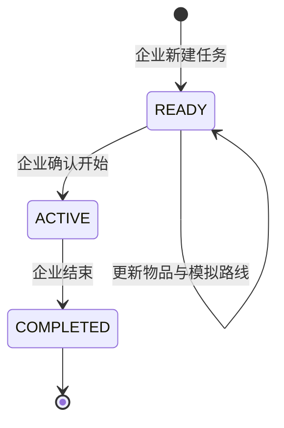
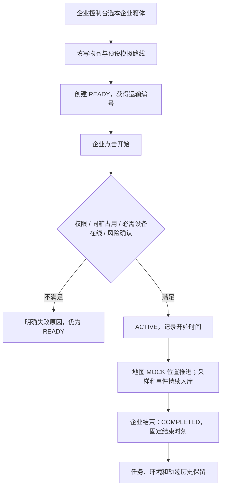

# SmartBox 企业端物流运营控制台 V2.0 需求规格

| 属性 | 内容 |
|---|---|
| 文档版本 | V2.0 / 2026-11-24 |
| 产品方向 | **企业端优先**：一个完整的物流运营控制台 |
| 产品范围状态 | 用户已明确收敛到企业端；本文件为下一阶段的**产品需求与实施依据**，新功能尚未实现/验收 |
| 变更来源 | [CR-007 企业端优先与物流运营控制台](../changes/CR-007-企业端优先与物流运营控制台.md) |
| 视觉来源 | [物流地图控制台原型 `direction=route`](../../frontend/design-exploration/src/App.vue)；[数据样本仅作视觉示意](../../frontend/design-exploration/src/data.ts) |
| 代码基线 | 已有真实双板 ENV/POSE、MQTT/模拟器、Spring Boot/MySQL、V1～V15 迁移、TASK-011～014 实际代码 |
| 约束 | 保留 BL-002 的有效设备协议/安全和数据质量边界；不把旧的三角色业务范围强行当成 V2.0 当前交付 |
| 不包含 | 骑手工作台、客户/普通用户端、访客验证码入口、企业成员系统、真实 GPS、真实签收/支付 |

> **阅读约定：**本文描述下一轮**应该实现的产品行为**，不是“已经完成”的功能清单。旧 BL-002 / CR-006 的原文、合同与历史 TASK/TC 报告仍保留以供兼容、追踪和实际证据核对；对新的企业端业务范围，以本文件与 CR-007 为当前产品方向。正式替换既有 REQ、接口和数据库的变更仍需按实现范围进行后续设计与编号同步。

## 1. 背景、问题与目标

### 1.1 背景

当前系统已有实体 ENV/POSE 双板的环境、姿态、输出控制链路，也有云端 Broker、MySQL、模拟节点和既有三端业务代码。此前正式企业界面通过 TASK-014 还原了 `route` 方向的侧边栏、顶部区域、地图与任务布局，但地图主要是静态示意，资产/运输业务仍以少量列表为主，与所选原型的**运营总览、物流箱资产、八分区详情、告警中心、位置与设备**的丰富交互存在差距。

项目以展示能力、业务连贯和 UI 完整度为目标，不以生产级物流 SaaS 为目标。核心不足不是缺少一个按钮，而是**一个真实箱体难以构成运营态势；地图、统计、运输、环境、告警、设备彼此没有完整的联动业务闭环**。

### 1.2 本期目标

1. **企业单入口**：一个演示企业管理员登录后直接进入物流运营控制台，不需要骑手、客户或访客配合完成业务。
2. **原型大部分可见业务能操作**：运营总览、资产管理、箱体详情八个 Tab、告警中心、位置与设备，以及独立的运输任务管理。
3. **1＋N 数据支撑**：至少 1 个真实 ENV/POSE 箱体，建议 5 个独立模拟箱体；统一列表、详情、统计、地图和事件。
4. **企业掌控运输**：企业可为自己箱体创建 READY、填写物品及模拟路线、开始 ACTIVE、结束 COMPLETED、查看运输历史。
5. **模拟地图真正联动**：箱体位置、选中、路线推进、轨迹回放与任务状态相互关联；全部位置注明 MOCK，不混充真实 GPS。
6. **完整展示设备价值**：环境、姿态、节点在线、数据质量、告警、命令和回执都能在箱体详情找到；实体能力和模拟能力明确区分。
7. **便于交付**：少量代表性测试＋一次完整浏览器与设备/模拟器演示；不投入复杂运营组织、极端一致性、海量性能测试。

### 1.3 本期非目标与明确暂停

- **取消本阶段用户端**：不开发 `/rider`、`/track`、客户自助登录、验证码查看、用户绑定或客户通知；旧实现保留兼容但不出现在新导航与演示脚本。
- **非真实物流**：不做真实地图导航、GPS 安装、运费、收件签字、车辆/骑手派单、路线最优化、物流公司多层组织权限。
- **非实物安全认证**：不承诺真实门磁、真实地理位置、设备失电可靠补传、生产级温控精度、防盗报警或全时在线。
- **非复杂管理后台**：暂不建设企业成员邀请、客户分配、岗位审计门户、自动调度规则引擎和统一消息中心。

## 2. 角色、范围及统一业务模型

### 2.1 唯一正式业务角色

| 身份 | 页面 | 权限与边界 |
|---|---|---|
| 企业管理员 `LOGISTICS_OPERATOR` | `/enterprise` 及所属的企业页面 | 可查询**本企业**全部箱体、任务、事件、模拟地图数据；可进行受控资产维护、企业运输开始/结束、告警人工处理，以及原权限允许的设备控制 |
| 历史 `COURIER`、`DELIVERY_USER`、`LOGISTICS_VIEWER` | 本期不提供新产品入口 | 旧代码、用户/表和既有安全约束暂不删除；不参与新运输创建或演示导航 |

本期只需一个预置演示企业。**本企业全部箱体 ≠ 所有数据库中的箱体**：服务端通过现有 `enterprises` + `box_ownerships` 过滤，不能因管理员角色就无条件读跨企业数据。演示账号可经受控初始化准备；数据库只存密码哈希，不在前端提交可用的高权限明文密码。

### 2.2 必须分开的状态维度

| 维度 | 示例 | 说明 |
|---|---|---|
| `asset_source` | REAL / SIMULATED | 设备/数据是否来自实物或模拟器 |
| `location_source` | MOCK / NONE | 本项目无真实 GPS；实体箱也可用 MOCK 位置 |
| `connectivity` | ONLINE / PARTIAL / OFFLINE / UNKNOWN | 必需节点心跳与在线判定 |
| `data_state` | FRESH / STALE / INVALID / UNKNOWN | 样本能否作为当前可信读数 |
| `environment` | 正常 / 异常 / 未知 | 仅使用已实现的后端评估结论，不让 UI 自造规则 |
| `transport_status` | NONE / READY / ACTIVE / COMPLETED | 来自运输业务状态机，独立于设备/地图状态 |
| `alarm_operating_status` | 待确认 / 已确认 / 处理中 / 已处理 | 人工动作；不等于设备报警已经恢复 |

**同一个箱体可以同时是“ACTIVE＋OFFLINE＋MOCK位置＋告警已确认”。** UI 必须独立显示这些事实，避免用一个“正常/异常”徽标覆盖所有维度。

### 2.3 权威数据与一致性

- 箱体身份、所属企业和来源：`boxes` / `box_ownerships` / 候选来源配置。
- 真实与模拟 ENV/POSE 采样：统一 MQTT→服务端→MySQL，前端只查询后端。
- 在线/当前状态：现有 `nodes`、`node_runtime`、后端快照及数据质量规则。
- 任务：`transport_tasks`；同箱至多一个 ACTIVE，仍保留数据库约束。
- 位置：本期统一使用标记为 MOCK 的任务路线/位置记录（与真实硬件状态独立）；不能让页面每次刷新随机造坐标。
- 告警：现有 `alarms` / `alarm_state`、`events`；新增人工处理事实与设备恢复分开。
- 运营 KPI：服务端或一次性读取聚合相同企业的资产、任务、在线和告警事实，避免地图、列表和统计各自编造数字。

## 3. 信息架构与视觉设计基准

视觉唯一主要基准：[`frontend/design-exploration` 的 `direction=route`](../../frontend/design-exploration/README.md)。不重新设计为普通后台表格页。沿用深蓝侧边栏、顶部工作区、地图主区和任务侧栏；企业操作体验以已有正式 Vue 代码为基础补齐功能。

### 3.1 导航

| 一级入口 | 内容 | 页面关系 |
|---|---|---|
| **运营总览**（首页） | KPI、地图主视图、在途/待开始任务、最近动态 | 进入资产、任务、告警或详情 |
| **物流箱资产** | 列表、来源/状态筛选、模拟箱体创建和修改、导出 | 点击箱体进入详情 |
| **运输任务**（新增独立业务入口） | 创建/编辑/开始/结束、列表、筛选、任务详情与轨迹 | 地图和箱体详情联动 |
| **告警中心** | 告警队列、处理状态、异常详情和关联跳转 | 进入对应箱体与任务 |
| **位置与设备** | 大地图、模拟点位、设备/箱体列表与命令入口 | 进入设备节点及箱体详情 |
| **物流箱详情**（二级） | 八个 Tab，保留统一箱体上下文 | 从资产/地图/告警/运输进入，不必占一级导航 |

### 3.2 原型组件处理规则

- **保留**：`route-dashboard-layout`、`route-map-panel`、`route-task-panel` 的页面比例，地图右侧任务/资产联动、详情抽屉、深色侧栏、顶部信息架构。
- **替换**：`data.ts` 中 `SBX-24018` 等示例箱、上海/苏州虚构实际运输、固定时钟、四条硬编码告警、假 KPI、静态趋势图。
- **合理差异**：由于没有真实 GPS，地图显示“模拟位置 / MOCK”，可以使用预设地点/示意路网；原型中的“待签收/已签收”改成真实定义的 READY / ACTIVE / COMPLETED 文案。
- **不留死按钮**：筛选、刷新、选中、详情、创建、开始、结束、告警确认等 P0 必须实际工作。无后端语义的生产高风险操作隐藏或标“未支持”，不可假装成功。

## 4. 模块一：运营总览（DASH）

| ID | 需求 | 必须的行为与规则 | 优先级 |
|---|---|---|---|
| E2-DASH-01 | 企业 KPI | 资产总数、ONLINE/PARTIAL/OFFLINE 数、ACTIVE 运输数、当前活跃告警箱数、当期已完成任务数；明确统计口径 | P0 |
| E2-DASH-02 | 地图总览 | 展示本企业有 MOCK 位置的箱体标记；无位置的箱体在右栏显示“未定位” | P0 |
| E2-DASH-03 | 运输列表 | 展示最近任务，READY/ACTIVE/COMPLETED 分区或筛选；记录运输编号/物品/箱体/时间 | P0 |
| E2-DASH-04 | 交互联动 | 选中任务→地图聚焦标记/路线；选中箱体标记→右栏定位箱体并提供详情入口 | P0 |
| E2-DASH-05 | 异常入口 | 最近活跃告警和异常箱体可跳转到告警中心/箱体详情 | P0 |
| E2-DASH-06 | 最近动态 | 任务创建/开始/结束、设备事件、告警状态变更按服务端时间排序 | P0 |
| E2-DASH-07 | 快捷操作 | 新建运输、查看全部资产、查看告警，均指向可用页面 | P0 |
| E2-DASH-08 | 更新时间 | 10～15 秒可配置刷新、手动刷新、显示最后数据更新时间；不可把旧值作为实时新值 | P0 |
| E2-DASH-09 | 时间维度筛选 | 今日/7 天等影响最近动态和完成数量，不能影响全资产数的口径 | P1 |

**KPI 约定：**“在线箱体”仅计算所有必需节点满足既有判定的箱体；PARTIAL 和 UNKNOWN 另列，不偷偷算在线。运输中来自 ACTIVE；待处理异常数量按明确的人工处理状态，不混用“当前告警已恢复”。所有统计都限制到当前企业。

**空态：**无运输任务时保留地图与创建入口；无可用位置时地图示意背景存在但不绘制虚构点；设备过期时对指标显示缺口。

## 5. 模块二：物流箱资产（ASSET）

| ID | 需求 | 行为和限制 | 优先级 |
|---|---|---|---|
| E2-ASSET-01 | 统一资产列表 | 真实/模拟同一列表；列出编号、名称、来源、在线、运输、环境、更新时间 | P0 |
| E2-ASSET-02 | 搜索/筛选 | 名称/编号、来源、在线、运输状态、当前告警；少量演示资产可在前端过滤 | P0 |
| E2-ASSET-03 | 查看详情 | 保留选中箱体与返回列表上下文，跳转八 Tab 详情 | P0 |
| E2-ASSET-04 | 创建模拟箱体 | 企业填写展示名和预设场景，后端受控创建箱体＋独立 ENV/POSE 节点身份和来源 | P0 |
| E2-ASSET-05 | 编辑资产元信息 | 修改名称/用途/备注，不允许随意改真实 box_id、node_id 或 MQTT 密钥 | P0 |
| E2-ASSET-06 | 场景切换 | 模拟箱体选择正常、温度异常、离线、数据过期、姿态事件；服务端/模拟器生成对应事实 | P0 |
| E2-ASSET-07 | 启停模拟资产 | 停止模拟输入保留历史；ACTIVE 运输不允许直接删除/停用影响任务的基础数据 | P1 |
| E2-ASSET-08 | 排序/分页 | 按最近更新、名称、风险状态排序；演示规模先前端分页 | P1 |
| E2-ASSET-09 | CSV 导出 | 导出当前筛选的非敏感资产字段，正确转义公式注入，不含密码/设备凭据 | P1 |

**本期无客户绑定、骑手分配。** 企业资产不依赖任何客户/骑手即可参与运输。原有 `box_assignments` 保留供历史兼容，不参与新企业运输资格判定。

## 6. 模块三：物流箱详情（DETAIL，八个 Tab）

| Tab | 编号 | P0 交付内容 | P1 可以补充 |
|---|---|---|---|
| 总览 | E2-DETAIL-01 | 基础信息、来源、当前在线、环境/运输摘要、最近告警与快速跳转 | 多种历史卡片 |
| 环境监测 | E2-DETAIL-02 | 真实或模拟温湿度、光照、FRESH/STALE/UNKNOWN、最近数据和至少 1h/6h/24h 时段趋势 | 自定义时间 |
| 姿态监测 | E2-DETAIL-03 | POSE 加速度/倾角等实际可用数据、变化事件与未知状态 | 扩展交互式姿态 3D |
| 定位轨迹 | E2-DETAIL-04 | 关联任务的 MOCK 当前位置/路线、历史位置点、完成任务轨迹 | 时间轴自动回放 |
| 告警事件 | E2-DETAIL-05 | 活跃告警、历史事件、级别、发生/恢复与人工处理状态 | 多维筛选 |
| 设备节点 | E2-DETAIL-06 | ENV/POSE 节点、能力位、必需标记、在线、最后心跳、最近可用状态 | 更详细诊断 |
| 控制中心 | E2-DETAIL-07 | 仅显示该节点确实支持的动作；提交、PENDING、ACK、失败/超时可见 | 历史控制记录筛选 |
| 运行日志 | E2-DETAIL-08 | 将设备事件、操作审计、运输状态变更按时间组合成只读时间线并注明来源 | 导出 |

**共用规则：**切换 Tab 不丢箱体上下文；无节点、无轨迹、无可信样本必须呈现明确空态。所有控制动作继续经现有服务端权限/能力校验。模拟器支持五种命令，**实体固件支持范围以当前实际代码与实测为准**，模拟成功不可展示为实体执行成功。

详情历史不是简单读取 `node_latest`：已结束运输的历史时间范围不能使用下一任务的当前样本冒充。设备当前读数必须显示观测时间和质量；不能只展示漂亮的正常状态。

## 7. 模块四：企业运输管理（TRANS）

### 7.1 状态与操作者变更

本版企业管理员直接创建/开始/结束运输，不经骑手、客户或访客。保留现有状态机：

旧 `TransportService.requireCourier` 和 `transport_tasks.rider_id NOT NULL` 与新规则冲突，**必须通过后续设计与追加 Flyway 迁移调整**，不能用“虚构骑手”绕过授权。历史旧任务保持不变；企业操作者和所属企业由服务端记录并校验。

### 7.2 功能清单

| ID | 功能 | 必须的规则 | 优先级 |
|---|---|---|---|
| E2-TRANS-01 | 创建 READY | 选择本企业箱体、物品名称与简述、预设 MOCK 路线；服务端生成唯一编号 | P0 |
| E2-TRANS-02 | 编辑 READY | 允许改物品和路线；ACTIVE/COMPLETED 不允许更改 | P0 |
| E2-TRANS-03 | 开始运输 | 重验企业/箱体归属、状态和必要在线/风险条件；写入服务端 UTC 开始时间 | P0 |
| E2-TRANS-04 | 结束运输 | 企业有权操作者结束 ACTIVE；固定结束时间；设备离线不影响结束 | P0 |
| E2-TRANS-05 | 同箱排他 | 保留数据库“同箱最多一个 ACTIVE”约束；不能只靠前端禁用 | P0 |
| E2-TRANS-06 | 在途/历史列表 | 按企业范围、状态、箱体、时间查询；展示任务编号、物品、起止与执行者 | P0 |
| E2-TRANS-07 | 运输详情 | 任务、箱体、环境/事件、模拟位置与路线、操作记录关联 | P0 |
| E2-TRANS-08 | 地图双向联动 | 创建后定位起点，ACTIVE 推进位置，COMPLETED 固定历史轨迹 | P0 |
| E2-TRANS-09 | 运输结束后再用箱体 | 新任务不覆盖旧任务物品、时间和轨迹 | P0 |
| E2-TRANS-10 | 搜索筛选/排序 | 支持编号、箱体、状态和时间的简单过滤 | P0 |
| E2-TRANS-11 | 取消 READY | 扩展 `CANCELLED` 状态前需单独审核兼容性；本轮可不做/明确无操作 | P1 |
| E2-TRANS-12 | 历史轨迹回放 | 已结束路线按保存位置点/时间播放，可简化为点选进度 | P1 |
| E2-TRANS-13 | CSV 任务导出 | 导出任务摘要和时间，避免暴露设备/账号敏感信息 | P1 |

**开始规则与模拟箱体：**实物箱体遵循现有必需节点在线与风险确认，不能因为地图有 MOCK 位置就当硬件在线；模拟箱体由受控 MQTT 模拟器或演示服务产生可验证的在线/采样事实。演示环境允许明确标识的模拟设备开始；没有设备依据、没有节点的箱体只允许 READY，不可默默启动。环境未知/异常必须明确提示，允许显式风险确认，但不能变更原告警结论。

**结束规则：**状态转 COMPLETED 只表示本次运输完成，**不是收件签收**；重复结束不改写原时间。运输 ACTIVE 后设备离线不能自动结束任务。

### 7.3 核心主流程

## 8. 模块五：模拟地图与位置设备（MAP）

### 8.1 地图行为

| ID | 功能 | 必须的行为与数据要求 | 优先级 |
|---|---|---|---|
| E2-MAP-01 | 多箱体标记 | 有 MOCK 位置的箱体绘制独立点位；无位置显示“暂无位置” | P0 |
| E2-MAP-02 | 位置来源 | 所有坐标、地点和路线都标 `MOCK`；地图不是实际 GPS | P0 |
| E2-MAP-03 | 状态标记 | 独立表达 ACTIVE/READY/COMPLETED、在线/离线与异常（避免颜色语义混淆） | P0 |
| E2-MAP-04 | 标记/列表选择 | 点击标记选中箱体；右侧任务/资产列表选中后地图高亮相应点或路线 | P0 |
| E2-MAP-05 | 位置详情浮层 | 箱体名、编号、位置更新时间、任务、环境摘要、跳转详情 | P0 |
| E2-MAP-06 | 预设路线 | 企业可选 2～3 条 DEMO 路线，每条由起点、终点、途经点组成 | P0 |
| E2-MAP-07 | ACTIVE 动态位置 | 根据服务端任务开始时间、路线与确定性推进规则更新；跨浏览器视图位置一致 | P0 |
| E2-MAP-08 | 历史轨迹 | 位置点与 transport_id 绑定，旧任务完成后仍可查询，不被新任务覆盖 | P0 |
| E2-MAP-09 | 地图筛选 | 全部/在途/异常/离线、单箱体检索 | P0 |
| E2-MAP-10 | 缩放与重置 | 地图缩放、适配视图、重新居中选中箱体 | P0 |
| E2-MAP-11 | 模拟控制 | 有权管理员可对模拟箱切换正常/异常/离线演示场景 | P0 |
| E2-MAP-12 | 轨迹回放 | 已完成任务按时间步进/拖动回放 | P1 |

### 8.2 简化实现原则

现有 `location_samples` 和 Python `tools/simulator/model.py` 有 MOCK 位置基础，但旧位置不以某个企业运输 `transport_id` 为唯一归属。V2 需要**任务绑定的模拟路线与位置事实**，可以建立最少的路线/任务位置记录或扩展独立 DEMO 服务，避免直接依靠前端计时器随机生成位置。

- READY：保持模拟起点，不自动前进。
- ACTIVE：按可复现的路线节点/时间推进，必要时保存采样点；用户刷新可恢复当前进度。
- COMPLETED：固定终点或结束时最后位置并保存历史；原模拟位置不会被下一任务覆盖。
- OFFLINE：保留最后已知 MOCK 位置并标更新时间；不把已停止的设备心跳说成新的实时定位。
- 环境异常：地图显示异常提示，不自动结束运输。
- REAL 箱体：可显示独立 MOCK 位置，但不能拿模拟 GPS 证明实体设备在线。
- 不必须接第三方地图 SDK；允许本地 SVG/Canvas/轻量地图视图以与原型接近的视觉进行示意路线展示。

## 9. 模块六：告警中心（ALARM）

### 9.1 两条独立状态线

**设备异常是否活跃/恢复**来自现有 `alarms` / `alarm_state`、事件和规则；**企业操作是否确认/处理**来自新增加的人工处置记录。管理员点“已处理”不会自动让温度恢复正常。

| ID | 功能 | 必须的行为与规则 | 优先级 |
|---|---|---|---|
| E2-ALARM-01 | 告警列表 | 本企业告警、来源、级别、箱体、触发与更新时间、恢复状态 | P0 |
| E2-ALARM-02 | 搜索/筛选 | 时间、箱体、严重程度、活跃/已恢复、处理状态 | P0 |
| E2-ALARM-03 | 详情抽屉 | 告警说明、来源事件、相关样本/证据、变化时间、操作记录 | P0 |
| E2-ALARM-04 | 确认告警 | 管理员确认已知晓，保存 actor/时间 | P0 |
| E2-ALARM-05 | 标记处理中/已处理 | 可填简短备注，保存状态；不改设备实际异常状态 | P0 |
| E2-ALARM-06 | 恢复展示 | 真实/模拟恢复事件驱动设备异常恢复；人工状态仍单独保留 | P0 |
| E2-ALARM-07 | 关联跳转 | 点击告警定位对应箱体详情、设备事件或 MOCK 地图标记 | P0 |
| E2-ALARM-08 | 顶部通知 | 最近待确认告警计数与入口；不发送短信/邮件 | P1 |
| E2-ALARM-09 | CSV 导出 | 受控导出当前筛选告警及人工状态 | P1 |

首轮人工处置建议一个简单记录表或已有审计能力的最小扩展，无需复杂工单、多人处理队列或审批流程。

## 10. 模块七：设备与运行辅助（OPS）

| ID | 功能 | 实际行为 | 优先级 |
|---|---|---|---|
| E2-OPS-01 | 设备树 | 本企业箱体及其 ENV/POSE 节点，节点角色/必需/能力清晰 | P0 |
| E2-OPS-02 | 节点状态 | 心跳/在线/最近运行状态、能力标签；无数据不假定正常 | P0 |
| E2-OPS-03 | 环境与姿态 | 使用已接入真实/模拟样本渲染趋势与最近值，带时间质量 | P0 |
| E2-OPS-04 | 设备控制 | 根据设备角色、能力和已有权限提交支持的命令 | P0 |
| E2-OPS-05 | 执行结果 | 显示已提交、处理中、设备 ACK/失败/超时及逐节点事实 | P0 |
| E2-OPS-06 | 运行日志 | 将任务状态记录、命令、审计与设备事件做只读时间线 | P0 |
| E2-OPS-07 | 受控导出 | 资产/告警/任务的最小 CSV 导出，不暴露原始凭据 | P1 |

**能力边界**：`tools/simulator` 支持 output、gps_mode、profile、calibrate、sentry 等模拟行为；实体开发板的实测和固件实现范围不能由模拟器成功反推。操作成功必须依据后端命令状态和设备回执，不是前端点击或 HTTP 已受理。

## 11. 演示数据与初始化：1 REAL＋5 SIMULATED

首轮推荐准备以下**场景模板**，而不是直接把表格示例硬编码到页面：

| 资产 | 来源 | 场景 | 运输/地图用途 |
|---|---|---|---|
| 实物箱体 1 | REAL：ENV＋POSE | 真正的温湿度、光照、加速度及节点状态 | 可配 MOCK 位置；设备在线与否仍按实物事实 |
| 模拟箱 1 | SIMULATED | 在线、环境正常 | 作为主动开始运输的标准场景 |
| 模拟箱 2 | SIMULATED | 在线、环境偏高/异常 | 运输中出现可解释环境告警 |
| 模拟箱 3 | SIMULATED | 节点离线 | 最后位置保留、在线状态变更 |
| 模拟箱 4 | SIMULATED | 姿态/冲击事件 | 详情与告警事件演示 |
| 模拟箱 5 | SIMULATED | 曾完成运输并留存历史 | 轨迹回放、完成任务与历史记录 |

### 11.1 硬性数据规则

- 每个模拟箱体、ENV/POSE 节点和 MQTT 客户端使用**独立身份、配置与状态目录**，不得和实物节点共用身份或同时在线。
- 受控初始化创建演示资产和预设任务，反复运行不能覆盖已有实板数据、修改历史时间或清空开发库。
- 从模拟器通过 Broker 入库的遥测和事件，可以与真实数据使用统一的服务端查询；但`asset_source`必须表明 SIMULATED。
- “模拟异常”必须通过可观察的受控数据/后端规则形成，不能在前端独立塞一条没有来源的告警。
- 可配置模拟场景“在线/异常/离线/数据过期”；停止模拟器不意味着要直接改旧设备身份或删除历史。
- 实物仅一个时，系统页面也必须能展示多个箱体，但**不把五个模拟箱误称为五台实体设备**。

## 12. UX 与交互验收约定

| 页面 | 首屏结构与关键交互 | 响应式要求 |
|---|---|---|
| 运营总览 | KPI → 地图主区＋任务侧栏 → 最近动态；地图标记与任务联动 | 1440×900 为主；768×1024 时可上下堆叠 |
| 资产列表 | 搜索、筛选、表格、创建模拟箱/编辑/详情 | 表格可横向滚动或精简列，不能遮挡主按钮 |
| 运输任务 | 列表筛选、创建抽屉、READY 编辑、ACTIVE 开始/结束、详情轨迹 | 桌面优先，可在小屏查看关键操作 |
| 箱体详情 | 标题及状态一直可辨；八个 Tab 有真实/模拟数据或清楚的空态 | 图表与按钮不溢出 |
| 告警中心 | 统计/筛选/队列/详情抽屉与确认按钮 | 异常处理前有可读确认 |
| 位置与设备 | 大地图与资产列表、节点树/监测/控制 | 地图和任务主次明显，来源标记可见 |

**视觉约束**：优先复用现有 `frontend/src/business/enterprise` 布局与 `frontend/design-exploration` 的 route 原型结构；保留侧栏、顶部、地图主视图、表格与抽屉的层级。P0 不允许退化为几个独立占位卡片。交互按钮必须是真实操作或清楚的禁用/不支持状态。

## 13. 实施依赖与代码影响（设计输入，不是已实现）

| 现有模块 | 已存在的可复用能力 | V2 需要补充/调整 |
|---|---|---|
| V1 `users/boxes/nodes` 与 JWT | 用户、角色、箱体及节点身份、旧登录 | 新导航只允许企业；企业箱体范围由所有权校验 |
| V13 `enterprises/box_ownerships` | 受控企业资产所有权与资产列表 | 模拟资产创建/编辑和来源标记；取消本期对骑手分配的依赖 |
| V14 `transport_tasks` | READY→ACTIVE→COMPLETED、时间与同箱 ACTIVE 唯一约束 | **企业作为操作者**；原 `rider_id NOT NULL` 及 `requireCourier` 需要追加迁移和服务改造 |
| V15 访客凭据 | 已存在的历史接口 | 本期不使用，不删表/不新增访客能力 |
| `QueryService` / `LiveController` | 箱体当前快照、历史、事件、节点和命令 | 本企业聚合查询和详情投影、统计；旧 `user_box_access` 授权不可直接解释为所有权 |
| `alarms` / `alarm_state` | 异常设备事实与状态 | 加简化人工处理状态，不能覆盖设备恢复 |
| `location_samples` / `tools/simulator` | MOCK 定位、采样与事件模拟 | 任务级预设路线、点位历史、不同模拟箱体隔离 |
| `frontend/src/business/Enterprise.vue` 与企业布局 | route 风格、企业资产/运输查询和少量分配按钮 | 五大主页面、八分区详情、地图联动、企业运输动作、异常与节点功能 |

数据库升级只允许**追加后续未占用的 Flyway 版本**，不能改 V1～V15；实际版本号须在编码前查询仓库，不把本需求文档中的数据模型建议当成已迁移事实。

### 13.1 业务写入最小一致性

- 企业开始运输与同箱 ACTIVE 唯一约束使用数据库事务；服务端核实当前企业拥有目标箱体，不信任前端传入企业 ID。
- 企业结束只完成任务状态并停止模拟路线；不改设备的 ONLINE/告警状态。
- 地图位置推进可由简单演示调度器负责；不需要生产级任务调度集群，但前端刷新应得到可复现的服务端位置。
- 告警人工处置与设备异常是两条记录，不能前端仅改颜色而不持久化。
- 真实采样与模拟采样来源保持明确；历史曲线来自实际数据，不在 UI 做固定线条冒充查询。

## 14. P0 演示闭环与验收标准

**最小完整展示流程：**

1. 企业账号登录进入 route 风格运营总览，看到**一个实物箱体和五个模拟箱体**，来源清楚。
2. KPI、地图标记、资产列表与任务侧栏指向**同一批服务端数据**；可按箱体、状态筛选。
3. 在资产页创建/调整一个模拟箱体及场景，在地图/详情能看到对应变化。
4. 企业在任务页选择本企业模拟箱体、填写物品和预设 MOCK 路线，创建 READY。
5. 企业点击开始并通过权限/在线/风险校验，得到 ACTIVE；同箱第二次开始被拒绝。
6. 地图点位沿模拟路线推进；任务详情、运营地图及箱体页的选中位置/状态一致。
7. 模拟一项设备异常，在详情和告警中心看到同一异常事实，管理员可确认、标记处理中；模拟恢复后恢复状态独立更新。
8. 企业结束运输得到 COMPLETED；旧任务的物品、起止时间、模拟轨迹与本次环境/事件可回查。
9. 切换到实体 ENV/POSE 箱体：查看**真实采样、心跳及可用的设备控制/回执**，地图明确是 MOCK。
10. 浏览五大主页面及八个详情 Tab：没有大面积死按钮或无说明的空面板；CSV/日志等已列为 P1 的可以标未支持。

### 14.1 最小质量门槛

| 类别 | 通过条件 |
|---|---|
| 业务正确 | 创建→开始→结束可在真实 MySQL 跑通；同箱只能有一个 ACTIVE；权限按企业范围执行 |
| 数据真实性 | REAL、SIMULATED、MOCK、UNKNOWN、STALE 含义不混淆；没有数据不绘制假趋势 |
| 页面完整 | 五个原型主页面和运输管理实际可用；八个详情 Tab 至少 P0 功能与空态存在 |
| 跨页一致 | 统计/地图/资产/运输/告警读取同一服务端事实，点击能互相定位 |
| 设备安全 | 不扩大原控制权限；真实命令结果来自设备 ACK/最终状态，不将受理视为成功 |
| 运行与展示 | 在 1440×900 优先核对 route 构图，基本检查 768×1024；完成一条浏览器主路径 |
| 验证投入 | 必要 MySQL/HTTP、一次浏览器全链路和一组权限/重复开始/假数据负例，不要求生产长稳和大并发 |

### 14.2 明确可以延后的 P1

自定义分析维度、大量导出、复杂路线编辑器、多任务自动调度、历史轨迹全动画回放、远程固件升级、多人多企业权限、短信通知、大并发/高可用与长期实板 Flash 补传不作为本轮企业产品 DEMO 的完成门槛。

## 15. 建议的开发阶段，不提前创建新 TASK 编号

| 阶段 | 交付切片 | 阶段验收 |
|---|---|---|
| A. 企业身份与模拟资产 | 单企业入口、1＋5 资产/来源、模拟场景及后台可见 | 列表与详情真实/模拟可区分 |
| B. 企业运输业务 | 企业直接 READY/ACTIVE/COMPLETED、单箱排他、预设路线 | 可以完成两笔同箱不同时间运输 |
| C. 运营地图与联动 | MOCK 任务位置、动态推进、地图/列表/统计与最近动态 | 选中和状态更新跨页面一致 |
| D. 详情和设备工作区 | 8 Tab、环境/姿态/节点/控制/日志 | 实物与模拟源都能查看正确字段 |
| E. 告警中心与整体交付 | 告警查询、简化人工处理、历史/导出、UI/业务回归 | 完成 `14` 十步演示与未覆盖记录 |

执行时按依赖合并开发工作，保持**单体 Java、现有 Vue、已有 MQTT 与模拟器**架构。无需为了文档整洁强行将 5 个阶段拆成大量功能很小的微任务。新 TASK/TC 编号如需正式建立，须同步现有模块追踪校验器，且不得重用历史编号。

## 16. 历史范围、优先级与变更管理

- **产品工作范围**：V2.0 企业端优先；不再以“企业/骑手/访客三端同步完善”作为当前路线。
- **技术及已发布协议**：BL-002、CR-001～CR-005、已落地 MQTT/HTTP 契约、实际硬件/软件报告继续有效，除非有明确兼容性修改。
- **CR-006 与 TASK-011～014**：历史阶段的需求、已写代码、迁移和测试证据**保留**；与 V2 当前交付冲突的骑手分配/访客验证码规则不作为当前实现目标。旧任务完成状态是当时完成状态，不等于本版企业端功能已经实现。
- **本需求不是自动验收**：新的地图动态、资产创建、企业运输和人工告警处理均须实施与测试后才能标已完成。
- **文档阅读入口**：优先本文件；现有 REQ 目录、追踪矩阵供设备协议/历史规则定位；旧三端长篇说明作为历史产品草案阅读，不能优先于 V2 决定当前 UI 范围。

### 待实施时优先确定的三个工程细节

1. V14 的 `rider_id`、企业操作者字段如何在不损坏旧任务的情况下进行追加迁移。
2. 模拟路线位置与既有 `location_samples` 的存储边界，保证路线任务隔离、来源 MOCK 和刷新恢复。
3. 告警设备事实与人工操作表的关联键、生命周期和最简状态映射。

这三点属于**详细设计决策**，不影响本期“企业主导运输／地图模拟／告警可处置”的产品行为确定。