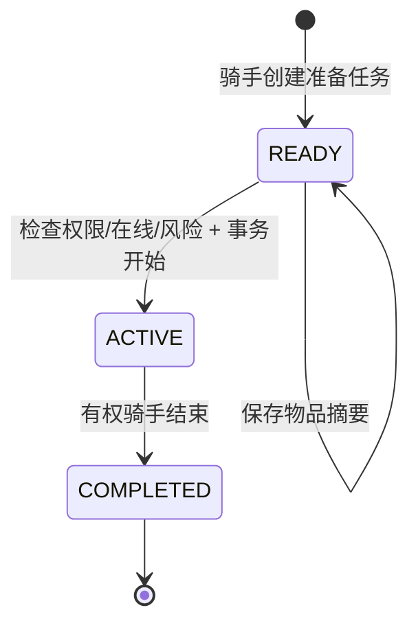

# TASK-012 运输任务状态与事务闭环

| 属性 | 内容 |
|---|---|
| 阶段 | CR-006 / 候选 BL-003 |
| 负责人 | 用户 |
| 状态 | 已完成（DEMO后端运输事务闭环；开发库在线开始未演示；页面/访客待TASK-013） |
| 依赖 | TASK-011 |
| MOD | [MOD-07](../requirements/MOD-07-运输任务与过程管理.md) |
| 需求 | [REQ-M07-001](../requirements/MOD-07-运输任务与过程管理.md#req-m07-001)、[REQ-M07-002](../requirements/MOD-07-运输任务与过程管理.md#req-m07-002)、[REQ-M07-003](../requirements/MOD-07-运输任务与过程管理.md#req-m07-003)、[REQ-M07-004](../requirements/MOD-07-运输任务与过程管理.md#req-m07-004)、[REQ-M07-007](../requirements/MOD-07-运输任务与过程管理.md#req-m07-007) |

## 1. 目标、完成标准和不做的范围

本任务是 **CR-006 演示优先**的第二个开发切片：接在已完成的 [TASK-011](TASK-011-企业资产权属与分配底座.md) 后，建立真实 MySQL 运输任务，实现骑手的“选择箱体 → 创建准备任务 → 绑定物品 → 开始运输 → 结束运输 → 查看自己的运输记录”闭环。本轮**优先后端、数据库和 REST**，不开发三端完整界面。

| 本任务交付 | 完成口径 |
|---|---|
| 独立运输任务持久化 | V14 新增一张 `transport_tasks` 表，READY/ACTIVE/COMPLETED 按后端权威保存 |
| 物品与运输编号 | 一任务一箱一份物品摘要，后端生成唯一 `transport_no`，结束后历史不被新任务覆盖 |
| 同箱互斥 | 数据库唯一索引保证同箱同时最多一个 ACTIVE；简单重复请求返回原状态或清晰冲突 |
| 开始/结束 | 开始前核验使用资格、设备在线和风险确认；结束固定 UTC 毫秒时间，设备离线可以结束 |
| 与 TASK-011 衔接 | 企业普通收回遇 ACTIVE 返回 409；开始与收回遵守同一锁顺序 |
| 我的运输 API | 骑手只查询自己的运输摘要/状态；企业和普通用户查看权限留给 TASK-013 |
| 最小实际测试 | 真实 MySQL/HTTP 的一次完整闭环＋关键拒绝用例；记录通过、失败和未测边界 |

**本轮不做**：真实运单系统、企业派单、多物品清单、运输中换箱、客户签收、复杂紧急接管、访客验证码、任务级环境曲线与历史告警、复杂会话/幂等中间件、WebSocket 推送、20+ 并发压测、长期稳定性测试、三端完整页面。原候选 REQ-M07-007 的“企业紧急接管”仍保留需求但本轮暂缓，不能因任务完成就标其全量验收。

依据：演示优先实施方案、[MOD-07](../requirements/MOD-07-运输任务与过程管理.md)、[数据与事务设计](../design/CR-006-企业箱体与运输任务数据设计.md)、历史验证。

## 2. 先理解 TASK-011 的真实交付

已阅读 TASK-011 实际报告 和 main 分支源代码；报告记载 V13 三表已应用测试/开发库、4 个 JWT 资产接口已实现，34 单元＋64 真实集成通过，测试库 22 条和开发库 19 条 HTTP 验证通过。**这些只证明资产/分配功能，尚未证明 TASK-012。**

| 已存在代码/数据 | 可直接复用 | 重要约束 |
|---|---|---|
| `V13__demo_asset_ownership.sql` | `enterprises`、`box_ownerships`、`box_assignments` | 新迁移仅追加 V14，不能改 V1～V13 |
| `AssetService.requireRiderUse` | 核实骑手当前是企业分配或个人拥有 | 它目前使用普通读，事务状态转换应新增**锁内当前读**验证 |
| `AssetMapper.lockOwnership`、`assignment` | 两者均执行 `SELECT ... FOR UPDATE` | TASK-011 曾发生 REPEATABLE READ 旧快照问题，修复后并发分配才正确 |
| `AssetService.unassign` | 已锁定 `box_ownerships` 所有权行并删除分配 | 当前有明确注释要求 TASK-012 增加 ACTIVE 守卫 |
| `CurrentUser`、`LoginService`、`SecurityConfig` | 既有 JWT 认证，`COURIER` 角色 | 不新建账号/登录系统，不把新业务端点加 `permitAll` |
| `ApiEnvelope`、`ApiAdvice` | `data + request_id` 与错误结构 | 状态冲突需要明确业务码；不要把唯一冲突误报 503 |
| `QueryService`、`node_runtime` | 当前设备在线/最近心跳事实 | `snapshot()` 受旧 `user_box_access` 限制，**不能直接当新的业务分配资格查询** |

TASK-011 没有把分配自动写入 `user_box_access`；旧 `GET /api/v1/boxes`、`/boxes/{id}/latest` 的范围仍属于旧授权体系。本任务要在运输 Service 中用新资产关系作业务判断，**不改动原设备控制权限**。TASK-013 再解决新的任务只读历史及多端展示。

## 3. 状态机与演示规则



| 状态 | 允许 | 禁止 |
|---|---|---|
| READY | 当前有使用权时编辑物品并开始；本人可读 | 当作已经运输、对访客开放、自动占用 ACTIVE |
| ACTIVE | 本人查询并结束；企业查看当前分配 | 修改物品、换箱、开始第二个同箱 ACTIVE、普通收回分配 |
| COMPLETED | 本人查看旧记录，箱体可开启新任务 | 重开、改写原结束时间、覆盖物品 |

首轮默认规则：

- **创建**：骑手当前有箱体使用权才允许创建 READY；可存在多个同箱 READY 草稿，最终只有一个能开始；不做自动草稿清理。
- **物品**：只保存一份摘要，`name` 去空白后非空，长度 1～50 Unicode 字符；`description` 可空，最长 200；开始后固定。客户端不能修改 `box_id`、`rider_id`、运输编号和起止时间。
- **开始**：必须从 READY 进入，当前账号是有效 `COURIER` 且仍有使用权；至少一个 `required` 节点、所有必需节点处于现行在线状态。个人无设备 DEMO 箱可创建 READY，**不可伪装在线启动**。
- **风险**：设备在线但环境/告警异常、未知或过期时，简单显示警告并要求 `confirm_risk=true`；服务端拒绝未确认的开始。不要在 TASK-012 重新开发告警规则或擅自显示“正常”。
- **结束**：本人经 JWT 操作 ACTIVE；即使设备离线也允许结束；结束只代表业务事实完成，不代表已签收、告警恢复或数据已经全部补传。
- **历史**：TASK-012 的“历史”仅指任务本身的箱体、物品、起止时间及状态；遥测曲线、事件/告警时间归属交由 TASK-013。

## 4. V14 迁移：仅需一张 `transport_tasks` 表

建议文件：`backend/src/main/resources/db/migration/V14__transport_tasks.sql`。以下是候选 SQL，需用隔离 MySQL 8 验证并按工程规范调整，不是已实施结果：

```sql
CREATE TABLE transport_tasks (
  id BIGINT NOT NULL AUTO_INCREMENT PRIMARY KEY,
  transport_no VARCHAR(32) CHARACTER SET ascii COLLATE ascii_bin NOT NULL,
  box_id VARCHAR(48) CHARACTER SET ascii COLLATE ascii_bin NOT NULL,
  rider_id BIGINT NOT NULL,
  status VARCHAR(16) CHARACTER SET ascii COLLATE ascii_bin NOT NULL DEFAULT 'READY',
  item_name VARCHAR(50) NULL,
  item_description VARCHAR(200) NULL,
  started_at BIGINT NULL,
  ended_at BIGINT NULL,
  created_at BIGINT NOT NULL,
  updated_at BIGINT NOT NULL,
  active_box_key VARCHAR(48) CHARACTER SET ascii COLLATE ascii_bin
    GENERATED ALWAYS AS (
      CASE WHEN status='ACTIVE' THEN box_id ELSE NULL END
    ) STORED,
  CONSTRAINT fk_transport_box FOREIGN KEY (box_id) REFERENCES boxes(box_id) ON DELETE RESTRICT,
  CONSTRAINT fk_transport_rider FOREIGN KEY (rider_id) REFERENCES users(id) ON DELETE RESTRICT,
  CONSTRAINT chk_transport_status CHECK (status IN ('READY','ACTIVE','COMPLETED')),
  CONSTRAINT chk_transport_times CHECK (
    (status='READY' AND started_at IS NULL AND ended_at IS NULL)
    OR (status='ACTIVE' AND started_at IS NOT NULL AND ended_at IS NULL AND item_name IS NOT NULL)
    OR (status='COMPLETED' AND started_at IS NOT NULL AND ended_at IS NOT NULL
        AND ended_at>=started_at AND item_name IS NOT NULL)
  ),
  UNIQUE KEY uk_transport_no (transport_no),
  UNIQUE KEY uk_transport_active_box (active_box_key),
  INDEX ix_transport_rider_created (rider_id,created_at,id),
  INDEX ix_transport_box_created (box_id,created_at,id)
) ENGINE=InnoDB DEFAULT CHARSET=utf8mb4 COLLATE=utf8mb4_0900_bin;
```

**设计判断：** MySQL 的唯一索引允许多个 `NULL`，所以 READY/COMPLETED 的 `active_box_key` 是 NULL；ACTIVE 时变成 `box_id`，数据库从根本上阻止第二个同箱 ACTIVE。Java 层仍需校验身份、当前分配、状态和设备在线，不能只靠唯一索引。任务编号由后端随机生成（如 `TR-`＋20 位随机十六进制），数据库唯一约束防重复；不是验证码。

时间取服务端 `Clock.millis()`，使用 UTC 毫秒；不取前端/设备时间。为保持 DEMO 简单，物品直接在任务表，不建物品、访问会话、审计流水或幂等记录表；重复操作靠当前状态和条件更新处理。

**对已有测试的影响：** 新表外键指向 `users/boxes`。当前 `AssetIT`、`BackendIT` 和 `LiveIT` 都有按指定顺序清空测试数据的代码，必须在它们删除用户/箱体/资产之前清理 `transport_tasks`，其他具同类清理逻辑的测试也要检查。清理只允许 `smartbox_test` 并遵守 `TestDatabaseGuard`；严禁在 `smartbox_dev` 做测试清库或关闭外键检查来逃避修复。

## 5. 后端工程结构与职责

继续使用现有 Java 21 / Spring Boot / MyBatis 单体，建议新增：

```text
backend/src/main/java/cn/smartbox/transport/
  TransportController.java     # JWT/参数校验、ApiEnvelope
  TransportService.java        # 业务状态、事务、锁、授权与冲突
  TransportMapper.java         # 参数化 SQL
  TransportView.java           # 可选的任务摘要 DTO/record

backend/src/main/resources/mapper/
  TransportMapper.xml

backend/src/main/resources/db/migration/
  V14__transport_tasks.sql

backend/src/test/java/cn/smartbox/
  TransportIT.java             # 真实 MySQL/HTTP 的代表用例
```

`TransportController` 不直接拼 SQL；`TransportService` 统一执行业务守卫、`@Transactional`、状态转换和对 `AssetService` 的重用；`TransportMapper` 提供按骑手过滤的查询、任务锁定、条件更新与同箱 ACTIVE 查询。共用现有 `CurrentUser`、`Inputs`、`Clock`、`ApiException`、`ApiEnvelope`。必要的操作审计可复用 `AuditService`（它是提交后尽力写入，不宣称原子审计）。

**不要修改** MQTT Topic、原 `CommandService`、设备固件、旧 `PermissionPolicy.Action` 设备控制动作或现有冻结的 11 项 HTTP 协议。开始/结束运输是 MySQL 业务事务，不是设备控制命令。

## 6. REST API 方案（本轮实现）

全部接口通过已有 JWT；沿用 `/api/v1/rider` 前缀和当前 CORS 允许的 POST/GET 方法。六项业务操作，约六个接口：

| 操作 | API | 输入 | 输出 |
|---|---|---|---|
| 创建 READY | `POST /api/v1/rider/transports` | `{"box_id":"BOX-0001"}` | `task_id,transport_no,status` |
| 保存物品 | `POST /api/v1/rider/transports/{id}/item` | `{"name":"书籍","description":"演示物品"}` | 更新后的任务 |
| 开始 | `POST /api/v1/rider/transports/{id}/start` | `{"confirm_risk":false}`（必要时 true） | ACTIVE＋`started_at` |
| 结束 | `POST /api/v1/rider/transports/{id}/finish` | 无请求体 | COMPLETED＋`ended_at` |
| 我的任务列表 | `GET /api/v1/rider/transports` | 无参数；首轮最近 50 项即可 | 本人任务摘要 |
| 本人详情 | `GET /api/v1/rider/transports/{id}` | 任务 ID | 本人任务状态与物品 |

返回沿用 `{"data":...,"request_id":"..."}`，**不要**创建另一套响应封装。状态、时间、箱体和物品统一从数据库读取；客户端不得自报开始时间、所有权或操作者。

| 主要错误 | 建议返回 | 说明 |
|---|---|---|
| 未登录 | 401 | 现有 JWT 逻辑 |
| 无权使用箱体/访问任务 | 403 或统一隐藏资源 404 | 客户端改 ID 不能越权 |
| 参数错误、物品为空 | 400 `VALIDATION_ERROR` | 使用已有输入检查 |
| 同箱已在运输中 | 409 `BOX_IN_USE` | 生成列唯一约束作为底线 |
| 非法状态转换 | 409 `INVALID_TASK_STATE` | 例如 COMPLETED 再开始 |
| 设备离线或无必需节点 | 409 `BOX_OFFLINE` | 个人无节点 DEMO 箱不能启动 |
| 风险未知且未确认 | 409 `RISK_CONFIRMATION_REQUIRED` | 前端展示明确确认入口 |

`ApiAdvice` 当前会把数据库异常映射为 503。因此**已知**的 `uk_transport_active_box` 唯一冲突要单独转换成 409；其他数据库错误仍按 503，不能全吞并或把所有 SQL 错误视为“箱体已占用”。

## 7. 核心事务和与 TASK-011 的加锁衔接

这是本任务最值得投入工程精力的部分。**开始运输与收回分配必须共享同一箱体锁：先锁 `box_ownerships`，再查分配和任务，最后写状态。**

### 7.1 创建与编辑

- 创建 READY 调用现有 `AssetService.requireRiderUse(user,boxId)`；使用已登录用户作为 `rider_id`，生成运输编号并保存。
- 更新物品时要求本人、当前 READY 及仍然具有使用资格，按 `task_id + rider_id + status` 做条件更新。
- READY 允许同箱多条草稿，开始才排他；首轮无需通用幂等键表或草稿管理 UI。

### 7.2 开始 ACTIVE

TASK-011 的 `AssetService.requireRiderUse()` 目前使用普通读，不能仅凭它完成并发状态转换。建议增加一个**只在事务中调用**的锁内验证方法，例如 `requireRiderUseForUpdate`：

1. 当前账号依旧启用、角色仍是 `COURIER`。
2. 使用 `AssetMapper.lockOwnership(boxId) FOR UPDATE` 锁定箱体所有权行。
3. PERSONAL 时核对当前 `owner_user_id`；ENTERPRISE 时用 `AssetMapper.assignment(boxId) FOR UPDATE` 当前读核对骑手，避免旧快照。
4. 锁住任务行、确认归属本人且状态 READY、物品有效。
5. 依 `nodes.required` 和 `node_runtime.online/last_seen` 检查所有必需节点在线；无必需节点、部分节点缺失或超过现有约 90 秒在线窗口都不可开始。
6. 读取现有环境/告警判定；已知异常、过期或未知时要求 `confirm_risk=true`（简单警告确认即可，不重做算法）。
7. 写入服务端 `started_at`、ACTIVE 状态及更新时间并提交；数据库唯一索引负责最终并发排他。

```text
BEGIN
  lock box_ownerships(box_id) FOR UPDATE
  verify rider's current OWNED/ASSIGNED relationship
  lock transport_tasks(id) FOR UPDATE
  verify READY + same rider + item present
  verify required nodes online; require risk confirmation if necessary
  UPDATE transport_tasks SET status='ACTIVE',started_at=server_utc_ms,...
  -- UNIQUE(active_box_key) stops a second ACTIVE for this box
COMMIT
```

注意：方法必须在**同一个 Spring 事务**中使用同一个数据库连接，不能提前释放 ownership 锁；若无当前所有权登记，不允许降级为旧 `user_box_access` 的许可。

### 7.3 补全企业普通收回的 ACTIVE 守卫

当前 `AssetService.unassign()` 已在 `requireOwned` 里锁定 `box_ownerships`，但尚未判断 ACTIVE，源码注释明确留给 TASK-012。本轮必须修改：

- 持有 ownership 锁后，用当前读检查该箱体是否有 ACTIVE 运输。
- 有 ACTIVE：返回 409 / `BOX_IN_USE`，**不删除** `box_assignments`。
- 没有 ACTIVE：保留原 TASK-011 收回行为。
- 与运输开始统一锁顺序，避免“企业收回成功、骑手也开始成功”的竞态。
- 不实现紧急接管；需要收回时先由骑手结束。

TASK-011 已真实修复过 REPEATABLE READ 下的旧快照问题，因此检查 ACTIVE 也应使用当前读/锁读，而不是事务开始时的陈旧普通查询。

### 7.4 结束 COMPLETED

先从任务读取 `box_id` 以确定锁目标，再在同一个事务中**先锁 ownership、后锁任务**并重查任务状态。要求请求骑手与任务 `rider_id` 一致、账号有效。ACTIVE→COMPLETED 只写一次 `ended_at=Clock.millis()`；重复结束返回原记录，不得重新计算结束时间。

设备离线不阻止结束；完成后生成列变 NULL，箱体可以进行新的运输，也允许企业正常收回。旧任务属于原骑手本人，不因后续分配变化被其他骑手继承。

## 8. 设备在线及风险状态的最小复用

`QueryService.snapshot()` 受旧 `BoxAccessService` 授权限制，**不要**调用它来证明新分配骑手能开始运输。建议内部只读 SQL：

- 从 `nodes` LEFT JOIN `node_runtime` 取得目标箱体 `required=true` 的节点。
- 至少一个必需节点，并且每一个在线：`online=true` 且最近 `last_seen` 未超出当前约 90 秒在线窗口。
- 无节点的 `BOX-DEMO-02` 只可演示个人拥有与 READY；若没有真实节点，不可伪造 ACTIVE。
- 环境与告警风险读取已有服务端结论（如 `alarm_state`），未知状态不得显示正常；第一版通过一个 `confirm_risk` 布尔字段实现明确确认即可。

不要在此新增节点权限、环境阈值、哨兵融合算法；业务任务状态与设备状态保持独立，进行中设备掉线不自动结束运输。

## 9. 最小真实测试与测试数据库兼容

先在隔离 `smartbox_test` 执行 V14，再考虑受控 `smartbox_dev` 迁移。参考 TASK-011 报告 的独立 18080 服务、可关闭 MQTT、保护原 8080 服务及开发库旧数据的方式。**不能**在开发库执行测试数据清空。

| 用例 | 最少验收 |
|---|---|
| A. 迁移 | V14 能从现有 V13 升级，表/外键/唯一索引存在，历史迁移不变 |
| B. 主流程 | 分配箱体→创建 READY→绑定物品→开始 ACTIVE→结束 COMPLETED→再次创建运输 |
| C. 使用权 | 未分配或其他骑手不能开始/结束 他人的任务；收回后 READY 不能开始 |
| D. 同箱排他 | 同箱两个 READY 尝试开始，第二个被拒；数据库始终最多一个 ACTIVE |
| E. 与收回互斥 | ACTIVE 时 `unassign` 返回 409；结束后可收回；先收回再开始必须失败 |
| F. 在线规则 | 没有必需节点/离线不允许开始；合法 ACTIVE 在设备离线后仍可结束 |
| G. 历史固定 | 重复结束 `ended_at` 不变，老运输的物品和编号不被新任务覆盖 |
| H. 回归 | TASK-011 四个资产接口、旧登录及一个旧箱体查询继续可用 |

**测试数量不作为目标**：一个新 `TransportIT` 覆盖主路径和关键负例，再回归必要的资产测试即可；可使用两个请求检查同箱冲突，无需 20 并发压测、长周期实板和全异常组合。未执行的边界一律标为“未覆盖”，不计通过。

**测试清理必须同步改造**：新表引用 `users/boxes`，仓库 `AssetIT`、`BackendIT`、`LiveIT` 的测试清理都显式包含旧资产表；在删除用户/箱体前先删除 `transport_tasks`，否则旧集成测试可能因外键失败。仅对受 `TestDatabaseGuard` 保护的测试库执行清理，不能为方便关闭外键检查。

## 10. 建议开发步骤（Agent 可直接依次执行）

| 步骤 | 具体实现 | 每步验证/成果 |
|---|---|---|
| S1 | 核对 TASK-011 源码、`AssetMapper.xml` 锁和测试库保护 | 确保以 GitHub 当前代码为准 |
| S2 | 新增 V14 迁移、TransportMapper/SQL，调整受影响的测试清理 | 测试库迁移成功，唯一约束有效 |
| S3 | 创建 READY、保存物品、本人任务列表/详情 | 服务端有真实数据、权限拒绝正确 |
| S4 | 实现开始事务和锁内当前使用权校验、在线/风险规则 | 在线可开始，离线/越权不开始，重复 ACTIVE 冲突 |
| S5 | 在 `AssetService.unassign` 同锁下检查 ACTIVE；实现结束及重复结束 | ACTIVE 不能普通收回，完成后能收回及复用 |
| S6 | 编写/执行最少 `TransportIT`，补充 API 文档 | 真实 MySQL/HTTP 通过或清楚记录失败 |
| S7 | 受控应用开发库迁移、独立 HTTP 演示，不碰原 8080 | 账号、旧箱体和历史数据受到保护 |
| S8 | 更新任务、测试与简短报告，明确 TASK-013 的输入 | 未覆盖项不假装完成 |

**完成标准**：真实服务可演示“企业分配 → 骑手创建/绑定/开始/结束 → 本人历史 → 箱体重新可用”，权限和数据库约束成立，旧业务基本回归可用。不要求本轮完整网页实现。

## 11. 提交物与向 TASK-013 的交接

本轮应提交：

- `V14__transport_tasks.sql`；
- `cn.smartbox.transport` 下 Controller / Service / Mapper，必要时少量 DTO；
- `AssetService` 的 ACTIVE 收回守卫与锁内使用资格校验；
- 最少一组真实 MySQL/HTTP 代表场景以及原有测试清理兼容调整；
- 新任务 API 的独立**增量**说明与正反示例，不直接修改已经冻结的旧 HTTP 操作；
- 本 TASK、历史验证、验证报告的真实状态记录。

TASK-013 可以直接使用本任务的 `transport_no`、`task_id`、`rider_id`、`box_id`、`item_name`、`started_at`、`ended_at` 进行任务范围环境查询、访客验证码和三端业务展示。但**不能**把旧箱体历史的 `received_at` 范围直接当作有质量保证的任务采集时间；不可靠的设备时间只能显示数据不足或缺口。运输编号不是访问令牌，访客必须独立验证后取得只读资格。

## 12. 本文与实际进度

本轮只是**编写 TASK-012 开发计划**，未执行 V14、未生成运输业务 Java 代码，也未运行 TASK-012 测试。TASK-011 的已完成记录保持不变；TASK-012 继续标记“待开始”。实际开发后才能基于报告填写已实现、已通过、失败和跳过项，不得将本设计或可点击的原型计为业务验收。

## 13. 实际执行记录（2026-11-23）

本节取代上一节“仅计划”的当时状态；上一节保留为计划阶段记录。

- V14 已实现并应用到 `smartbox_test` 与 `smartbox_dev`；V1～V13 未改写，两个库均为 V14、28 张业务表（Flyway 历史表另计）。
- 新增 `cn.smartbox.transport` Controller/Service/Mapper/View 与 `TransportMapper.xml`；`AssetService` 增加事务内锁读使用资格、`unassign` 的 ACTIVE 守卫；开始/结束/收回统一 ownership → task 锁顺序。
- 6 个骑手运输 REST 操作、增量契约 `contracts/http/transport/`、`tools/check_transport_contracts.py` 与 5 项契约工具回归已建立；冻结 11 项接口未修改。
- 真实结果：34 项后端单元、73 项真实集成（含 9 项 `TransportIT`）通过，0 失败/0 错误/0 跳过；主流程、同箱排他（含 2 并发启动）、ACTIVE 收回 409、结束/重复结束、离线/无节点、风险确认、越权、物品边界和旧资产/设备查询回归通过。
- `TransportIT` 的在线节点和告警状态是显式测试夹具，不是真实设备在线；开发库没有写入夹具。
- 开发库独立 18080 HTTP 演示：分配、创建 READY、保存物品、列表/详情通过；因现有节点最近活动已超过 90 秒，开始返回 409 `BOX_OFFLINE`，没有伪造 ACTIVE；READY 草稿已清理、分配已收回。原 8080/5173 未停止或替换。
- 未覆盖/未宣称：开发库真实在线开始/结束演示、全部页面、访客验证码与任务历史（TASK-013）、创建严格幂等（DEMO 允许同箱多个 READY）、紧急接管、20+ 并发压测、长期稳定性；完整 MOD-07 候选需求、整份 历史验证 和 BL-003 不因本切片自动验收。
- 实际执行者为当前 AI 编码代理，用户独立开发与验收；详细证据见实际报告。