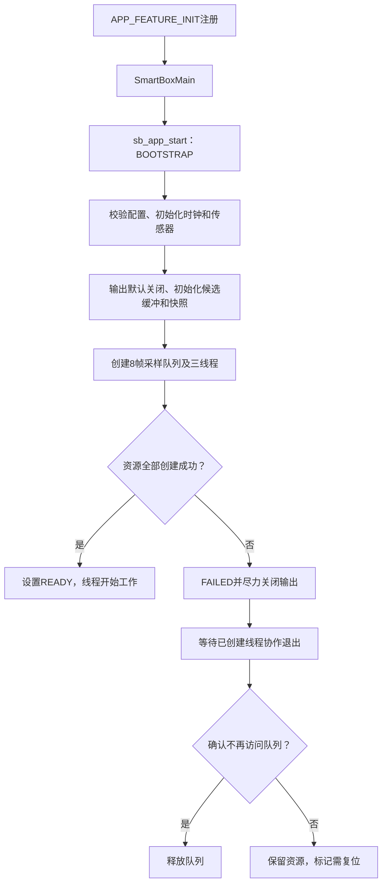
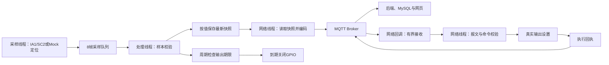

# SmartBox 固件目录与核心代码阅读指南

新电脑获取 SDK、SSH 构建及烧录的完整步骤见[部署指南](../docs/delivery/deployment/开发者完整部署指南.md)。SDK 独立交付，`tools/project.py firmware-build` 通过 SSH 受控同步，不强制要求映射盘；传统映射构建入口继续保留。

这个目录保存运行在 **BearPi-HM Nano** 上的 SmartBox 固件源码，使用 **C、CMSIS-RTOS2 和既有 OpenHarmony SDK**。它负责板端采集、样本快照、Wi-Fi/MQTT、时间质量以及真实输出控制；后端、数据库和网页属于仓库其他工程。

**当前状态：TASK-007 已完成基础真实双板链路验证。** IA1/SC2真实数据已经过Broker、Spring Boot、MySQL到网页，补光灯、风扇及指示灯的10秒输出与自动关闭已获用户实物确认；双板310秒、断电及90秒静默/Broker恢复有实际证据。完整业务算法、Flash事件可靠性、资源峰值与长期稳定性尚未验收。历史TASK-002的Mock/未验板范围不能当作当前固件状态。证据见[任务7验证报告](../docs/testing/reports/TASK-007-双板接入验证报告.md)。

## 1. ENV 与 POSE 为什么共用这个目录

一套源码通过编译配置生成两个独立角色产物，**没有另一套单独维护的POSE工程**。角色影响传感器、输出、身份与能力，公共调度、时间和网络实现共用。

| 项目 | ENV＋IA1 | POSE＋SC2 |
|---|---|---|
| 演示箱体 | BOX-0001 | BOX-0001 |
| 节点身份 | BOX-0001-ENV | BOX-0001-POSE |
| 能力位 | 71 | 120 |
| 真实采集 | SHT30温湿度、BH1750光照 | MPU6050三轴加速度、基础倾角 |
| 真实输出 | 补光灯、风扇 | 指示灯 |
| 主采样调度 | 1000ms | 20ms，初始目标50Hz |
| 定位输入 | 无 | 固定GPS Mock；真实构建每10000ms产生新位置观测 |
| 网络上报 | 遥测约每1秒，心跳约每30秒 | 遥测约每1秒，心跳约每30秒 |

身份、能力和周期集中在[角色配置实现](services/sb_config.c)。能力位含义以[MQTT文字契约](../contracts/mqtt/v1.md)为准；能力声明不代表所有业务命令已经实现，当前真实固件仅执行`output`。固定定位重复携带同一观测时，不递增位置采样序号或伪造新观测时间。

### 源码、构建副本、产物的区别

| 位置 | 用途 | 开发约定 |
|---|---|---|
| Windows主仓库中的`firmware/` | 唯一长期编辑源，包含ENV/POSE公共源码 | 在这里修改并提交Git |
| Ubuntu SDK的`applications/BearPi/BearPi-HM_Nano/sample/logistics_box/` | 受控同步得到的SDK构建副本 | 不在这里长期独立修改；变动会参与同步冲突检查 |
| 本地`artifacts/` | 构建快照、各角色镜像、日志、校验值和恢复证据 | Git忽略；按角色及manifest核对后烧录 |

映射磁盘只提供文件访问；Ubuntu编译需要可用的执行通道。具体连接信息属于本地忽略说明，不复制到公共README。

## 2. 实际目录地图

```text
firmware/
├─ README.md
├─ app/
│  ├─ smartbox_main.c          # 系统注册与应用入口
│  └─ smartbox_tasks.c         # 三线程、门禁、队列、故障收敛与统计
├─ domain/
│  └─ sb_pipeline.c            # 样本校验与最新快照，业务规则预留位置
├─ drivers/
│  ├─ sb_sensor_real.c         # IA1/SC2真实读取与基础换算，固定Mock定位
│  ├─ sb_output_real.c         # 真实输出状态、期限和自动关闭
│  ├─ sb_hardware_sdk.c        # GPIO/I2C及引脚复用适配
│  ├─ sb_wifi_sdk.c            # SDK扫描结果与认证类型适配
│  ├─ sb_boot_sdk.c            # 启动记录的底层存储读写与回读
│  ├─ sb_platform_cmsis.c      # tick、频率与短临界区适配
│  ├─ sb_sensor_mock.c         # 显式测试用确定性输入
│  └─ sb_output_mock.c         # 显式测试用内存输出
├─ services/
│  ├─ sb_config.c             # 角色、身份、能力、周期与配置检查
│  ├─ sb_clock.c              # 单调时间、UTC锚点与周期推进
│  ├─ sb_sntp.c               # 校时响应校验及重试调度
│  ├─ sb_boot.c               # 节点绑定的最小启动代次双记录
│  ├─ sb_wire.c               # 遥测/心跳编码，命令校验与回执
│  ├─ sb_network_real.c       # Wi-Fi/MQTT/SNTP网络运行
│  ├─ sb_event_buffer.c       # 16项易失候选工作缓冲
│  └─ sb_network_stub.c       # 显式测试用未实现网络桩
├─ include/
│  ├─ sb_types.h              # 公共数据类型与错误类别
│  ├─ sb_ports.h              # 上层使用的函数接口
│  ├─ sb_config.h             # 编译角色互斥与配置接口
│  ├─ sb_hardware.h           # 硬件/启动存储/校时适配接口
│  ├─ sb_wire.h               # 报文接口与payload容量
│  ├─ sb_sntp.h               # SNTP解码和调度接口
│  └─ sb_wifi.h               # Wi-Fi认证类型与查找接口
└─ build/
   ├─ BUILD.gn               # 真实固件GN源码与依赖入口
   └─ roles/
      ├─ ENV.gni             # ENV角色模板
      └─ POSE.gni            # POSE角色模板
```

上图是受控文件结构。私有生成头文件及SDK内生成的角色选择文件不在图中，见第7节。

## 3. 从系统启动到三个线程工作

系统通过[smartbox_main.c](app/smartbox_main.c)的`APP_FEATURE_INIT(SmartBoxMain)`注册入口，不由项目自己实现操作系统的`main()`。`SmartBoxMain()`调用`sb_app_start()`，然后打印节点、启动结果、状态、失败位置及是否需要复位。



初始化任一步骤失败也进入故障收敛路径。线程在BOOTSTRAP期间等待，不能提前访问未完整创建的资源；不能确认安全退出时宁可保留资源，也不提前释放队列。具体逻辑集中在[smartbox_tasks.c](app/smartbox_tasks.c)。传感器普通读取失败通过样本质量/错误计数表达，不因单次失败永久终止应用。

| 线程 | 优先级 | 真实构建栈配置 | 主要工作与阻塞边界 |
|---|---|---|---|
| `sb_sample` | AboveNormal | 4096字节 | 按截止时间读取传感器并非阻塞入队；队列满计数，不做网络I/O、不逐帧打印 |
| `sb_process` | Normal | 4096字节 | 有限等待采样队列，更新快照并检查输出期限；不做网络I/O |
| `sb_network` | BelowNormal | 8192字节 | 调用网络轮询，持有MQTT客户端，处理连接/校时/消息及发送；网络桩返回未实现时计数 |

这些是配置值，不是RAM峰值或线程栈安全的完整验收成绩。Mock构建网络线程仍为4096字节。延时通过毫秒到内核tick的显式换算完成，不假定一个tick等于1ms。错过采样周期后推进到下一个未来截止时间，累计`missed_periods`，不集中补跑旧采样。当前SDK的`osThreadExit`为空，工作函数通过返回结束。

## 4. 数据怎样流转



采样队列按帧传递`SbSensorFrame`，快照`SbSnapshot`按输入种类保存最近一帧；读写通过短临界区保护，不向另一线程暴露正在修改的指针。网络回调只做有界复制，网络线程再调用报文处理；当前接收队列为4项，满时计数。网络发送或断线恢复不会放进采样线程。输出期限主要由处理线程周期检查，读取输出状态时也会调用期限检查。

**50Hz采样不等于50Hz上报。** POSE主采样约20ms一次，网络约1秒发送当时最新快照，网页还有自身读取/刷新节奏。判断采样周期应看板端`sampled`、间隔及错过计数，不能用网页跳动频率证明。

当前快照处理没有生成完整环境异常、冲击、门融合或哨兵业务事件。16项候选缓冲尚未接成可靠事件发送链路，因此图中没有“候选数据→可靠事件入库”的已实现箭头。

## 5. 核心代码文件导读

### 5.1 启动和领域入口

| 文件 | 负责什么 | 主要入口或数据 | 由谁调用／何时修改 |
|---|---|---|---|
| [smartbox_main.c](app/smartbox_main.c) | 注册系统启动、调用应用启动并打印结果 | `SmartBoxMain()` | SDK初始化机制调用；修改启动注册或启动摘要时阅读 |
| [smartbox_tasks.c](app/smartbox_tasks.c) | 生命周期、三线程、采样队列、输出期限检查和运行统计 | `sb_app_start()`、`sb_app_status()` | 应用入口调用；调整调度、启动门禁、队列及失败收敛时修改 |
| [sb_pipeline.c](domain/sb_pipeline.c) | 校验样本角色/来源，按值更新与读取快照 | `sb_pipeline_process()`、`sb_pipeline_snapshot()` | 处理线程写入，网络读取；新增业务规则时从预留入口设计，不能把快照保存当作已完成算法 |

### 5.2 真实设备和平台适配

| 文件 | 负责什么 | 主要入口或数据 | 由谁调用／何时修改 |
|---|---|---|---|
| [sb_sensor_real.c](drivers/sb_sensor_real.c) | IA1周期测量/CRC、SC2寄存器配置与读取、单位转换、基础倾角、固定Mock定位 | `sb_sensor_init()`、`sb_sensor_read()` | 启动及采样线程；调整器件、量程、单位或质量处理时阅读 |
| [sb_output_real.c](drivers/sb_output_real.c) | 校验输出能力，设置GPIO状态与单调期限，读状态、到期关闭 | `sb_output_set/get/poll()` | 网络命令设置，处理线程检查期限，报文读取状态；修改输出行为时阅读 |
| [sb_hardware_sdk.c](drivers/sb_hardware_sdk.c) | 一次性GPIO/I2C初始化、引脚复用、底层读写和电平 | `sb_hw_*()` | 真实传感器/输出驱动；换引脚、总线或SDK端口时修改，不能在上层散落寄存器调用 |
| [sb_wifi_sdk.c](drivers/sb_wifi_sdk.c) | 读取SDK扫描结果，匹配SSID，转换支持的认证类型并拒绝不支持类型 | `sb_wifi_find()` | 网络层；排查扫描容量、认证映射或SDK差异时阅读；接口支持不等于各种AP均已实测 |
| [sb_boot_sdk.c](drivers/sb_boot_sdk.c) | 启动记录底层读写，区分不存在与I/O错误，并直接回读核验 | `sb_boot_read/write()` | 启动代次服务；迁移存储接口或排查保存失败时阅读，不凭声明假定SDK行为 |
| [sb_platform_cmsis.c](drivers/sb_platform_cmsis.c) | CMSIS tick/频率、短调度锁保护；只释放本次实际取得的锁 | `sb_platform_*()` | 时钟、快照、缓冲及任务；移植RTOS/SDK时修改，保护区用于短状态操作，不能包围网络等待或长耗时调用 |

### 5.3 配置、时间、网络和协议服务

| 文件 | 负责什么 | 主要入口或数据 | 由谁调用／何时修改 |
|---|---|---|---|
| [sb_config.c](services/sb_config.c) | 集中提供角色、身份、能力和周期，检查配置组合 | `sb_config_get/validate()` | 启动和各模块；修改角色配置时阅读，同时核对契约及测试约束 |
| [sb_clock.c](services/sb_clock.c) | 扩展tick回绕、生成单调时间、保存校时锚点、换算tick及推进周期 | `sb_clock_*()`、`sb_ms_to_ticks()`、`sb_schedule_advance()` | 采样、输出、网络与调度；调整时间计算时覆盖零频率、溢出、回绕和未校时 |
| [sb_sntp.c](services/sb_sntp.c) | 校验SNTP响应与请求关联，独立管理失败重试/成功校时周期 | `sb_sntp_decode()`、`sb_sntp_attempt_*()` | 网络层；修改校时解析/调度时阅读，不承担socket收发 |
| [sb_boot.c](services/sb_boot.c) | 校验节点绑定/校验和的双记录，保留并核验新启动代次 | `sb_boot_reserve()` | 网络初始化阶段、首次联网前调用；修改启动身份策略时阅读 |
| [sb_wire.c](services/sb_wire.c) | 遥测/心跳编码、JSON及身份/能力/时间/参数检查、32项命令结果缓存、output回执和箱体状态接收校验 | `sb_wire_property/heartbeat/command/box_state()` | 网络线程独占其状态；修改报文或命令适配时先核对有效契约 |
| [sb_network_real.c](services/sb_network_real.c) | Wi-Fi/DHCP、socket、SNTP网络请求、MQTT连接/订阅、重连、收发队列与诊断 | `sb_network_poll()` | 网络线程；修改连接生命周期或传输时阅读；事件发送接口仍未实现 |
| [sb_event_buffer.c](services/sb_event_buffer.c) | 16项内存候选队列，满时拒绝并计数，读取即出队 | `sb_event_buffer_put/get()` | 当前初始化和统计已接入，业务生产/可靠发送未接通；未来规则/事件设计时阅读 |

协议职责分工：网络服务决定“何时连接和收发”，报文服务决定“怎样编码、校验和形成回执”；完整告警/融合算法不应写进MQTT回调。SDK相关socket细节留在网络适配，实现业务规则时优先保持输入可模拟测试。

### 5.4 公共头文件与数据类型

| 文件 | 提供内容 | 开发时怎样使用 |
|---|---|---|
| [sb_types.h](include/sb_types.h) | 角色、输入种类、来源、时间质量、错误类别与公共结构体 | 跨层共享类型从这里理解，不把SDK私有结构传播给所有模块 |
| [sb_ports.h](include/sb_ports.h) | 采集、输出、时钟、快照、候选缓冲、网络、启动和统计接口 | 上层依赖接口；检查实现与测试替身是否遵循同一签名 |
| [sb_config.h](include/sb_config.h) | 角色宏互斥和值检查、配置访问接口 | 缺失角色、两个角色同时定义或值不是1时编译失败 |
| [sb_hardware.h](include/sb_hardware.h) | I2C/GPIO/延时、启动存储及校时写入端口 | 真实驱动与平台实现之间的边界；主采样开始后I2C由采样线程访问 |
| [sb_wire.h](include/sb_wire.h) | 报文入口、1536字节payload上限与网络线程所有权约定 | 网络与报文配合，避免多线程直接修改请求缓存 |
| [sb_sntp.h](include/sb_sntp.h) | SNTP调度状态、响应解码接口 | 网络负责传入接收包和请求nonce；纯解码/调度可用组件测试 |
| [sb_wifi.h](include/sb_wifi.h) | 项目认证枚举及SSID查找接口 | 将SDK扫描结构限制在适配层 |

关键类型：[公共类型定义](include/sb_types.h)中的`SbSensorFrame`带角色、输入种类、REAL/MOCK来源、时间和有效性；`SbSnapshot`保存分种类最新样本；`SbClock`同时表达单调时间与可空UTC；`SbOutputRequest`使用毫秒期限；`SbAppStatus`保存启动状态、采样间隔、错误/队列满/错过周期及需复位标记。`SbResult`区分成功、参数错误、能力不支持、无数据、缓冲满、未实现和平台错误，不能把所有非成功都解释成断网。

### 5.5 Mock 与网络桩为什么保留

| 文件 | 测试用途与边界 |
|---|---|
| [sb_sensor_mock.c](drivers/sb_sensor_mock.c) | 确定性模拟样本，帮助验证上层接口、周期和状态；不是实物采集证据 |
| [sb_output_mock.c](drivers/sb_output_mock.c) | 只改变模拟输出状态，不访问GPIO；测试成功不表示实物动作 |
| [sb_network_stub.c](services/sb_network_stub.c) | 明确返回`SB_NOT_IMPLEMENTED`，不假装发送成功，不清空候选缓冲 |

当前[生产GN](build/BUILD.gn)不链接以上三个文件；[Mock检查工具](../tools/check_firmware.py)使用显式测试源码集合。不能把real和mock两份同名接口实现同时加入一个产物，也不能为方便测试把生产网络改成成功桩。

## 6. 时间、身份与尚未完成的可靠性

- **单调时间**`uptime_ms`用于采样截止和输出期限，不因SNTP调整而跳变。**UTC**用于上报和命令时间判断，未校时用有效性标记/UNSYNCED表达，报文UTC保持空值，不能把开机毫秒数冒充实际日期。
- **有效性与来源彼此独立**：REAL不等于读数有效，SNTP不等于传感器已校准；GPS MOCK也可以拥有有效样本与校时时间。
- **启动代次**`boot_id`用于区分同节点重启。首次联网前预留新值并写入/回读；网络重连不另分配新代次。双记录校验、节点绑定和本地预留区间共同避免错误复用；读写异常、损坏或耗尽不能静默归零。
- **候选缓冲不是可靠事件库**：16项内存队列断电即失，当前`sb_network_publish()`未实现完整事件发送。订阅`event_ack`也不会凭空确认已持久化数据，心跳storage保持DEGRADED。至少64条Flash事件容量、精确业务确认与补传由后续可靠性任务完成。
- 当前真实固件只执行`output`。画像、校准、定位模式及哨兵命令的完整板端实现仍待后续；门/告警无判断器时保持未知。`box_state`接收校验不代表已实现云端开门抑制及其未决有效期。

协议规范以[当前有效契约](../contracts/effective/README.md)、[MQTT契约入口](../contracts/mqtt/v1.md)及其引用的补充为准。README解释代码，不复制另一套Topic/字段规范，也不据此修改业务规则。

## 7. GN、配置与实际编译入口

[BUILD.gn](build/BUILD.gn)导入SDK副本中的`selected_role.gni`，只接受ENV或POSE，定义`SB_ROLE_ENV=1`或`SB_ROLE_POSE=1`并启用`SB_HARDWARE=1`。它显式链接真实驱动、网络、报文及SDK的Paho MQTT、cJSON和KV依赖，不是扫描目录后编译所有C文件。

- [ENV模板](build/roles/ENV.gni)和[POSE模板](build/roles/POSE.gni)由[同步工具](../tools/sync_firmware.py)选取，在SDK副本生成`build/selected_role.gni`。不要在主仓库反复改公共头文件切换角色。
- 本地生成的`include/sb_local_config.h`包含网络及启动区间配置，Git忽略，缺少时需要按指南准备；不要粘贴真实内容到README、日志或Git。
- [硬件配置工具](../tools/hardware.py)的`prepare`会预留新的启动代次区间，必须构建对应新镜像。**仅启动已有Broker时不重复prepare**，也不删除/回退区间账本或整片擦除后复用旧配置。
- 完整构建按“检查配置→只读预览同步→受控应用→备份SDK入口/旧输出/厂商树→Ubuntu分别构建ENV和POSE→立即独立归档→恢复旧环境”执行。第二次构建可能覆盖输出，不能将同一个bin改名当两个角色。
- 烧录先核对角色、节点、manifest和SHA256，用户逐板操作并退出HiBurn释放串口后再看日志；每次重新枚举COM，不把历史端口当永久绑定。

具体参数与操作步骤集中在[编译烧录与联调指南](../docs/development/guides/编译烧录与联调流程.md)和[工具说明](../tools/README.md)，本README不维护第二份完整烧录手册。

## 8. 推荐阅读与修改入口

首次阅读建议按“本页角色/目录→[类型](include/sb_types.h)和[端口](include/sb_ports.h)→[角色配置](services/sb_config.c)→[系统入口](app/smartbox_main.c)和[任务装配](app/smartbox_tasks.c)→[样本快照](domain/sb_pipeline.c)→真实驱动→网络/报文→GN及构建指南”的顺序。若只关心POSE，仍从公共入口读起，再沿角色分支查看SC2与指示灯实现。

| 修改目标 | 优先阅读的入口 | 应选择的验证 |
|---|---|---|
| 传感器读取、单位、量程 | [真实采集](drivers/sb_sensor_real.c) | 硬件组件有效/无效/I2C/CRC检查；需要时双角色构建和真实读数核验 |
| 引脚、I2C、输出电平 | [SDK硬件端口](drivers/sb_hardware_sdk.c)、[输出驱动](drivers/sb_output_real.c) | SDK端口故障注入、默认关闭/期限测试，再核对实际板件动作 |
| 身份、能力、采样周期 | [配置](services/sb_config.c)、[角色约束](include/sb_config.h) | 角色合法/非法构建、契约适配、周期统计；改身份需同时规划服务端注册及私有配置 |
| 新业务规则 | [处理流水线](domain/sb_pipeline.c)、[公共样本](include/sb_types.h) | 先用模拟输入验证业务边界，再按需求接真实输入；不能凭基础倾角直接宣布算法通过 |
| 连接/重连/订阅 | [网络运行器](services/sb_network_real.c)、[Wi-Fi适配](drivers/sb_wifi_sdk.c) | 有界回调、认证/订阅/恢复检查，真实Broker联调；不能阻塞采样线程 |
| 编码、命令及回执 | [报文服务](services/sb_wire.c) | 现行契约、容量、身份/能力/时间、重复/冲突及实际动作回归 |
| 时间或启动存储 | [时钟](services/sb_clock.c)、[SNTP](services/sb_sntp.c)、[代次](services/sb_boot.c) | 回绕/溢出/UNSYNCED、校时失败重试、存储失败/损坏/重启；不能回退代次账本 |
| 新构建依赖或源文件 | [GN入口](build/BUILD.gn) | 明确real/mock集合、两角色真实链接与SDK恢复，独立归档产物 |

测试分层：使用[硬件组件工具](../tools/check_hardware.py)验证真实核心、SDK适配及输出报文；使用[骨架/Mock检查](../tools/check_firmware.py)覆盖启动和生命周期；临时SDK工具测试验证同步/恢复。宿主测试、真实SDK链接、烧录、实物与端到端验收是不同证据，按变更选择适当层次，不把一种结果替代另一种。

## 9. 常见问题从哪里排查

| 现象 | 首先核对 |
|---|---|
| 启动失败或提示需复位 | 启动摘要的`failure/state/reset_required`，对应任务初始化分支；不要跳过门禁强制工作 |
| 有上报但无有效读数 | 样本valid/source、I2C/CRC/器件初始化、角色与扩展板；无效值不能用0或旧值冒充新数据 |
| 页面更新慢或POSE周期存疑 | 分开看板端sampled/interval/missed、网络property序号和网页刷新；查看队列满计数 |
| 未校时 | Wi-Fi/DNS/校时网络响应、SNTP重试及ts_src；未校时应继续采集，远程控制受限属于预期 |
| 无法联网 | 当前2.4GHz网络、认证、DHCP、电脑Broker实际LAN地址、账号/ACL与订阅；板端127.0.0.1不是电脑 |
| 命令被拒绝 | request_id/operation_id、身份、能力、retained、有效期、时间质量、参数及实际支持命令；HTTP202不等于执行成功 |
| 重启后不上线 | 启动记录读取/回读、节点绑定、预留区间与上限；禁止为“修复”而清空记录或复用旧代次 |

### 设计与验收资料

- [TASK-002骨架设计](../docs/development/tasks/TASK-002-双角色固件骨架.md)：线程、接口、失败收敛及受控构建设计的起点。
- [TASK-007实际接入](../docs/development/tasks/TASK-007-双板实际采集与输出接入.md)：真实驱动、网络、身份和用户物理操作的详细边界。
- [固件总体设计](../docs/design/firmware/固件架构与SDK接入.md)：架构职责与其他设计入口。
- [硬件及演示动作](../docs/design/hardware/节点与演示动作.md)：器件、引脚核对及模拟边界。
- [双板验证报告](../docs/testing/reports/TASK-007-双板接入验证报告.md)：实际镜像指纹、失败修复、310秒运行和恢复结果；POSE启动1次无效读取、31次错过周期及最大570ms间隔保留，稳定窗口约50Hz不等于全程无丢周期。

本页是代码阅读与开发入口，不新增需求或验收结论。完整环境/姿态/冲击/门融合/哨兵规则、Flash可靠事件存储以及长期稳定性仍按后续任务推进。
