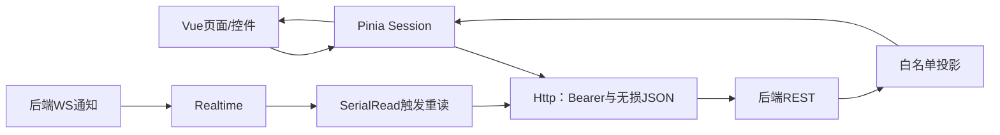

# SmartBox 电脑网页：授权视图与控制结果

前端为授权用户展示箱体实时情况，把用户确认的操作提交给后端并追踪真实执行结果。已有登录、箱体列表、详情、质量状态、五类授权控制表单及操作结果；完整历史筛选、轨迹和CSV页面仍留后续，不要求手机布局。

网页已通过真实服务＋双模拟器闭环，并用于TASK-007真实双板基础验证。**五类表单不意味着真实板支持五类动作：当前真实固件只执行output，模拟器支持五类模拟命令。** GPS保留MOCK，无判断器时门/告警显示未知。证据见[网页报告](../docs/testing/reports/TASK-006-网页与首轮闭环验证报告.md)、[双板报告](../docs/testing/reports/TASK-007-双板接入验证报告.md)。

## 1. 页面与角色

| 路由/区域 | 用户交互与数据来源 |
|---|---|
| `/login` | 账号/密码登录；没有注册、角色选择或刷新令牌入口 |
| `/boxes` | 当前账号授权箱体列表与状态摘要，空授权/错误与无数据分开 |
| `/boxes/:boxId` | 环境、允许的姿态/节点、MOCK定位、门/告警/哨兵状态与质量 |
| 详情控制与结果 | 表单校验→确认→受理→整体/逐节点结果；模拟与实物范围有提示 |

物流操作者可提交五类允许操作，骑手仅布撤防，物流寄收件人无控制；外卖用户省略姿态、证据、节点诊断、哨兵和命令明细。入口隐藏只是交互策略，最终授权仍在服务端；直接改URL或请求参数不能扩大权限。规范见[角色权限](../docs/requirements/product/角色与权限.md)。

## 2. 实际目录与核心文件

```text
frontend/
├─ package.json / package-lock.json
├─ index.html / vite.config.ts / tsconfig.json / vitest.config.ts
├─ src/
│  ├─ app/         # main.ts、App.vue、全局样式
│  ├─ router/      # 路由与登录守卫
│  ├─ features/    # Login、Boxes、Detail、Controls
│  ├─ api/         # HTTP、无损JSON、类型、字段白名单和命令适配
│  ├─ stores/      # session：身份、箱体、实时与操作生命周期
│  ├─ realtime/    # WebSocket及串行重读调度
│  ├─ components/  # SampleCard质量卡片
│  └─ domain.ts    # 角色策略、状态标签和格式化
└─ tests/          # 单元/组件、隔离浏览器、真实服务浏览器
```

| 文件 | 具体作用与修改入口 |
|---|---|
| [main.ts](src/app/main.ts)、[App.vue](src/app/App.vue) | 装配Vue/Pinia/Router、布局、账号退出和全局状态 |
| [router](src/router/index.ts) | 三条主路由、回退和内存登录态守卫；不替代箱体授权 |
| [Login](src/features/Login.vue)、[Boxes](src/features/Boxes.vue) | 登录输入与授权列表，调用Session而不散落拼接请求 |
| [Detail](src/features/Detail.vue) | 组织当前箱体、采样质量、节点及控制区域，随路由切换打开/清理scope |
| [Controls](src/features/Controls.vue) | 角色可用表单、目标提示、参数与确认、重复提交限制及操作结果 |
| [SampleCard](src/components/SampleCard.vue)、[domain](src/domain.ts) | 单位、状态和过期展示；数据未知不能用0或“正常”补齐 |
| [HTTP](src/api/http.ts) | Bearer、request_id、错误类型、取消信号与幂等头；不使用Cookie |
| [JSON](src/api/json.ts) | HTTP/WS共用无损解析/编码，大整数先保留精度，不能先普通JSON解析再补救 |
| [类型](src/api/types.ts)、[投影](src/api/projection.ts) | 消费有效契约并白名单选字段；不把任意服务端JSON保存在页面状态 |
| [命令适配](src/api/commands.ts) | 从表单构建五类请求，校验范围；不让用户编辑真实布防修订号 |
| [Session](src/stores/session.ts) | 身份、列表、当前箱体、节点、命令、待重试请求、连接及最后同步状态 |
| [Realtime](src/realtime/connection.ts) | 申请ticket、连接/订阅、断线后权限复核与退避重连 |
| [SerialRead](src/realtime/serial.ts) | 每资源单次在途读取、合并通知、限频、取消与后续补读 |

## 3. 登录与状态隔离



`login()`先清理旧会话，取得Token后请求`/me`，由服务端确定角色和授权箱体。Token只保存在Http对象内存，密码不持久化；刷新重新登录。`logout()`递增会话代次、清空Token/箱体/节点/操作/草稿、关闭WS、取消读取和定时器。

Session还使用独立scope代次区分当前页面/箱体。切箱、退出或账号变化时，旧HTTP响应和旧回调即使稍后到达，也不能覆盖新状态。401清会话，403/404清对应资源，503或网络失败标注暂不可用，不把依赖故障当成空数据。

`verifyIdentity()`复查角色和箱体范围；权限变化时退出并要求重新登录。前端[projectBox](src/api/projection.ts)再按白名单保留允许字段，服务端授权仍是最终依据。

## 4. 为什么WS通知后还要REST重同步

当前WS没有订阅成功回执、快照也没有统一版本号，因此页面不直接把无序推送合并成权威快照。首次REST读取后连接/订阅WS，连接成功再触发REST；snapshot/node_status等通知触发当前资源重读，command_status触发操作查询。

[SerialRead](src/realtime/serial.ts)使同资源请求串行、最多约每秒启动一次；在途期间收到多个通知只标dirty，完成后再补读。活动页面每5秒补查并复核身份，非终态操作每2秒补查；WS恢复重新申请一次性票据，1秒起退避到约30秒并带抖动。退出或权限失效停止重连。

WS断开不等于设备离线，设备在线不等于采样新鲜。样本有效性、REAL/MOCK、时间质量、环境/姿态5秒、定位15秒和节点90秒分别显示。浏览器自动处理协议Ping/Pong，不新增JSON心跳。重连不承诺事件可靠重放，当前页面以REST恢复为准。

## 5. 一次控制如何完成

1. 用户选择允许操作、校验参数并确认，`buildCommand()`生成请求，Session为本次动作分配一个幂等键。
2. `submit()`提交REST；HTTP202只创建待查询操作，不显示设备已执行。
3. 网络结果不确定时保留原键和原内容重试，不自动产生新动作；明确4xx按错误处理。
4. 操作结果由WS通知及串行查询更新，终态停止常规轮询，保留手动刷新以取得迟到执行事实。
5. 整体成功/部分成功/失败/超时与逐节点实际状态分开。EXPIRED不等于没执行；布防缓冲不等于ARMED；画像请求值不等于已采用值。

当前接口适配按服务端要求提交合法布防修订占位，真实修订号由后端分配；前端不维护另一套修订规则。没有取消、回滚或完整命令历史API，不提供虚假入口。

## 6. 安装、启动与测试

版本以[package.json](package.json)、[锁文件](package-lock.json)及[版本矩阵](../docs/development/environment/工具与依赖版本矩阵.md)为准，不在本页重复完整版本列表。仓库根目录运行：

```powershell
.venv/Scripts/python tools/frontend.py install
.venv/Scripts/python tools/frontend.py dev
```

install执行锁定安装并将匹配Chromium准备到忽略的artifacts；dev固定127.0.0.1:5173，端口占用不改号。实际数据先按[启动指南](../docs/development/guides/网页启动与首轮验收.md)启动Broker、后端和选择的输入。真实板模式见[固件联调指南](../docs/development/guides/编译烧录与联调流程.md)。[Vite配置](vite.config.ts)代理API/WS到回环8080，保留Origin；网页不直连MQTT或MySQL，不接收设备/数据库密码。

```powershell
.venv/Scripts/python tools/frontend.py check
.venv/Scripts/python tools/frontend.py build
.venv/Scripts/python tools/frontend.py browser
.venv/Scripts/python tools/frontend.py integration --profile test --allow-test-reset --run-dir artifacts/frontend/NEW-RUN
```

check为类型和[单元/组件](tests/unit/core.test.ts)，build生成dist；browser按[隔离配置](tests/playwright.config.ts)使用[受控响应](tests/browser/ui.spec.ts)，不能证明真实授权。integration按[真实配置](tests/live.config.ts)执行[系统浏览器场景](tests/live/closed-loop.spec.ts)，使用真MySQL/Broker/后端/双模拟器，显式允许清理smartbox_test，不能与其他同库测试并行。它不是自动真实硬件验收。证据与边界见[测试导读](../tests/README.md)。

## 7. 如何增加功能

| 修改目标 | 阅读顺序与验证 |
|---|---|
| 新显示字段 | 有效契约→types→projection→Session→卡片/页面；覆盖四角色及无效/未知/过期，不透传原始JSON |
| 新页面 | router→新features组件→scope/读取调度；检查直改URL、账号/箱体切换、旧响应和退出清理 |
| 新控制 | 需求/服务端与节点支持→commands→Controls→Session；验证权限、幂等、响应丢失、超时与迟到 |
| 新通知行为 | 先明确REST恢复依据，再改Realtime/SerialRead；覆盖持续通知、断线、取消和权限变化 |

开发日志、截图和测试证据不保存密码、JWT或ticket，不启用会捕获凭据的原始HAR/trace。完整历史/轨迹/导出、安全业务算法与长期可靠性仍在后续任务范围，本页不批准新业务。
