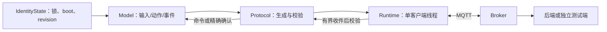

# Python双节点模拟器：状态模型与真实MQTT输入

模拟器让没有接板的开发者也能运行ENV/POSE输入，复用与真实板相同的身份、Topic和契约，通过真实Broker验证服务端链路。Mock表示输入或动作来自主机程序，不表示后端、Broker和数据库也是假实现。

它支持五类模拟控制；真实固件当前只执行output。模拟器的校准成功、NORMAL姿态或哨兵状态是场景输入，不证明真实算法、实体防盗或硬件精度。与真实板同身份的进程必须停止后才能切换，不能同时争用连接。

## 1. 实际模块分工

| 文件 | 核心对象／职责与设计原因 |
|---|---|
| [config.py](config.py) | 私有配置、角色账号/Topic方向、准备/加载/路径约束；将凭据和可提交代码分开 |
| [model.py](model.py) | `Model`：确定性采样、定位/输出/画像/校准/哨兵状态、命令缓存及待确认事件；可注入时钟测试边界 |
| [runtime.py](runtime.py) | `Node`：一个进程一个线程拥有Paho客户端，调用Model、协议校验、网络循环和状态保存 |
| [protocol.py](protocol.py) | `Protocol`、`pack/unpack`：Schema、严格UTF-8/JSON、容量、身份、能力、时间和方向检查 |
| [storage.py](storage.py) | `FileLock/IdentityState/atomic_json`：主机独占身份、预留boot代次、修订号及原子写入 |
| [broker.py](broker.py) | `Broker`：只启动/停止对象自身创建的Mosquitto进程，端口占用拒绝 |
| [scenarios.py](scenarios.py) | 观察端/控制端和真实故障场景，使用独立测试配置与运行目录，不重置日常身份 |
| [__init__.py](__init__.py) | 包入口；外部命令统一由[tools/mqtt.py](../mqtt.py)提供 |



## 2. 一个节点怎样运行

`Node.run()`取得本节点状态锁，创建Model时先持久预留boot_id，再建立客户端。MQTT3.1.1、clean session、60秒keepalive；连接后订阅三类下行Topic，确认订阅成功才发布上线、遥测、心跳和事件。回调只复制到32项有界接收队列，主循环再做完整处理，不混用后台网络线程。

正常场景约1秒遥测、30秒心跳；定位始终MOCK，FIXED每10秒新观测，其他已有模式约每秒。主机时间用于模拟SNTP质量，UNSYNCED场景保持UTC空值，不宣称执行真实SNTP；种子和输入序列可重复，整个会话的墙钟时间不保证相同。

断线后按退避/抖动重连和重订阅，**重连不换boot，进程重启才预留新代次**。状态缺失、损坏、身份不符、写入失败或耗尽时拒绝复用，不自动归零；同一节点并发实例被锁拒绝。

## 3. 五类命令、幂等和事件队列

[Runtime.process()](runtime.py)先检查Topic、payload、QoS、retained、能力和时间，再交给`Model.request()`。至少32项request_id缓存保留请求内容和结果：同号同内容重试不重复动作，同号异内容冲突。

| 命令 | 模拟结果与真实能力边界 |
|---|---|
| output | 改变角色支持的内存输出，按单调期限关闭；没有GPIO动作 |
| gps_mode | 切换已有可重复定位模式/种子，保持MOCK及独立观测标记 |
| profile | 保存模拟画像参数，不执行完整环境告警算法 |
| calibrate | 模拟校准完成，不验证真实器件校准精度 |
| sentry | 检查修订号，模拟3秒缓冲后ARMED，从ARMED起算duration_s；0不自动到期 |

哨兵计时按[CR-003](../../docs/management/changes/CR-003-布防有效期限计时起点.md)，时间/新鲜度等按[有效契约](../../contracts/effective/README.md)。主机只保存身份/修订元数据，重启不宣称恢复未确认的防护期限，按现有降级状态表达。

`Model.event()`生成测试事件并放入64条内存待确认队列；批次最多4条且受字节容量约束。重传保持原身份/内容/观测时间，外层传输时间和重传标记可变；PUBACK不能清理，只有匹配节点/boot的精确event_ack集合才能清除对应事件。满容量覆盖最旧，累计损失计数/区间。**进程退出即失去待确认事件，storage=DEGRADED，主机身份文件不等于设备Flash事件可靠性。**

box_state只检查和接收，不凭空实现未决抑制TTL。正常软件闭环的业务确认来自后端数据库提交；独立MQTT场景的测试端event_ack只是受控输入，不是后端已保存证据。

## 4. 安装与手动运行

新环境先按[环境与版本](../../docs/development/environment/工具与依赖版本矩阵.md)准备项目`.venv`和现有Mosquitto，仓库根目录执行：

```powershell
.venv/Scripts/python -m pip install -r tools/requirements-contracts.txt -r tools/requirements-simulator.txt
.venv/Scripts/python -m pip check
.venv/Scripts/python tools/mqtt.py prepare
```

prepare默认生成/校验忽略的`secrets/mqtt.local.json`、账号/ACL及身份状态；重跑不静默重置。各终端分别运行：

```powershell
.venv/Scripts/python tools/mqtt.py broker
.venv/Scripts/python tools/mqtt.py node --role ENV
.venv/Scripts/python tools/mqtt.py node --role POSE
```

`--config`指定项目私有配置；`--run-dir`指定证据目录；`--scenario normal/invalid/unsynced`、`--seed`和`--events`控制输入。各终端Ctrl+C正常退出，Broker和节点由各自入口管理。后端和网页另按[软件闭环指南](../../docs/development/guides/网页启动与首轮验收.md)启动，模拟器本身不直接操作MySQL。

默认运行器只连接回环Broker；真实板由显式硬件模式接入，不把模拟器改为任意远程客户端。开发库已记录真实板较高boot时，旧模拟代次不会覆盖实时状态；应选择隔离test联调，不降低代次或删除开发历史。

## 5. 验证与增加场景

```powershell
.venv/Scripts/python tools/mqtt.py unit
.venv/Scripts/python tools/mqtt.py integration
```

unit执行[状态/协议测试](../../tests/simulator/test_model.py)，使用临时目录，不启动Broker。integration要求1883空闲及匹配Mosquitto，启动自己的Broker、双节点和测试端，至少实际观察30秒心跳；缺依赖失败，不静默跳过，完成后清理自身进程。配置与状态独立，不重置日常boot。后端保存/授权/WS由[服务端联调](../live_integration.py)验证，完整层次见[测试体系](../../tests/README.md)。

扩展输入时先在Model实现确定序列及质量标记，注入时钟覆盖边界；涉及字段或命令先核对需求/契约。扩展故障场景在Scenarios组合正常节点与独立测试端，不能为了注入错误放宽正常Protocol检查。真实retained命令应先保存、再订阅获得保留投递，不把普通在线投递当成该场景。

回归需覆盖输入复现、拒绝不改状态、重复/冲突、精确确认与覆盖、断线重订阅及代次。运行目录保存脱敏状态/证据；日志、密码及散列不入Git，人工操作与真实板验收另行记录。原结果见[MQTT报告](../../docs/testing/reports/TASK-004-MQTT与模拟节点验证报告.md)，后续软件/硬件状态看当前根README。
